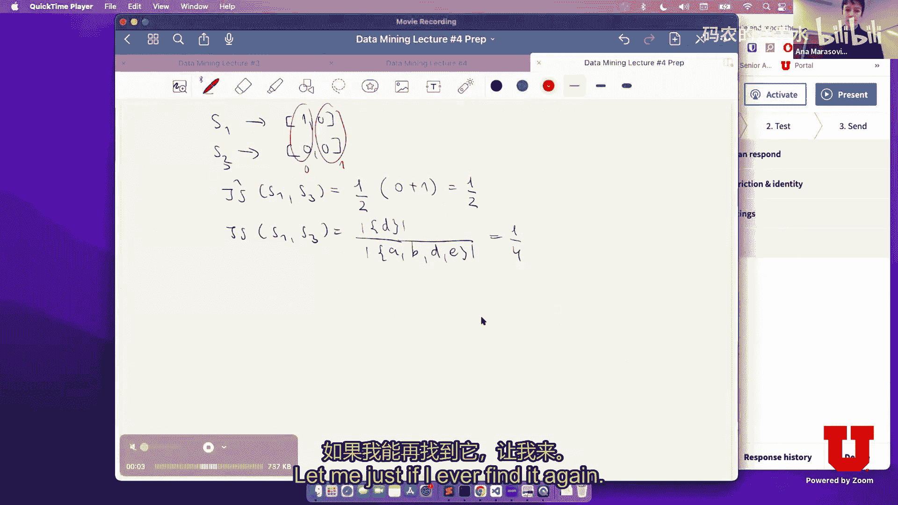

# 005：完成最小哈希 🧮

在本节课中，我们将继续学习“寻找相似项”系列的第二部分。我们将重点解决当文档集合（表示为k-gram集合）过大时，如何高效地计算文档间相似度的问题。具体来说，我们将学习如何将大型集合转换为紧凑的“签名”向量，并利用这些签名来近似计算杰卡德相似度。

---

## 课程公告与项目提案提醒 📢

首先，提醒大家我们已经启用了Piazza平台进行课程交流，并因此禁用了Canvas中的讨论区，以避免信息交叉发布。如有任何问题，请通过Piazza联系我们。

接下来，重申关于抄袭和作弊的学术诚信政策，这与犹他大学计算学院的规定一致。如有疑问，请参考学生权利与责任守则。

关于即将于1月25日（两天后）截止的项目提案，大家提出了许多问题。以下是关键点：
*   **内容要求**：提案需说明小组成员、计划使用的数据及其来源、希望从数据中挖掘的结构、项目的意义以及导师能从中学习到什么新内容。
*   **技术选择**：即使课程尚未深入讲解所有算法，你们也需要根据所选数据和问题类型，自行研究课程日历和讲义，判断哪些技术可能适用。可以分工查阅资料。
*   **反馈目的**：提交提案的目的是让我们审核项目的可行性。即使你们选择的技术路径不完全合适，只要按要求提交了提案，就不会丢分，我们会提供反馈指导调整。
*   **与机器学习项目的关系**：原则上，希望数据挖掘项目使用不同的数据和问题。如果确实想研究同一问题，必须确保所使用的技术（如分类 vs. 聚类）、数据表示和预处理方法有显著不同，并需在提案中充分论证。如有疑虑，请直接联系我确认。
*   **格式与长度**：提案应简洁，控制在100-200词左右。

如有其他问题，欢迎在课后答疑时间咨询。

---

## 回顾：寻找相似项的问题 🎯

上一节我们介绍了如何将文档转换为k-gram集合，并通过计算集合的杰卡德相似度来衡量文档相似性。杰卡德相似度公式为：
`Jaccard(S1, S2) = |S1 ∩ S2| / |S1 ∪ S2|`

然而，当文档很长时，对应的k-gram集合会非常庞大，直接计算效率低下。

因此，本节我们将学习如何将这些大型集合转换为短小的“签名”向量，并确保能够从这些签名中准确地估计出原始的杰卡德相似度。

---

## 从概念到签名：最小哈希方法 🧠

我们的目标是：将大型集合转换为小向量（签名），并且能够基于签名估计杰卡德相似度。

### 特征矩阵

首先，我们引入一个概念工具——**特征矩阵**。该矩阵的行为全域集合中的所有元素（例如所有可能的k-gram），列为各个文档的集合。

*   如果元素 `i` 出现在集合 `j` 中，则矩阵第 `i` 行第 `j` 列的值 `M[i][j] = 1`。
*   否则，`M[i][j] = 0`。

这是一个概念上的表示，在实际中因为矩阵过于稀疏，我们不会真正这样存储数据。

**示例**：
假设有集合：
S1 = {a, d}
S2 = {c}
S3 = {b, d, e}
S4 = {a, c, d}
全域元素为 {a, b, c, d, e}，映射为行号 0 到 4。

其特征矩阵如下（列代表S1到S4）：

| 行（元素） | S1 | S2 | S3 | S4 |
| :--- | :--- | :--- | :--- | :--- |
| 0 (a) | 1 | 0 | 0 | 1 |
| 1 (b) | 0 | 0 | 1 | 0 |
| 2 (c) | 0 | 1 | 0 | 1 |
| 3 (d) | 1 | 0 | 1 | 1 |
| 4 (e) | 0 | 0 | 1 | 0 |

### 最小哈希值

接下来，我们定义**最小哈希值**。这同样是一个概念性定义：
1.  随机打乱特征矩阵的行序（即进行一个排列）。
2.  对于每个集合（矩阵的列），其最小哈希值 `h(S)` 定义为：在打乱行序后，从上往下扫描，**第一个出现“1”的行号**。

**最小哈希的关键性质**：对于任意两个集合 S1 和 S2，它们的最小哈希值相等的概率，恰好等于它们的杰卡德相似度！
`Pr[h(S1) = h(S2)] = Jaccard(S1, S2)`

**证明思路**：
考虑特征矩阵中对应S1和S2的两列。将所有行分为三类：
*   **X类**：两列的值都为1（即元素在交集中）。
*   **Y类**：一列为1，另一列为0（即元素在对称差中）。
*   **Z类**：两列都为0。

在随机排列的行序中，从上往下扫描，首先遇到的是X类行的概率是 `|X| / (|X| + |Y|)`，这正好是 `|S1 ∩ S2| / |S1 ∪ S2|`，即杰卡德相似度。而如果首先遇到的是Y类行，则两个集合的最小哈希值必然不同。

### 签名矩阵

单一的最小哈希值估计方差较大。为了获得更稳健的估计，我们使用 `k` 个不同的随机排列，从而得到 `k` 个不同的最小哈希函数 `h1, h2, ..., hk`。

对于一个包含 `n` 个文档的集合，我们构建一个**签名矩阵**：
*   矩阵有 `k` 行（对应 `k` 个哈希函数）和 `n` 列（对应 `n` 个文档）。
*   第 `i` 行第 `j` 列的值是 `hi(Sj)`，即第 `i` 个哈希函数对第 `j` 个文档集合计算得到的最小哈希值。

此时，两个文档签名向量的相似度（即对应列中值相同的行数比例），就是它们杰卡德相似度的无偏估计。

---

## 实践中的高效最小哈希算法 ⚡

上一节介绍的方法需要实际构造并打乱庞大的特征矩阵，这在实践中效率极低。本节我们来看看如何高效地计算签名矩阵。

核心思想是：**用哈希函数来模拟行排列的效果**。我们选择 `k` 个将元素映射到大整数范围的哈希函数（例如 `h(x) = (ax + b) mod prime`）。

**快速最小哈希算法**：
对于每个文档集合 `S`：
1.  初始化一个长度为 `k` 的签名向量 `sig`，所有值设为无穷大（或一个非常大的数）。
2.  遍历集合 `S` 中的每一个元素 `x`。
3.  对于每一个哈希函数 `hj` (j 从 1 到 k)：
    *   计算 `hv = hj(x)`。
    *   如果 `hv < sig[j]`，则更新 `sig[j] = hv`。
4.  遍历完成后，向量 `sig` 即为该文档的签名。

**算法理解**：
可以将哈希函数值 `hj(x)` 想象为元素 `x` 在某个虚拟的“行排列”中所处的位置。算法始终保留遇到的最小哈希值，这模拟了在排列后扫描时记录“第一个1”的行号的过程。

**示例**：
假设集合 S1 = {a, d}，对应整数 {0, 3}。
选用两个哈希函数（仅为演示）：
`h1(x) = (x + 1) mod 5`
`h2(x) = (3x + 1) mod 5`
初始化签名 `sig = [∞, ∞]`。

*   处理元素 `0`：
    *   `h1(0)=1`，小于 `sig[0]=∞`，更新 `sig[0]=1`。
    *   `h2(0)=1`，小于 `sig[1]=∞`，更新 `sig[1]=1`。
*   处理元素 `3`：
    *   `h1(3)=4`，不小于 `sig[0]=1`，不更新。
    *   `h2(3)= (9+1) mod 5 = 0`，小于 `sig[1]=1`，更新 `sig[1]=0`。

最终得到 S1 的签名 `sig = [1, 0]`。

**估计相似度**：
要估计两个文档的杰卡德相似度，只需计算它们签名向量中对应位置值相同的比例。例如，若 S1 签名为 `[1, 0]`，S3 签名为 `[0, 0]`，则相似度估计为 `1/2 = 0.5`（实际杰卡德相似度需另行计算以验证估计质量）。

---

## 总结 📝

本节课我们一起学习了最小哈希技术的核心内容：
1.  **目标**：将大型集合压缩成短签名，以高效估计杰卡德相似度。
2.  **概念基础**：通过特征矩阵和行排列定义最小哈希值，并证明了 `Pr[h(S1)=h(S2)] = Jaccard(S1, S2)`。
3.  **签名构造**：使用多个最小哈希函数构建签名矩阵，以降低估计误差。
4.  **高效算法**：掌握了实践中使用的快速最小哈希算法，该算法通过哈希函数模拟行排列，无需构造庞大矩阵，只需线性扫描集合元素即可生成签名。

在下一讲中，我们将利用这些签名，通过“局部敏感哈希”技术，最终实现在海量文档集合中快速寻找相似项的目标。