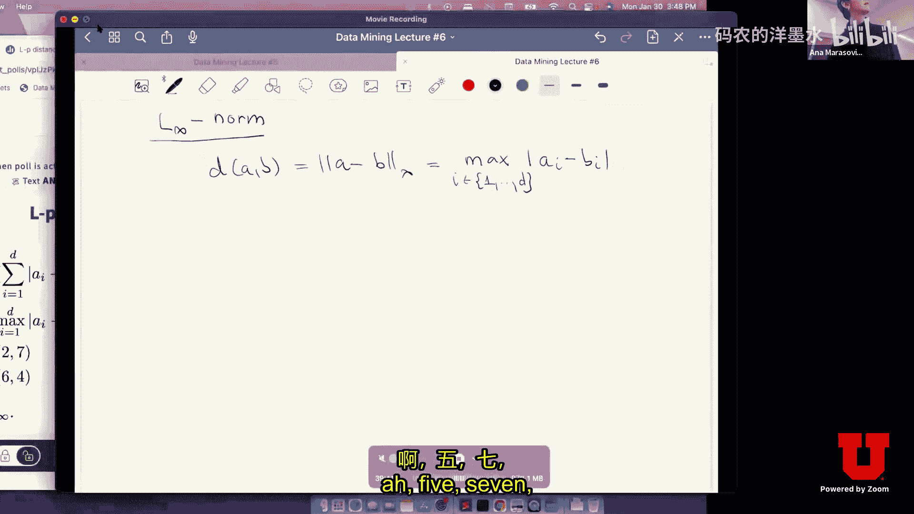
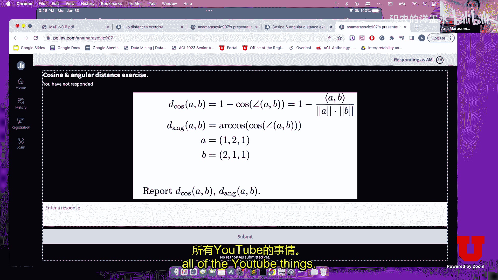

# 006：距离 📏

在本节课中，我们将学习数据挖掘中常用的各种距离度量。理解这些距离对于后续的聚类分析以及构建高效的相似性搜索算法（如局部敏感哈希）至关重要。我们将从距离的数学定义开始，然后逐一介绍几种核心的距离度量，并探讨其中一些如何与特定的哈希函数族结合，用于近似最近邻搜索。

## 距离的定义与性质

上一节我们介绍了基于Jaccard相似度的局部敏感哈希技术。本节中，我们来看看距离的正式定义。与相似度不同，距离度量通常需要满足一些数学性质。

一个距离函数 `d: X × X → [0, ∞)` 将集合 `X` 中的点对映射到非负实数。如果它满足以下所有性质，则被称为**度量**：
1.  **非负性**：`d(x, y) ≥ 0`
2.  **同一性**：`d(x, y) = 0` 当且仅当 `x = y`
3.  **对称性**：`d(x, y) = d(y, x)`
4.  **三角不等式**：`d(x, z) ≤ d(x, y) + d(y, z)`

如果函数不满足同一性，则称为**伪度量**；如果不满足对称性，则称为**拟度量**。在实际应用中，有时人们会宽松地使用“距离”一词，即使某些性质不成立。

## 从相似度到距离

我们之前讨论过Jaccard相似度。自然地，可以定义对应的Jaccard距离。

**Jaccard距离** 定义为 `1` 减去 Jaccard 相似度：
`d_J(A, B) = 1 - J(A, B) = 1 - (|A ∩ B| / |A ∪ B|)`

可以证明，Jaccard距离满足所有度量性质，因此它是一个真正的度量。

## 常见的向量空间距离

当数据点表示为向量时，有一系列常用的距离度量。以下是其中几种核心的距离。

### 欧几里得距离 (L2距离)

这是最直观的距离，即两点间的“直线”距离。
`d_E(a, b) = sqrt( Σ (a_i - b_i)^2 ) = ||a - b||_2`

### 曼哈顿距离 (L1距离)

模拟在网格状道路（如曼哈顿街区）上行走的距离。
`d_M(a, b) = Σ |a_i - b_i| = ||a - b||_1`

### 闵可夫斯基距离 (Lp距离)

这是欧氏距离和曼哈顿距离的推广。
`d_p(a, b) = ( Σ |a_i - b_i|^p )^(1/p) = ||a - b||_p`
当 `p=1` 时为曼哈顿距离，`p=2` 时为欧氏距离。

### 切比雪夫距离 (L∞距离)

取所有维度上差值绝对值的最大值。
`d_∞(a, b) = max_i |a_i - b_i| = ||a - b||_∞`

为了帮助理解这些距离的计算，我们来看一个简单的例子。

**计算示例**：
假设有两个二维向量 `a = (3, 4)` 和 `b = (7, 1)`。
- **L1 (曼哈顿) 距离**：`|3-7| + |4-1| = 4 + 3 = 7`
- **L2 (欧几里得) 距离**：`sqrt((3-7)^2 + (4-1)^2) = sqrt(16 + 9) = sqrt(25) = 5`
- **L∞ (切比雪夫) 距离**：`max(|3-7|, |4-1|) = max(4, 3) = 4`

### 马氏距离

当数据各维度的尺度（单位）不同或存在相关性时，直接使用Lp距离可能不恰当。马氏距离通过引入协方差矩阵（或其逆）来标准化距离。
`d_M(a, b) = sqrt( (a - b)^T * Σ^{-1} * (a - b) )`
其中 `Σ` 是数据的协方差矩阵。当 `Σ` 为单位矩阵时，马氏距离退化为欧氏距离。

## 余弦距离与角度距离

在文本挖掘等领域，向量的方向往往比大小更重要。这时会用到基于角度的距离。

### 余弦相似度与余弦距离

首先定义**余弦相似度**，即向量夹角的余弦值：
`cos_sim(a, b) = (a · b) / (||a|| * ||b||)`
其中 `a · b` 是点积。夹角越小，余弦值越接近1，表示越相似。

**余弦距离**通常定义为：
`d_cos(a, b) = 1 - cos_sim(a, b)`
需要注意的是，余弦距离**不是**一个度量。例如，向量 `a` 和 `2a` 方向相同，夹角为0，余弦距离为0，但它们并非同一个向量，违反了度量的同一性。

### 角度距离

**角度距离**直接使用向量间的夹角（通常以弧度为单位）：
`d_angle(a, b) = arccos( cos_sim(a, b) )`
角度距离是一个度量，满足所有度量性质。有时在文献中，“余弦距离”指的就是角度距离，阅读时需注意区分。

## 为角度距离构建LSH族

回顾局部敏感哈希（LSH）的核心思想：为特定的距离或相似度度量，找到一个哈希函数族，使得相似的点以高概率哈希到同一个桶中。我们曾为Jaccard相似度找到了MinHash族。现在，我们也可以为角度距离构建这样的哈希函数族。

**哈希函数族定义**：
1.  随机选取一个单位向量 `u`（即 `||u||=1`）。
2.  对于任意向量 `a`，定义哈希函数 `h_u(a) = sign(u · a)`。这里 `sign` 是符号函数，若点积为正则输出 `+1`，为负则输出 `-1`。

**关键性质**：
可以证明，对于两个向量 `a` 和 `b`，在随机选择单位向量 `u` 的情况下，它们被哈希到相同值（即 `h_u(a) = h_u(b)`）的概率为：
`P[h_u(a) = h_u(b)] = 1 - (d_angle(a, b) / π)`

这个性质与MinHash对于Jaccard相似度的性质（`P = Jaccard相似度`）类似。因此，这个基于随机超平面的哈希函数族，与角度距离一起，构成了另一个可用的LSH方案，满足 `(d1, d2, p1, p2)`-敏感性的要求。

## 总结

本节课中我们一起学习了数据挖掘中多种重要的距离度量。
- 我们首先明确了距离和度量的数学定义。
- 接着，回顾了从Jaccard相似度导出的Jaccard距离。
- 然后，系统学习了向量空间中常见的距离家族：欧氏距离（L2）、曼哈顿距离（L1）、闵可夫斯基距离（Lp）和切比雪夫距离（L∞），并了解了处理不同尺度数据的马氏距离。
- 之后，我们探讨了在文本等领域常用的余弦相似度、余弦距离以及更符合度量定义的角度距离。
- 最后，我们展示了如何为角度距离设计一个随机超平面哈希函数族，从而扩展了局部敏感哈希（LSH）技术的应用范围。

理解这些距离的适用场景和数学性质，是选择合适的数据挖掘算法（尤其是接下来的聚类算法）的基础。