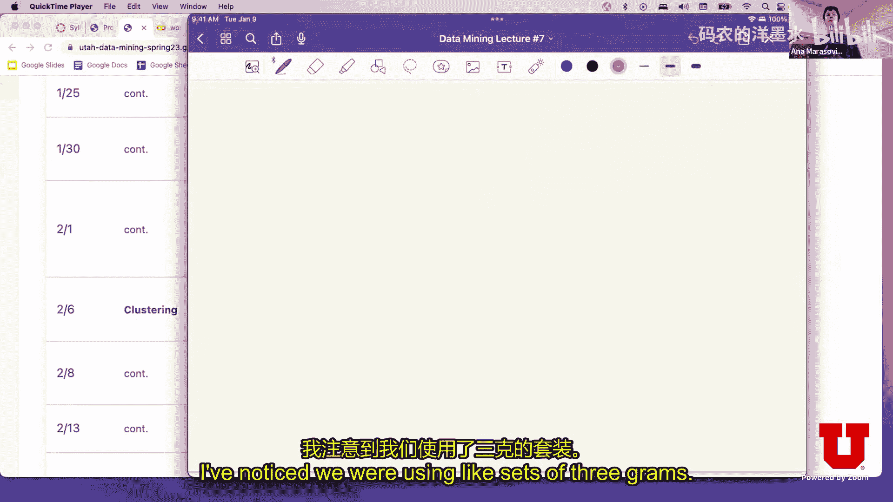
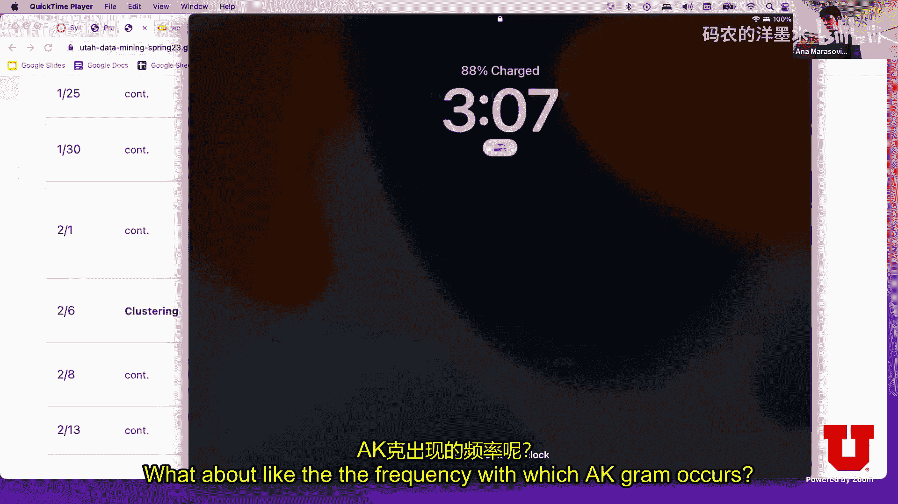
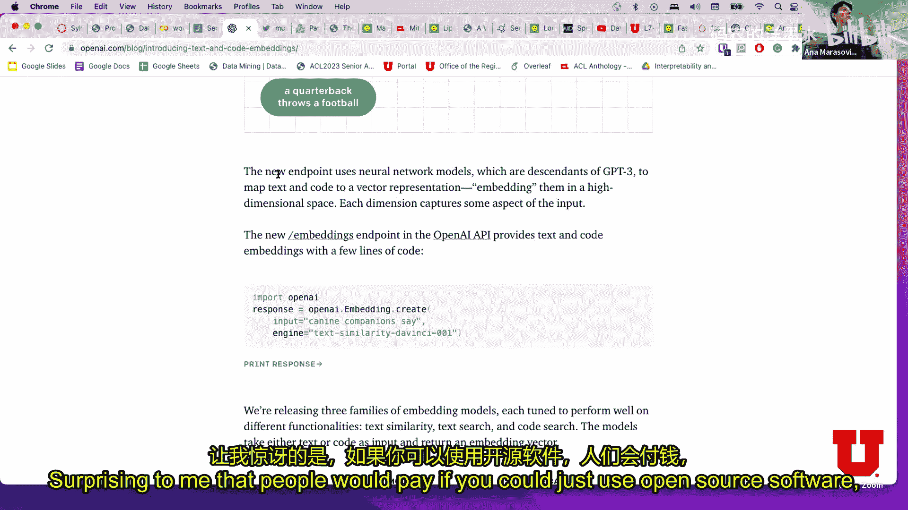
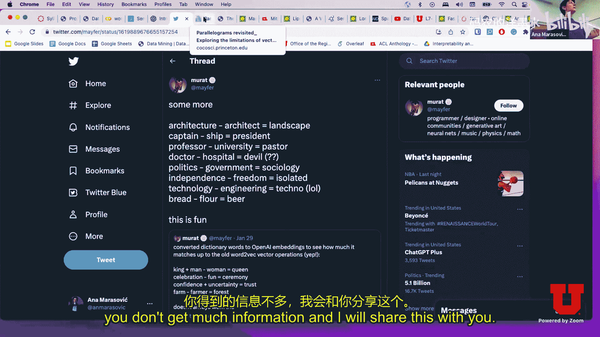
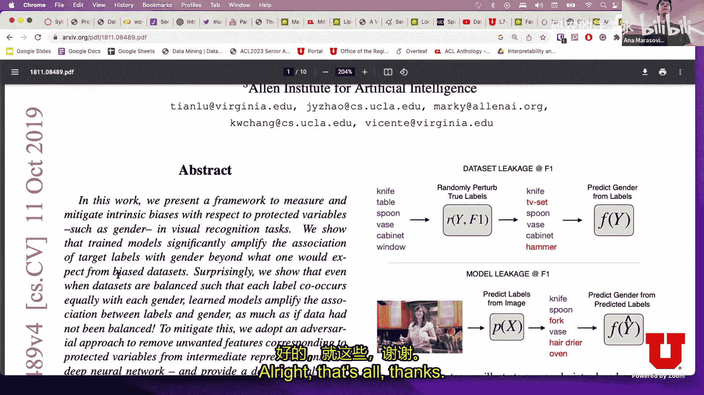

# 007：嵌入与表示 📚

在本节课中，我们将学习如何将文本和图像等非结构化数据转换为计算机可以理解和处理的数值形式，即“表示”。我们将重点介绍几种核心的表示方法，包括TF-IDF、词嵌入和上下文化表示，并简要探讨图像表示。理解这些方法对于后续进行相似性计算、聚类等数据挖掘任务至关重要。

---

## 文本表示：从词袋到词嵌入

上一节我们讨论了基于集合（如k-gram）的相似性度量。本节中，我们来看看如何将文本表示为数值向量，以便进行更复杂的计算。

### 词袋模型与TF-IDF

词袋模型将文档表示为一个向量，其中每个维度对应一个词，其值为该词在文档中出现的次数。然而，这种方法忽略了词的重要性和文档间的差异。

以下是TF-IDF（词频-逆文档频率）方法，它通过结合局部和全局信息来改进词袋模型。

*   **词频**：衡量一个词在单个文档中的重要性。公式为：`TF(t, d) = (词t在文档d中的出现次数) / (文档d的总词数)`。有时也直接使用原始计数。
*   **逆文档频率**：衡量一个词在整个文档集合中的普遍重要性。公式为：`IDF(t) = log(文档总数 / 包含词t的文档数)`。IDF值高意味着该词在少数文档中出现，具有较好的区分度。
*   **TF-IDF权重**：最终的词权重是TF和IDF的乘积：`TF-IDF(t, d) = TF(t, d) * IDF(t)`。

通过计算每个文档中所有词的TF-IDF值，我们可以构建一个**词-文档矩阵**。每个文档可以表示为该矩阵的一列（文档向量），然后使用余弦相似度等度量来计算文档间的相似性。

### 词嵌入：密集向量表示

TF-IDF向量通常是稀疏的（包含大量零值）。词嵌入提供了一种密集的、低维的向量表示。

其核心思想基于**分布假说**：出现在相似上下文中的词往往具有相似的含义。因此，词嵌入的目标是学习一个向量空间，使得语义相近的词在空间中的位置也接近。

一个著名的词嵌入模型是**Word2Vec**，它包含两种算法：Skip-gram with Negative Sampling (SGNS) 和 Continuous Bag of Words (CBOW)。其训练过程简述如下：

1.  给定一个目标词（如“apricot”）及其上下文窗口（如左右各两个词）。
2.  模型的目标是：最大化目标词向量与其上下文词向量之间的相似度（点积）。
3.  同时，模型会采样一些不在上下文中的“负例”词，并最小化目标词向量与这些负例词向量的相似度。
4.  通过反复迭代上述过程，更新所有词的向量表示，最终得到训练好的词嵌入。

训练完成后，我们可以丢弃模型，只保留这些词向量。对于一个句子，常见的表示方法是将其所有词的词向量取平均值，得到一个句子的密集向量表示。

使用词嵌入时需要注意：
*   **静态性**：每个词只有一个固定的向量，无法处理一词多义。
*   **偏见**：词嵌入会反映并放大训练数据中存在的社会偏见（如性别、职业偏见），可能导致资源分配不公或代表性伤害。

### 上下文化表示

为了解决一词多义问题，出现了基于Transformer架构的上下文化表示模型（如BERT）。这类模型的核心是**自注意力机制**，它能够根据句子中其他词的信息来动态调整每个词的表示。

训练时，模型通过预测被掩盖的词语来学习上下文信息。使用时，将整个句子输入模型，对输出的每个词的表示进行平均（或使用特殊的[CLS]标记），即可得到整个句子的表示。这类表示能更好地捕捉语义。

---

## 图像表示 🖼️

与文本类似，图像也需要转换为数值表示。最基本的方法是将图像视为像素矩阵（灰度图）或三通道张量（RGB彩色图）。

### 深度特征表示

当前，最常用的图像表示方法是利用预训练的深度神经网络提取特征。

*   **卷积神经网络特征**：例如，Faster R-CNN等模型在图像分类任务上预训练后，可以提取图像中不同区域或整个图像的特征向量。这些向量编码了高级视觉信息。
*   **多模态模型特征**：如CLIP模型，同时在图像和文本数据上训练。其图像编码器部分输出的特征向量，与语义信息关联更强，是目前性能优异的图像表示方法。

选择图像表示方法时需考虑：
*   **计算资源**：大型模型（如CLIP）需要较强的硬件支持。
*   **领域适应性**：预训练数据的领域应与目标应用相近（例如，用自然图像训练的模型处理医学X光片效果可能不佳）。
*   **社会偏见**：图像表示模型同样可能继承和放大训练数据中的偏见，需谨慎评估。

---

## 总结

本节课我们一起学习了数据挖掘中至关重要的数据表示技术。
*   对于文本，我们介绍了从稀疏的TF-IDF表示，到基于分布假说的静态词嵌入（如Word2Vec），再到能处理一词多义的上下文化表示（如BERT）的演进。
*   对于图像，我们了解了从原始像素到利用预训练深度神经网络（如CNN、CLIP）提取高级特征向量的方法。
*   无论哪种表示，其目标都是将数据转换为稠密、低维且蕴含语义/视觉信息的向量，以便后续进行相似性计算、聚类、分类等任务。在选择具体方法时，需要综合考虑任务需求、数据特性、计算成本以及模型可能带来的偏见等问题。