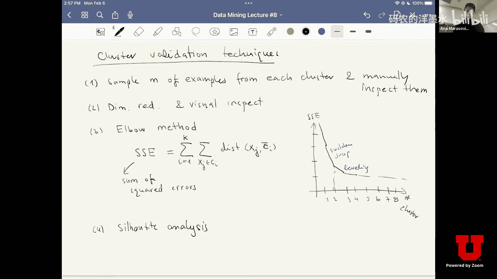

# 008：分层聚类 📊

在本节课中，我们将要学习一种重要的数据挖掘技术——分层聚类。我们将了解其基本思想、算法步骤、如何衡量簇之间的距离、何时停止合并簇，以及该方法的优缺点。

## 概述

分层聚类是一种“自底向上”的聚类方法。其核心思想是：开始时，将每个数据点视为一个独立的簇；然后，反复合并两个“最接近”的簇，直到满足停止条件。最终，我们会得到一个簇的层次结构，可以直观地表示为树状图。

## 算法步骤

分层聚类算法的流程非常直观。

1.  **初始化**：将数据集中的每个数据点 `Xi` 都视为一个单独的簇。
2.  **循环合并**：当不满足停止条件时，重复以下步骤：
    *   **寻找最近簇**：在所有簇对中，找到距离最近的两个簇 `Ci` 和 `Cj`。
    *   **合并簇**：将 `Ci` 和 `Cj` 合并为一个新的簇。

## 如何衡量簇间距离

算法的关键在于如何定义两个簇之间的“距离”或“接近度”。以下是几种常见的方法：

*   **质心距离**：计算每个簇的质心（即簇内所有点的平均向量），然后计算两个质心之间的距离。公式为：`d(C1, C2) = distance(centroid(C1), centroid(C2))`。这种方法适用于欧几里得空间。
*   **单链距离**：取两个簇中任意两点间距离的最小值。公式为：`d(C1, C2) = min{distance(x, y) for x in C1, y in C2}`。它对噪声和离群点敏感，容易形成“链式”簇。
*   **全链距离**：取两个簇中任意两点间距离的最大值。公式为：`d(C1, C2) = max{distance(x, y) for x in C1, y in C2}`。它倾向于产生紧凑的球形簇。
*   **平均链距离**：计算两个簇中所有点对之间距离的平均值。公式为：`d(C1, C2) = average{distance(x, y) for x in C1, y in C2}`。这是单链和全链之间的一个折中。
*   **基于半径/直径的距离**：合并两个簇后，计算新簇的半径（质心到最远点的距离）或直径（簇内最远两点间的距离）。选择合并后能使半径或直径最小的簇对。这有助于保持簇的紧密度。

## 何时停止合并

上一节我们介绍了如何合并簇，本节中我们来看看算法何时应该停止。这通常取决于具体的应用场景和目标。

*   **达到预定簇数量**：当合并到只剩下 `K` 个簇时停止。这需要事先对数据有较好的了解。
*   **距离阈值**：当最近的两个簇之间的距离超过某个预设阈值时停止。
*   **簇的紧密度**：当合并会产生一个“质量不佳”的簇时停止。例如，新簇的半径或直径过大，或者簇内点的平均距离超过限制。
*   **肘部法则**：绘制随着簇数量减少，某个指标（如误差平方和）的变化曲线。当曲线出现明显的拐点（像肘部）时，对应的簇数量可能是最佳选择。
*   **构建完整树**：不设置停止条件，一直合并到只剩下一个包含所有数据点的簇。最终结果是一个完整的层次树（树状图），用户可以根据需要从树的任何层级“切割”出特定数量的簇。

## 算法效率分析

分层聚类算法概念简单，但计算复杂度较高。

*   **朴素实现**：在每一步都需要计算和比较所有簇对的距离。总时间复杂度约为 **O(n³)**，其中 `n` 是数据点的数量。这对于大规模数据集来说非常慢。
*   **优化实现（使用优先队列）**：可以维护一个优先队列来高效地查找最近簇对。优化后的时间复杂度约为 **O(n² log n)**。虽然比立方级好，但对于海量数据仍然不够高效。

因此，分层聚类更适合中小规模数据集，或者当数据本身具有清晰的层次结构时使用。

## 聚类结果验证

在得到聚类结果后，我们需要评估其质量。以下是几种验证方法：

*   **人工抽样检查**：从每个簇中随机抽取一些样本，人工检查它们是否属于合理的类别。
*   **降维可视化**：使用降维技术（如PCA、t-SNE）将高维数据投影到2D或3D空间，然后可视化观察簇的分布是否清晰可辨。
*   **肘部法则**：如前所述，通过绘制误差平方和与簇数量的关系图，寻找拐点来评估最佳的簇数量。

## 总结

本节课中我们一起学习了分层聚类算法。我们了解了其自底向上的合并过程，探讨了多种衡量簇间距离的方法（如质心、单链、全链等），讨论了决定何时停止合并的策略，并分析了算法的时间复杂度。最后，我们简要介绍了如何验证聚类结果的有效性。分层聚类是一种直观且能揭示数据层次结构的强大工具，尤其适用于簇数量未知或数据具有内在层次关系的场景。