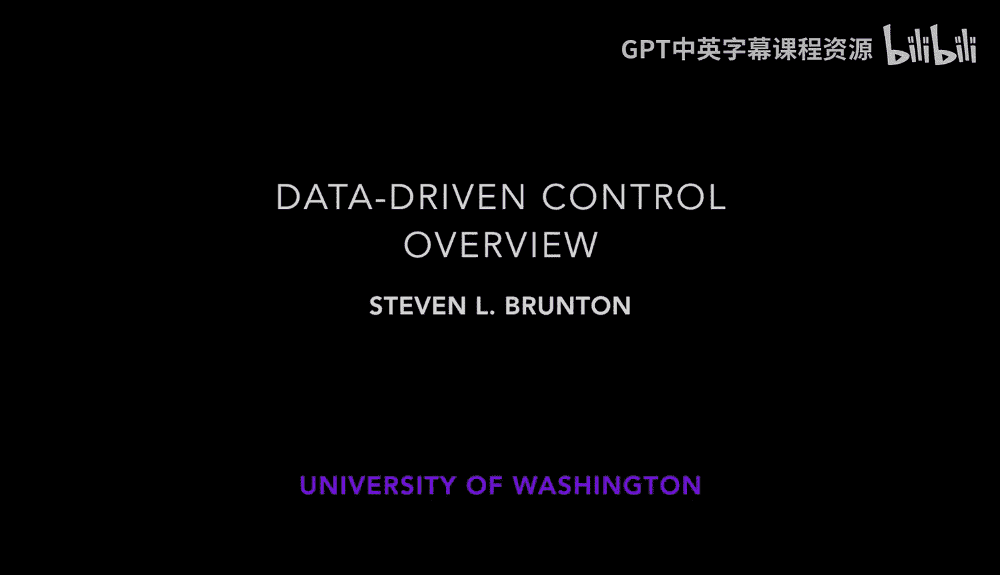

# 01：概述

在本节课中，我们将要学习数据驱动控制的基本概念，了解传统控制方法在现实世界系统中的局限性，并探讨如何利用现代机器学习技术来解决这些问题。

## 课程目标与背景

本课程的目标是介绍如何利用强大的现代机器学习方法来处理现实世界的控制系统。这是一个快速发展的应用数学和工程领域，本课程仅触及冰山一角，旨在激发兴趣并引导思考如何将这些方法应用于实际系统。

学习本课程需要具备控制理论的基础知识以及基本的应用数学能力，以便理解主要以线性代数形式呈现的机器学习方法。

## 传统控制及其局限性

上一节我们介绍了课程目标，本节中我们来看看传统控制方法及其面临的挑战。

在过去的几十年里，对于一大类控制系统，传统做法是写下系统的运动方程。例如，对于一个可以左右移动的小车上的倒立摆，目标是稳定摆杆的直立状态。

传统流程如下：
1.  写下系统的拉格朗日量或哈密顿量，得到非线性方程。
2.  在某个平衡点（如摆杆直立状态）附近对非线性方程进行线性化。
3.  获得线性方程组后，应用线性状态空间控制理论（如卡尔曼滤波器结合线性二次型调节器）进行控制。

这可以总结为一个经典的反馈控制框图：系统有输出，控制器根据传感器测量值 `y` 和可能的系统模型，计算出驱动信号 `u` 来作用于系统，以实现控制目标（如稳定倒立摆）。

然而，现实世界中我们真正感兴趣的系统动力学通常是状态 `x` 和控制输入 `u` 的非线性函数，其时间导数 `ẋ` 可以表示为：
`ẋ = f(x, u)`
对于非线性控制，问题变得非常复杂。

以下是传统线性化方法难以应对的现代系统示例：
*   **神经科学**：理解、建模并控制大脑活动以预防癫痫发作。
*   **湍流流体系统**：控制高攻角机翼后的湍流，使其重新层流化以获得更高升力和更低阻力。
*   **疾病建模与流行病学**：抑制疟疾在洲际间的传播。
*   **金融**：调控金融市场。
*   **气候**：理解非线性反馈并设计控制策略来调节系统行为。

## 现代控制面临的核心挑战

上一节我们看到了传统方法的局限，本节我们来详细探讨现代控制系统面临的核心挑战。

以下是这些系统共有的主要挑战：

*   **高度非线性**：系统行为无法用简单的线性模型近似，有时甚至不存在合适的线性化平衡点。
*   **未知动力学**：在许多情况下，我们根本不知道描述系统行为的方程 `f` 是什么。例如，我们无法就大脑或气候的方程达成一致；对于湍流，方程虽然存在但过于庞大复杂，难以用于在线控制。
*   **高维状态空间**：描述系统状态 `x` 需要极多的自由度。例如，模拟疾病传播时，每个个体的健康状态都可能是一个维度；模拟地球天气或大脑活动时，维度可达数百万甚至数十亿。
*   **低维主导模式**：尽管系统是高维和非线性的，但往往会涌现出主导的相干模式。例如，湍流中的大尺度结构、流行病传播波、癫痫发作时神经元的同步振荡。我们真正想要控制的往往是这些低维模式的代理指标。
*   **有限的测量与驱动能力**：对于高维系统，我们通常只能测量部分状态 `y`，也只能在有限的位置驱动系统 `u`。例如，在海洋中只能布置有限浮标，在疾病控制中只能在特定村庄设立疫苗接种点。

## 数据驱动的机遇与解决方案框架

面对上述挑战，我们迎来了一个重要的机遇：数据爆炸。通过高保真仿真、先进的实验测量技术、廉价的存储和快速的计算，我们收集系统数据的能力空前增强。

因此，本系列讲座的核心思想是：利用现代数据驱动和机器学习技术来应对这些挑战，使控制理论更能应用于现实系统。需要强调的是，对于神经科学、湍流、金融、气候等领域，这仍是开放的研究挑战，数据驱动技术是解决方案的重要组成部分，需与经典的动力学系统及控制理论结合。

那么，如何应用机器学习来解决控制问题呢？我们可以从三个主要方向入手：

*   **用于数据驱动建模的机器学习**：针对“未知动力学”的挑战，我们可以收集系统状态 `x`、输入 `u` 及其变化 `ẋ` 的数据，利用机器学习直接从数据中学习系统模型 `f`。获得模型后，便可应用经典控制或模型预测控制等方法。
*   **用于直接学习控制律的机器学习**：与其费力地先建模，不如直接将数据驱动的机器学习技术用于学习一个好的控制器。这类似于人类通过探索和尝试来学习有效控制策略的过程。我们可以同时进行系统建模和控制律学习。
*   **用于传感器与驱动器优化的机器学习**：利用机器学习和数据科学中的优化技术，直接学习最佳的传感器和驱动器布置位置。对于高维系统，这是一个组合难解问题，但现代优化方法可以快速找到近似最优的布置方案。

## 控制与机器学习的本质

在深入具体方向前，我们最后来统一一下对“控制”和“机器学习”本质的理解。

**控制**可以看作一个受系统动力学（物理规律）约束的优化问题。系统会受到扰动 `d`，并有一个需要优化（最小化成本或最大化收益）的目标 `J`。控制器根据测量值 `y` 计算出控制量 `u`，其核心是求解这个带动力学约束的优化问题。对于线性系统和二次型成本，存在闭式解（如LQR）；对于非线性系统，优化变得复杂，常需在线求解（如模型预测控制）。

**机器学习**本质上是一套基于数据的、强大的非线性优化技术。例如，用于图像分类的深度学习，就是利用大量标注图像数据，解决高维非线性优化问题，以识别像素中的模式。

由此，我们可以建立联系：现代控制中许多问题（如控制癫痫、增强流体混合）是高维非线性优化问题；而机器学习正是一套基于数据解决非线性优化问题的强大工具。我们拥有日益增长的数据，这正是我们将要探索的结合点。

## 总结

本节课中我们一起学习了数据驱动控制课程的概述。我们了解到传统控制方法在处理高度非线性、动力学未知、状态空间高维的现实系统时面临挑战。同时，我们也看到了数据爆炸带来的机遇。课程的核心思想是利用现代机器学习技术，主要从三个方向切入：1）从数据中学习系统模型；2）直接从数据中学习有效的控制律；3）优化传感器和驱动器的布置。通过将控制理解为受动力学约束的优化，将机器学习理解为基于数据的非线性优化工具，我们为后续深入探讨如何将两者结合解决实际问题奠定了基础。