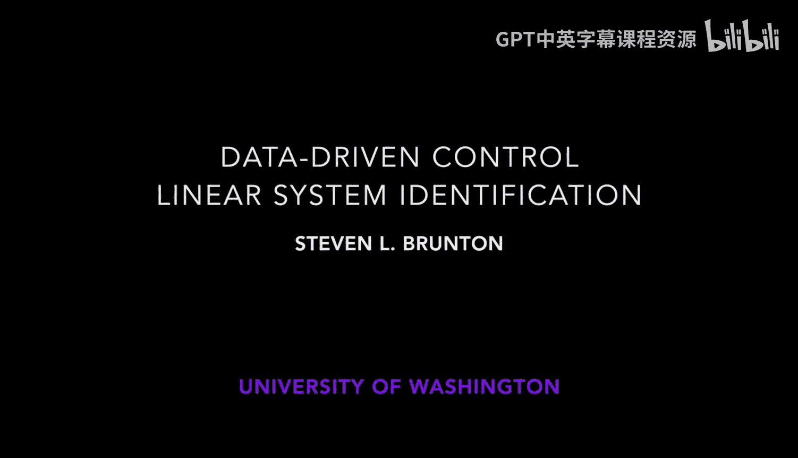

# 02：数据驱动建模与系统辨识概述

在本节课中，我们将要学习数据驱动建模的核心概念，特别是系统辨识。系统辨识是一门利用数据来为未知或复杂系统建立模型的学科，它是连接数据科学与控制理论的关键桥梁。

## 从数据到模型：系统辨识简介

上一节我们介绍了如何利用数据科学和机器学习方法处理复杂的现代控制系统。本节中，我们来看看如何将这些方法具体应用于**系统辨识**，即从数据中学习系统的动态模型。

系统辨识并非新概念，它至少可以追溯到20世纪60年代的Ho和Kalmán。其核心思想是：收集系统数据，构建一个模型，并期望该模型能对未来未见过的输入和状态做出良好预测。这本质上是一种针对动态系统的机器学习。

## 系统辨识与模型降阶

系统辨识与**模型降阶**密切相关但目标不同。
*   **系统辨识**：当没有先验模型时，通过测量数据（如状态 `x` 和输入 `u`）来构建一个代理模型 `ẋ = f(x, u)`。
*   **模型降阶**：当已有一个高维复杂模型（例如，由百万网格点离散化Navier-Stokes方程得到）时，目标是找到一个更低维、更易处理的模型 `ȧ = f̃(a, u)`，其中 `a` 的维度远小于 `x`，但能捕捉原系统的主要动态。

寻找一个好的坐标系统 `a` 来高效表示高维数据 `x`，是物理建模和模型降阶的核心。

## 线性系统辨识 🧮

系统辨识的很大一部分工作围绕**线性系统**展开。这是因为控制理论中最强大、最成熟的技术（如最优控制律）大多是为线性系统开发的。

对于一个线性系统，其动态通常描述为：
`ẋ = A x + B u`
其中 `x` 是状态向量，`u` 是控制输入，`A` 和 `B` 是矩阵。

线性系统辨识的目标就是从测量数据中学习出矩阵 `A` 和 `B`。对于高维系统，我们通常同时学习一个好的坐标系统，以获得一个简化的低维模型 `ȧ = Ã a + B̃ u`。

拥有一个低维模型至关重要，尤其是在控制应用中。它意味着更快的模型预测速度，从而可以实现更低延迟、更高带宽的控制器，这对于系统稳定性和快速扰动跟踪至关重要。

以下是线性系统辨识与模型降阶的一些关键方法：
*   **特征系统实现算法**：一种经典的系统辨识技术。
*   **平衡截断** 与 **平衡本征正交分解**：主要用于模型降阶的技术。
*   **动态模态分解**：一种较新的数据驱动方法，用于从数据中提取动态模式（主要学习 `A` 矩阵），其扩展形式也能学习 `B` 矩阵。

## 非线性系统辨识 🔄

许多系统本质上是非线性的，其动态描述为 `ẋ = f(x)`。非线性系统辨识更具挑战性，因为从数据中获取非线性模型更难，且基于非线性模型进行控制也更复杂。

以下是几种非线性系统辨识的方法：
*   **NARMAX模型**：非线性自回归滑动平均外生输入模型，是经典且强大的非线性建模技术。
*   **稀疏辨识非线性动力学**：一种利用稀疏优化从数据中直接学习 `f(x)` 结构的新方法。其优点是模型可解释，能反映物理结构。
*   **遗传编程**：使用遗传编程算法来发现描述动力学的函数形式 `f(x)`。

## 基于测量的动力学与Koopman理论 ✨

在实际中，我们通常无法直接测量全部状态 `x`，而只能获得一些测量值 `y = g(x)`。这些测量可能是线性的，也可能是非线性的。

一个新兴（或重新兴起）的领域是研究如何在**测量空间** `y` 中直接建立动力学模型。这与 **Koopman理论** 相关。该理论的一个惊人结论是：对于一个非线性系统，如果我们能获取**足够丰富**的测量集合 `y`，那么在这些测量所张成的高维空间中，动力学可能呈现出**线性**的形式。

这具有重要意义，因为一旦动力学在某个坐标下是线性的，我们就可以应用成熟、高效的线性最优控制理论。当前的研究前沿在于如何为特定的非线性系统找到这样一组“好”的测量 `y`。

## 从模型到控制：模型预测控制 🎯

我们进行数据驱动建模的最终目的，通常是为了实现**基于模型的控制**。其中，**模型预测控制** 是一种极其强大且灵活的技术，广泛应用于工业控制。它能够处理非线性动力学、约束、时延等复杂情况。

MPC的核心是在每个控制周期，基于当前模型预测系统未来一段时间的行为，并优化控制输入。因此，一个能够**快速仿真**的模型至关重要。这再次凸显了模型降阶的价值——我们需要一个能捕捉关键动态的最小化模型，以实现实时控制。

## 核心方法与技术总结

所有上述系统辨识方法都有一个共同的基础：**回归**。从最早的Ho-Kalmán到最新的稀疏辨识方法，本质上都是将数据回归到某种动力学模型上。

以下是本课程后续将深入探讨的一些主题：
*   **扩展方法以包含控制**：许多方法（如DMD、SINDy）最初用于辨识无激励动力学，我们需要将其扩展以包含控制输入 `u` 的影响。
*   **神经网络**：神经网络在预测复杂非线性动力学方面表现出巨大潜力。
*   **回归的变体**：包括稀疏回归（如SINDy）、约束回归（嵌入已知物理约束或对称性）等。

本节课中我们一起学习了数据驱动建模与系统辨识的广阔图景。我们了解了线性与非线性系统辨识的区别，认识了模型降阶的重要性，并接触了Koopman理论这一将非线性动力学线性化的有力框架。最后，我们明确了所有这些建模工作的最终目标：为高效、鲁棒的模型预测控制等先进控制策略提供基础。后续课程将深入探讨这些具体的技术和方法。