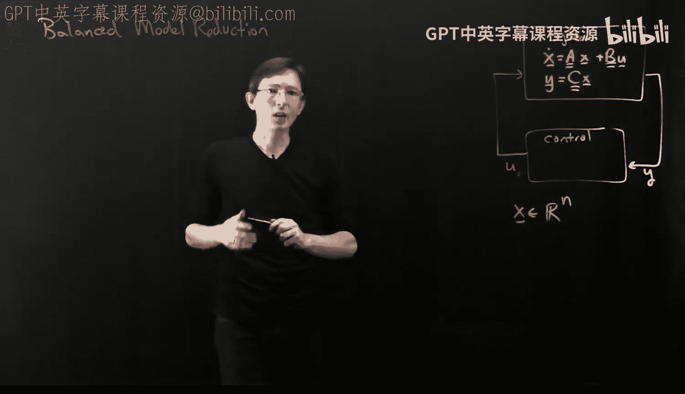
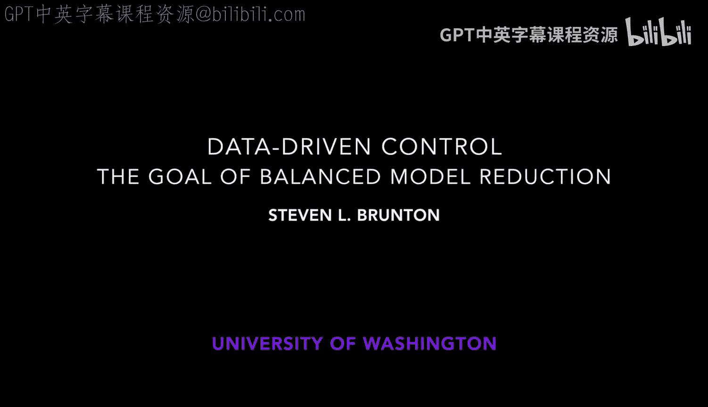

# 03：平衡模型降阶的目标


在本节课中，我们将要学习模型降阶，特别是平衡模型降阶。模型降阶是指当我们拥有一个模型，但其规模过大而无法用于控制时，我们试图找到一个能捕捉大部分动态特征的、规模更小的模型。今天讨论的许多关于模型降阶的思想，同样适用于系统辨识。

## 背景与目标

上一节我们介绍了模型降阶的基本概念，本节中我们来看看其具体目标和数学描述。

我们考虑一个最终希望被控制的系统。系统会接受一些测量值 `y`，而控制律将产生一些执行器信号 `u`，即我们可以控制的“旋钮”，用以改变系统的动态和行为。



接下来几讲的内容都将围绕线性动态系统展开，而非非线性系统。我们假设系统模型为：

```
ẋ = Ax + Bu
y = Cx
```

其中，状态向量 `x` 的维度 `n` 可能非常大（例如，对于湍流或大规模人口系统，`n` 可能达到百万甚至十亿级）。如果 `x` 的维度非常高，模型降阶的目标就是找到一个能捕捉大部分输入到输出动态的新系统，但其状态 `x̃` 的维度 `r` 远小于 `n`。

## 降阶模型的形式

以下是降阶模型的目标形式：

```
ẋ̃ = Ãx̃ + B̃u
y = C̃x̃
```

请注意，输入 `u` 和输出 `y` 并未改变。唯一改变的是我们如何用规模小得多的状态 `x̃` 来表示系统的内部动态。`x̃` 只包含了对于建模输入到输出动态最核心的信息。

对于控制设计而言，我们不希望处理百万维的状态向量 `x`，因为相应的控制律（如LQR）会变得极其庞大。相反，我们希望用一个 `r` 维的小状态来表征这些动态，这将使预测和执行控制的速度更快，从而实现更低延迟、更高带宽的控制。

## 状态重构与模式分解

我们还假设可以从降阶状态 `x̃` 重构出原始状态 `x`。这通过一个矩阵 `Ψ` 实现：

```
x ≈ Ψx̃
```

我们可以这样理解：原始的高维状态 `x` 中，可能只存在少数几种主导的动态模式。矩阵 `Ψ` 的每一列就代表这样一种模式（例如，机翼绕流中形成和脱落的大涡旋）。而 `x̃` 是一个低维向量，它告诉我们此刻系统的状态 `x` 中，这几种模式各自活跃的程度。因此，我们可以通过找到数据中这些主导模式的某种组合来近似高维状态。

这样，我们可以在降阶模型上设计控制器。如果需要查看系统实际状态的直观图像，只需用 `Ψ` 重构即可得到完整的 `x`。

## 一个简单示例

让我们通过一个非常简单的例子来说明这些思想。假设我们有一个二维系统（`n=2`），希望找到一维近似（`r=1`）。

系统方程为：
```
d/dt [x1, x2]ᵀ = [[-2, 0], [0, -1]] [x1, x2]ᵀ + [1, 1e-10]ᵀ u
y = [1, 1e-10] [x1, x2]ᵀ
```

如果仅基于矩阵 `A` 的特征值来决策（忽略可控性和可观性），我们可能会选择保留 `x2`，因为其特征值 `-1` 比 `x1` 的 `-2` 衰减更慢，动态更“持久”。

然而，这个直觉是错误的。观察矩阵 `B` 和 `C`：输入 `u` 对 `x2` 的影响微乎其微（`B` 的第二项为 `1e-10`），同时输出 `y` 也几乎测量不到 `x2` 的信息（`C` 的第二项为 `1e-10`）。这意味着 `x2` 方向既几乎不可控，也几乎不可观。

因此，在这个例子中，最佳的降阶模型是保留 `x1`，舍弃 `x2`：
```
ẋ̃ = -2x̃ + u
y = x̃
```
这个从二维到一维的降阶，才是捕捉 `u` 到 `y` 动态的最佳方式。

## 平衡的含义与核心思想

这个简单的例子引出了平衡模型降阶的核心思想。选择降阶模型的方法有很多，但仅基于矩阵 `A` 特征值的朴素方法是错误的。

平衡模型降阶所做的，正是寻找那些能同时平衡状态的可控性与可观性的状态。我们更关心那些既容易被控制，又容易被观测的状态。如果一个状态完全不可控或不可观，我们根本无需关心它。如果一个状态很容易控制但很难观测，即使控制了它，我们也无法有效测量以进行反馈。同样，一个很容易观测但完全无法控制的状态，我们也无需过多关注。

因此，我们真正关心的是找到那些主导模式（即矩阵 `Ψ` 的列），它们是状态空间中最能同时体现可控性和可观性的方向。我们将用可控性格拉米矩阵和可观性格拉米矩阵来量化这一点。如果您需要复习这些概念，请回顾控制基础课程。



本节课中我们一起学习了平衡模型降阶的基本目标、数学形式，并通过一个例子理解了为何需要同时考虑系统的可控性与可观性，而不是仅仅关注系统矩阵 `A` 的动态特性。平衡模型降阶的核心在于寻找并保留那些对输入-输出动态贡献最大、且最兼具可控与可观性的状态。