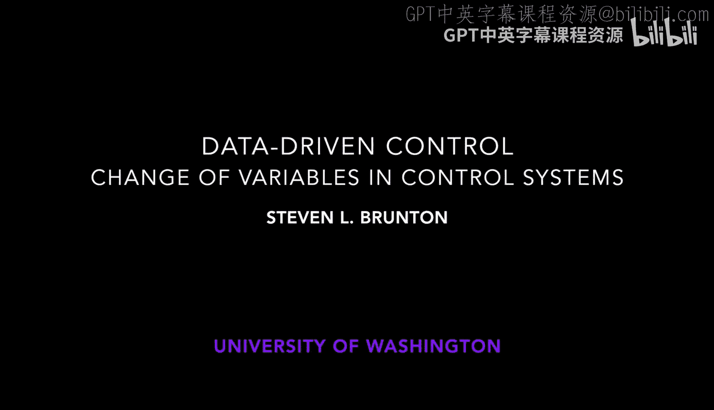

# 05：控制系统中的变量变换（修正）


在本节课中，我们将学习控制系统中的一个重要概念——变量变换，特别是如何修正之前关于格拉姆矩阵变换描述中的笔误。我们将详细推导变换矩阵 **T** 如何影响系统的可控性格拉姆矩阵，并展示其简洁的计算方法。

上一节我们介绍了变量变换的基本概念，本节中我们来看看如何正确推导格拉姆矩阵在变换下的表达式。

## 修正推导过程

我之前的描述中有一个笔误。我遗漏了 **â** 是复共轭转置（即 **â***）这一事实。这意味着表达式 **T⁻¹a*T*** 实际上需要修正。让我们重新推导一下。

假设我们有一个矩阵 **â**。那么 **â*** 的表达式如下：

**â* = T* a* T⁻¹***

这里，**a*** 是原矩阵 **a** 的复共轭转置。如果我们有一个矩阵乘积并想对其进行转置，我们需要翻转乘积顺序并对每个矩阵分别转置。

因此，**T⁻¹ a T** 的复共轭转置为：

**(T⁻¹ a T)* = T* a* T⁻¹***

这就是我之前弄错的地方。正确的表达式中应该是 **T*** 和 **T⁻¹***，而不是 **T⁻¹** 和 **T**。

## 格拉姆矩阵的变换

基于上述修正，可控性格拉姆矩阵 **W_c** 在变量变换下的正确表达式为：

**Ŵ_c = T⁻¹ W_c T⁻¹***

这听起来很复杂，但实际上在 MATLAB 中可以非常简单地用一行代码计算。`T⁻¹*` 就是计算 **T** 的逆矩阵后再进行转置。在 MATLAB 中，转置操作就是加一个撇号（`'`）。

以下是计算示例：
```matlab
W_c_hat = inv(T) * W_c * inv(T)';
```

因此，尽管数学符号看起来很复杂，但其计算本质是简单的：先求逆，再转置。

## 变换性质总结

以下是格拉姆矩阵在变量变换下的关键性质：

*   **可控性格拉姆矩阵** 按 **Ŵ_c = T⁻¹ W_c T⁻¹*** 进行变换。
*   **可观测性格拉姆矩阵** 也按类似的性质进行变换（推导过程类似）。

你可以在一张干净的纸上仔细推导整个过程，以确信格拉姆矩阵确实是这样变换的。我们将利用这个变换性质，来设计一个优秀的变换矩阵 **T**，以平衡系统的可控性与可观测性。



本节课中我们一起学习了变量变换下格拉姆矩阵的正确变换公式，修正了先前描述中的错误，并了解了其简洁的数值计算方法。这是后续设计平衡系统实现的基础。