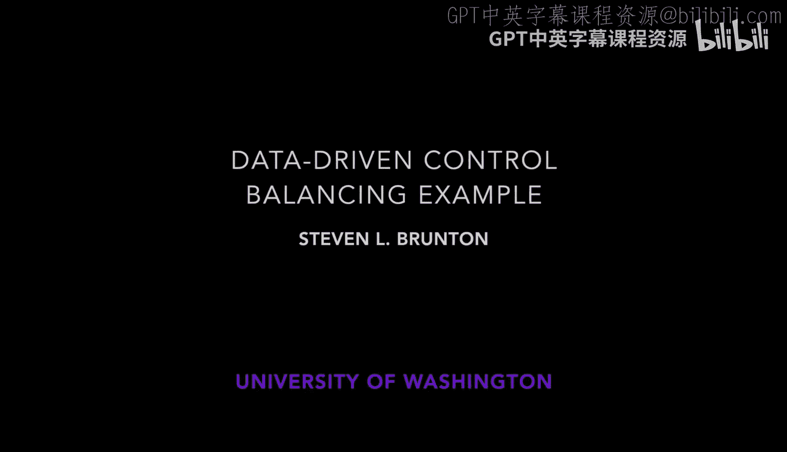

# 06：平衡示例 🧮


在本节课中，我们将学习一个具体的平衡变换示例。我们将看到，即使一个线性动力系统在原始坐标下表现出极不平衡的“可控性”与“可观测性”，通过一个简单的坐标变换，我们也能使其达到平衡状态。这个直观的例子将帮助我们理解后续处理大型复杂系统时所用方法的核心思想。

## 回顾与引言

上一节我们介绍了线性动力系统在可逆坐标变换下的行为。具体来说，从 **X** 坐标变换到 **Z** 坐标时，系统矩阵 **A**、**B**、**C** 会相应地变为 **Â**、**B̂**、**Ĉ**。同时，可控性格拉姆矩阵 **Wc** 和可观测性格拉姆矩阵 **Wo** 也会按特定公式进行变换。

本节中，我们将通过一个极其简单的例子，来具体演示如何通过坐标变换实现格拉姆矩阵的平衡。这个例子源自 Moore 在 1981 年发表的具有开创性意义的论文，该论文奠定了平衡模型降阶方法的基础。

## 一个不平衡的示例系统

让我们从一个非常简单的二维系统开始。为了便于理解，我们选择一个解耦（对角化）的动力系统。

在 **X** 坐标下，系统的动态方程为：
```
d/dt [x1; x2] = [ -1,   0;  // A 矩阵
                   0, -10 ] * [x1; x2] + [ 1e-3;  // B 矩阵
                                          1e+3 ] * u
```
输出方程为：
```
y = [ 1e+3,  1e-3 ] * [x1; x2]  // C 矩阵
```

请注意这个系统的特点：
*   **状态 x2** 非常容易控制（**B** 矩阵对应元素为 `1e+3`），但很难测量（**C** 矩阵对应元素为 `1e-3`）。
*   **状态 x1** 则恰恰相反，非常难以控制（`1e-3`），但很容易测量（`1e+3`）。

这导致系统的可控性格拉姆矩阵和可观测性格拉姆矩阵极不平衡，就像两个状态分别用“毫米”和“公里”来度量一样不协调。

## 设计平衡坐标变换

我们的目标是找到一个坐标变换 **Z = T⁻¹ X**，使得在新坐标 **Z** 下，系统的可控性和可观测性达到平衡。

对于这个简单的例子，我们可以直观地构造变换矩阵。我们通过缩放来“统一单位”：
*   将难以控制的 **x1** 放大 1000 倍。
*   将难以观测的 **x2** 缩小 1000 倍。

这对应于以下变换：
```
Z = [ z1;   = [ 1e+3,     0;  * [x1;   = T⁻¹ * X
      z2 ]      0,     1e-3 ]    x2 ]
```

## 新坐标下的平衡系统

现在，让我们推导在新坐标 **Z** 下的系统动态。

首先，状态方程 `dZ/dt`：
由于原 **A** 矩阵是对角阵，且变换矩阵 **T⁻¹** 也是对角阵，它们可交换。因此，新系统的 **Â** 矩阵与原 **A** 矩阵相同：
```
d/dt [z1; z2] = [ -1,   0;  * [z1; z2] + B̂ * u
                  0, -10 ]
```

接下来是关键的变化，计算新的输入矩阵 **B̂** 和输出矩阵 **Ĉ**：
*   **B̂ = T⁻¹ B**：变换放大了 **x1** 对应的输入通道，同时缩小了 **x2** 对应的通道。
*   **Ĉ = C T**：变换缩小了 **x1** 对应的输出通道，同时放大了 **x2** 对应的通道。

计算后得到：
```
B̂ = [ 1;   // 原 1e-3 * 1e+3 = 1
      1 ]  // 原 1e+3 * 1e-3 = 1

Ĉ = [ 1,  1 ] // 计算过程：1e+3 * 1e-3 = 1, 1e-3 * 1e+3 = 1
```

## 结果分析

在 **Z** 坐标下，我们的系统变为：
```
d/dt [z1; z2] = [ -1,   0;  * [z1; z2] + [1; 1] * u
                  0, -10 ]
y = [1, 1] * [z1; z2]
```

现在，两个状态 **z1** 和 **z2** 对输入 **u** 的影响程度变得相同（**B̂** 元素均为 1），同时它们对输出 **y** 的贡献程度也变得相同（**Ĉ** 元素均为 1）。这意味着，在新坐标下，系统的可控性和可观测性达到了平衡。

这个简单的缩放变换，本质上是为两个状态选择了更合理的“度量单位”（例如，将“毫米”和“公里”都统一为“米”），从而消除了因坐标选取不当而造成的表象上的不平衡。

## 总结与展望

本节课中，我们一起学习了一个通过坐标变换实现格拉姆矩阵平衡的直观示例。我们看到，一个在原始坐标下可控性与可观测性严重失衡的系统，可以通过一个简单的线性变换，转化为一个平衡的系统。这个变换的核心思想是重新缩放状态变量，使所有状态在输入和输出中的“能见度”达到均衡。



这个低维例子为我们提供了关键的直觉。接下来，我们将把这一思想推广到高维、非对角化的复杂系统中，学习如何为任意大型线性系统系统地构造平衡变换矩阵 **T**。这正是 Moore 平衡实现算法的核心内容。