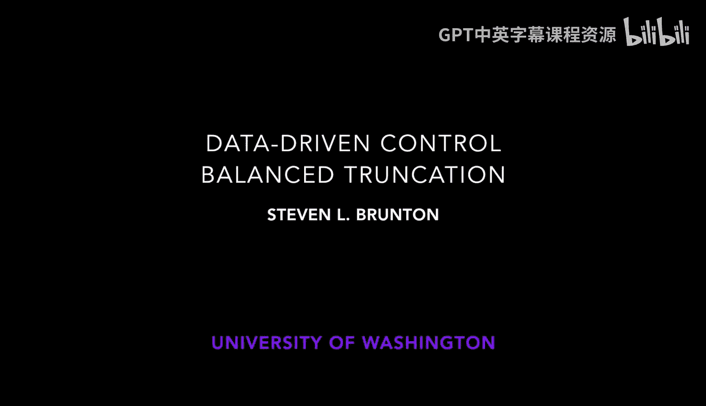

# 08：平衡截断法

在本节课中，我们将学习一种名为“平衡截断法”的模型降阶技术。该方法通过找到系统中最可控且最可观的状态方向，并仅保留最重要的部分，从而将高维复杂系统简化为低维、易于处理的模型。

## 平衡坐标变换

上一节我们介绍了可控性和可观性格拉姆矩阵，它们量化了系统在不同方向上的可控与可观程度。本节中，我们来看看如何利用一个坐标变换矩阵 **T**，使这两个格拉姆矩阵在新的坐标系下变得相等且对角化。

这个变换将原始状态 **x** 转换到新的坐标 **z**：
**z = T⁻¹x**

在这个新的 **z** 坐标系中，系统的动态特性被“平衡”了，这意味着状态变量根据其联合可控性与可观性的重要性进行了排序。第一个变量 **z₁** 最重要，其次是 **z₂**，依此类推。

## 模型截断的核心思想

虽然平衡坐标变换本身不降低维度，但它为我们提供了一个绝佳的截断基础。核心思想是：只保留前 **r** 个最重要的 **z** 坐标（对应最可控且最可观的状态），而丢弃其余部分。

具体操作如下：
*   我们保留变换矩阵 **T** 的前 **r** 列，记作矩阵 **Ψ**。
*   被保留的 **r** 维状态记作 **x̃**，即降阶后的状态。
*   原始高维状态 **x** 可近似表示为：**x ≈ Ψ x̃**

这个过程被称为**平衡截断**。它本质上是将系统动态投影到由 **Ψ** 的列张成的最重要的子空间上。

## 降阶模型的推导

为了得到降阶模型的具体形式，我们需要进行一些数学推导。我们将矩阵 **T** 及其逆矩阵 **S = T⁻¹** 进行分块，分别保留与截断部分。

以下是关键步骤的分解：

1.  **定义分块矩阵**:
    *   **T = [Ψ, T_trunc]**，其中 **Ψ** 是前 **r** 列（保留部分），**T_trunc** 是剩余列（截断部分）。
    *   **S = T⁻¹ = [Φ*; S_trunc]**，其中 **Φ*** 是前 **r** 行（保留部分），**S_trunc** 是剩余行。

2.  **写出分割后的系统动态**:
    在 **z** 坐标下，系统动态被分割为保留部分 **x̃** 和截断部分 **z_trunc**。其状态方程可写为：
    **d/dt [x̃; z_trunc] = [Φ* A Ψ, Φ* A T_trunc; S_trunc A Ψ, S_trunc A T_trunc] [x̃; z_trunc] + [Φ* B; S_trunc B] u**

3.  **进行截断近似**:
    平衡截断法直接忽略（截断）所有与 **z_trunc** 相关的项。这是一个近似，基于的假设是被丢弃的状态对输入-输出行为的贡献很小。

4.  **得到最终降阶模型**:
    应用截断近似后，我们得到简化的 **r** 维状态空间模型：
    *   **d/dt (x̃) = A_r x̃ + B_r u**
        *   其中 **A_r = Φ* A Ψ**， **B_r = Φ* B**
    *   **y ≈ C_r x̃**
        *   其中 **C_r = C Ψ**

这个模型 **{A_r, B_r, C_r}** 就是我们的降阶模型。矩阵 **A_r** 是 **r × r** 的，因此模拟和控制器设计都变得非常高效。

## 方法总结与局限

本节课中我们一起学习了平衡截断法。它是一种强大且广泛使用的模型降阶技术，能够为线性系统提取出捕获主要输入-输出动态的低维模型。

然而，该方法有一个主要限制：它需要显式地计算和分解高维的格拉姆矩阵。对于状态维度 **n** 高达百万或亿级的系统（例如复杂流体仿真），构建 **n × n** 的格拉姆矩阵并计算其特征向量在计算上是不可行的。

这引出了我们下一节要讨论的主题：如何利用数据驱动的方法来近似平衡截断中的变换 **Ψ** 和 **Φ**，从而将此类降阶技术扩展到超大规模系统。这种方法被称为平衡本征正交分解。