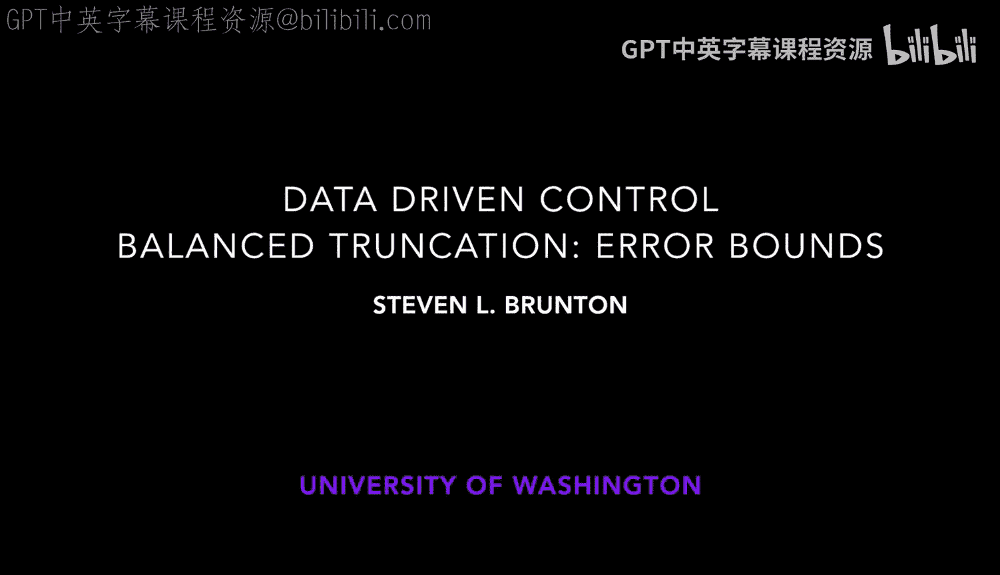

# 10：平衡截断的误差界


在本节课中，我们将学习平衡截断模型降阶方法的一个重要特性：误差界。我们将了解如何量化降阶模型与原始全阶模型之间的近似程度，并学习相关的上界和下界公式。

## 概述

上一节我们介绍了平衡变换，它将系统转换到一个新的坐标系，使得可控性和可观性格拉姆矩阵相等且平衡。本节中，我们将探讨这种平衡截断方法带来的一个重要优势：我们可以明确地知道，对于一个给定的模型阶数，降阶模型的近似效果有多好或多差，即我们丢弃了多少信息。


## 系统回顾

我们首先回顾一下原始系统和降阶模型。

原始全阶系统（维度为 `n`）的状态空间表示为：
```
ẋ = Ax + Bu
y = Cx
```

通过平衡变换和截断，我们得到降阶模型（维度为 `r`，且 `r << n`）：
```
ẋ̃ = Ãx̃ + B̃u
y = C̃x̃
```

这两个系统都对应着各自的传递函数：`G(s)` 和 `G̃(s)`。尽管状态维度降低了，但输入 `u` 和输出 `y` 的维度保持不变，这是模型降阶框架中的一个关键点。

## 误差度量：无穷范数

为了衡量降阶模型 `G̃(s)` 对原始模型 `G(s)` 的近似程度，我们使用无穷范数 `||·||∞`。这个范数可以被理解为“最坏情况”范数。

对于单输入单输出系统，`G(s)` 是一个标量函数，其无穷范数是其频率响应在所有频率上的最大幅值：
```
||G||∞ = max_ω |G(jω)|
```

对于多输入多输出系统，`G(s)` 是一个矩阵，其无穷范数是其频率响应矩阵在所有频率上的最大奇异值：
```
||G||∞ = max_ω σ₁[G(jω)]
```

我们的控制目标是使降阶模型与原始模型的误差尽可能小，即希望 `||G - G̃||∞` 这个值很小。

## 平衡截断的误差界

平衡截断方法的一个显著优点是，其近似误差存在明确的上界和下界，这些界限由系统的 Hankel 奇异值决定。

在平衡坐标系中，可控性和可观性格拉姆矩阵相等且为对角矩阵 `Σ`：
```
Ŵc = Ŵo = Σ = diag(σ₁, σ₂, ..., σₙ)
```
其中，`σ₁ ≥ σ₂ ≥ ... ≥ σₙ ≥ 0` 被称为 Hankel 奇异值。它们衡量了每个状态模式在输入-输出行为中的“能量”重要性。

当我们截断并保留前 `r` 个最重要的模式时，近似误差的无穷范数满足以下不等式：

**误差下界**：
```
||G - G̃||∞ ≥ σ_{r+1}
```
这意味着，误差不可能小于被丢弃的第一个（即第 `r+1` 个）奇异值。

**误差上界**：
```
||G - G̃||∞ ≤ 2 * (σ_{r+1} + σ_{r+2} + ... + σₙ)
```
这意味着，误差不会超过被丢弃的所有奇异值之和的两倍。

## 奇异值分布与模型阶数选择

这些误差界为什么重要？因为它们为如何选择降阶模型的阶数 `r` 提供了指导。

我们可以绘制 Hankel 奇异值 `σ_j` 随索引 `j` 变化的曲线（通常用对数坐标）。曲线的形态决定了模型降阶的难易程度。

以下是两种典型分布：

*   **快速衰减**：奇异值迅速下降（例如指数衰减）。这意味着前几个模式主导了系统的输入-输出行为。存在一个清晰的截断点，选择较小的 `r` 即可捕获绝大部分能量，获得既低维又精确的模型。
*   **缓慢衰减**：奇异值初始下降较快，但随后进入一个缓慢的“尾巴”。这种情况下，选择截断点 `r` 更加困难，因为被丢弃的奇异值之和（误差上界）可能仍然很大。这类系统通常更难控制和降阶。

## 物理意义举例

从物理上理解，Hankel 奇异值大的模式对应着对系统输入-输出行为影响显著的状态。例如，在驾驶汽车时，方向盘、油门和刹车直接影响车辆的位置和速度（高可控可观性）。而收音机的音量、空调温度或车窗位置这些状态，虽然也是系统的“模式”，但它们对于“从A点到达B点”这个控制目标来说，几乎是不可控和不可观的（对应的 Hankel 奇异值非常小）。

## 总结



本节课中，我们一起学习了平衡截断模型降阶方法的误差分析。我们了解到，通过计算系统的 Hankel 奇异值，我们可以得到降阶模型近似误差的明确上界和下界。这些界限为选择合适的模型降阶阶数 `r` 提供了理论依据，帮助我们权衡模型复杂度与近似精度。理解奇异值的分布形态，对于判断一个系统是否易于降阶和控制至关重要。