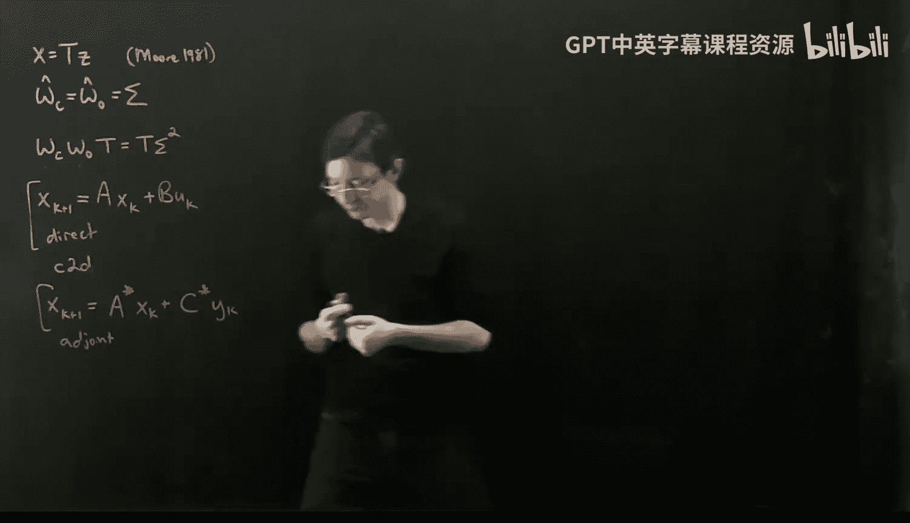
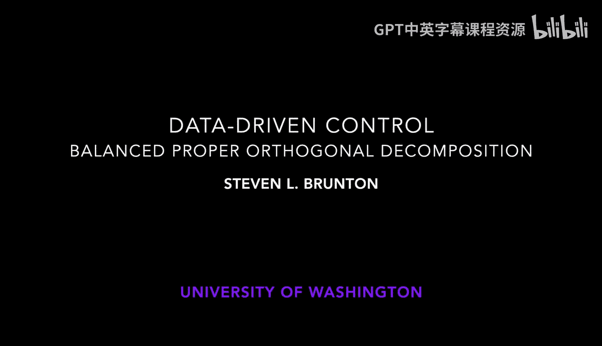

# 11：数据驱动的平衡截断与平衡本征正交分解


在本节课中，我们将学习一种针对大规模系统的高效模型降阶方法——平衡本征正交分解。我们将了解如何绕过传统方法中计算昂贵格拉姆矩阵的步骤，直接利用系统仿真数据来构建降阶模型。

## 概述

上一节我们介绍了平衡截断，这是一种有效的模型降阶策略。其核心思想是通过坐标变换，将系统状态按可控性与可观性的重要程度重新排列，从而截取最重要的状态来构建低阶模型。然而，传统方法需要计算高维的格拉姆矩阵并进行特征分解，这对于状态数巨大的系统（如湍流、神经科学模型）是难以实现的。

本节中，我们将探讨如何利用系统的仿真数据，通过一种名为“平衡本征正交分解”的方法，高效地实现模型降阶，而无需显式计算格拉姆矩阵。

## 从连续时间到离散时间

为了使后续的矩阵运算更简洁，我们首先将系统切换到离散时间框架。这并不改变问题的本质，只是为了数学推导的方便。

离散时间系统可以描述为：
```
x_{k+1} = A_d x_k + B_d u_k
y_k = C_d x_k
```
其中，`A_d`, `B_d`, `C_d` 是离散化后的系统矩阵。从连续时间系统转换到离散时间系统有标准的公式和方法。



## 伴随系统与数据驱动思想

对于我们可以进行计算机仿真的大型系统（如气候、流体力学模型），除了上述的“直接系统”，我们还可以定义一个“伴随系统”。

伴随系统的动态方程为：
```
x_{k+1} = A_d^* x_k + C_d^* y_k
```
这里，`*` 表示复共轭转置（对于实矩阵就是转置）。在伴随系统中，原来的输出 `y` 变成了输入。

**核心概念**：我们可以通过数值实验来理解这两个系统：
*   **直接系统**：给输入 `u` 一个脉冲激励，观察系统状态 `x` 随时间演化的“电影”。
*   **伴随系统**：给输出 `y`（想象为一个传感器）一个脉冲激励，观察在伴随动力学下，哪些状态的历史最能激发这个测量值。

通过运行这些仿真实验，我们可以构造两个关键的数据矩阵，而无需求解复杂的李雅普诺夫方程。

## 构建数据矩阵：替代格拉姆矩阵

以下是构建数据矩阵的步骤：

首先，我们对直接系统进行脉冲响应实验。假设在零初始条件下，在 `k=0` 时刻给输入一个脉冲（`u_0` 为脉冲函数），然后记录 `M+1` 个时间步长的系统状态。将这些状态向量按时间顺序排列，就得到了**可控性矩阵** `C`（注意是花体，不是输出矩阵 `C`）：
```
C = [B_d, A_d B_d, A_d^2 B_d, ..., A_d^M B_d]
```
这个矩阵的每一列都是系统在某个时刻的状态快照。

类似地，我们对伴随系统进行脉冲响应实验。给输出 `y` 一个脉冲，记录伴随系统的状态演化，可以得到**可观性矩阵** `O`：
```
O = [C_d; C_d A_d; ...; C_d A_d^M]
```

**核心创新**：研究表明，系统的可控性格拉姆矩阵 `W_c` 和可观性格拉姆矩阵 `W_o` 可以近似为：
```
W_c ≈ C C^*
W_o ≈ O^* O
```
这里的 `^*` 表示复共轭转置。当离散时间步长 `ΔT` 足够小，且记录的时间步数 `M` 足够大时，这个近似就相当于对格拉姆矩阵的积分进行黎曼和逼近，精度很高。

因此，我们通过运行仿真（数据驱动）得到了格拉姆矩阵的近似，避免了昂贵的直接计算。

## 平衡本征正交分解的核心步骤

虽然上述方法（由Moore提出）比直接计算格拉姆矩阵更优，但对于状态维数 `n` 极大的系统，构建 `n×n` 的矩阵 `C C^*` 和 `O^* O` 并进行特征分解仍然非常昂贵。

后续的研究者（如Wilcox和Rowley）提出了更高效的改进。其中，Rowley在2005年提出的方法完全绕开了显式构造格拉姆矩阵的步骤，直接利用数据矩阵 `C` 和 `O`。

**核心操作**是计算汉克尔矩阵 `H` 并对其进行奇异值分解：
```
H = O C = U Σ V^*
```
这个汉克尔矩阵 `H` 的元素由系统的马尔科夫参数（`C_d A_d^k B_d`）构成，其奇异值就是**汉克尔奇异值**，它们与平衡截断中的重要性度量直接相关。

我们对 `H` 进行截断的奇异值分解，只保留前 `r` 个主导的奇异值和对应的奇异向量：
```
H ≈ Ũ Σ̃ Ṽ^*
```
其中 `Ũ` 是 `U` 的前 `r` 列，`Σ̃` 是 `Σ` 的前 `r×r` 对角块，`Ṽ` 是 `V` 的前 `r` 列。

## 构建降阶模型

利用SVD的结果，我们可以直接得到平衡坐标变换中最重要的 `r` 个方向（即原平衡变换矩阵 `T` 的前 `r` 列及其逆矩阵的前 `r` 列）。

直接模态 `Ψ` 和伴随模态 `Φ` 的计算公式如下：
```
Ψ = C Ṽ Σ̃^{-1/2}
Φ = O^* Ũ Σ̃^{-1/2}
```
`Ψ` 的列张成了最重要的 `r` 个可控/可观子空间。`Φ` 与 `Ψ` 满足双正交关系：`Φ^* Ψ = I`。

最后，利用这些模态，我们可以通过**伽辽金投影**得到 `r` 维的降阶模型：
```
à = Φ^* A_d Ψ
B̃ = Φ^* B_d
C̃ = C_d Ψ
```
这个降阶模型 `(Ã, B̃, C̃)` 捕捉了原高维系统中最关键的动态特性。

## 方法演进总结

本节课我们一起学习了平衡本征正交分解方法的演进逻辑：
1.  **Moore (1981)**：提出了平衡截断思想，通过格拉姆矩阵定义状态的重要性顺序。
2.  **Moore的改进**：提出利用直接/伴随系统的脉冲响应数据构建“经验格拉姆矩阵”，避免了求解李雅普诺夫方程，但仍有 `O(n^2)` 或 `O(n^3)` 的计算。
3.  **Wilcox 等人 (2002)**：提出在计算经验格拉姆矩阵时进行低秩截断，只计算我们最终需要的 `T` 矩阵的前 `r` 列，减少了计算量。
4.  **Rowley (2005)**：提出了本节课介绍的核心方法，完全绕过格拉姆矩阵，直接对数据矩阵乘积 `O C`（即汉克尔矩阵）进行SVD，一步到位地得到降阶模型，极大地提升了对于大规模系统的计算可行性。

这种方法的核心优势在于它是数据驱动的（基于仿真数据），并且通过线性代数的工具（SVD）高效地实现了基于系统物理特性（可控/可观性）的模型降阶。

## 下节预告



BPOD方法假设我们可以测量全状态 `x` 并运行伴随仿真。然而，当系统的输出 `y` 本身也是极高维（例如，百万像素的图像）时，对每个输出通道进行脉冲响应实验是不现实的。在下一讲中，我们将探讨Rowley等人如何进一步改进方法，以处理输出维度极高的情形。