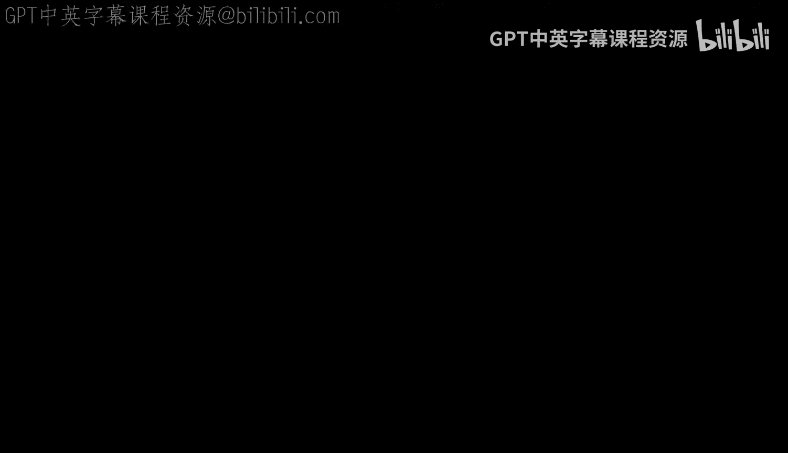
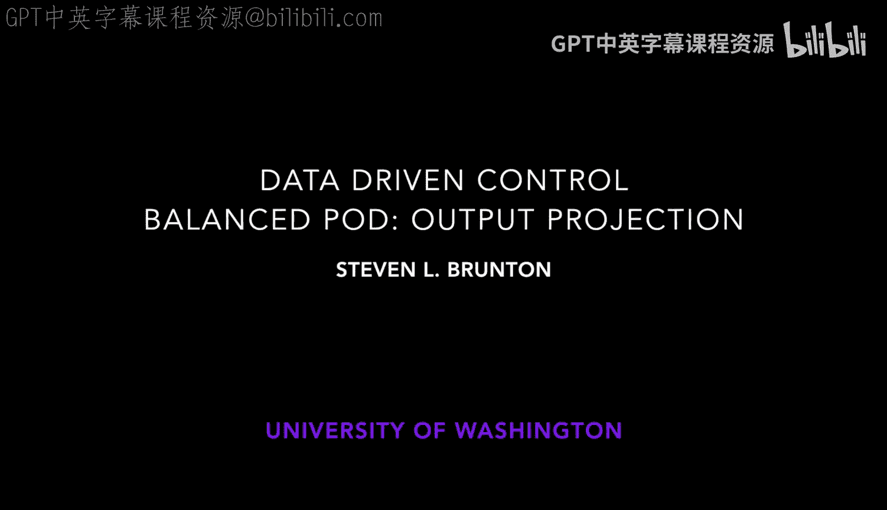

# 12：数据驱动控制_BPOD与输出投影

在本节课中，我们将学习如何将平衡截断算法扩展到具有极高维输出（测量）的系统。核心挑战在于，当测量维度（y）非常大时，对每个测量通道进行独立的脉冲响应实验在计算上是不可行的。我们将介绍一种创新方法，利用输出数据的固有结构来大幅减少所需的实验次数。

上一节我们介绍了利用平衡本征正交分解（BPOD）处理大型系统的方法。本节中，我们来看看当系统输出维度极高时，如何进一步优化该方法。

## 高维输出带来的挑战

在许多系统中，执行器（输入u）的数量通常很少。然而，测量（输出y）的维度可能非常高。例如，在流体模拟中，我们可能拥有测量整个流场（即完整状态x）的能力，这相当于有上百万个测量点。

问题在于，BPOD方法需要对每个独立的输出通道进行脉冲响应实验。如果y有上百万维，这意味着需要进行上百万次独立的模拟来收集数据，这在计算时间和存储空间上都是不可行的。

## 解决方案：利用输出的相干结构

Rowley在2005年提出的一个关键创新是认识到：即使是非常高维的系统，当受到激励时，其响应数据中通常存在一些**主导模式**或**相干结构**。这些模式可以通过对直接脉冲响应数据矩阵进行**本征正交分解**来发现。

具体来说，我们构建从输入到状态的脉冲响应快照矩阵 **C**（即可控性格拉姆矩阵的近似）。对其进行奇异值分解（SVD）：
**C = U D V^T**

分解后，矩阵 **U** 的前几列就代表了系统响应中最活跃、最主导的空间模式。这些被称为**POD模态**。在流体力学、物理学和光学中，研究人员经常使用POD来分析高维数据中的相干结构。

## 核心思想：投影到POD模态空间

Rowley的核心洞见是：在伴随方程中，我们无需对原始的、高维的状态 **x** 的每一个分量进行脉冲激励。相反，我们可以只激励那些从数据中发现的、最重要的POD模态。

其操作如下：
1.  首先，对直接脉冲响应数据（**C** 矩阵）进行POD分析，得到主导模态矩阵 **U_r**（仅保留前r列）。
2.  在伴随方程的模拟中，将原本对输出 **y**（这里等于全状态 **x**）的激励，替换为对POD模态系数 **α** 的激励。伴随方程的输入变为 **C* U_r**，其中 **U_r** 是POD模态矩阵。

这意味着，伴随方程的动力学变为：
**x_{k+1} = A* x_k + C* U_r α_k**

通过这种方式，我们只需要进行 **r** 次脉冲响应模拟（r是保留的POD模态数，通常很小），而不是 **m** 次（m是原始输出的维度，可能极大）。这极大地降低了数据收集的计算成本。

## 方法优势与总结

总而言之，当处理具有全状态测量（即超高维输出）的系统时，标准的BPOD方法会遇到计算瓶颈。Rowley的改进方法通过以下步骤解决了这个问题：

以下是该方法的步骤概要：
1.  对直接脉冲响应数据矩阵进行POD分析，提取主导空间模态。
2.  在伴随方程的模拟中，仅激励这些提取出的POD模态，而非所有原始状态分量。
3.  利用缩减后的直接和伴随响应数据，继续执行BPOD的后续步骤，最终得到降阶模型。

这个巧妙的想法使我们能够基于全状态测量，高效地为百万维级别的系统构建数据驱动的降阶模型。

本节课中，我们一起学习了如何通过输出投影到POD模态空间，来克服高维输出系统在数据收集方面的挑战。下一节，我们将通过代码实现这一方法，并观察其实际效果。