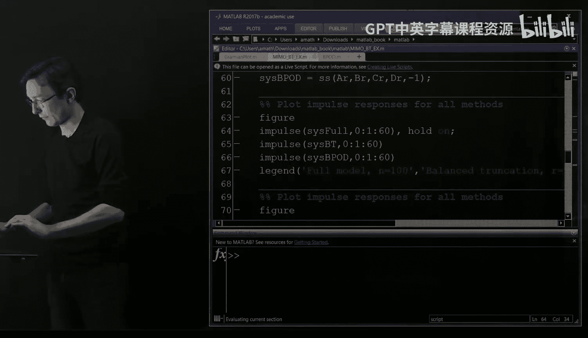
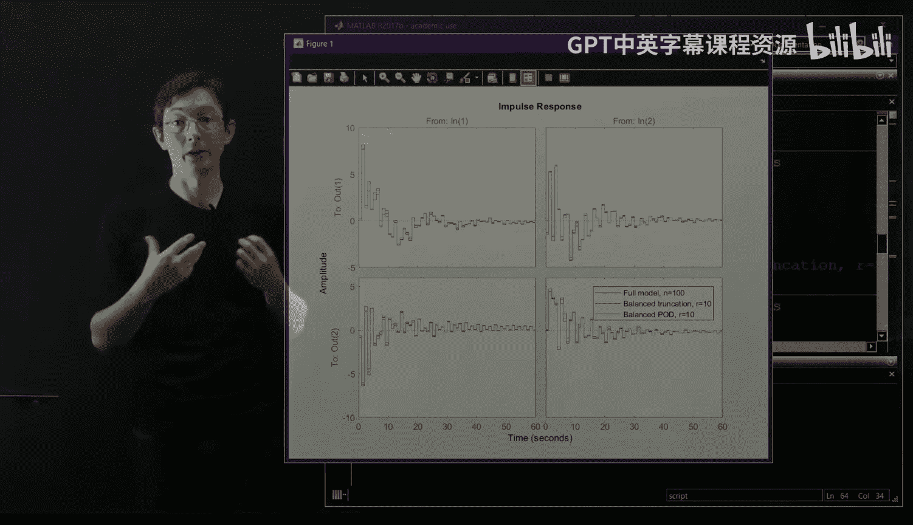
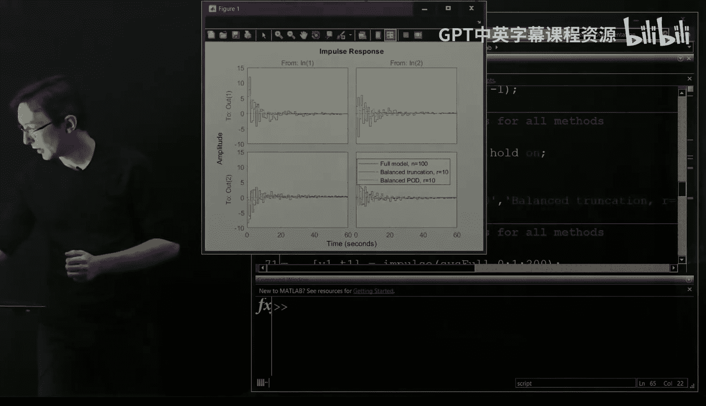
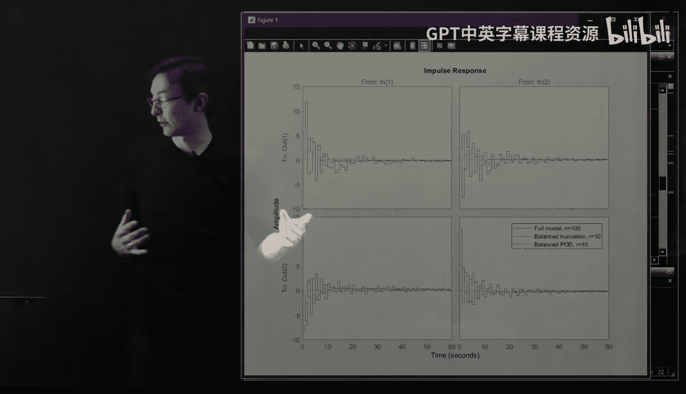
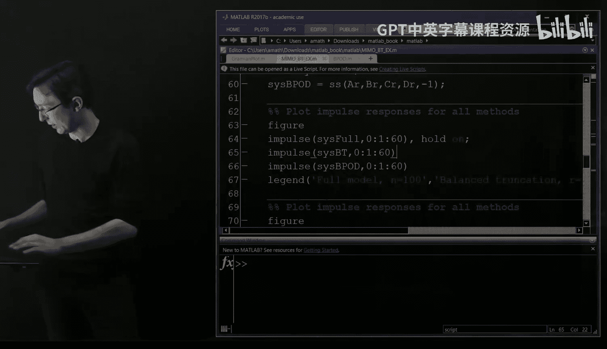
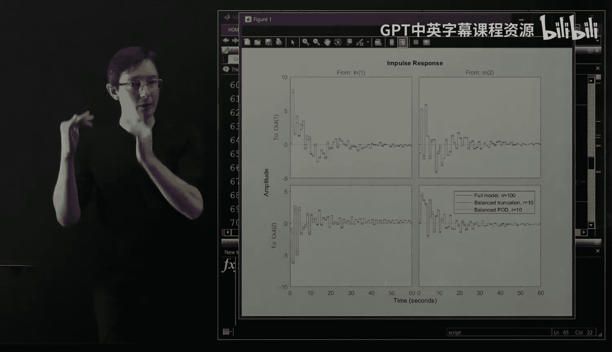
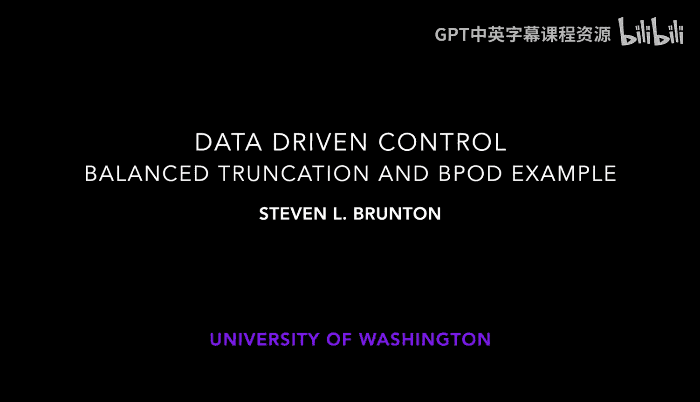

# 13：平衡截断与BPOD实例 🧮


在本节课中，我们将通过一个具体的编程实例，学习如何对多输入多输出系统应用平衡截断与平衡本征正交分解方法进行模型降阶。我们将从一个100维的随机状态空间系统出发，将其降阶为10维模型，并比较降阶模型与原始模型的动态响应。

## 系统构建与汉克尔奇异值分析

首先，我们构建一个具有100维状态、2个输入和2个输出的随机离散状态空间系统。在MATLAB中，可以使用 `drss` 命令方便地生成此类系统。

```matlab
% 生成一个100阶、2输出、2输入的随机离散状态空间系统
sys_full = drss(100, 2, 2);
```

为了评估系统可被降阶的潜力，我们计算并绘制其汉克尔奇异值。汉克尔奇异值的大小反映了每个状态对系统输入-输出行为的贡献程度。

```matlab
% 计算汉克尔奇异值
hsv = hsvd(sys_full);
% 绘制汉克尔奇异值及其累积和
figure;
subplot(1,2,1); semilogy(hsv, 'o-'); title('汉克尔奇异值');
subplot(1,2,2); plot(cumsum(hsv)/sum(hsv), 'o-'); title('累积能量占比');
```

分析上图可知，前10个模式已经捕获了系统超过90%的“能量”（即汉克尔奇异值之和）。这为我们将其降阶至10维模型提供了理论依据。

## 平衡截断法

对于维度适中的系统（如本例的100维），MATLAB提供了内置函数 `balred` 来直接进行精确的平衡截断，这仅需一行代码。

```matlab
% 设定目标降阶维度
r = 10;
% 使用平衡截断法获得降阶模型
sys_bt = balred(sys_full, r);
```

`balred` 函数内部自动执行了计算可控/可观性格拉姆矩阵、进行平衡变换、并根据汉克尔奇异值截断状态等一系列步骤，最终返回降阶后的状态空间模型 `(A_red, B_red, C_red, D_red)`。

## 平衡本征正交分解法

对于维度过高、无法直接计算格拉姆矩阵的大规模系统，我们需要采用基于数据的平衡本征正交分解方法。BPOD通过模拟系统的脉冲响应来近似计算汉克尔矩阵，从而避免了大矩阵的运算。

以下是BPOD的核心步骤简述：



1.  **生成数据**：分别对原系统 `sys_full` 及其对偶系统 `sys_full'` 施加脉冲激励，收集状态响应数据，构成矩阵 `X`（类似可控性矩阵）和 `Y`（类似可观性矩阵）。
2.  **构建汉克尔矩阵**：计算 `H = Y * X`，这是一个近似的外积，其奇异值分解能揭示系统的平衡结构。
3.  **计算平衡模态**：从 `H` 的奇异值分解中，提取左、右奇异向量，并组合得到直接模态 `Phi` 和对偶模态 `Psi`。
4.  **投影得到降阶模型**：将原系统的 `A, B, C` 矩阵投影到由 `Phi` 和 `Psi` 张成的低维子空间上。

```matlab
% 简化的BPOD核心代码逻辑示意
% 1. 脉冲响应模拟（获取数据矩阵X, Y）
% 2. 构建汉克尔矩阵 H = Y * X
% 3. 对H进行奇异值分解 [U,S,V] = svd(H)
% 4. 计算模态 Phi = X * V * inv(sqrt(S)), Psi = Y' * U * inv(sqrt(S))
% 5. 投影得到降阶模型 A_red = Psi' * A * Phi; B_red = Psi' * B; C_red = C * Phi;
```

## 结果对比与分析

我们同时绘制原始系统、平衡截断模型和BPOD模型的脉冲响应进行对比。




上图显示，蓝色曲线（原始100维模型）、红色曲线（平衡截断10维模型）和金色曲线（BPOD 10维模型）几乎完全重合。这表明两种降阶方法都成功地用10维模型捕捉了原始100维系统的主要输入-输出动态特性。



## 探索性实验：过度降阶的影响



为了理解降阶维度的选择如何影响精度，我们将目标维度 `r` 从10改为3，重新进行降阶并比较。




此时，汉克尔奇异值累积图显示，前3个模式仅能捕获约40%的系统能量。从脉冲响应对比图可以明显看出，无论是平衡截断还是BPOD得到的3维模型（红、金曲线），都与原始模型（蓝曲线）存在显著差异，且两种降阶方法的结果也不再一致。

这个实验揭示了几个关键点：
1.  降阶模型的精度与保留的汉克尔奇异值能量直接相关。
2.  当降阶过于激进（保留能量过低）时，降阶模型会失真。
3.  在适度降阶（如保留90%能量）时，平衡截断和BPOD结果一致；但在过度降阶时，基于数据近似的BPOD方法可能比精确的平衡截断更早地出现性能下降，这是因为数据模拟和矩阵近似引入了额外误差。



## 总结

本节课中，我们一起学习了平衡截断与平衡本征正交分解的实践应用：
*   **平衡截断** 是模型降阶的精确算法，适用于中小规模系统，在MATLAB中可一键完成。
*   **BPOD** 是适用于大规模系统的数据驱动近似方法，通过脉冲响应数据绕过大规模矩阵计算。
*   **汉克尔奇异值** 是指导降阶维度选择的关键指标，其累积能量占比直观反映了降阶可能带来的精度损失。
*   降阶的目标是在模型复杂度与精度之间取得平衡，以获得更易于控制器设计和在线实施的简化模型。



这两种方法都假设我们拥有系统的数学模型（`A, B, C` 矩阵）。在接下来的课程中，我们将探讨当没有数学模型、只有实验测量数据时，如何利用相同的数学框架（基于汉克尔矩阵）进行系统辨识。这正是特征系统实现算法的用武之地。