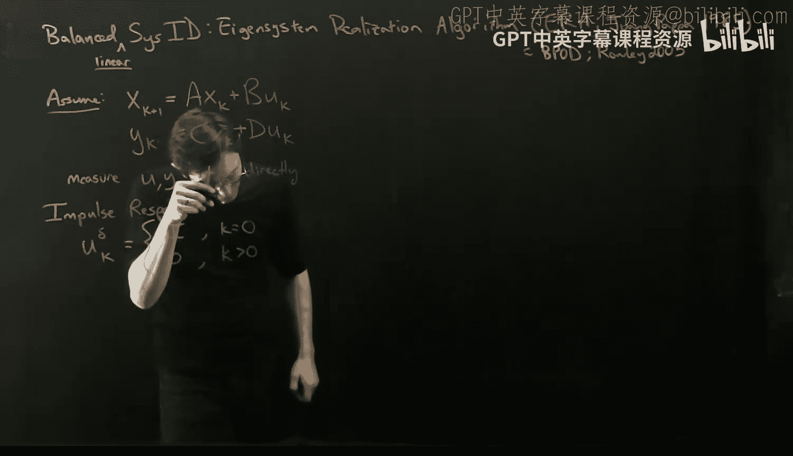

# 14：数据驱动的控制：特征系统实现算法 (ERA) 🧠


在本节课中，我们将学习一种直接从实验数据构建低阶、平衡状态空间模型的方法——特征系统实现算法。这是一种强大的系统辨识技术，尤其适用于我们拥有系统输入输出测量数据，但不知道其内部精确数学模型的情况。

## 概述

上一节我们介绍了平衡模型降阶，它假设我们已知系统的完整模型。然而，在许多实际应用中，我们只有系统的测量数据。本节中，我们将探讨如何仅利用脉冲响应数据，来辨识出一个平衡的、低阶的线性系统模型。

## 基本假设与问题设定

我们首先明确ERA算法的基础假设。

我们假设存在一个线性系统，其动态可以用离散时间状态空间方程描述：
```
x(k+1) = A x(k) + B u(k)
y(k) = C x(k) + D u(k)
```
其中，`x` 是状态向量，`u` 是输入向量，`y` 是输出向量。矩阵 `A`, `B`, `C`, `D` 定义了系统动态。

**关键假设如下：**
1.  系统本质上是线性的（至少在所关注的扰动幅度下）。
2.  我们可以测量输入 `u` 和输出 `y`，但**无法直接测量或知晓内部状态 `x`** 的物理意义。
3.  我们可以进行**脉冲响应实验**。这意味着在时间 `k=0` 时，给系统一个脉冲输入（例如，用“锤子”敲击），之后输入为零，并记录系统的输出响应。

## 脉冲响应与数据

让我们具体看看脉冲响应实验和数据形式。

对于一个多输入多输出的系统，脉冲输入 `u(k)` 可以表示为：
```
u(0) = I (单位矩阵)
u(k) = 0, 对于所有 k > 0
```
在零初始条件下，系统的输出响应（即脉冲响应）可以解析地写出：
```
y(0) = D
y(1) = C B
y(2) = C A B
...
y(k) = C A^(k-1) B, 对于 k >= 1
```
这些输出序列 `{y(0), y(1), y(2), ...}` 就是我们通过实验收集到的**数据**。

以下是脉冲响应实验的直观图示：
*   **输入 `u`**：在 `k=0` 时刻有一个单位脉冲，其他时刻为零。
*   **输出 `y`**：系统受到脉冲激励后，产生并逐渐衰减的动态响应。我们在离散时间点上测量这些响应值。



## ERA算法目标

有了脉冲响应数据后，ERA算法的目标是什么？

ERA算法将脉冲响应数据作为输入，并输出一个**降阶的（秩为 `r`）状态空间模型**：
```
x̃(k+1) = A_r x̃(k) + B_r u(k)
y(k) = C_r x̃(k) + D u(k)
```
请注意：
*   `A_r`, `B_r`, `C_r` 是降阶后的矩阵，其维度由我们选择的模型阶数 `r` 决定。
*   输入 `u` 和输出 `y` 的维度不变，因此矩阵 `D` 保持不变。
*   这个模型是一个“黑箱”模型，其状态 `x̃` 是从数据中学习到的潜在变量，不一定有直接的物理意义，但能最佳地以 `r` 阶线性动态来近似描述观测到的输入-输出关系。

**本质上，ERA是一种机器学习方法**：它从数据（脉冲响应）中学习一个可泛化的模型（状态空间方程），以紧凑的形式捕捉系统的动态特性。

## 历史背景与应用

了解ERA的起源有助于理解其价值。

ERA由Juang和Pappa在1985年提出。其发展背景是航天结构（如哈勃太空望远镜、空间站）的振动分析。这些结构复杂、轻质，容易产生振动模态，很难从第一性原理（如教科书方程）进行精确建模。

因此，工程师们转而采用数据驱动的方法：通过实物模型或仿真，收集系统的脉冲响应数据（“敲击并记录响应”），然后利用ERA直接构建一个用于描述其振动特性的低阶输入-输出模型。如今，ERA及其相关方法已被广泛应用于流体湍流控制、机器人学等众多领域。

## 与平衡降阶的联系

ERA有一个非常重要的理论联系。

研究表明，ERA得到的降阶模型，在特定条件下**等价于平衡截断（Balanced Truncation）和平衡本征正交分解（Balanced POD）** 得到的模型。后两者需要已知系统矩阵或能进行伴随仿真。而ERA**仅需要脉冲响应数据**，就能达到类似的效果，这使其在实际工程中极为强大和实用。

## 总结

本节课我们一起学习了特征系统实现算法的核心思想。我们明确了其数据驱动的本质：仅利用脉冲响应实验数据，辨识出一个平衡的、低阶的线性状态空间模型。我们了解了其基本假设、问题设定、算法目标以及重要的历史背景和理论价值。在接下来的章节中，我们将深入ERA的数学步骤和实现细节。