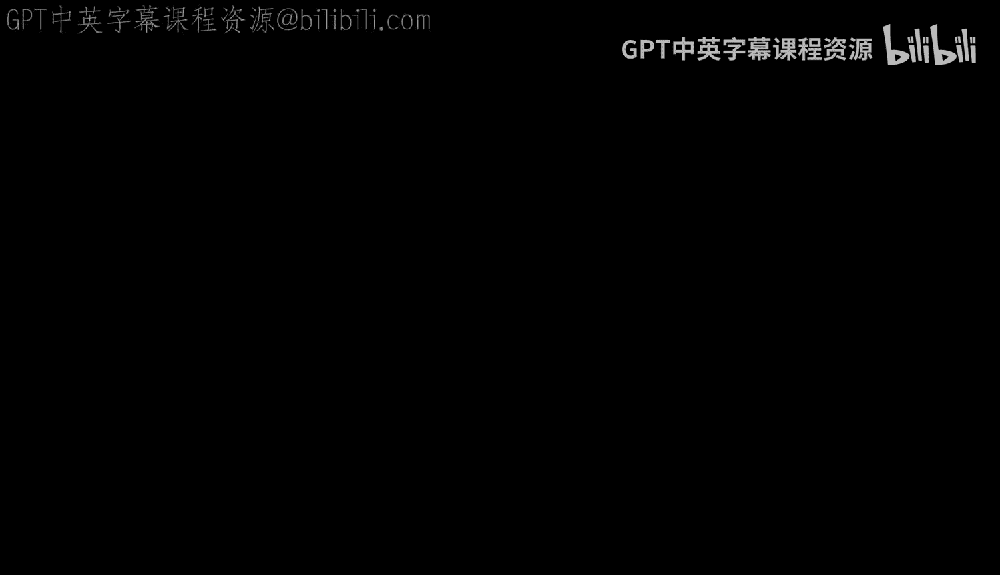
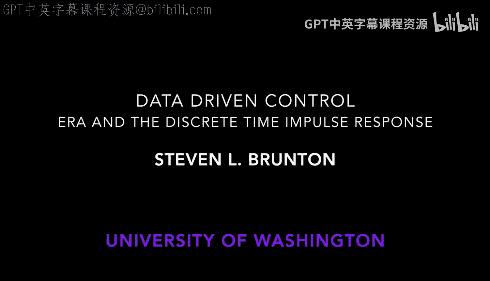

# 15：数据驱动控制_ ERA与离散时间脉冲响应




欢迎回来。在上一讲中，我们概述了特征系统实现算法（ERA）的目标：我们将为类似航空航天系统的对象，根据测量到的脉冲响应数据，拟合一个最佳拟合的、秩为R的线性动力学系统模型。

上一节我们快速介绍了脉冲响应的概念。本节中，我们将更详细地讲解如何计算离散时间脉冲响应，这是理解ERA算法的基础。

## 离散时间脉冲响应计算

我们考虑一个线性离散时间系统，其状态空间模型为：
```
x[k+1] = A x[k] + B u[k]
y[k] = C x[k] + D u[k]
```
其中，`x`是状态向量，`u`是输入向量，`y`是输出向量，`A, B, C, D`是系统矩阵。

为了计算脉冲响应，我们进行一个思想实验：假设系统初始状态为零（`x[0] = 0`），并且在`k=0`时刻输入一个单位脉冲（即`u[0] = I`，其中`I`是单位矩阵），之后所有时刻输入为零（`u[k] = 0, k>0`）。我们将逐步推导系统在`k=0, 1, 2, ...`时刻的输出`y[k]`。

以下是逐步推导过程：

*   **k = 0时刻**：
    *   输入：`u[0] = I`
    *   状态：`x[0] = 0` （零初始条件）
    *   输出：`y[0] = C * x[0] + D * u[0] = D * I = D`

*   **k = 1时刻**：
    *   输入：`u[1] = 0`
    *   状态：`x[1] = A * x[0] + B * u[0] = A * 0 + B * I = B`
    *   输出：`y[1] = C * x[1] + D * u[1] = C * B + D * 0 = C * B`

*   **k = 2时刻**：
    *   输入：`u[2] = 0`
    *   状态：`x[2] = A * x[1] + B * u[1] = A * B + B * 0 = A * B`
    *   输出：`y[2] = C * x[2] + D * u[2] = C * A * B`

*   **k = 3时刻**：
    *   输入：`u[3] = 0`
    *   状态：`x[3] = A * x[2] + B * u[2] = A * (A * B) = A^2 * B`
    *   输出：`y[3] = C * x[3] = C * A^2 * B`

通过观察这个模式，我们可以得到任意`k>0`时刻的脉冲响应输出的一般公式：
```
y[k] = C * A^(k-1) * B
```
其中`A^(k-1)`表示矩阵`A`的`(k-1)`次幂。

因此，整个离散时间脉冲响应序列可以表示为：
```
Y = { D, C*B, C*A*B, C*A^2*B, C*A^3*B, ... }
```
这就是我们通过思想实验推导出的表达式。我们只需假设在零时刻输入一个单位脉冲，之后输入为零，并跟踪所有后续时刻的数学运算即可得到。

## 关于输入与ERA算法的说明

上述推导假设了理想的脉冲输入。然而，在实际系统中，施加一个完美的脉冲通常是困难的。因此，在应用特征系统实现算法时，我们可能会向系统输入白噪声或某种伪随机信号，然后尝试从中反推出脉冲响应，或者直接反推出系统矩阵`A, B, C, D`。

如果输入`u`在`k>0`后不立即变为零，那么上述表达式会变得复杂得多。例如，`y[1]`将不再是简单的`C*B`，而会是`C*B + D*u[1]`等。目前，为了理解ERA算法，我们首先在输入为理想脉冲这个简单情况下进行思考。后续我们将讨论输入为一般序列`u[0], u[1], u[2], ...`时的更通用表达式。

## 数据与算法目标

对于特征系统实现算法，我们假设拥有脉冲响应数据。具体来说，我们拥有的数据就是测量得到的输出序列：
```
Y_data = { y[0], y[1], y[2], y[3], ... }
```
这些数据对应于系统对脉冲输入的响应。ERA算法的目标正是：仅利用这些输出数据`Y_data`，构建一个降阶模型，即完成系统辨识。



**本节课总结**


本节课中，我们一起学习了如何计算离散时间线性系统的脉冲响应。我们通过逐步的思想实验，推导出在零初始条件和单位脉冲输入下，系统输出序列的通用公式`y[k] = C * A^(k-1) * B`（`k>0`）。我们明确了特征系统实现算法（ERA）所依赖的数据正是这个脉冲响应序列`{D, C*B, C*A*B, C*A^2*B, ...}`，并且了解了在实际应用中，可能需要通过其他输入信号来间接获取这些数据。这为后续深入讲解ERA算法奠定了重要基础。