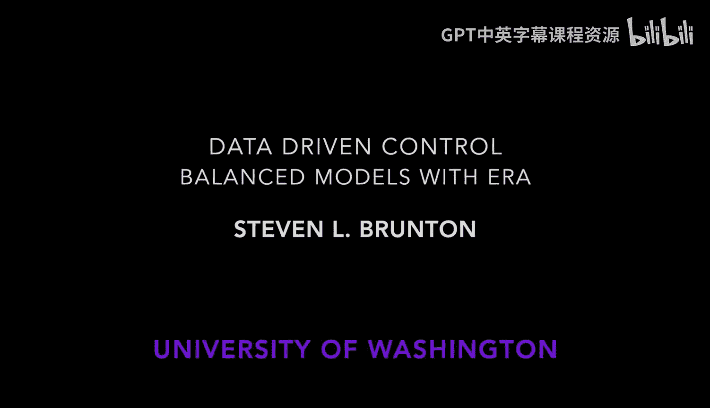

# 17：数据驱动控制与平衡模型实现算法

在本节课中，我们将学习如何将特征系统实现算法（ERA）转化为实际代码，并探讨其与平衡模型降阶、平衡本征正交分解（BPOD）之间的深刻联系。我们还将了解，当拥有全状态测量数据时，如何获得可解释的降阶模型。

## 从算法到代码实现

上一节我们介绍了特征系统实现算法（ERA）。它是一个纯粹的数据驱动算法：收集数据，构建矩阵，进行奇异值分解（SVD），最终得到一个模型。

接下来，我们将把这个算法编写成代码。这涉及到将所有步骤程序化，并仔细处理矩阵的维度、P和Q等参数。正如俗语所说，要“注意你的P和Q”，在这里我们确实需要精确管理这些矩阵。

## ERA与平衡模型降阶的联系

基于汉克尔矩阵的对称性，ERA算法生成的模型本质上是平衡的。如果你收集了足够长时间的数据，使得系统的瞬态响应完全衰减，那么得到的模型将是平衡模型。在这些坐标下，系统的能控性和能观性格拉姆矩阵将近似相等且为对角矩阵，这是一个非常棒的特性。

这建立了与平衡本征正交分解（BPOD）和平衡截断法之间的联系。本质上，你可以将所有数据驱动的方法，用直接快照矩阵 **C** 和伴随快照矩阵 **O** 来表述。通过数学推导，你会发现它们是等价的。

## 拥有全状态测量时的优势

到目前为止，我们假设存在一个潜在的、通常无法直接测量的全状态 **X**，我们只能测量输入和输出数据，并试图用一个低维的代理状态 **x̃** 来近似这些动力学。

但是，如果我在实验室或仿真中，**确实能够** 在一次实验中获取系统随时间演化的全状态测量数据 **x_k** 呢？例如，我可能有一个机翼的完整流场模拟“电影”。

*   **目标**：我仍然想构建一个模型，用于在线飞行控制，而在实际飞行中，我可能只有一个压力传感器（输出 **y**）。
*   **优势**：在模型构建阶段，如果我能利用一次性的全状态数据，就可以得到一个**可解释的**模型。

在只有输入输出数据时，降阶模型的状态 **x̃** 是难以解释的潜在变量。但有了全状态数据，我们可以计算出有物理意义的模态。

以下是建立可解释模型的关键步骤：

1.  首先，像往常一样运行ERA算法，从输入输出数据中得到降阶的奇异值矩阵 **Σ̃** 和右奇异向量矩阵 **Ṽ**。
2.  利用在实验室收集的全状态快照数据构建矩阵 **C**（即 **x1, x2, x3, ...**）。
3.  通过以下公式计算全状态模态 **Ψ**：
    **Ψ = C * Ṽ * Σ̃^{-1/2}**

矩阵 **Ψ** 的每一列都是一个全尺寸的模态（例如，一个流场图片）。此时，降阶状态 **x̃** 中的每一个分量（例如 **x̃₁, x̃₂, x̃₃**）就对应了 **Ψ** 中的一个具体模态。**x̃₁(t)** 的值就代表了在时刻 **t**，第一个模态 **Ψ(:,1)** 的激活强度。

这样，我就可以用降阶模型来近似重构全状态：**x ≈ Ψ * x̃**。这让我能够“观看”我的降阶模型所表示的全尺寸系统动态“电影”。

## 总结与展望

本节课中，我们一起学习了如何将ERA算法代码化，并深入理解了其生成的模型本质上是平衡的。更重要的是，我们探讨了当在训练阶段拥有全状态测量数据时，ERA与平衡本征正交分解（BPOD）的等价性，这使我们能够获得物理意义清晰的可解释降阶模型。

下一节，我们将讨论一个更实际的问题：如果无法对系统施加干净的脉冲激励来获取脉冲响应数据，该怎么办？如果我们只能给系统一些伪随机激励，又该如何从中提取出脉冲响应呢？