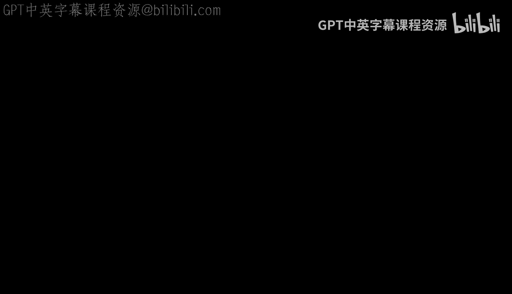
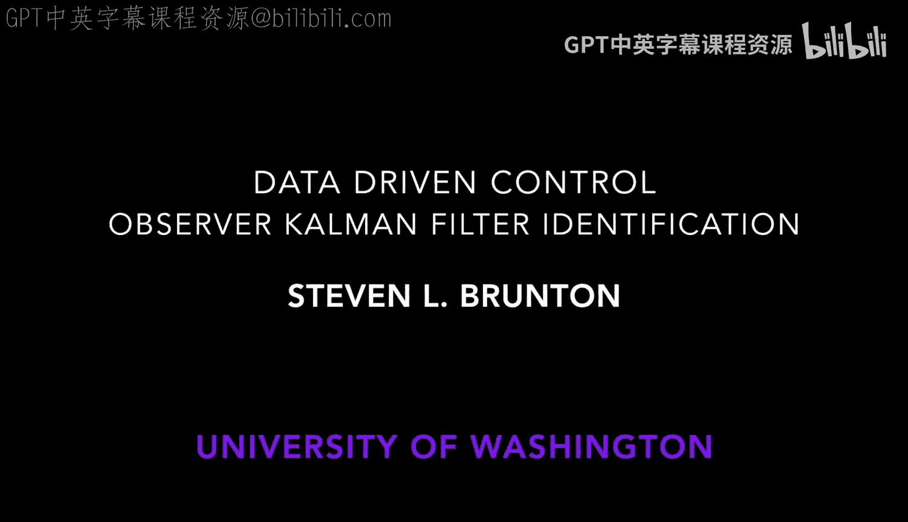

# 18：数据驱动的控制 - 观测器卡尔曼滤波器辨识 (OKID) 🧠



在本节课中，我们将学习一种名为“观测器卡尔曼滤波器辨识”的强大工具，简称OKID。当系统难以获取干净的脉冲响应数据时，OKID可以与特征系统实现算法结合使用，从嘈杂的输入输出数据中构建出可靠的系统模型。

## 概述

在之前的课程中，我们介绍了特征系统实现算法。这是一种非常通用且强大的数据驱动工具。如果我们能获得系统的脉冲响应数据，就能构建一个能最佳捕捉输入输出动态特性的低维模型，并用于预测和控制。

然而，获取一个理想的脉冲响应在实际中可能非常困难。系统可能存在噪声、非线性或响应缓慢等问题。OKID方法应运而生，它能处理伪随机的输入输出数据，并最优地估计出与这些数据最一致的脉冲响应（或系统矩阵），从而为后续的ERA分析提供干净的“数据”。

## 从脉冲响应到一般输入

上一节我们介绍了基于脉冲响应的ERA方法。本节中，我们来看看当输入不再是简单的脉冲，而是一般性的时间序列时，情况会如何变化。

我们假设系统由以下线性离散状态空间方程描述：
```
x[k+1] = A * x[k] + B * u[k]
y[k]   = C * x[k] + D * u[k]
```
其中，`x`是状态，`u`是输入，`y`是输出。初始状态`x[0] = 0`。

当输入是一个时间序列`u[0], u[1], u[2], ...`而不仅仅是脉冲时，系统的输出会变得复杂。以下是前几个时间步的输出推导：

*   `y[0] = D * u[0]`
*   `y[1] = C*B * u[0] + D * u[1]`
*   `y[2] = C*A*B * u[0] + C*B * u[1] + D * u[2]`

可以看到，每个时刻的输出`y[k]`都是当前及所有历史输入的加权和（卷积），权重正是脉冲响应矩阵`D, C*B, C*A*B, C*A^2*B, ...`。

## OKID的核心思想

基于上述关系，我们可以将一段时间内的所有输出数据整理成一个矩阵方程。以下是其核心形式的概念性描述：

将测量到的输出数据`Y`、已知的输入数据`U`以及我们想要求的脉冲响应矩阵`H`（即`D, C*B, C*A*B, ...`）关联起来，可以写成如下形式：
```
Y ≈ H * T(U)
```
其中，`T(U)`是一个由输入数据`u[0], u[1], u[2], ...`构成的特定上三角托普利兹矩阵。

在这个方程中：
*   `Y` 是已知的测量输出数据（可能含有噪声）。
*   `U` 是已知的输入数据（也可能不完美）。
*   `H` 是我们希望求解的脉冲响应矩阵。

OKID算法的本质，就是提供一种最优的（在统计意义上）方法，在`Y`和`U`都可能存在噪声和干扰的情况下，“反解”这个方程来估计出脉冲响应矩阵`H`。它利用了卡尔曼滤波器的思想，以一种鲁棒的方式处理噪声数据。

## 工作流程总结

本节课我们一起学习了OKID的基本原理。总结其工作流程如下：

1.  **数据收集**：对系统施加一段**伪随机**的输入信号`u[k]`，并测量对应的输出响应`y[k]`。这比获取理想的脉冲响应要容易得多。
2.  **OKID处理**：将输入输出数据`{u[k], y[k]}`送入OKID算法。该算法会最优地估计出与这些数据最匹配的**脉冲响应序列**（或等价的状态空间矩阵`A, B, C, D`）。
3.  **ERA建模**：将OKID估计出的“干净的”脉冲响应数据，输入到之前学过的**特征系统实现算法**中，最终得到一个降阶的、可用于控制和预测的系统状态空间模型。



因此，OKID+ERA构成了一个强大的组合工具，专门用于处理从实际复杂、嘈杂系统中获取的数据，并从中提取出可靠的线性动态模型。在接下来的课程中，我们将通过代码实例来具体演示这一过程。