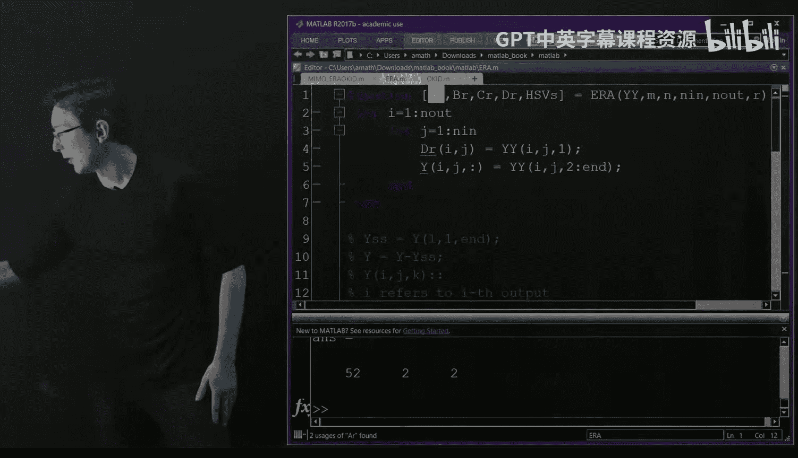
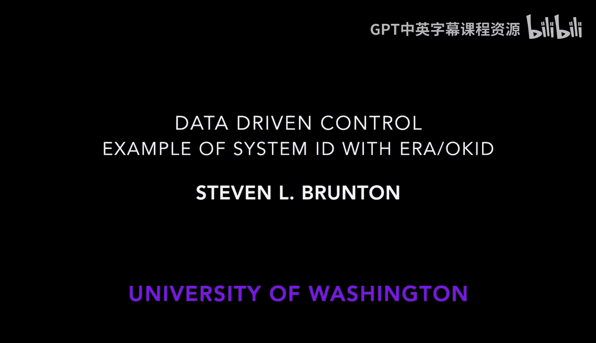

# 19：ERA与OKID的Matlab示例 🧪


在本节课中，我们将学习如何使用特征系统实现算法（ERA）和观测器卡尔曼滤波器辨识（OKID）进行线性系统辨识。我们将通过一个Matlab示例，展示如何仅利用数据来辨识一个系统的低阶状态空间模型。

## 概述

上一节我们介绍了ERA和OKID的理论基础。本节中，我们来看看如何在Matlab中实际应用这些方法。我们将使用一个具有100个状态、2个输入和2个输出的离散随机状态空间系统作为示例。我们将假装无法访问其原始的A、B、C、D模型矩阵，只能获得实验数据，并基于这些数据重建一个简化的10阶模型。

## 数据准备与系统辨识



首先，我们需要从系统中收集数据。在这个示例中，我们通过给系统施加脉冲输入来收集输出响应数据。

以下是数据收集与处理的步骤：

1.  **运行系统脉冲响应**：我们对完整的系统施加脉冲输入，并收集输出数据 `Y`。这是我们进行ERA辨识所需的唯一数据。
2.  **数据重塑**：收集到的原始数据需要被重塑为适合ERA算法的矩阵格式。对于一个有 `q` 个输入和 `p` 个输出的系统，每个时间步的测量值需要被排列成一个 `p x q` 的块矩阵。例如，在第一步（`k=0`），这个块就是 **D** 矩阵；在第二步（`k=1`），这个块对应 **C B**；在第三步（`k=2`），对应 **C A B**，依此类推。数据重塑是正确应用ERA和OKID的关键步骤。

```matlab
% 假设 Y 是收集到的原始脉冲响应数据
% 重塑数据以构建Hankel矩阵所需的块结构
% 此处代码会根据输入(q)和输出(p)的数量进行重塑
```

## 应用特征系统实现算法

一旦数据被正确重塑，应用ERA就变得非常简单。我们使用一段现成的 `era.m` 代码，它可以根据输出数据 `Y` 和目标模型阶数 `r`，计算出降阶后的 **A_red**、**B_red**、**C_red** 和 **D_red** 矩阵。

```matlab
% 设定目标模型阶数
r = 10;
% 运行ERA算法
[A_red, B_red, C_red, D_red] = era(Y, r);
```

运行这行代码后，我们就得到了一个简化的状态空间模型（`sys_ERA`），它可以用来模拟系统响应。

## 当只有随机输入输出数据时

在实际实验中，可能难以获得纯净的脉冲响应数据。更常见的情况是，我们拥有系统在某个随机输入序列 `U` 作用下的输出响应 `Y`。

以下是处理此类数据的步骤：

1.  **使用OKID估计脉冲响应**：我们使用另一段 `okid.m` 代码。给定测量值 `U` 和 `Y` 以及目标阶数 `r`，该代码会估计出系统的脉冲响应序列，并将其排列成矩阵 **H**。**H** 矩阵包含了 **D**、**C B**、**C A B**、**C A^2 B** 等序列信息。
2.  **将结果输入ERA**：将OKID得到的 **H** 矩阵直接输入到 `era.m` 函数中，即可得到辨识出的状态空间模型。

```matlab
% 假设 U 和 Y 是收集到的随机输入和输出数据
% 使用OKID从随机数据中估计脉冲响应
H = okid(U, Y, r);
% 将估计的脉冲响应输入ERA，得到模型
[A_red2, B_red2, C_red2, D_red2] = era(H, r);
```

## 结果验证与对比

现在，我们可以对比原始系统、基于脉冲响应的ERA模型以及基于随机数据的ERA-OKID模型的输出。

运行示例代码后，我们会得到对比图。图中显示：
*   蓝色曲线代表原始100阶系统的真实脉冲响应。
*   红色曲线代表仅使用脉冲响应数据通过ERA辨识出的10阶模型。
*   绿色曲线代表使用随机输入输出数据通过OKID+ERA辨识出的10阶模型。

可以观察到，两个低阶模型（红线和绿线）都非常准确地复现了原始高阶系统（蓝线）的动态响应。这表明，纯粹基于数据驱动的方法，结合ERA和OKID，能够有效地捕捉系统的核心动态特性，并生成可用于控制器设计的低阶模型。

## 总结

本节课中我们一起学习了如何在Matlab中实践数据驱动的系统辨识。
1.  我们首先从系统收集数据，无论是脉冲响应还是随机激励响应。
2.  接着，我们通过数据重塑将其转换为适合算法的格式。
3.  然后，我们应用**特征系统实现算法**直接从脉冲响应数据中辨识模型。
4.  当只有随机输入输出数据时，我们先用**观测器卡尔曼滤波器辨识**方法估计脉冲响应，再将其输入ERA。
5.  最后，我们验证了辨识出的低阶模型能够高度精确地匹配原始系统的动态行为。



这些方法建立在Hankel矩阵、汉克尔奇异值分解和平衡截断等坚实的线性代数基础之上，但在实践中，一旦准备好数据，只需一两行Matlab代码即可执行。请尝试将这些工具应用到你自己的数据或非线性系统中，通过实践来深入理解其能力和局限。