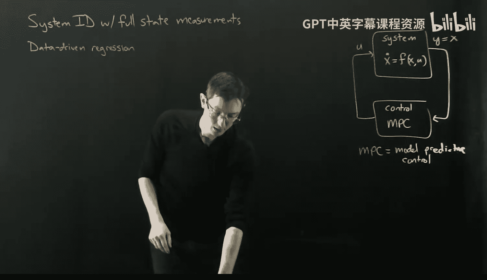

# 20：带控制的全状态模型系统辨识

欢迎回来。我们一直在讨论复杂系统的数据驱动建模与控制。这些系统可能是高维的，也可能是非线性的。我们一直在构建一个基本框架：存在一个系统和一个控制器。系统会产生测量值，即系统的输出 **Y**。然后，控制律会决定某种反馈信号，以驱动执行器 **U**，从而改变系统行为，以实现某个期望的目标。

需要记住的是，我们通常无法直接获得系统的运动方程。这不像打开教科书就能找到运动方程，然后据此设计控制律。因此，我们讨论的是如何从数据中发现系统模型。

之前我们讨论了平衡模型降阶和系统辨识，即给定输入 **U** 和输出 **Y**，尝试获得输入到输出动态的降阶模型。现在我们要讨论的内容略有不同但密切相关，这里我们假设可以获得**全状态测量**。也就是说，我们的测量值 **Y** 就是系统的**全部状态** **X**。这个状态可能是高维的，也可能是低维的，但我们假设测量不受限，可以实际测量整个系统。在大数据时代，这种情况越来越常见，你很可能在某些场景下拥有系统的全状态测量。

因此，我们将这种情况称为**带全状态测量的系统辨识**。当然，这里的最终目标是为了控制。我们不仅想辨识系统模型，更想获得系统的输入-输出动态模型，以便设计控制律。

通常，我们的系统模型由类似 **Ẋ = F(X, U)** 的方程给出。这是一个包含非线性动态 **Ẋ = F(X)** 的方程，但我们也需要考虑驱动 **U** 的影响。我们假设可以测量全状态 **X**，因此将使用数据科学和数据驱动的优化方法（如机器学习）来构建可用于控制的系统模型。

在这种情况下，我推荐使用**模型预测控制器**。MPC 是一个非常强大的控制优化框架。如果你拥有系统模型，你基本上可以为不同的驱动输入 **U** 运行一系列模型预测，然后针对某个短期控制信号优化 **U**，以最大化某个目标函数。模型预测控制非常强大，可用于非线性控制。我强烈建议你深入了解 MPC。

基本思路是，我们将讨论如何构建这些可能非线性的输入-输出动态的系统辨识模型，以便与模型预测控制结合使用。这里与之前通过平衡模型降阶进行系统辨识的区别在于，我们明确假设拥有全状态测量 **Y = X**。这与平衡截断、平衡 POD、特征系统实现算法等密切相关，但更具体地针对全状态测量的大数据场景。

我们将贯穿使用的一个关键工具是**数据驱动的回归**。这听起来可能有点高级，但本质上是指我们将使用**线性回归**，将数据拟合到这些模型上。我们将使用数据来拟合模型参数，并在线性回归中添加一些正则化项，例如，为了**促进稀疏性**（使模型中只包含少数项），或者**防止过拟合**。我们将使用现代回归方法从数据中找到这些模型。

接下来，我将概述在后续几讲中将要探讨的内容。

## 线性动态系统

在最简单的情况下，我们可能拥有线性动态系统。对于无驱动（无 **U**）的系统，我们可以写成 **Ẋ = A X**。我们可以直接构建模型 **Ẋ = A X**，这就是**动态模式分解**方法。

但在带全状态测量的系统辨识中，特别是为了**控制**，情况非常重要。我们不仅仅是在做无驱动的系统辨识，而是为了能够通过控制来修改系统。因此，在这种情况下，我们不仅要使用回归来构建动态系统 **A** 的模型，还要弄清楚输入如何影响系统。

我们将同时辨识 **+ B U** 项，这被称为**带控制的动态模式分解**。这是对 DMD 的一个相当直接的修改，允许我们也构建一个关于输入如何影响状态的线性模型。

## 非线性动态系统

对于非线性系统，存在多种新兴技术来辨识完整的非线性系统 **Ẋ = F(X)**。

如果只是 **Ẋ = F(X)**，我们本质上会采用类似**非线性动态稀疏辨识**的方法。该算法会构建一个包含所有可能描述动态的右侧函数的库，并使用稀疏回归来仅选择与 **Ẋ** 等于这些项相符的最少数量的非线性项。它本质上建立了一个稀疏回归来辨识动态系统中的非线性项。这种促进稀疏性的约束正则化了问题，防止了过拟合，并提供了一个可解释的模型，因为它只包含少数项，便于理解系统的非线性动态。这是一种简洁的非线性系统数据驱动回归方法。

我们还将讨论如何辨识控制的影响，这被称为**带控制的 SINDy**。

希望你能看到这里的主题：我们将采用动态模式分解算法并添加控制；我们将采用 SINDy 算法并添加控制；然后我们将展示一旦获得这些基于状态的模型，如何将它们放入模型预测控制框架中。

## 非线性系统的线性表示

最后一部分，我想讨论的是，如果我有一个非线性系统，但想要一个**非线性系统的线性表示**。

如果我想要非线性系统的线性表示，那么有**库普曼算子理论**。本质上，我可以获取测量值 **X**，并将其扩展为更大的测量值。我可以测量诸如 **X²**、**X³**、**X⁴** 等等。在系统所有可能测量的空间中，即使对于强非线性动态，动态实际上也会变得线性。

也就是说，如果我有足够丰富的测量值 **Y**，如果 **Y** 甚至比状态更大，像是所有可能对状态进行的测量，那么我就可以得到 **Ẏ = K Y**，其中 **K** 是这个大的**库普曼算子**。这实际上是这些非线性动态的一个线性表示。

关键在于，这个测量函数 **Y** 必须足够丰富，以使库普曼算子理论成立。通常，找到这些测量值以获得这种近似的线性表示可能相当具有挑战性。我们将讨论如何做到这一点，如何找到系统的良好测量值，使得即使是非线性系统看起来也是线性的。

然后，我们将讨论**如何添加控制**。关于如何在这里添加控制，我有点含糊其辞，因为这有点微妙。这被称为**带控制的库普曼方法**。

以上基本上是接下来几讲内容的概述。我们将进行系统辨识，包括线性和非线性系统辨识，针对我们假设拥有全状态测量但需要进行控制的系统。我们拥有全状态测量和某些输入 **U**，希望使用回归从数据中构建这些系统模型，然后将它们用于控制，例如使用模型预测控制。

这些内容将建立在其他相关讲座的基础上，例如关于动力系统、SINDy、DMD 和库普曼的独立讲座系列。但现在我们要讨论的是如何修改它们以添加控制。

谢谢。