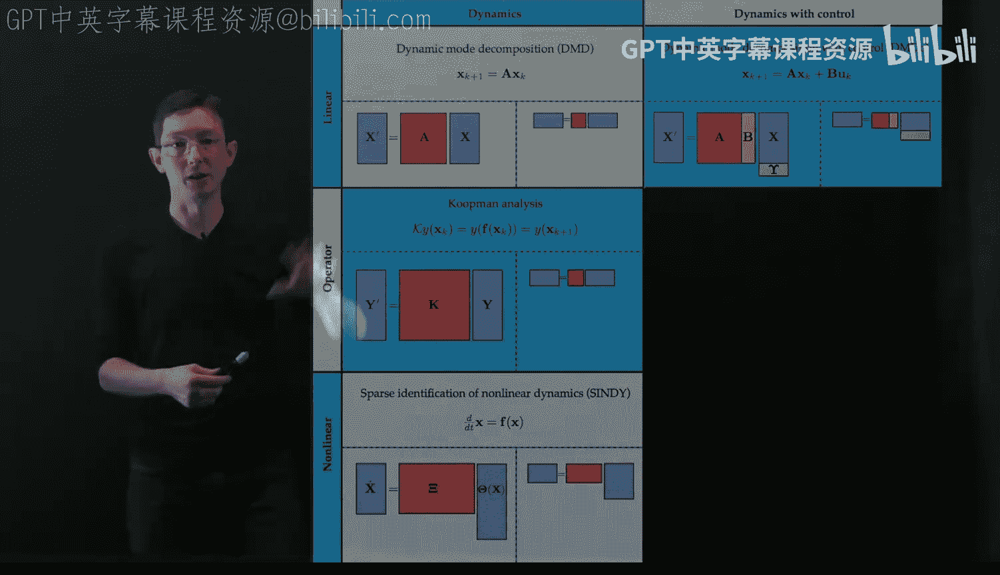

# 21：系统辨识与回归模型 📊

在本节课中，我们将学习如何利用数据驱动的回归方法进行系统辨识，特别是如何将线性、非线性以及库普曼（Koopman）算子模型扩展到包含控制输入的情况。

上一节我们介绍了基于全状态测量的数据驱动模型辨识。本节中，我们将通过一个图表来系统性地回顾和梳理这些方法，并重点讲解如何将它们扩展到包含控制输入的场景。

## 数据驱动回归框架概览

以下是三种主要的数据驱动回归方法，它们都旨在从数据中辨识出描述系统动态的模型。

### 动态模态分解（DMD）

动态模态分解（DMD）是一种线性回归方法，用于寻找一个线性算子 **A**，该算子能将当前状态 **X** 映射到下一个时间步的状态 **X'**。

其核心公式为：
**X' ≈ A X**

当数据维度很高时（例如流体模拟中有数百万个状态变量），直接计算 **A** 会非常昂贵且容易过拟合。因此，常见的做法是先对数据 **X** 进行降维处理。

以下是处理高维数据的步骤：
1.  对数据矩阵 **X** 进行奇异值分解（SVD），提取其主要相干结构。
2.  在降维后的坐标（例如POD系数）上进行DMD回归。
3.  这种方法结合了本征正交分解（POD）和DMD，是流体力学等领域的标准做法。

### 扩展动态模态分解（Extended DMD）

对于非线性系统，扩展DMD方法通过构建增广状态向量 **Y** 来获得其线性表示。**Y** 不仅包含原始状态 **x**，还包含其非线性函数（如 **x²**, **sin(x)** 等）。

其回归公式为：
**Y' ≈ K Y**

这里，**K** 是库普曼算子，它在增广的线性空间中描述了非线性系统的演化。同样，为了计算效率，我们也可以在降维后的坐标上进行此回归。

### 稀疏辨识非线性动力学（SINDy）

SINDy方法旨在直接辨识出完全非线性的动力学方程。它通过构建一个包含候选非线性函数的库 **Θ(X)** 来实现。

其核心思想是求解以下稀疏回归问题：
**Ẋ = Θ(X) Ξ**

目标是找到最稀疏的系数矩阵 **Ξ**，使得 **Θ(X) Ξ** 能够以最简洁的形式匹配观测到的导数数据 **Ẋ**。对于高维数据，同样可以先进行POD或SVD降维，再对降维后的坐标应用SINDy。

## 扩展到包含控制输入

之前讨论的方法都未考虑控制输入。现在，我们将探讨如何将它们扩展到包含驱动项 **Bu** 的受控系统，其一般形式为 **ẋ = Ax + Bu** 或 **ẋ = f(x, u)**。

### DMD with Control

如果我们不仅测量了状态序列 **X** 和 **X'**，还测量了同一时间段内的控制输入序列 **Υ**，我们就可以同时辨识出 **A** 和 **B** 矩阵。

其回归公式扩展为：
**X' ≈ A X + B Υ**

这种方法被称为带控制的DMD（DMDc）。它能同时辨识系统内部动态（**A**）和控制输入的影响（**B**），是Josh Proctor等人早期的重要扩展。

### 扩展到库普曼与SINDy框架

类似的扩展思想也适用于库普曼和SINDy框架。

1.  **对于扩展DMD**：我们可以将控制输入 **u** 也纳入增广状态向量中，构建如 **[Y; u]** 的形式，然后进行回归以同时辨识状态和控制的动力学。
2.  **对于SINDy**：我们可以构建一个同时包含状态 **x** 和控制 **u** 的候选函数库 **Θ(X, U)**，例如包含 **x**, **u**, **x u**, **u²** 等项。

然后通过稀疏回归求解：
**Ẋ = Θ(X, U) Ξ**

从而得到稀疏的非线性受控系统模型 **ẋ = f(x, u)**。

## 总结与应用展望

本节课中，我们一起学习了数据驱动系统辨识的回归框架。我们回顾了三种核心方法：动态模态分解（DMD）、扩展DMD和稀疏辨识非线性动力学（SINDy），并重点讲解了如何将它们扩展到包含控制输入的情形。

这个统一的框架允许我们根据系统特性（线性/非线性）和数据条件，选择合适的方法来辨识出 **ẋ = Ax + Bu** 或 **ẋ = f(x, u)** 形式的模型。这些从数据中直接学习得到的模型，将为后续应用模型预测控制（MPC）等先进控制策略来驾驭高维、复杂的非线性系统奠定坚实的基础。