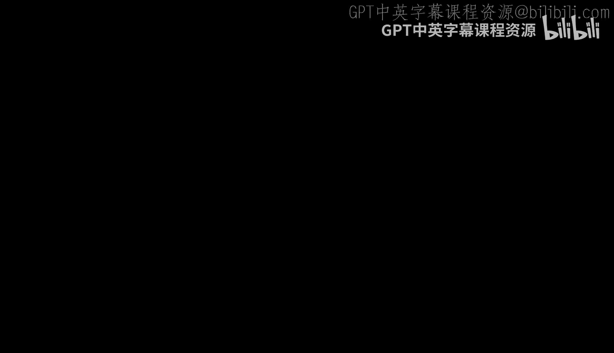

# 22：带控制的动态模态分解系统辨识

在本节课中，我们将学习一种名为“带控制的动态模态分解”的系统辨识方法。该方法利用系统状态和外部控制输入的测量数据，通过回归求解出最能拟合观测数据的线性动力学系统模型。我们将了解其基本原理、两种主要应用场景，以及在实际应用中需要注意的关键点。

## 概述与数据准备

上一节我们讨论了基于全状态测量的系统辨识。本节中，我们来看看一种具体的线性系统辨识方法：带控制的动态模态分解。

该方法由Josh Proctor等人于2016年提出。其核心思想是，当我们拥有系统状态随时间演化的测量值 `X` 以及控制输入 `U` 随时间演化的测量值时，可以通过回归来求解最能拟合这些观测数据的 `A` 和 `B` 矩阵，从而找到最优的线性动力学系统模型。

通常，我们在离散时间框架下处理这个问题。因此，动力学系统可以表示为：
`x_{k+1} = A x_k + B u_k`

以下是该方法所需的输入数据：

*   **状态快照矩阵 `X`**：包含系统状态在不同时间点的测量值，时间从左到右递增。
    `X = [x_1, x_2, ..., x_m]`
*   **状态快照矩阵 `X'`**：`X` 矩阵在时间上向前平移一个时间步长 `Δt` 的版本。
    `X' = [x_2, x_3, ..., x_{m+1}]`
*   **控制输入快照矩阵 `Υ`**：包含控制输入在不同时间点的测量值。
    `Υ = [u_1, u_2, ..., u_m]`

`X` 和 `X'` 是标准动态模态分解的输入。现在，我们增加了控制输入矩阵 `Υ`，这有助于区分系统自然动力学和外部控制的作用。

## 核心公式与求解思路

利用这些数据矩阵，我们可以将离散时间动力学系统直接写成矩阵方程的形式：
`X' = A X + B Υ`

这是一个矩阵方程组。如果我们已知动态模态分解的基本原理（即求解 `X' = A X`），那么现在只是增加了 `B Υ` 项。

接下来，我们根据对 `B` 矩阵的了解程度，分两种情况讨论求解方法。

## 情况一：已知 `B` 矩阵

在第一种情况下，我们假设已知控制输入矩阵 `B`，但未知系统动力学矩阵 `A`。

如果已知矩阵 `B`，我们可以对已知的控制效应进行校正。具体做法是将 `B Υ` 项移到等式左边：
`X' - B Υ = A X`

此时，等式左边 `X' - B Υ` 和 `X` 都是已知或可计算的量，`A` 是唯一的未知量。因此，我们可以将这个修正后的 `X' - B Υ` 视为新的状态演化矩阵，然后应用标准的动态模态分解流程来求解 `A`。如果系统维度很高，我们还可以求解 `A` 的主导特征值和特征向量，以获得降阶表示。

**总结**：当已知 `B` 矩阵并拥有控制输入的时间序列测量值时，我们可以简单地减去控制效应，然后像处理标准动态模态分解一样求解 `A`。这种情况相对简单。

## 情况二：未知 `B` 矩阵

在第二种情况下，我们既不知道 `A` 矩阵，也不知道 `B` 矩阵。

当 `B` 未知时，我们需要更巧妙的方法。Josh Proctor 提出的方案是将问题重新组织。具体做法是构建一个增广的未知矩阵 `[A B]` 和一个增广的已知数据矩阵 `[X; Υ]^T`（即 `X` 和 `Υ` 的纵向堆叠）。这样，原方程可以重写为：
`X' = [A B] * [X; Υ]^T`

此时，我们已知 `X'` 和堆叠后的数据矩阵 `[X; Υ]^T`，未知的是包含 `A` 和 `B` 的增广矩阵。然后，我们可以在这个框架下运行动态模态分解算法，通过数据驱动的回归同时求解出 `A` 和 `B`。这涉及到对该数据矩阵进行奇异值分解、求伪逆等数学操作。无论哪种情况，最终都可以获得 `A` 和 `B` 矩阵，并进一步提取 `A` 的主导特征值和特征向量来构建线性降阶模型。

## 方法的重要性与注意事项

这种方法有几个非常重要的特点。

首先，**考虑控制输入至关重要**。如果我们不考虑 `+ B U` 项，而直接对受控系统应用标准的动态模态分解来求解 `A` 矩阵，那么得到的 `A` 矩阵将会被未考虑的控制效应所“污染”，从而得出错误的结果。我们将在后续的MATLAB演示中对比这种情况：对受控系统进行“天真”的动态模态分解会得到错误答案，而使用带控制的校正动态模态分解则能得到正确的 `A` 动力学。

其次，存在一个**根本性的模糊性问题**。我喜欢这样理解：如果我们实施的是反馈控制，即 `u_k = K x_k`，那么动力学方程变为：
`x_{k+1} = A x_k + B K x_k = (A + B K) x_k`
这意味着，如果我们在不考虑输入数据 `U` 的情况下，天真地对数据 `X` 进行动态模态分解，我将得到错误的动力学（即修改后的 `A + B K`），而不是原始的 `A` 和 `B` 矩阵。从回归的角度看，对于一个 actively controlled 的系统，`x_{k+1} = (A + B K) x_k` 和 `x_{k+1} = A x_k`（无激励）都可能成为数据的有效解。

因此，**当系统处于主动反馈控制（`U = KX`）时，我们必须偶尔对控制输入施加“扰动”或“激励”**。通过偶尔“踢”一下 `U`，我们可以测量系统的瞬态响应，从而从系统中获取更多信息，以消除 `A` 和 `B` 之间的模糊性。

## 总结

本节课中，我们一起学习了一种从数据中辨识 `A` 和 `B` 模型的程序——带控制的动态模态分解。

我们了解到，如果系统处于主动反馈控制之下（`U = KX`），则存在根本性的辨识模糊性。为了解决这个问题，我们需要偶尔对控制输入施加扰动，以获取足够的信息来区分 `A` 和 `B`。随后，我们可以将这些辨识出的模型直接用于模型预测控制，或用于理解系统的底层动力学和敏感性。