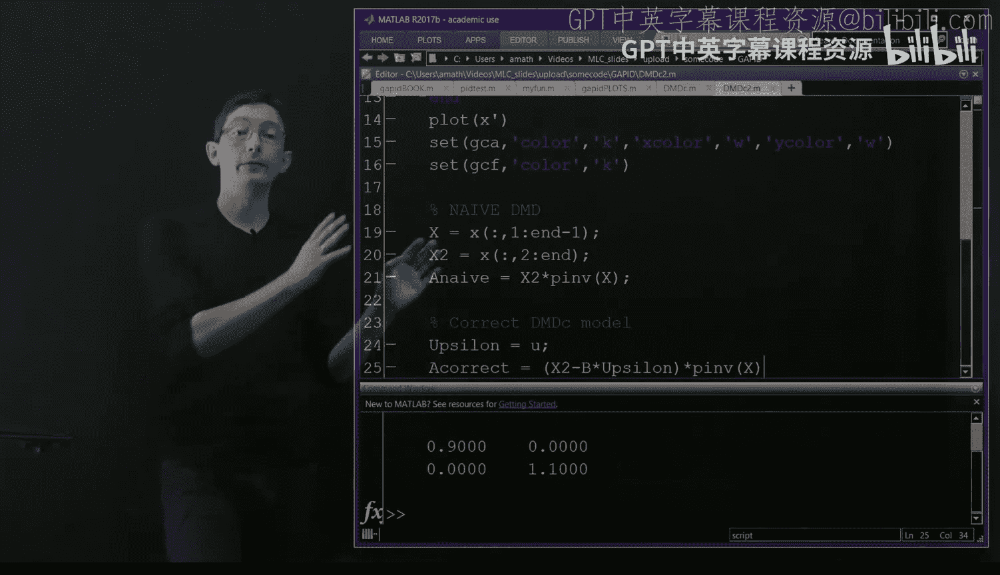

# 23：系统辨识_DMD控制示例 🎯

在本节课中，我们将学习如何应用带控制的动态模态分解（DMDc）进行系统辨识。我们将通过一个简单的MATLAB示例，演示如果忽略控制输入而直接应用DMD会得到什么错误结果，以及如何通过DMDc方法进行修正，从而获得真实的系统动态模型。

## 系统设置与问题引入

上一节我们介绍了带控制的动态模态分解（DMDc）的基本概念。本节中，我们来看看一个具体的数值示例。

我们有一个离散时间系统，其动态由以下方程描述：
`x_{k+1} = A * x_k + B * u_k`
其中，状态矩阵A是一个2x2矩阵：
`A = [0.9, 0; 0, 1.1]`
输入矩阵B为：
`B = [0; 1]`
这是一个不稳定的系统，因为矩阵A的一个特征值（1.1）的模大于1。

我们假设系统运行在一个反馈控制律下：
`u_k = -K * x_k`
其中增益矩阵K为：
`K = [0, 0.3]`
因此，闭环系统方程为：
`x_{k+1} = (A - B*K) * x_k`
这个闭环系统是稳定的。

## 生成闭环系统数据

以下是生成仿真数据的步骤：

1.  设定初始状态 `x_1 = [10; 10]`。
2.  进行10个时间步的迭代。
3.  在每个时间步k，计算控制输入 `u_k = -K * x_k`。
4.  根据动态方程计算下一个状态 `x_{k+1} = A * x_k + B * u_k`。

运行仿真后，我们绘制状态随时间的变化。由于反馈控制的作用，状态会呈现稳定的衰减趋势。从数据中，我们无法直接看出开环系统本身是不稳定的。

## 应用朴素DMD（忽略控制）

现在，我们尝试在不知道存在控制输入的情况下，对收集到的闭环数据应用标准的DMD方法。

DMD的核心是寻找一个矩阵A_naive，使得 `X' ≈ A_naive * X`。其中：
*   `X` 是状态数据矩阵，包含从时间步1到n-1的快照。
*   `X'` 是状态数据矩阵，包含从时间步2到n的快照。

计算A_naive的公式为：
`A_naive = X' * pinv(X)`
其中 `pinv` 表示伪逆。

运行此计算后，我们发现得到的A_naive矩阵的特征值是稳定的。这实际上是闭环系统 `(A - B*K)` 的模型，而不是真实的、不稳定的开环系统矩阵A。这就是朴素应用DMD会带来的错误。

## 应用带控制的DMD（DMDc）进行修正

为了获得真实的系统动态，我们需要应用DMDc方法。此方法要求我们知道控制输入序列 `U`（即Opsilon）和输入矩阵 `B`。

DMDc的核心思想是重构方程：
`X' - B * U ≈ A * X`
其中 `U` 是控制输入数据矩阵。

因此，修正后的矩阵A_correct可以通过以下公式计算：
`A_correct = (X' - B * U) * pinv(X)`

运行此计算后，我们得到的A_correct矩阵与最初定义的真实矩阵A完全一致，它正确地包含了一个不稳定的特征值（1.1）。这表明DMDc成功地从不稳定的闭环数据中辨识出了不稳定的开环动态。

## 总结与讨论

本节课中，我们一起学习了如何通过一个简单的MATLAB示例实现带控制的动态模态分解（DMDc）。

我们首先设置了一个不稳定的开环系统，并通过反馈控制使其稳定。然后，我们生成了该闭环系统的数据。如果忽略控制输入，直接应用标准DMD，会错误地将稳定的闭环动态识别为系统模型。最后，通过引入已知的控制输入数据和输入矩阵B，并应用DMDc公式进行修正，我们成功地恢复了真实的不稳定开环系统模型。

这个例子清晰地展示了在存在持续控制作用的情况下进行系统辨识的挑战，以及DMDc方法在解决这一问题上的有效性。它强调了在分析受控系统数据时，考虑控制输入影响的必要性。