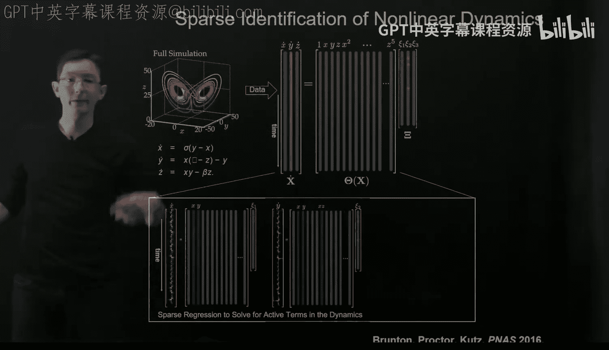
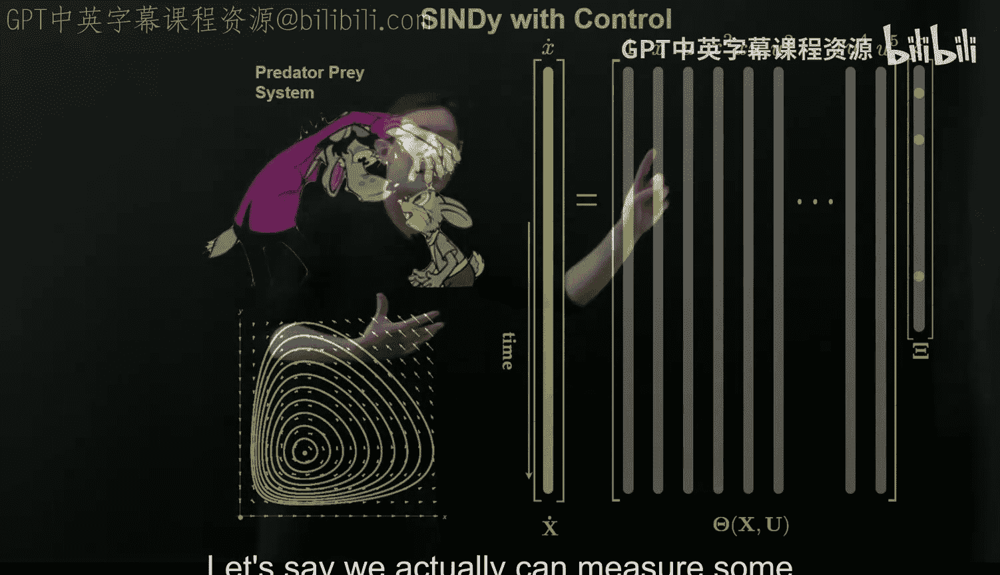
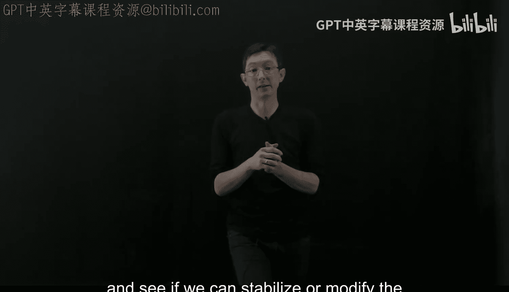

# 25：带控制的稀疏非线性模型系统辨识

在本节课中，我们将学习如何利用数据驱动的回归方法，为模型预测控制获取模型。具体来说，我们将探讨一种名为“带控制的稀疏非线性动力学辨识”的方法，它能够从纯数据中识别出完全非线性的系统模型。

上一节我们介绍了带控制的DMD和库普曼算子方法，本节中我们来看看如何将稀疏辨识技术应用于带控制的非线性系统。

## 原始SINDy方法概述

SINDy方法的基本思想是，如果我们拥有某个非线性动力系统的测量数据，我们可以将这些数据整理成随时间演化的高维列向量。例如，对于三个状态变量x、y、z，我们有它们随时间变化的数据以及它们的时间导数ẋ、ẏ、ż。

SINDy方法的核心是构建一个非线性函数库矩阵 **Θ(X)**，其中包含了所有可能出现在系统动力学方程右侧的候选函数。这些函数可以用数据来评估。然后，它使用稀疏回归技术，从函数库中找出最少的列，这些列能够分别拟合出ẋ、ẏ和ż。

**公式表示：**
`Ẋ = Θ(X)Ξ`

其中，`Ξ` 是一个稀疏系数矩阵，每一列对应一个状态变量导数的拟合系数。通过求解这个稀疏回归问题，我们可以恢复出与原始系统一致的动力学方程，并识别出正确的非线性结构。这是一种纯粹从数据出发的非线性系统辨识方法。

一旦我们构建了这个函数库，问题本质上就变成了一个大型的线性方程组 `AX = B` 求解问题。

需要注意几点：
*   该方法同样适用于离散时间系统，此时状态方程形式为 `X_{k+1} = f(X_k)`。
*   接下来，我们将介绍如何将SINDy算法应用于带控制和激励的系统辨识。

## 带控制的SINDy方法

带控制的SINDy是原始SINDy的一个改进版本。现在，我们的函数库不仅包含状态变量x的函数（如x, x², x³等），还允许包含与激励U相关的交叉项。

以下是构建函数库时可以考虑的项：

*   状态变量本身（如x, y, z）
*   状态变量的多项式项（如x², xy, y³）
*   控制输入本身（如u）
*   状态与控制输入的交叉项（如xu, x²u, yu）

这个函数库的构建仅受限于你的想象力，它不一定非得是多项式，也可以包含正弦、余弦、正切、贝塞尔函数等任何你认为合适的函数。

带控制SINDy的思想是，应用相同的稀疏回归程序，从函数库矩阵中找出最少的列，以最佳地拟合测量状态向量X的时间导数。

## 示例：带控制的捕食者-猎物模型

我们将通过一个简单的系统来演示这个方法。经典的捕食者-猎物（Lotka-Volterra）模型会产生种群数量的相位滞后振荡。

原始SINDy可以毫无问题地从数据中识别出Lotka-Volterra动力学。但现在假设我们有一些激励和控制，正在通过反馈控制主动修改系统。例如，在种群动力学中，我们可能正在主动猎杀狼。

在这个测试案例中，我们写下带有控制输入U的方程，并模拟它们以生成数据。从时间0到100，我们采用一种控制策略（例如，积极捕猎狼）。在时间步100，控制策略改变。因此，0到100是训练数据，100到200是验证数据。

关键发现是：
*   如果我们使用原始的、未考虑控制输入的SINDy方法，模型在训练期间可以拟合得很好。
*   但是，当控制输入U切换后，这个SINDy模型开始发散，因为它本质上没有捕捉到控制变量U正在驱动系统这一事实。
*   相比之下，带控制的SINDy模型知道存在一个影响系统的U。只要我测量了这个U，我就能准确地预测未来不同控制策略下的系统行为，因此蓝色（带控制SINDy）的预测与验证数据吻合良好。

## 方法总结与图示

带控制的SINDy方法的核心是构建一个增强的函数库，它不仅包含状态动力学，还考虑了激励作用。这样，当测量动力学数据并训练模型时，它能够区分内部非线性动力学和激励控制的影响。因此，如果我在某个时间点改变控制策略，我的带控制SINDy模型能够进行补偿，而原始的SINDy模型则会失败。

下图是Erika Kaiser在相关论文中为洛伦兹系统制作的示意图，清晰地展示了带控制SINDy的流程：

流程描述：
1.  数据收集：收集状态X, Y, Z和控制输入U的数据。
2.  构建增强库：构建包含状态和控制非线性函数的增强库矩阵 **Θ(X, U)**。
3.  稀疏回归：通过稀疏回归，同时识别出无激励的动力学和激励的作用效果。

带控制的SINDy是一种强大的数据驱动回归技术，它允许你识别非线性输入输出模型，即一个非线性动力系统及其可能非线性的激励效应。

## 后续应用

我们接下来可以做的就是，将这些带控制的SINDy模型嵌入模型预测控制器中，看看我们是否能够稳定或改变强非线性系统的行为。

本节课中我们一起学习了带控制的稀疏非线性动力学辨识方法。我们了解到，通过构建包含状态和控制变量的增强函数库，并利用稀疏回归，可以从数据中同时辨识出系统的内部动力学和外部控制作用，从而为基于数据的模型预测控制提供了更强大的非线性模型基础。

