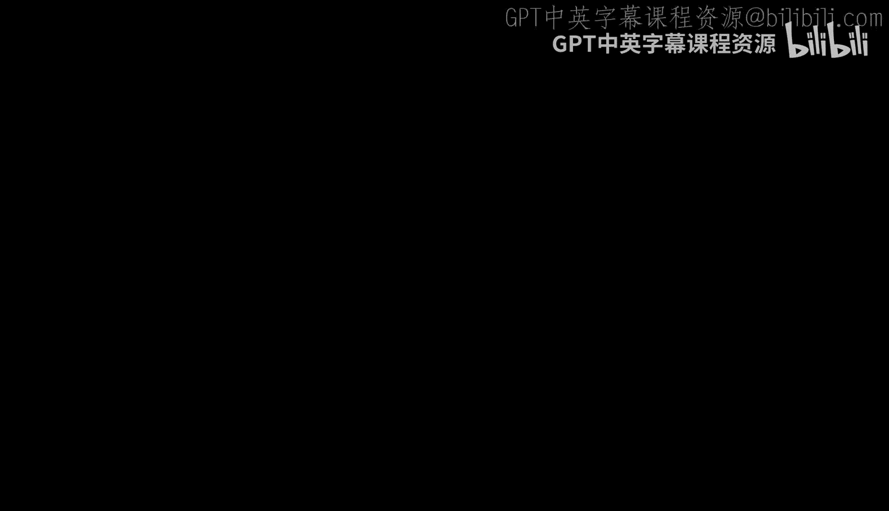
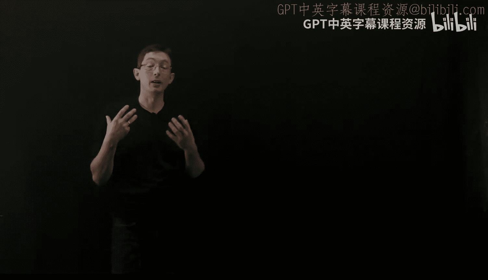
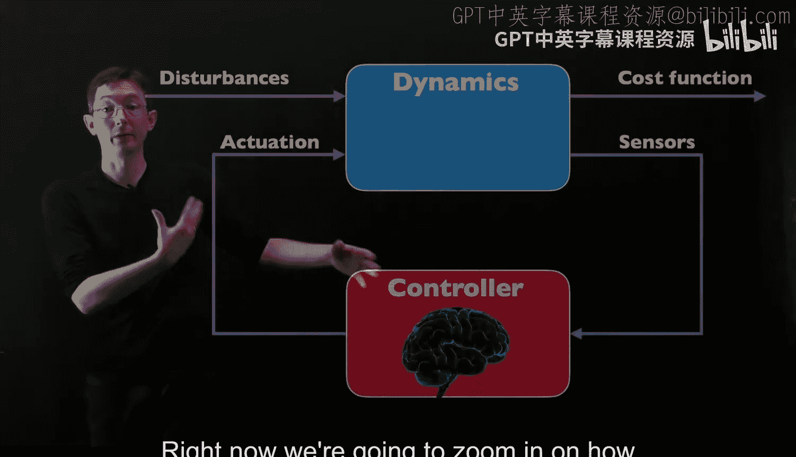
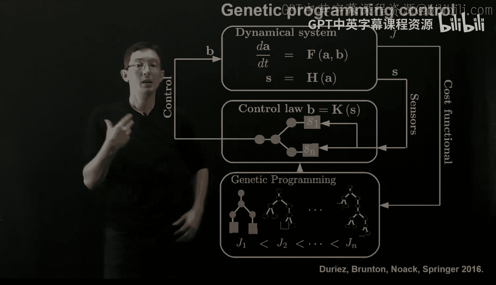
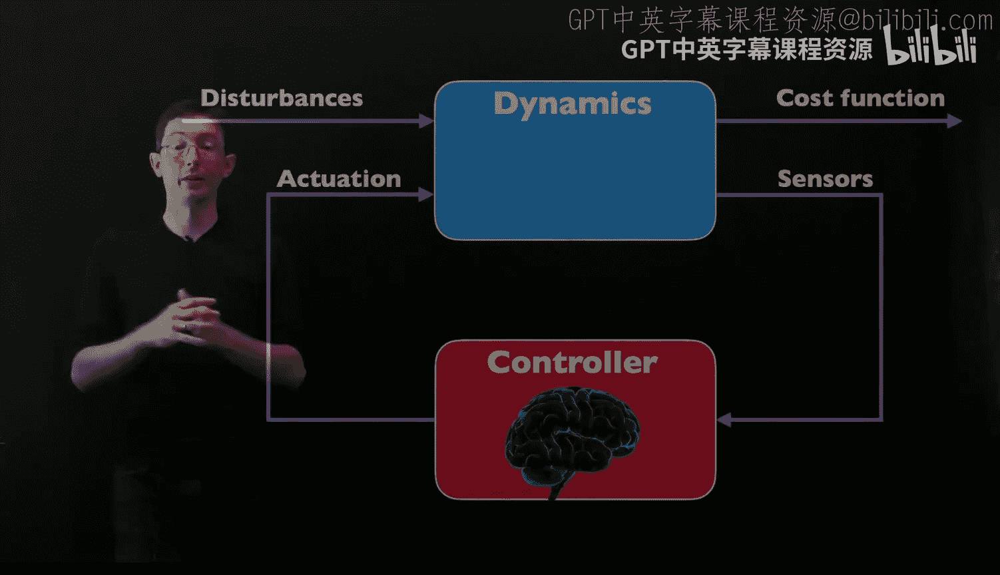

# 27：概述 🧠

在本节课中，我们将要学习如何绕过复杂的系统建模过程，直接利用数据和机器学习技术来设计有效的控制律。我们将探讨这种方法的动机、适用场景以及核心的实现思路。

---

上一节我们介绍了基于数据的系统辨识。本节中我们来看看如何将机器学习直接应用于控制器设计。

我们首先回顾基本的反馈控制框图。你有一个动态系统，它可能是复杂、非线性、多尺度、高维的。系统会受到一些扰动，例如阵风或不可测的参数变化。你有一个想要优化的高层目标函数。控制的目标是基于系统的传感器测量，设计一个控制律，通过执行器（你的控制旋钮）来驱动系统。

我们之前讨论的是如何使用数据驱动方法和机器学习来辨识系统动态模型，进而设计控制器。但今天我们将讨论一种不同的思路：不费力地精确辨识系统动态模型，而是直接使用统计和机器学习优化方法来设计有效的控制律，并将其应用于未知的动态系统。

以下是采用这种直接优化控制律方法的一些动机：
*   **动态系统难以精确建模**。在许多情况下，预测和理解物理系统所需的模型远比控制系统所需的模型复杂得多。花费大量时间获得一个精确描述物理系统的模型，对于控制设计而言可能是过度的。
*   **鲁棒控制可以处理模型不确定性**。鲁棒控制理论能够处理大量的模型不确定性和未建模动态。因此，将大量精力花在动态系统建模上可能不是最佳的时间利用方式。
*   **控制会改变系统动态**。控制的目的是测量系统并驱动它改变动态。例如，对于一个火箭，其自然动态是不稳定的，而控制的目标是使其变为稳定动态。如果在施加控制前花费大量时间辨识系统，那么一旦施加控制，动态可能会发生巨大变化，出现前所未有的新现象，导致之前建立的动态模型迅速失效。这在复杂高维非线性系统（如政治系统、金融市场或疾病模型）中尤其明显。

因此，与其将所有精力投入动态建模，不如更多地尝试直接利用数据设计有效的控制律。

这种思路的灵感来源于，在现代许多感兴趣的系统中，实际上有可能尝试大量不同的控制律并收集数据。例如，在湍流控制问题中，湍流是一个极具挑战性的高维动态系统，很难建立适用于控制的降阶模型。但在现代实验中，你可以在风洞或水槽中，在10秒或半分钟内尝试一个控制律，并立即知道它是否有效优化了目标函数。在这种时间尺度下，你可以尝试成百上千种不同的控制律，并利用这种数据驱动的机器学习优化架构，从大量候选控制律中筛选并精炼出非常有效的控制律。

其核心思想是：如果你有一个良好的控制器参数化空间（即一组定义控制器家族的参数），你可以直接在这些控制器上运行数据驱动的机器学习优化，然后将优化后的控制器应用于你的系统。

当然，这种方法并非适用于所有系统。以下是它可能不适用的情况：
*   **存在伦理问题的系统**。例如，在疾病建模中，尝试一千个可能无效的候选控制策略是不道德的，因为这可能浪费资源并伤害人群。
*   **高风险系统**。例如，在神经控制（如阻止癫痫发作）或核反应堆控制中，基于试错的策略可能带来灾难性后果。

对于高风险系统，一种可行的替代方案是：先利用机器学习建立一个**代理模型**，然后在仿真中对这个代理模型使用机器学习控制优化方法，而无需让真实系统承担风险。

展望未来5到20年的发展方向，我主张采用一种**混合方法**：同时学习系统动态和控制律。这更接近人类的学习方式。例如，在学习打网球时，我们脑中有一个基本的物理模拟器，可以预测在不同控制输入下可能发生的情况。我们可以在后台运行优化来寻找更好的控制律，然后定期进行真实练习，用真实数据精炼策略，并实时更新模型和控制律。这就是当前的发展趋势。

接下来的几节课，我们将聚焦于如何使用机器学习进行控制。其中一个特别有趣和令人兴奋的方向是使用**进化算法和遗传算法**进行控制。

这是一个通用的示意图：我有一个动态系统、一个控制律和某个成本函数 **J**。我运行一个元学习算法（遗传编程算法），尝试许多不同的控制律，但通过这种有针对性的、优化的试错过程，最终学习到一个有效的控制律。

我们将详细讨论遗传算法、遗传编程及其在控制中的应用。我们将在Matlab中创建一些简单的示例（例如PD控制），并介绍它如何被用于湍流控制。

当然，你还可以做更多。除了遗传编程优化，你也可以构建一个**神经网络**作为控制器来驱动动态系统。或者，在某些情况下，如果成本函数 **J** 的“地形”非常复杂（例如，在下棋中如何瞬间判断棋盘局势的好坏），你可以使用神经网络来学习这个成本函数景观。然后，在更好地了解系统或 **J** 之后，你可以使用强化学习或模型预测控制等方法。这正是当前深度强化学习和深度模型预测控制正在做的事情：它们使用深度神经网络来处理控制律中难以建模的部分（在强化学习中，这部分通常是价值函数景观）。

再次强调，控制是受动力学约束的优化，而机器学习是基于数据的优化。真正有趣的控制问题是非线性优化问题。幸运的是，机器学习正基于我们能收集到的大量数据，为我们提供越来越好的非线性优化技术。

这就是我们接下来要做的：讨论如何直接使用机器学习和数据驱动优化来寻找良好的控制律，而无需系统的动态模型。

---

本节课中我们一起学习了机器学习控制的核心概念：绕过精确的系统建模，直接利用数据优化控制律。我们探讨了这种方法的优势、局限性以及未来的混合发展方向。接下来的课程将深入讲解遗传算法等具体实现技术。