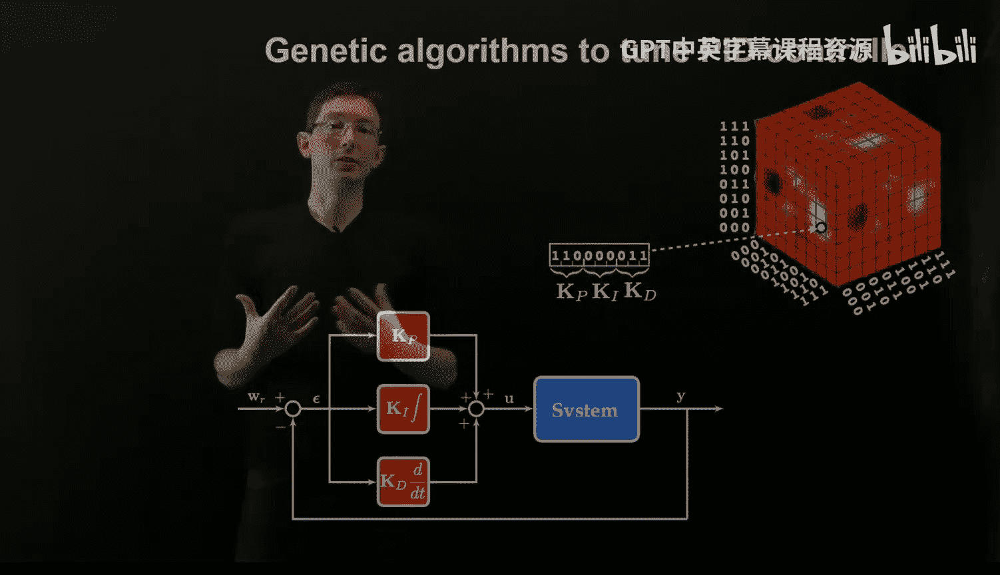
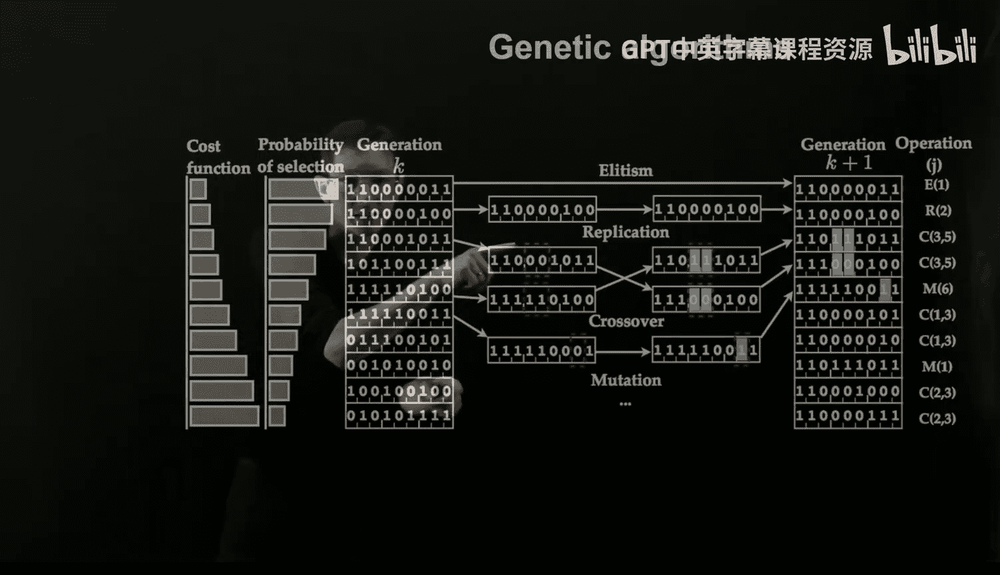

# 28：遗传算法 🧬

在本节课中，我们将学习如何使用遗传算法来设计有效的控制律。遗传算法是一种受自然选择启发的优化技术，特别适用于在高维参数空间中寻找最优解。我们将从一个简单的PID控制器调优示例开始，逐步讲解遗传算法的核心概念和工作流程。

上一节我们介绍了机器学习控制的基本概念，本节中我们来看看遗传算法的具体原理。

## 遗传算法概述

遗传算法基于自然选择的生物学原理。它从一个初始的“种群”（即一组候选控制律）开始，评估每个个体的性能（即“适应度”），然后通过一系列“遗传操作”（如选择、交叉、变异）来生成新的、性能可能更优的下一代种群。这个过程会迭代进行，使种群的整体性能逐代提升。

## 算法流程详解

以下是遗传算法的主要步骤，我们将结合PID控制器调优的例子进行说明。

### 1. 问题参数化与编码

首先，需要确定控制律的结构并将其参数化。在PID控制器的例子中，我们锁定了控制律的结构为 **`u = Kp * e + Ki * ∫e dt + Kd * de/dt`**，需要优化的参数是三个增益值：`Kp`、`Ki` 和 `Kd`。

接着，将这些参数编码成类似DNA的序列。例如，可以将每个参数值转换为二进制字符串。这定义了一个高维的参数空间，我们的目标是在这个空间中找到使目标函数（如控制误差的积分）最优的“热点”区域。

### 2. 初始化种群

算法开始时，随机生成第一代（Generation 0）种群。种群大小可根据计算成本调整。例如，我们随机生成10组 `[Kp, Ki, Kd]` 参数。

### 3. 评估适应度

对种群中的每一个个体（即每一组参数），在系统（仿真或实物）上运行并评估其性能。性能通过一个成本函数 `J` 来衡量，例如系统误差的积分。成本越低，表示适应度越高。

评估完成后，根据成本对种群中的所有个体进行排序。

### 4. 遗传操作生成下一代

基于个体的适应度（成本高低），以一定的概率选择它们参与生成下一代。适应度高的个体被选中的概率更大。以下是几种核心的遗传操作：

*   **精英保留**：直接将当代中适应度最高的一个或几个个体复制到下一代，确保最优解不会丢失。
*   **复制**：以一定的概率随机选择个体，并将其原样复制到下一代。适应度高的个体被复制的概率更高。
*   **交叉**：类似于有性繁殖。随机选择两个适应度较高的父代个体，交换它们部分“基因”（参数编码片段），从而产生两个新的子代个体。其思想是组合父代的优良特性。
*   **变异**：随机选择一个个体，并随机改变其编码序列中的某些部分（例如翻转几个比特位）。这有助于探索参数空间中的新区域。

在创建下一代时，我们会设定这些操作发生的概率（例如，60%交叉，30%变异，10%复制），然后通过“掷硬币”的方式为每个新个体的产生决定采用哪种操作。

### 5. 迭代优化

用新生成的种群（Generation K+1）取代旧种群（Generation K），重复步骤3和4。如此循环迭代，种群的整体适应度会逐渐提高，参数会收敛到最优解附近。

## 探索与利用的平衡

遗传算法中，交叉和变异扮演着互补的角色：
*   **交叉主要偏向“利用”**：它组合已知的优秀基因片段，旨在当前找到的优质解附近进行深度挖掘，找到更优解。
*   **变异主要偏向“探索”**：它引入随机变化，有助于跳出局部最优解，探索参数空间中未被发现的可能更优的区域。

通过调整交叉和变异操作的概率，可以控制算法是更倾向于深度开发当前区域，还是更广泛地探索未知空间。

## 总结

本节课中我们一起学习了遗传算法的基本原理。我们了解到，遗传算法通过模拟自然进化过程，在锁定的控制律结构下，优化其参数。其核心步骤包括：**参数编码、初始化种群、评估适应度、通过选择/交叉/变异等操作生成下一代**，并**迭代循环**。交叉和变异的巧妙结合平衡了“利用”与“探索”，使其能够有效处理高维优化问题。在接下来的课程中，我们将通过MATLAB实例来具体实现这一过程。