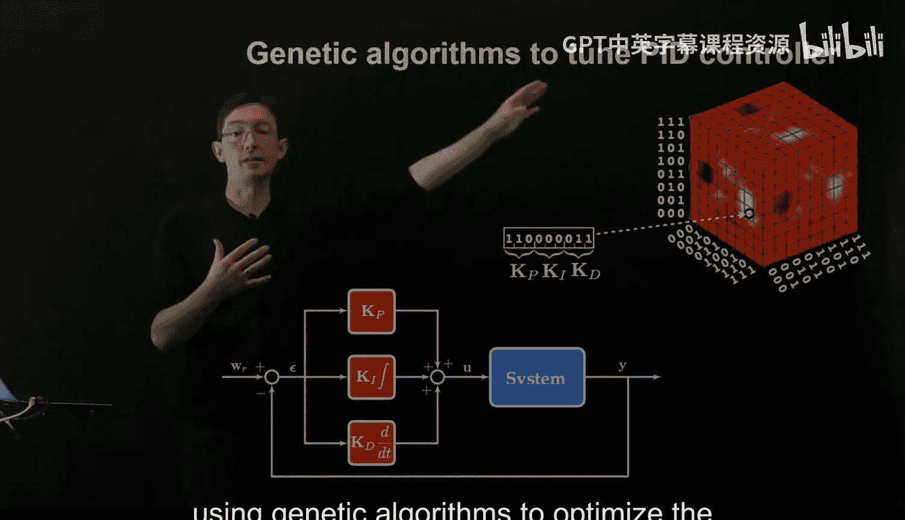
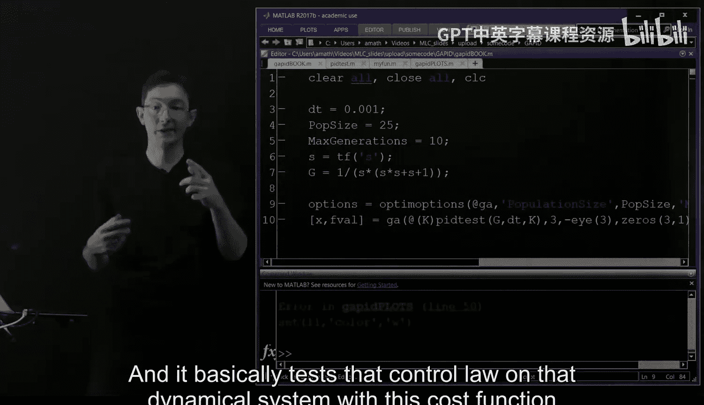
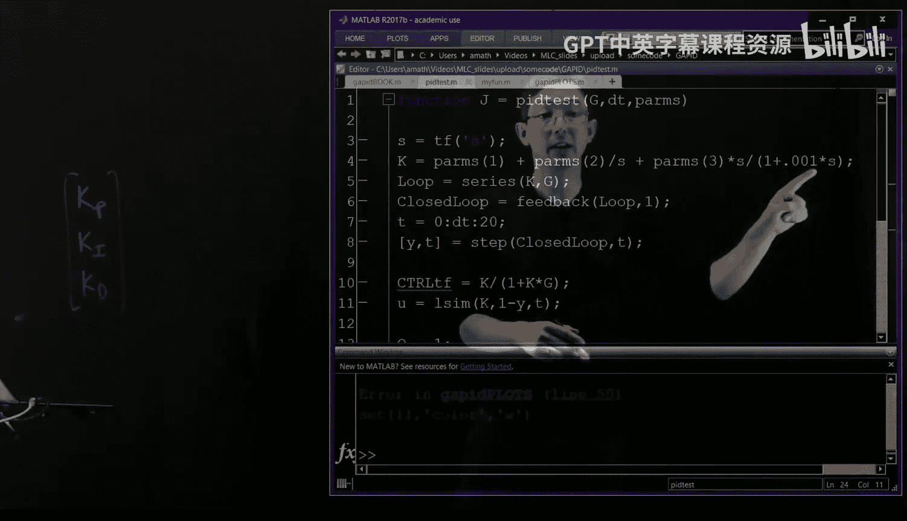
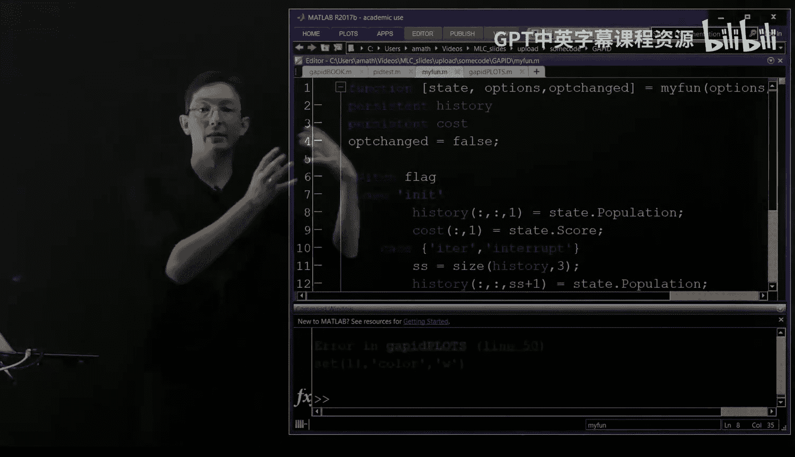
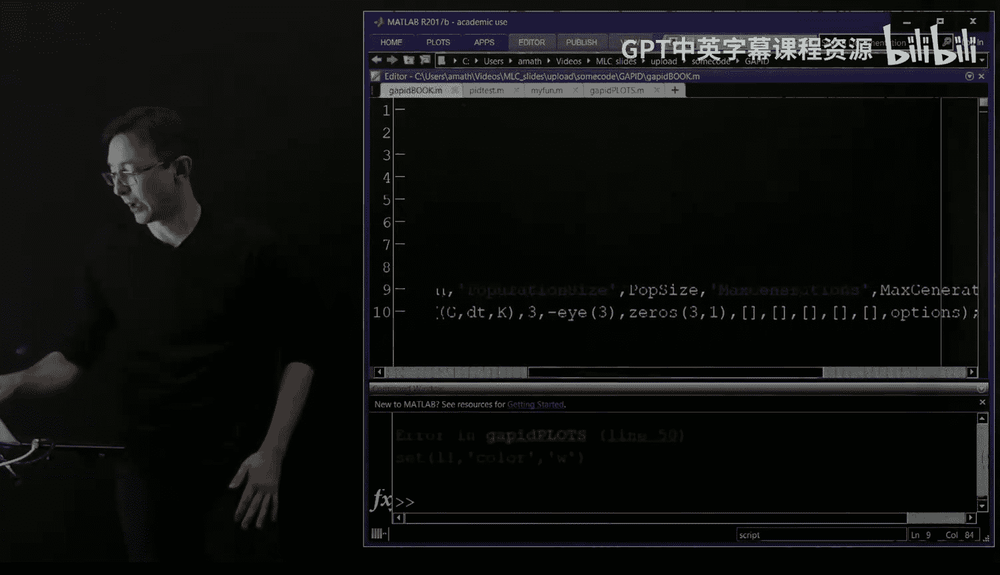
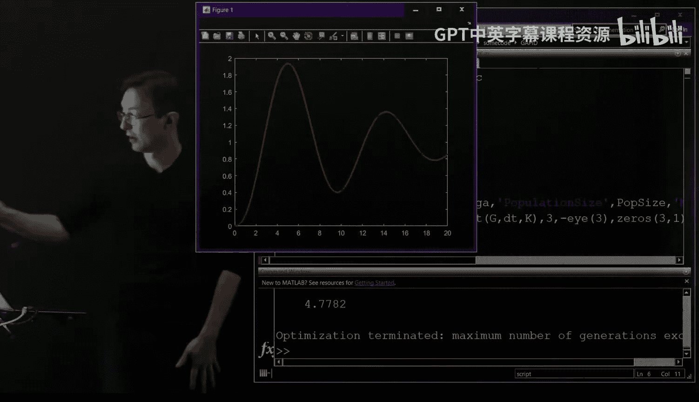
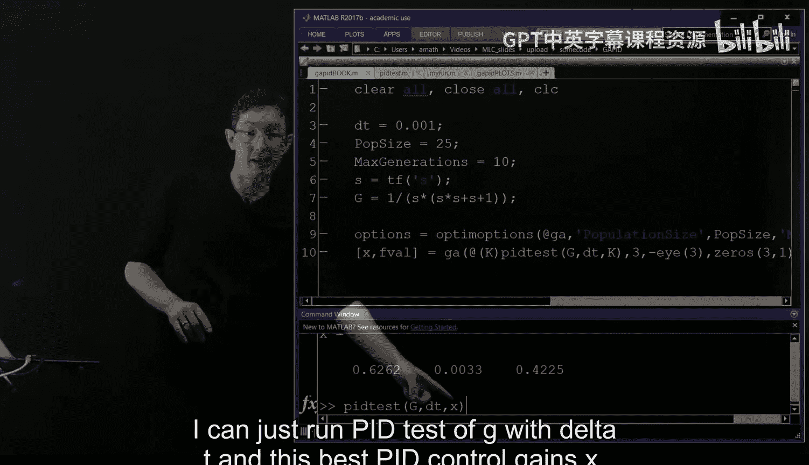
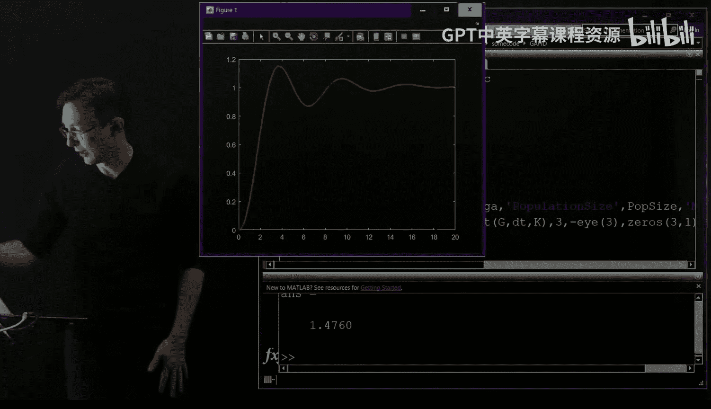
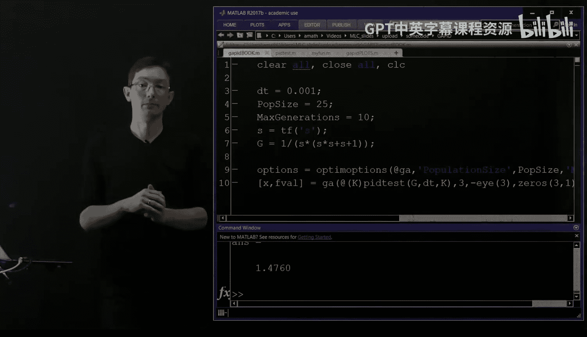

# 29：使用遗传算法整定PID控制器 🧬


在本节课中，我们将学习如何使用遗传算法来优化一个已知结构（PID控制器）的控制律参数。我们将通过一个MATLAB实例，演示如何定义系统、构建目标函数，并利用遗传算法命令 `ga` 来寻找最优的PID参数。


---

## 概述

我们将控制一个由传递函数 `G` 描述的系统。我们的目标是设计一个PID控制器，其参数（比例项 `Kp`、积分项 `Ki`、微分项 `Kd`）需要被优化，以最小化一个线性二次型调节器（LQR）成本函数 `J`。这个成本函数同时惩罚了状态跟踪误差和控制输入的能量。



上一节我们介绍了遗传算法的基本概念，本节中我们来看看如何将其应用于一个具体的控制问题。

---

## 系统定义

首先，我们需要定义被控对象的动态模型。我们在频域中使用拉普拉斯变量 `s` 来定义一个传递函数。

**传递函数公式：**
```
G(s) = 1 / [s * (s^2 + s + 1)]
```
在MATLAB中，这对应于：
```matlab
s = tf('s');
G = 1 / (s * (s^2 + s + 1));
```

这个三阶系统将作为我们应用PID控制的对象。

---



## 目标函数构建

接下来，我们需要一个函数来评估给定PID参数的控制性能。我们称之为 `PIDtest` 函数。

该函数接收系统 `G`、采样时间 `dt` 和PID参数向量 `K = [Kp, Ki, Kd]`，并执行以下步骤：



1.  **构建PID控制器**：根据参数 `K` 构造控制器传递函数 `C(s)`。
    *   比例项：`Kp`
    *   积分项：`Ki / s`
    *   微分项：`Kd * s / (1 + ε*s)` （为避免数值问题，使用了一个带有高频滚降的近似微分器，其中 `ε` 是一个非常小的数）。

2.  **构建闭环系统**：将控制器 `C(s)` 与被控对象 `G(s)` 串联，并施加单位负反馈，形成闭环传递函数。

3.  **仿真阶跃响应**：对闭环系统施加一个单位阶跃输入，并记录输出响应 `y(t)` 和控制输入 `u(t)`。

4.  **计算LQR成本**：成本函数 `J` 定义为状态误差和控制输入能量的加权和。
    **成本函数公式：**
    ```
    J = Σ (Q * y(t)^2 + R * u(t)^2) * Δt
    ```
    其中 `Q` 和 `R` 是权重因子，`Σ` 表示在整个仿真时间内求和。`J` 值越小，代表控制器性能越好（跟踪快、超调小、控制能量省）。

`PIDtest` 函数的最终输出就是这个成本值 `J`。遗传算法的任务就是寻找能使 `J` 最小化的 `K` 向量。

---

## 应用遗传算法

设置好系统和评估函数后，使用MATLAB的遗传算法工具就变得非常直接。

以下是核心步骤的简述：

1.  **定义优化变量**：明确告诉算法我们需要优化的是一个三维向量 `K`。
2.  **设置算法参数**：例如，设定种群大小（每代个体数）和最大迭代代数。
3.  **调用 `ga` 函数**：将 `PIDtest` 函数（已固定 `G` 和 `dt` 参数，仅作为 `K` 的函数）传递给 `ga` 命令。



**代码结构示意：**
```matlab
% 定义优化问题
fun = @(K) PIDtest(G, dt, K); % 目标函数，仅依赖于K
nvars = 3; % 优化变量个数（Kp, Ki, Kd）



% 设置遗传算法选项
options = optimoptions('ga', 'PopulationSize', 25, 'MaxGenerations', 10, ...);

% 运行遗传算法
[K_opt, J_min] = ga(fun, nvars, [], [], [], [], [], [], [], options);
```
运行后，`K_opt` 将包含找到的最优PID参数，`J_min` 是对应的最小成本值。

---

## 算法运行与结果分析

当代码运行时，算法会依次评估每一代中的每一个“个体”（即一组PID参数）。我们可以观察到：

*   **初期**：许多参数组合会导致系统不稳定（输出发散），对应的成本 `J` 非常高。
*   **进化过程**：随着代际更迭，算法通过选择、交叉和变异，逐渐淘汰性能差的参数，保留并改进性能好的参数。成本函数值 `J` 整体呈下降趋势，阶跃响应曲线变得越来越理想（快速、平稳地跟踪设定值）。
*   **收敛**：算法最终收敛到一组（近似）最优参数 `K_opt`。对其测试可得到最优的闭环阶跃响应。

需要强调的是，**“最优”是相对于你定义的成本函数 `J` 而言的**。如果 `J` 只惩罚误差而不限制控制量，算法可能会找到响应极快但控制量巨大的解。因此，设计合适的成本函数是应用此类方法的关键。



遗传算法的优势在于它能处理非凸、非光滑、带有复杂约束的优化问题，而这正是传统基于梯度的优化方法所不擅长的。



---

## 总结

本节课中我们一起学习了如何将遗传算法用于控制器参数整定。我们主要完成了以下工作：

1.  定义了一个待控制的动态系统模型 `G(s)`。
2.  构建了一个评估函数 `PIDtest`，用于计算特定PID参数下的LQR性能指标 `J`。
3.  利用MATLAB的 `ga` 函数，以 `J` 最小化为目标，自动搜索最优的PID参数 `[Kp, Ki, Kd]`。

这个过程的核心思想是：**将控制设计问题转化为一个参数优化问题，并利用进化计算策略来自动寻找解**。虽然本例以PID控制器为例，但该方法可广泛应用于任何结构已知、仅需优化参数的控制律设计场景。





在接下来的内容中，我们将加载算法运行的历史数据，深入分析遗传算法的搜索过程与学习轨迹。