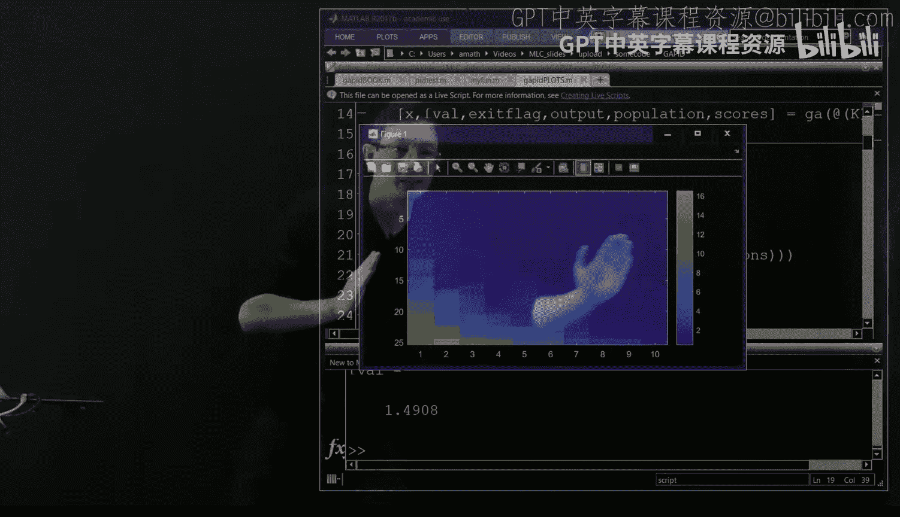
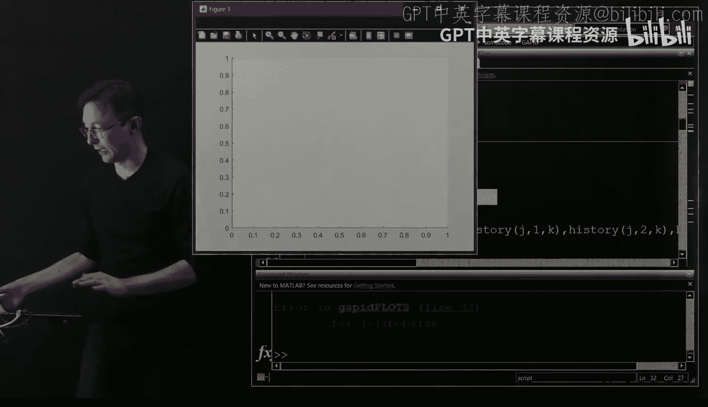
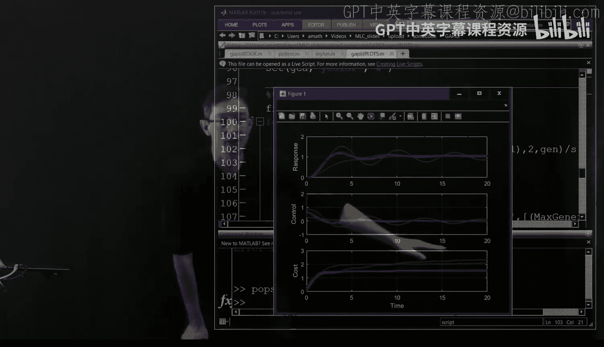

# 30：使用遗传算法调优PID控制器

在本节课中，我们将学习如何使用遗传算法来优化PID控制器的参数，以最小化线性二次型调节器成本函数。我们将通过分析遗传算法运行过程中的数据，直观地理解其优化过程。

上一节我们编写了遗传算法代码来优化PD控制器的增益参数。现在，我们将加载算法运行过程中保存的数据，并通过绘制图表来分析遗传算法的优化效果。

以下是遗传算法运行过程中，每一代所有个体的性能表现图。图中，每个点代表一个个体（即一组PID参数），颜色代表其成本函数值（蓝色表示成本低、性能好，黄色表示成本高、性能差），横轴代表代数。

从图中可以观察到，随着代数增加，图表整体颜色越来越蓝。这表明越来越多的个体获得了较低的成本函数值，性能接近最优。第一代由于参数随机，包含许多性能很差的个体（黄色）。但从第二代开始，性能差的个体数量显著减少，算法逐渐收敛到性能优异的参数区域。

接下来，我们绘制所有个体在PID参数空间中的分布图。红色点代表初始代的个体，蓝色点代表后续代的个体。

初始代的参数（红点）在参数空间中广泛分布。随着优化进行，后续代的参数（蓝点）逐渐聚集到一个特定的“热点”区域，这个区域对应着性能最优的参数组合。这直观展示了算法如何“群聚”并收敛到最优解。

现在，我们对比第一代和第十代所有个体的系统阶跃响应。

第一代个体的响应曲线非常不稳定，许多甚至发散，对应着很高的成本。这表明随机初始化的参数性能普遍很差。

相比之下，第十代个体的响应曲线全部稳定，并且高度集中在一条最优响应带附近。所有个体的成本函数值都较低，集中在1.5到10之间。这说明算法已经成功找到了性能优异的参数区域。

最后，我们绘制每一代中最佳个体的响应曲线。从第一代（红色）到第十代（蓝色），曲线变化明显。

早期最佳个体的响应振荡较多，控制输入成本较高。随着代数增加，响应曲线趋于平滑、快速，控制输入成本显著降低。经过十代优化，整体的LQR成本几乎降低了一半，获得了明显更好的控制性能。

通过输出并分析这些代际数据，我们可以诊断算法的学习速率、初始种群的有效性以及优化过程的效率。

遗传算法在MATLAB中功能强大且易于应用。你只需要一个能输出待最小化标量值的评估函数，算法就能自动寻找最优参数。你可以尝试将此方法应用于你自己的控制系统。

本节课中，我们一起学习了如何通过绘制和分析代际数据，来可视化并理解遗传算法优化PID参数的过程。我们观察到算法如何从随机初始种群开始，通过选择、交叉、变异等操作，逐步收敛到性能优异的参数区域，最终显著提升控制系统的性能。