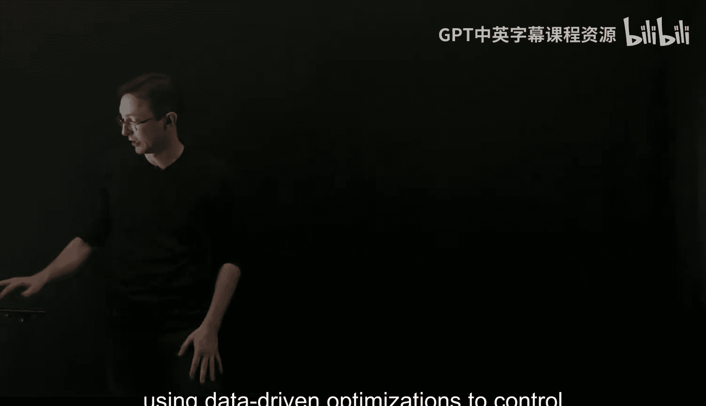
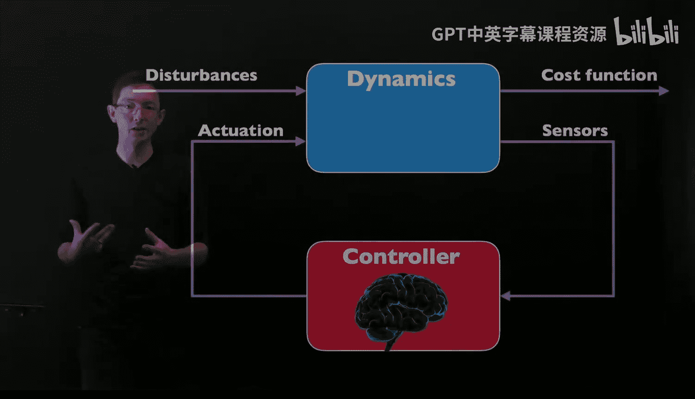
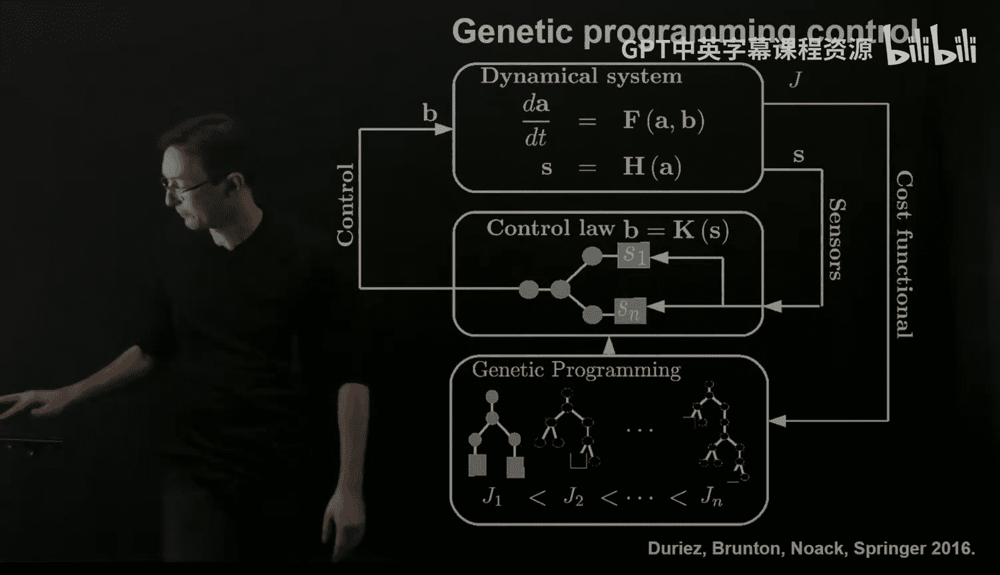
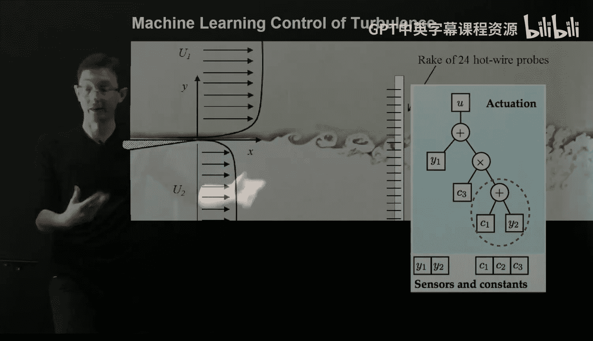
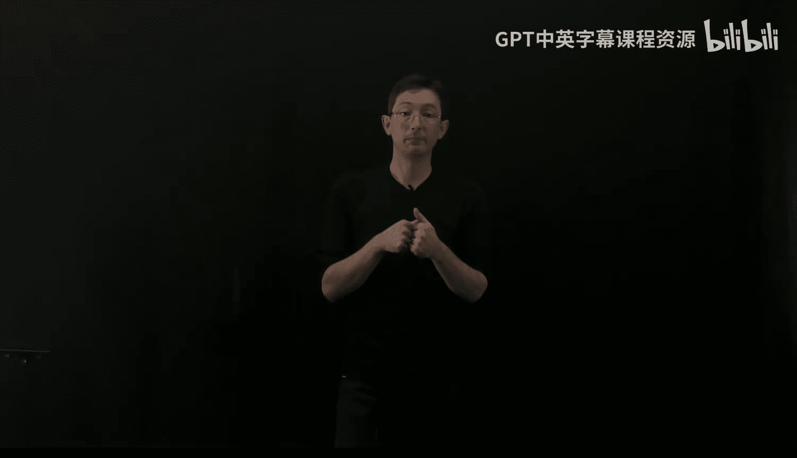

# 32：遗传编程控制在湍流控制中的应用 🌀

在本节课中，我们将学习如何利用遗传编程控制这一数据驱动优化方法，来控制复杂的非线性动力系统，特别是湍流流体系统。我们将通过一个具体的实验案例，展示遗传编程控制如何有效提升湍流混合效率，同时显著降低控制成本。

---

上一节我们介绍了遗传编程控制的基本架构，本节中我们来看看如何将这一方法应用于湍流控制这一极具挑战性的实际问题。

湍流流体动力学是一个高维、非线性、多尺度的问题。虽然其控制方程（纳维-斯托克斯方程）已知，但求解或模拟需要数百万甚至数十亿的自由度，这使其难以进行快速、实时的控制设计。湍流本身具有极快的时间尺度，要求控制决策必须低延迟、高带宽。

传统上，大量研究致力于为湍流控制建立降阶模型。然而，我们现在要探讨的是另一种思路：不试图为控制而建模湍流，而是直接使用机器学习方法——特别是遗传编程控制——来寻找有效的控制律以操控湍流。

湍流控制是现代社会的重大挑战问题之一，因为它几乎与所有万亿级产业息息相关：
*   **交通运输**：减少汽车、船舶、飞机或火车的阻力。
*   **国防**：制造更敏捷的飞行器和舰船。
*   **能源系统**：从发动机和涡轮机中获取能量。
*   **医疗系统**：优化人体内心脏、静脉和动脉内的血流。

因此，在湍流控制中即使取得微小的性能提升，也可能转化为巨大的经济效益和应用价值。

---

接下来，我们将通过一个由巴伦特·诺亚克及其合作者在法国普瓦捷进行的经典混合层实验，具体说明遗传编程控制的应用。

以下是该实验的基本设置：
*   实验在一个风洞中进行，顶部为高速流，底部为低速流，中间由一个分隔板隔开。
*   气流在分隔板下游会形成涡旋并最终发展为湍流混合层。
*   在下游某处布置了**24个热线探头**用于测量流场状态。
*   控制目标是**增加或减少**下游某处的湍流混合速率。
*   分隔板表面有**96个压力孔**，每个孔都可以独立地以极高或极低的频率喷射气流，以扰动和操控流场，从而影响混合效果。

在整个实验过程中，研究人员尝试设计控制律来优化这个高层目标函数。结果表明，**遗传编程控制是所尝试策略中最有效的一种**。其控制架构是：驱动压力孔的作动信号，是下游测量值经过某个复杂非线性函数（由遗传编程学习得到）的反馈结果。

---

以下是实验结果的可视化对比（时间从左向右演进，每条垂直带显示24个热线测量值，深色/浅色代表正/负流速大小）：

*   **上图：无控的自然流场**。可以看到典型的涡旋卷起结构。
*   **中图：开环周期强迫控制**。以最佳周期频率驱动压力孔（呈现规律的明暗交替）。这能增加下游混合（尾流变宽），但需要持续、周期性的控制作用。
*   **下图：遗传编程控制**。实现了与开环控制**相似的混合增强效果**（尾流宽度相近），但**控制消耗（白色区域代表控制开启）显著减少**。其控制信号**非周期**，而是根据瞬时流场状态进行反馈，从而实现了**更高效率**的混合增强。

简而言之，遗传编程控制以**低得多的作动成本**，实现了与优化后的开环控制**相当甚至略优的性能**。

---

在此实验之后，遗传编程控制架构已被成功应用于欧洲各地的众多流动控制实验，包括汽车减阻、斜坡后回流区控制、边界层控制等。这种方法特别适合能够快速获取数据以评估控制律好坏的实验场景。在一个快速实验中，可以在数小时内完成数百个个体的评估和数十代的进化。

遗传编程控制为湍流控制这一困扰领域专家数十年的难题提供了新的解决思路。随着数据方法、优化技术和计算能力的进步，以及传感器和作动器性能的提升，我们有越来越多的机会在重要的大规模问题上进行这种优化控制。

---

本节课中我们一起学习了如何将遗传编程控制应用于湍流控制。我们了解到，通过数据驱动的优化，可以直接为复杂的非线性流体系统寻找高效的控制律，而无需建立精确的降阶模型。通过一个混合层实验案例，我们看到了遗传编程控制如何在显著降低控制成本的同时，实现与开环控制相当的混合增强效果。这展示了机器学习控制在实际工程挑战中的巨大潜力和应用价值。