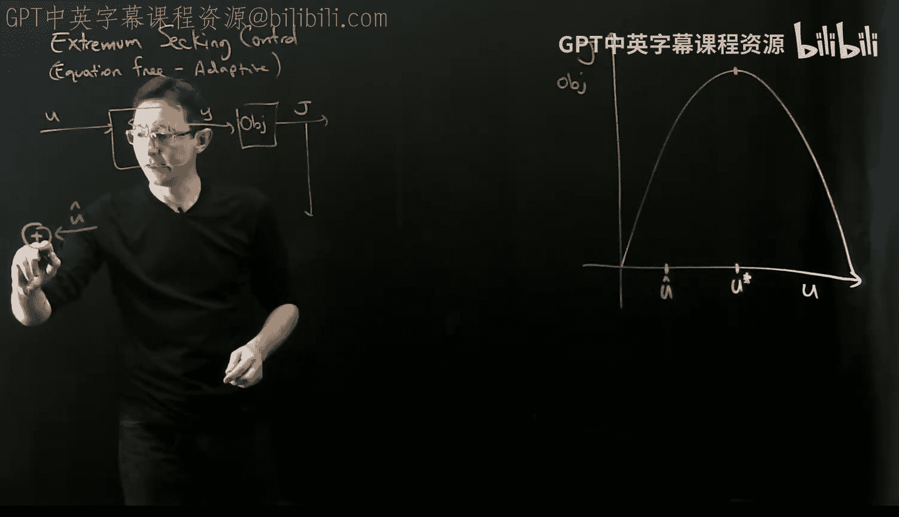
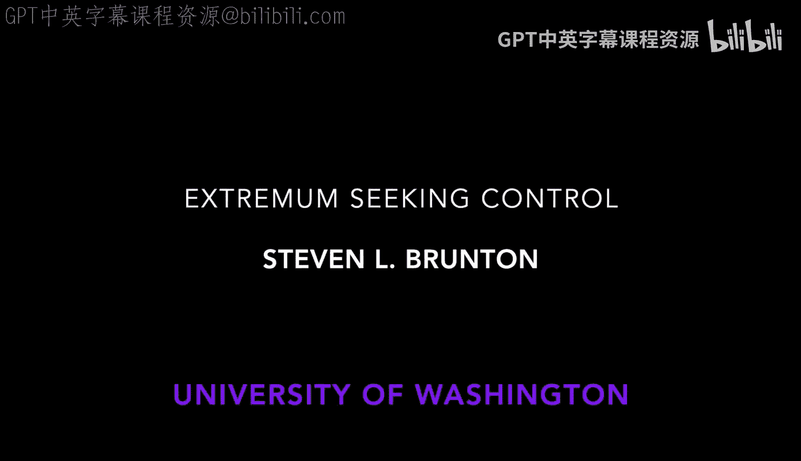

# 33：极值搜索控制 🎯

在本节课中，我们将学习一种名为“极值搜索控制”的自适应控制策略。这是一种无需系统模型的“无方程”控制方法，能够适应缓慢变化的参数，并直接优化一个总体的目标函数。

## 概述 📋

上一节我们讨论了数据驱动控制的基本概念。本节中，我们将深入探讨极值搜索控制。这是一种强大的优化方法，它通过向控制输入注入微小的正弦扰动来“探测”系统，从而找到能使目标函数最大化的最优控制输入，即使系统参数缓慢变化，它也能持续跟踪最优值。

## 极值搜索控制的基本思想 💡

极值搜索控制是一种无模型的优化技术。其核心思想是：我们有一个系统，输入为 **U**，输出为 **y**。输出 **y** 会馈入一个我们希望最大化的目标函数 **J**。我们假设可以测量 **J** 的值。

我们的目标是找到最优的控制输入 **U***，使得目标函数 **J** 达到最大值。即使这个峰值会随时间缓慢移动，控制器也应能跟踪它。

## 一个简化的思想实验 🧪

为了便于理解，我们先做一个高度简化的假设：系统动态响应是瞬时的，且目标函数 **J(U)** 是一个静态的、具有单一全局最大值的函数（例如一个抛物线）。

假设我们当前对最优控制的估计值是 **Û**。极值搜索控制器会在这个估计值上叠加一个正弦扰动：

**U = Û + a sin(ωt)**

然后，我们测量由此产生的目标函数 **J** 的变化。

*   **当 Û 位于最优值左侧（斜率为正）时**：输入 **U** 增加（向右摆动），**J** 增加；输入 **U** 减少（向左摆动），**J** 减少。因此，**J** 的扰动与 **U** 的扰动**同相**。将这两个同相信号相乘，会得到一个**主要为正**的信号，这告诉我们：“应该向右移动”。
*   **当 Û 位于最优值右侧（斜率为负）时**：输入 **U** 增加，**J** 减少；输入 **U** 减少，**J** 增加。因此，**J** 的扰动与 **U** 的扰动**反相**。将这两个反相信号相乘，会得到一个**主要为负**的信号，这告诉我们：“应该向左移动”。

如果我们对这个相乘后的信号进行积分，并将其反馈到估计值 **Û** 中，系统就会自动朝着最优值 **U*** 的方向移动。

## 极值搜索控制框图 🔄

以下是实现上述思想的控制框图：

让我们分解图中的每个步骤：

1.  **注入扰动**：在最佳估计 **Û** 上叠加正弦扰动 `a sin(ωt)`，得到实际控制输入 **U**。
2.  **测量与高通滤波**：测量系统输出的目标函数值 **J**。由于 **J** 包含较大的直流（稳态）分量，我们首先用一个**高通滤波器**（例如 `s/(s+ω_h)`）将其滤除，只保留由扰动引起的高频变化部分，记为 **ρ**。
3.  **解调（相乘）**：将滤波后的信号 **ρ** 与原始注入的正弦扰动 `a sin(ωt)` 相乘。这个相乘过程称为**解调**，它产生的信号 **ξ** 包含了斜率的方向信息（正或负）。
4.  **积分与更新**：将解调信号 **ξ** 乘以一个增益 **K**，然后通过一个**积分器**（`1/s`）。积分器的输出不断更新我们对最优控制的估计值 **Û**。如果 **ξ** 总体为正，积分会使 **Û** 增加；如果为负，则使 **Û** 减少。

当系统到达峰值（**Û = U***）时，无论向哪个方向扰动，**J** 都会略微下降。此时解调信号 **ξ** 的正负部分平均后接近于零，积分器输出基本保持不变，系统便稳定在最优值附近。

## 关键特性与假设 ⚙️

极值搜索控制具有一些重要特性和应用前提：

*   **自适应与无模型**：它不需要系统的精确数学模型，并能适应缓慢变化的参数。
*   **局部优化器**：它只能找到初始估计值 **Û** 附近的局部最优值。如果目标函数有多个峰值，控制器会收敛到离起始点最近的那个峰值。
*   **时间尺度分离假设**：这是该方法有效运作的关键。它假设三个过程发生在不同的时间尺度上：
    1.  **最慢**：系统参数或扰动的变化（例如，一天内的缓慢漂移）。
    2.  **中等**：注入的正弦扰动频率。
    3.  **最快**：系统本身的动态响应。即系统对控制输入变化的响应速度远快于扰动频率，这样我们才能为正弦波上的每个点“瞬时”测量到一个对应的目标函数值。

## 与其他方法的联系 🔗

极值搜索控制与一种更早的、更简单的方法——“扰动观察法”密切相关。

以下是扰动观察法的基本步骤：
1.  向控制输入 **U** 施加一个小的离散步长变化（ΔU）。
2.  观察目标函数 **J** 是上升还是下降。
3.  如果 **J** 上升，则沿相同方向再走一步；如果下降，则反向走一步。

极值搜索控制本质上是扰动观察法的**连续时间版本**。它的优势在于：
*   **变步长**：步长大小取决于目标函数在该点的斜率（梯度）。斜率大时步长大，收敛快；接近最优值时步长小，更精确。
*   **理论保证**：对于动态系统，有严格的理论可以证明其在什么条件下会收敛。

## 总结 📝

本节课我们一起学习了极值搜索控制。我们了解到：

*   极值搜索控制是一种强大的、无模型的自适应优化方法，通过向输入注入正弦扰动来探测系统并优化目标函数。
*   其核心原理是利用解调信号来估计目标函数的梯度方向，并通过积分驱动系统朝向最优值。
*   该方法适用于参数缓慢变化的系统，但本质上是一个局部优化器，其有效性依赖于时间尺度分离的假设。
*   它是更基础的“扰动观察法”的连续时间推广，具有更快的跟踪速度和理论收敛性保证。

在接下来的课程中，我们将在 MATLAB 中对此进行编码实现，并查看其在一些实际应用中的效果。