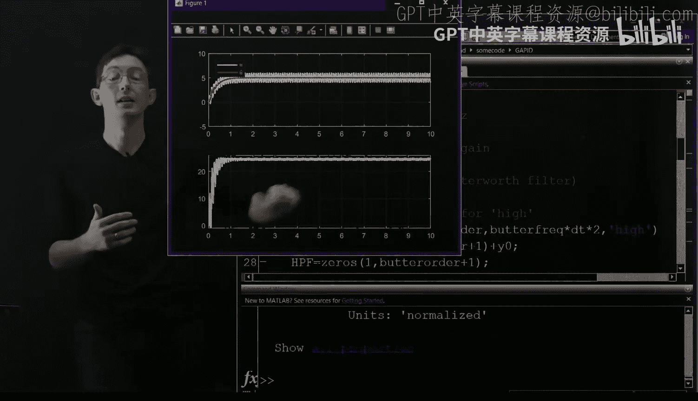
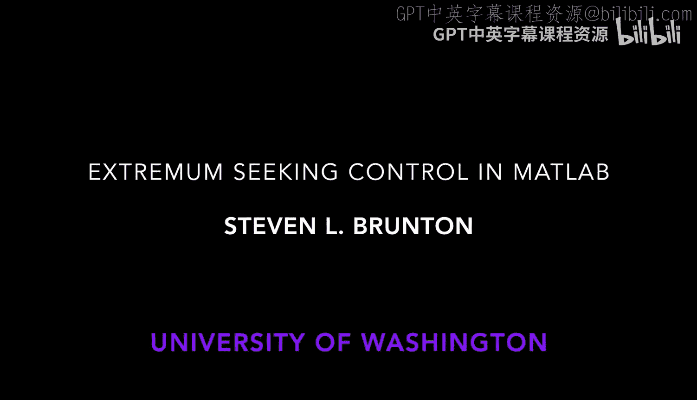

# 34：在Matlab中实现极值搜索控制


在本节课中，我们将学习如何在Matlab中实现极值搜索控制。这是一种无需精确模型、仅依靠系统输入输出数据来寻找并维持系统性能最优点的控制方法。我们将从一个简单的静态目标函数示例开始，逐步构建算法，并通过调整参数观察其效果。

## 概述

上一节我们介绍了极值搜索控制的基本原理。本节中，我们将通过Matlab编程，亲手实现一个极值搜索控制器，并复现其工作曲线。我们将使用一个简单的二次型目标函数作为示例，并探讨关键参数（如积分增益、扰动幅度和频率）对控制器性能的影响。

## 目标函数定义

首先，我们定义一个需要优化的静态目标函数。在本例中，我们使用一个简单的二次函数，其峰值位于控制输入 `u = 5` 处。

**代码：定义目标函数**
```matlab
J = 25 - (5 - u)^2;
```
这个函数在 `u = 5` 时取得最大值25，并向两侧呈二次型衰减。我们将其绘制在 `u` 从-5到15的区间内，可以清晰地看到一个抛物线状的峰值。

## 极值搜索控制器设计

接下来，我们设计极值搜索控制器。其核心思想是：在最佳控制估计值 `u_hat` 上叠加一个正弦扰动，通过观察目标函数 `J` 的响应来判断最优点的方向，并据此更新 `u_hat`。

以下是实现所需的关键步骤和参数：

**参数设置**
*   **采样时间** `dt = 0.05` 秒（对应20Hz采样频率）。
*   **仿真时长** `T = 10` 秒。
*   **正弦扰动幅度** `A = 0.2`。
*   **正弦扰动频率** `omega = 10 * 2 * pi` 弧度/秒（10 Hz）。
*   **相位偏移** `phi = 0`。
*   **积分增益** `K = 5`。

**算法步骤**
1.  **注入扰动**：在每个时间步，控制输入 `u` 为最佳估计 `u_hat` 加上正弦扰动 `A * sin(omega * t)`。
2.  **测量输出**：计算当前 `u` 对应的目标函数值 `J`。
3.  **高通滤波**：使用一个截止频率为2 Hz的高通滤波器处理 `J`，以去除其直流分量，只保留由扰动引起的振荡部分 `eta`。
4.  **解调**：将滤波后的信号 `eta` 与原始正弦扰动（可加入相位 `phi`）相乘，得到解调信号 `xi`。该信号的符号指示了应向哪个方向移动以接近最优点。
5.  **积分更新**：将解调信号 `xi` 乘以积分增益 `K` 和采样时间 `dt`，然后积分到最佳估计 `u_hat` 中。公式为：
    `u_hat_new = u_hat_old + K * xi * dt`

**代码：核心循环结构**
```matlab
for i = 1:length(t)
    % 1. 计算当前控制输入（含扰动）
    u = u_hat + A * sin(omega * t(i) + phi);
    % 2. 评估目标函数
    current_J = 25 - (5 - u)^2; % 调用目标函数
    % 3. 高通滤波（使用filter函数处理current_J）
    eta = filter(b_hp, a_hp, current_J);
    % 4. 解调
    xi = eta * sin(omega * t(i) + phi); % 此处phi=0
    % 5. 积分更新最佳估计
    u_hat = u_hat + K * xi * dt;
    % 存储数据用于绘图...
end
```

## 参数影响分析

运行上述代码后，我们可以观察到控制器成功地从初始位置（例如 `u=0`）寻优至峰值点 `u=5`。现在，我们来探讨不同参数如何影响控制性能。

### 积分增益 `K` 的影响

积分增益 `K` 决定了控制器根据误差修正 `u_hat` 的“积极性”。

*   **`K = 5`（适中）**：控制器平稳、快速地收敛到最优点，扰动引起的 `J` 振荡在接近最优点时变得很小。
*   **`K = 1`（较小）**：控制器更新缓慢，收敛到最优点的速度明显变慢。
*   **`K = 10`（较大）**：收敛速度极快，但响应曲线开始出现畸变，因为更新速度过快，高通滤波器来不及完全滤除 `J` 中的瞬变成分。
*   **`K = 20`（过大）**：系统变得不稳定，`u_hat` 和 `J` 剧烈振荡甚至发散。

**结论**：`K` 需要在收敛速度和稳定性之间取得平衡。过小则响应慢，过大则可能导致系统不稳定。

### 扰动幅度 `A` 的影响

扰动幅度 `A` 决定了“探测”信号的强度。

*   **`A = 0.2`（适中）**：在寻优过程中能提供足够的梯度信息，且在接近最优点时，`J` 的振荡幅度很小（约 `A^2` 量级），对峰值性能影响小。
*   **`A = 1`（较大）**：能提供更强的梯度信号，可能加快初始寻优速度。但即使在最优点，`J` 也会产生大幅振荡，这会降低系统的稳态性能。

**结论**：`A` 需要在探测灵敏度（寻优速度）和稳态性能损失（扰动引起的振荡）之间进行权衡。通常选择较小的 `A` 以最小化对最优性能的影响。

### 其他参数

*   **扰动频率 `omega`**：应选择在系统动态响应时间尺度和外部扰动或目标函数变化时间尺度之间。通常要求系统能快速响应此频率的扰动，而目标函数本身变化相对较慢。
*   **高通滤波器截止频率**：应设置为低于扰动频率 `omega`，以有效滤除 `J` 的直流分量，但又能完整保留扰动引起的交流分量。

## 总结



本节课中，我们一起学习了如何在Matlab中实现极值搜索控制。我们从一个静态二次目标函数出发，逐步构建了控制算法，该算法通过注入正弦扰动、测量输出响应、高通滤波、解调和积分更新等步骤，成功实现了自动寻优。

我们重点分析了**积分增益 `K`** 和**扰动幅度 `A`** 这两个关键参数对控制器性能的影响：
*   `K` 影响收敛速度和稳定性，需谨慎调节。
*   `A` 影响寻优速度和稳态性能，通常宜小不宜大。



极值搜索控制的优势在于其无需系统模型、仅依赖输入输出数据的特性，使其非常适用于复杂、模型未知或时变的系统优化问题。通过本节的动手实践，你应该已经掌握了其基本实现方法，并理解了参数调整的基本准则。