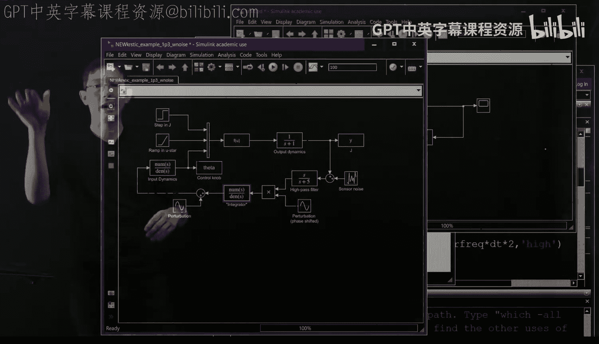
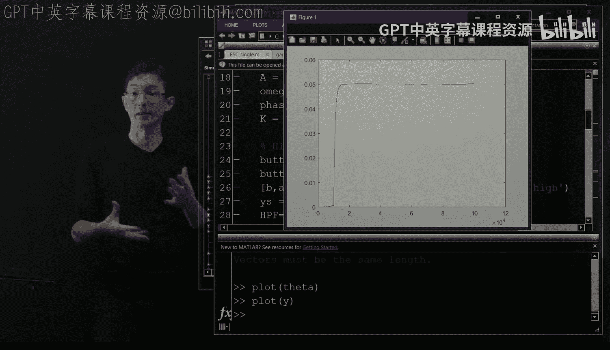
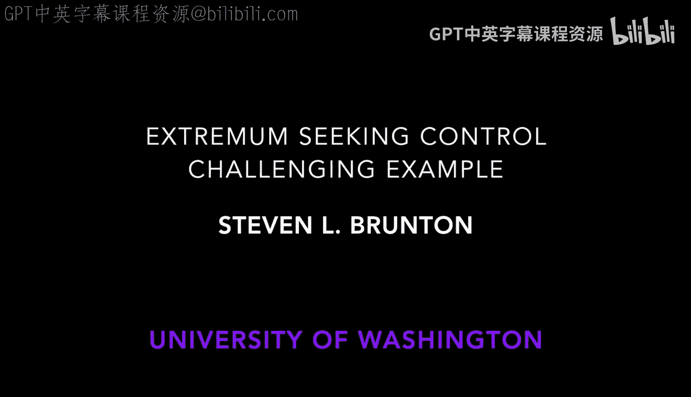

# 36：极值搜索控制_挑战性示例 🎯

在本节课中，我们将学习如何将极值搜索控制（Extremum Seeking Control）应用到一个极具挑战性的动态系统上。这个系统设计得非常复杂，包含非最小相位特性、时变的最优控制输入以及目标函数中的不连续跳变。我们将看到，即使面对如此困难的系统，极值搜索控制依然能够有效地工作。

## 概述

上一节我们介绍了极值搜索控制的基本原理，并将其应用于一个简单的静态目标函数。本节中，我们将探讨如何将这一方法应用于一个由Krstic和Arikan在2003年提出的、设计得极为“棘手”的动态系统。该系统包含了输入/输出动态、右半平面零点以及传感器噪声，是展示极值搜索控制鲁棒性的绝佳示例。

## 系统描述与挑战

该挑战性系统的基本架构与之前类似，但引入了额外的复杂性。目标函数 `J` 不仅依赖于控制输入 `u`，其最优值 `u*` 会随时间线性变化（斜坡信号），并且 `J` 本身在特定时刻会发生不连续的阶跃跳变。

更复杂的是，这个静态的目标函数会与输入动态和输出动态相乘。这意味着系统具有自己的内部动力学和时间尺度，由一些常微分方程或传递函数描述，使得控制变得极具挑战性。特别是，该系统包含一个**右半平面零点**，这导致系统是非最小相位（non-minimum phase）的。当控制输入 `u` 变化时，系统的初始响应会朝错误的方向运动，然后才转向正确方向，这使得即使已知系统方程，设计一个优秀的控制器也非常困难。

## 极值搜索控制架构

在本示例中，我们假设并不知道系统的精确方程，而是通过“调参”来应用极值搜索控制。其基本控制回路架构保持不变。

以下是控制回路的核心组件：
*   **正弦扰动**：我们向控制输入添加一个正弦扰动信号。
*   **高通滤波器**：用于从输出信号 `J` 中提取变化部分。
*   **解调与积分**：将滤波后的信号与一个相移后的正弦信号相乘，然后通过一个积分器（或类积分器）来更新控制估计值 `θ`。

然而，为了应对这个复杂系统，需要对基础架构进行两处关键调整：
1.  **解调信号的相移**：必须对解调所用的正弦波进行相移，系统才能稳定工作。
2.  **特殊的积分器设计**：积分器并非简单的 `1/s`，而是一个具有特定动态的“冲刷低通+积分”组合，其传递函数为：
    `(50s - 200) / (s - 0.001)`

此外，系统中还加入了**传感器噪声**，以模拟对目标函数 `J` 的不完美测量，这进一步增加了控制难度。

## 仿真结果与分析

运行仿真后，我们可以观察控制输入 `θ` 和系统输出 `Y`（即目标函数 `J`）的表现。

**控制输入 `θ` 的跟踪效果**
`θ` 试图跟踪那个线性变化的最优控制输入 `u*`。从结果来看，它的跟踪效果相当不错。特别值得注意的是，在时间 `t=1` 时，目标函数 `J` 发生了一个从0到1的大幅阶跃跳变，这导致了控制输入 `θ` 出现一个明显的“颠簸”。但控制器很快进行了大幅校正，并迅速回到了跟踪线性斜坡 `u*` 的正确轨道上。考虑到系统的非最小相位特性和右半平面零点，这个表现非常令人印象深刻。

**系统输出 `Y`（目标函数 `J`）的性能**
输出 `Y` 的表现则更为出色。最优的 `J` 值在 `t=1` 时从0跳变到0.05。可以看到，尽管系统具有非最小相位动态、传感器噪声等所有“棘手”特性，但当系统在 `t=1` 发生突变时，控制器几乎立即做出补偿，并将输出稳定在最优值附近，表现得非常“稳固”。

这意味着，即使底层控制器为了跟踪变化的 `u*` 和补偿复杂动态而进行着剧烈的调整，从系统输出的角度来看，性能在突变后得到了即时恢复和维持。

## 总结

本节课我们一起学习了极值搜索控制在一个极具挑战性的动态系统上的应用。我们首先回顾了该系统的复杂性，包括时变的最优设定点、非最小相位动态和传感器噪声。接着，我们分析了为应对这些挑战而对标准极值搜索控制架构所做的关键调整，特别是**解调信号的相移**和**特殊积分器**的使用。最后，通过仿真结果我们看到，尽管系统本身非常“棘手”，但经过适当调整的极值搜索控制器依然能够有效地跟踪时变的最优控制输入，并在目标函数发生突变时快速恢复最优性能。这充分展示了极值搜索控制在处理复杂、模型未知系统时的强大能力和鲁棒性。建议你尝试运行代码，调整滤波器频率、积分器参数等，亲自体验不同参数对控制性能的影响。