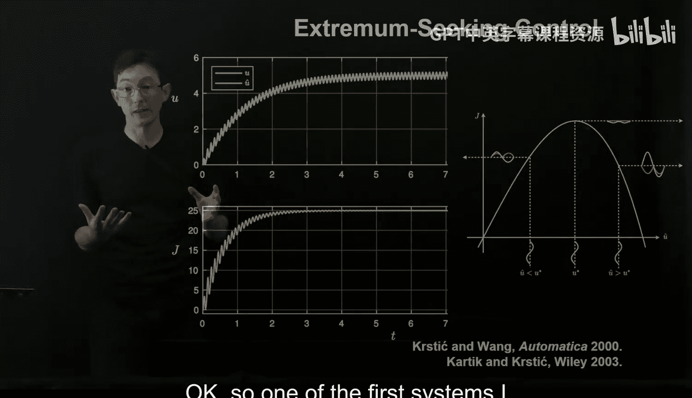
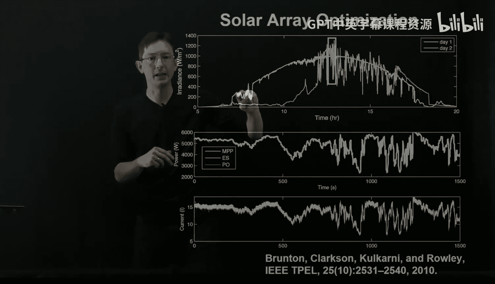
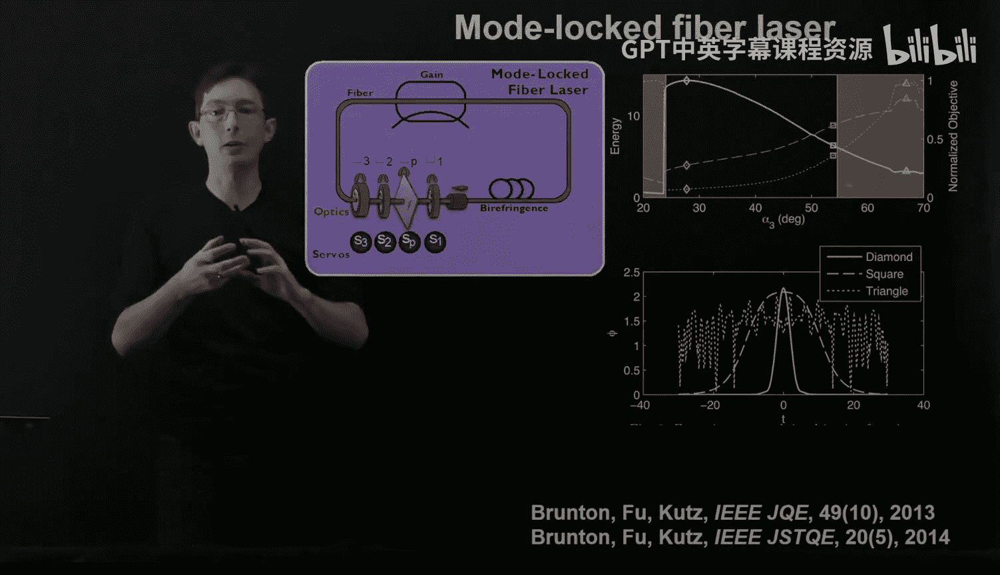
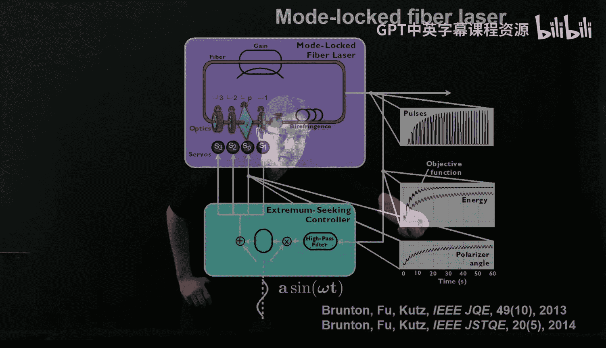
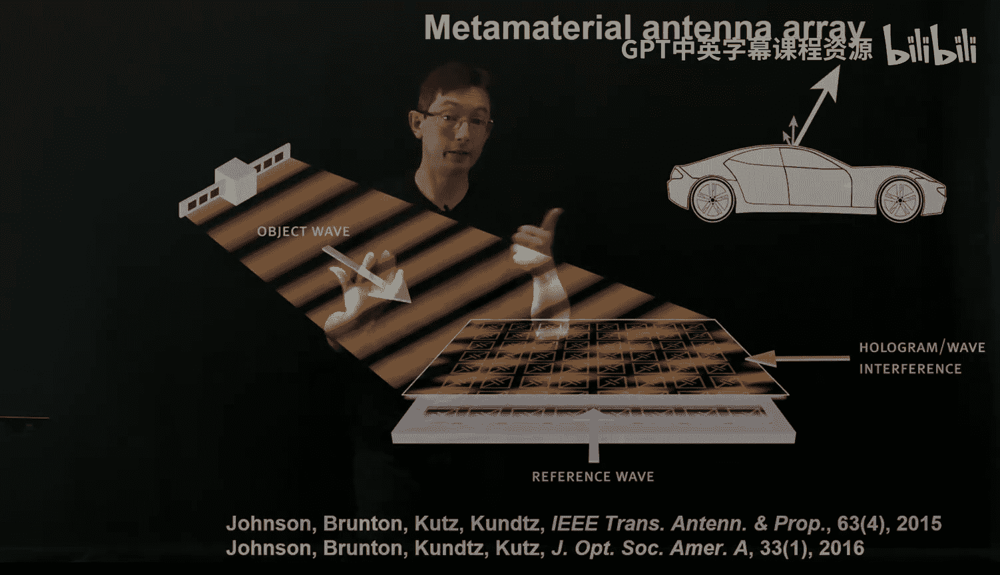
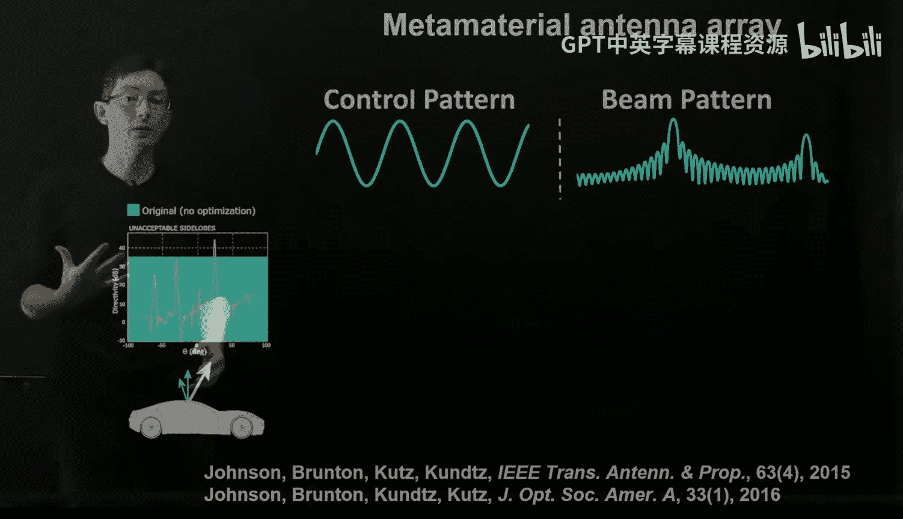

# 37：极值搜索控制应用 🎯

## 概述
在本节课中，我们将学习极值搜索控制算法在实际系统中的应用。我们将通过几个具体案例，了解如何利用该算法优化太阳能阵列、光纤激光器、流体混合层以及超材料天线阵列的性能。

---

## 极值搜索控制算法回顾
上一节我们介绍了极值搜索控制算法。该算法本质上是“扰动与观察”方法的智能版本。其核心思想是：对控制输入施加正弦扰动，测量目标函数对应的响应变化，然后根据该信息调整控制值的最佳估计，以最大化目标函数。

例如，对于一个二次成本函数，当控制值 `U` 低于最优值（例如 `U=5`）时，扰动会指示应增加 `U`；反之，高于最优值时则指示应减少 `U`。通过持续添加正弦扰动，可以轻松跟踪目标函数 `J` 的最优值。

当系统具有动态特性，而不仅仅是静态二次成本函数时，极值搜索控制显得尤为有趣。例如，流体系统或电力电子系统存在实际动态过程。此外，当系统存在难以测量的时变扰动或参数时，该算法也极具价值。例如，如果目标函数基于某个未知参数移动，极值搜索控制便能发挥作用。

---

## 太阳能阵列优化 ☀️
接下来，我们来看看极值搜索控制的首个应用案例：太阳能阵列优化。这是我在普林斯顿大学读研究生时，在实验室外一对太阳能阵列上进行的实验。

以下是该应用的基本思路：
当运行太阳能电池板阵列时，必须根据日照条件（如一天中的时间或云层覆盖）改变工作条件，即调整设定电流或设定电压。照射到面板上的太阳辐照量会改变应维持的功率逆变器最佳设定点。这些阵列通过并网逆变器接入电网，将直流电转换为交流电馈入电网。

在这个过程中，逆变器将直流电“斩波”并重整为正弦波交流电，这自然会在控制信号上产生正弦纹波。我们可以测量功率是否随输入信号的纹波摆动而增减，并据此设计极值搜索控制器，以维持阵列的峰值性能。

以下是太阳能阵列的功率-电压和功率-电流曲线示例。目标是最大化馈入电网的功率，即通过将电压 `V` 或电流 `I` 设定在峰值最优值来实现。

如图所示，最低曲线对应低太阳辐照度，最高曲线对应高太阳辐照度。在新泽西州普林斯顿，云层会在白天移动，太阳辐照度甚至在几分钟或几秒钟内就会发生巨大变化。因此，必须全天调整设定电压或电流以维持峰值功率，否则性能将不理想。

并网逆变器固有的60Hz交流正弦波“斩波”特性，为我们提供了控制信号上的自然正弦纹波。我们可以测量功率是否随纹波输入信号的摆动而增减，并利用此设计极值搜索控制器来维持阵列的峰值性能。

下图显示了新泽西州连续两天的太阳辐照度数据：

第一天，太阳辐照度曲线平滑，全天仍需持续调整电流或电压以跟踪最优功率条件。第二天则展示了新泽西州的典型天气：云层覆盖变化不定，阳光时有时无，太阳辐照度在几分钟或几秒内高度可变。放大第二天的小方框区域，可以看到功率输出在短时间内剧烈波动。

我们需要持续调整控制电流以维持最大功率条件。虽然由于速度太快（60Hz）而难以察觉，但电流上叠加了极快的正弦纹波。我们利用该信号测量功率增减，并据此调整电流。当有机会获得更多功率时，我们修改设定电流，从而维持最大可能功率。

图中蓝色线代表理论最大功率，我们的极值搜索控制器几乎能完美地跟踪这一最大允许功率，通过实时“抖动”电流实现优化。

---

## 光纤激光器自调谐 🔬
接下来，我们探讨极值搜索控制在光纤激光器自调谐中的应用。这是与华盛顿大学的Xing Fu和Nathan Cuz合作的工作。

基本思想是：我们有一个光纤激光器，希望从中获得最大能量的脉冲。可以通过调谐一些光学元件（如波片和偏振器）来过滤激光脉冲的不同方面，使其同步进入锁模高能脉冲状态。这是激光物理学中的一项成熟技术。

然而，实际问题在于：实验室中的激光器早晨开机时可能并未锁模，没有所需的高能单脉冲输出。专家可以快速调谐这些波片和偏振器使系统锁模。但问题在于，光纤具有一个难以测量的未知量——双折射。如果扭曲或加热光纤，双折射会改变，这对锁模和激光输出有巨大影响。

因此，如果室温在一天内升高5度，双折射就会变化，需要持续或间断地重新调谐系统以保持锁模。更糟糕的是，如果有人碰撞激光台，使光纤进入新的双折射状态，就必须从头开始重新调谐系统。

我们认为这是应用极值搜索控制的完美案例。我们希望在波片和偏振器的不同条件下，获得窄而高能的脉冲（如图中菱形标记所示）。虚线是激光的原始能量输出。如果仅基于能量进行极值搜索控制，系统会沿着曲线上行至某一点，但灰色区域是锁模失败的区域。

这引出了一个重要观点：优化过程中，有时会“优化过头”，即使获得更多能量，也可能进入混沌解，无法产生相干波脉冲。因此，我们不应仅仅最大化能量，而是除以信号的峰度（更高阶矩）来惩罚单纯的高能量，转而支持既高能又窄的脉冲。

我们需要利用专家知识设计一个能产生所需脉冲形状的目标函数。我们发现，单纯最大化能量会使优化陷入混沌的非锁模解。因此，我们设计了一个目标函数（如图中实线所示），以促进实际所需的脉冲形状。

然后，我们在所有波片和偏振器上施加小幅正弦扰动，测量输出响应，并应用极值搜索控制律，使系统进入并保持锁模状态，即使双折射随时间变化。

具体流程是：测量目标函数，将其反馈到具有正弦扰动的极值搜索控制器，然后将这些“抖动”信号应用到实际移动波片和偏振器的伺服电机上。

下图展示了仅修改偏振器角度时的效果。通过“抖动”这些伺服电机，系统能迅速找到一个良好的设定值，增加能量、提高目标函数并提升每个脉冲的功率输出。我们通过可测量的目标函数获得了窄而高功率的脉冲，这正是我们想要的。

这种方法特别有用，因为建模该激光器具有挑战性，而测量和建模双折射可能是不可能的。存在未知扰动时，我们无需测量它，只需通过“抖动”极值搜索控制信号来补偿。即使双折射随时间变化，我们也能跟踪那些产生高能锁模解的最优设置。

---

## 流体混合层控制 🌊
现在，我们来看极值搜索控制在流体混合层中的应用。该实验由法国普瓦捷的Barrett Noak运行，控制律由Vladimir Perizanovvi及其合作者设计并完成所有实验。

基本设置是：有一个分流板，其上为高速流动，其下为低速流动。这会产生开尔文-亥姆霍兹不稳定性和涡旋卷起，最终在下游测量位置破裂。我们试图通过分流板侧面的压力孔吹气，设计一种策略来增加或减少下游的混合。

这是一个非常难的非线性控制问题，绝对不想尝试建模该系统，因此无方程方法是理想选择。我们应用极值搜索控制来获得更好、增加或减少的混合效果。

在这个例子中，我们发现流动具有高度非线性，存在许多基于控制律参数化的局部最优解。因此，极值搜索控制只能找到局部最优解，而非全局最优解。

这是一个重要的注意事项：如果成本函数景观非常复杂，必须小心不要只找到局部最优解。

---

## 超材料天线阵列优化 📡
最后，我们介绍与Kaedta的Michaelya Johnson和Nathan Kuntz合作的工作，即优化超材料天线阵列的性能，以获得更好的波束导向和更低的旁瓣。

基本示意图如下：这种超材料天线可以安装在汽车车顶，与卫星通信。卫星指向主要方向，因此希望将所有能量集中在该方向的天线波束上。然而，基于这种超材料的非线性物理特性，会产生旁瓣方向的能量，这不仅浪费功率，还可能违反FCC关于旁瓣污染的规定。

因此，需要跟踪主波束并降低旁瓣以符合规定。

具体表现为：在超材料天线上建立某种控制模式，会产生如图所示的波束模式。主波束指向卫星，但存在希望尽可能降低的旁瓣干扰。因此，我们添加另一种具有特定频率和幅度的校正控制模式，目的是添加负旁瓣以抵消原有旁瓣，从而获得底部紫色曲线所示的波束模式。

我们试图扫描这些参数空间，找到能最大程度降低旁瓣的正确控制模式。Michaelya通过极值搜索控制，优化这些参数以找到最佳旁瓣抵消，显著降低了旁瓣。

这是另一个例子，其中电子设备本身的速度比这些扰动快得多，因此能够使用极值搜索优化来降低旁瓣。

在所有情况下，我们都能考虑未知扰动。例如，在超材料天线阵列案例中，我们模拟了天线在一天中的升温过程。随着温度升高，物理特性会发生变化。我们使用极值搜索控制来跟踪图中黄色的最优目标值。如果没有极值搜索控制器，随着天线升温，性能会下降。

---

## 总结
在本节课中，我们一起学习了极值搜索控制算法在多个实际系统中的应用。我们探讨了以下案例：

1.  **太阳能阵列优化**：通过扰动电流并测量功率响应，跟踪最大功率点，即使太阳辐照度剧烈变化。
2.  **光纤激光器自调谐**：通过扰动光学元件并优化脉冲形状目标函数，实现并维持锁模状态，补偿未知的双折射变化。
3.  **流体混合层控制**：展示了在高度非线性系统中，算法可能找到局部而非全局最优解。
4.  **超材料天线阵列优化**：通过扰动控制模式参数，优化旁瓣抵消，提高波束导向性能。

在所有案例中，我们都将极值搜索控制应用于内部动态相对于扰动能较快达到平衡的系统。我们利用扰动来优化控制策略，以实现高级目标，而无需知晓系统的任何动态方程。这些目标包括：
*   最大化太阳能阵列性能。
*   增加或减少流体混合。
*   获得高能窄脉冲激光。
*   最大程度降低天线旁瓣。

极值搜索控制还有许多其他应用，例如燃烧问题、编队飞行优化等。它是一种值得尝试的通用方法，但请注意它可能给出局部最优解，因此需要一个良好的初始猜测以获得更全局的最优解。