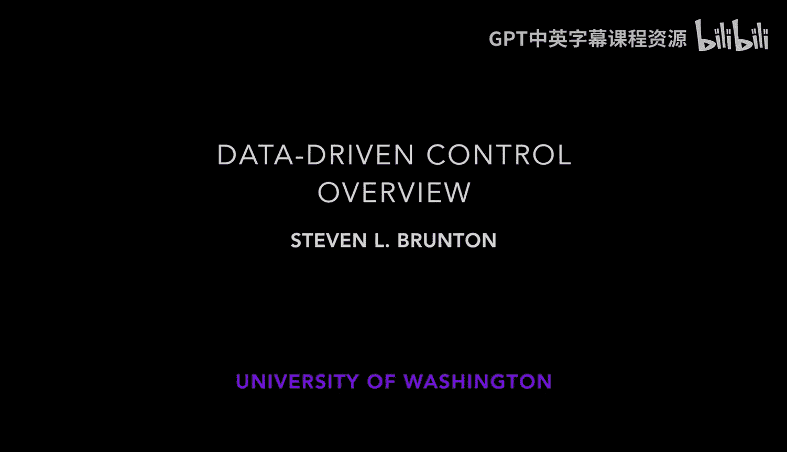

# 华盛顿大学《基于数据的机器学习控制｜Data-Driven Control with Machine Learning 2018》中英字幕 p01 -01-Data-Driven Control_ Overview.zh_en -BV1BK6MBQEtN_p1-

Hi everyone， I'm Steve Brenton， and this is the first video lecture in a new series I'm calling data driven Control。

So the purpose。Of this course。Is to start getting an understanding of when traditional control methods start to break down for real world systems and then start to leverage modern methods in machine learning。

 data science to start to solve these problems for real world control on actual systems of interest。

So if we're feeling a little ambitious， we might even go so far as to call this machine learning control。

I personally subscribe to the big umbrella view of machine learning。 so lots of what I do。

 I consider machine learning， whether or not it's extracting patterns from high dimensional data。

 discovering models of dynamical systems or learning control laws directly from data so really this is kind of modern mathematical methods in machine learning applied to control theory Okay so。

The the goals here again are to get you introduced to thinking about how these powerful modern methods and machine learning can be used to start to tackle real world control systems。

 And this is not comprehensive。 This is a very， very fast and growing field of applied mathematics and engineering where people are using these data-drin techniques for control。

 And so this is really just going to be the tip of the iceberg。 but I want to get you excited。

 And I want to get you starting to think about how you can use these methods to actually control real worldor systems of interest to you okay。

The background I'm assuming for this is a basic appreciation of control theory and some kind of。

You know， basic applied math so that when I tell you about the methods of machine learning。

 which is mostly going to be framed in terms of linear algebra， you can follow along。

 So if you want to get a quick up to speed background on control theory。

 you can see my control boot camp series， which is a few hours to get you up to speed just on linear linear control theory。

 so the motivation here， Let's let's motivate why we need modern fancy machine learning control。

 why doesn't traditional control work for the systems of interest。So back in the。You know。

 the the last few decades， essentially， what you would do for a large class of control systems is you would write down the equations of motion for your system。

 Maybe I'm working on an engine or an automobile。 or maybe let's take a really simple example。

 I want to stabilize a pendulum。 And that pendulum is on a cart that can move left or right。

 and I'm trying to stabilize that pendulum on a cart。So in the past。

 what we would do is we would write down the equations of motion。

 I would write down the Lagrangian or the Hamiltonian for this pendulum on a cart。

Those would be nonlinear equations， which would be difficult to control。

 but what I can do is for lots of systems of interest。

 I can linearize those nonlinear equations about some equilibrium， like the pendulum up conditiond。

And then what I can do is I get a linear system of equations。

 and I can use that with linear state space control theory。

 That could be a common filter with a a linear quadratic regulator。 It could be a robust control。

 All kinds of control methods once I have a linear system of equations。 Okay。

 so just to kind of recap， usually what I'm considering is that I have some kind of a system。Okay。

 that system is going to have some outputs， and I'm going to have some controller。

And this is all just just review。 Okay， so the controller has some measurements of the system。

 These are why my sensors。My sensors why sense what's happening in the system。

 and then that controller can actuate the system。 It can push on the system in the cart example。

 It might be a motor on the wheel that can drive the cart left or right。 So these are you。

 my auators。And the whole idea in this feedback control diagram is based on sensor measurements of the system and maybe some model of the system。

 I can design an actuation strategy that corrects and controls my system to stabilize， for example。

 the pendulum up conditiond okay so this is very classic you can work all of this out if you go back to the control boot camp for linear systems okay。

But this is where it gets interesting。So those traditional systems like Pendulum on a car or cruise control。

 things like that。We could write down the physics。 We knew F equals MA。

 We could write down the equations of motion。 We could linearize them。

 and then we could do linear control theory。 Okay， that's what the vast majority of kind of modern control is based on are these linearizations and linear control theory。

 But in the real world， the dynamics that were actually interested in are probably nonlinearar functions of x and the actuation U so x is the state of the system here。

 the time derivative of F is x is some nonlinearar function F of the state and the input U。

And so for nonlinear control， things get really， really nasty。Let me just give you some examples。

 The systems that we actually want to solve today are， for example。

 systems in neuroscience trying to understand， model and control what the brain is doing to prevent seizures。

 We might want to control a turbulent fluid system。

 So I have a wing and that wing is at a high angle of attack。

 So the flow is massively stalled behind it。 It's turbulent。

 I might want to control that and relaminize the flow to get higher lift and lower drag。 Okay。

 very nonlinear problem。 disease modeling， epidemiology。

Maybe I want to suppress the spread of malaria on a continent。 Okay finance。

 I want to regulate a financial market or the climate。 I want to do some kind of a feedback。

 I want to understand， first of all， the nonlinear feedback going on。

 But then maybe I actually want to design some control strategy to regulate the behavior of the system。

 Okay， so these are all examples of modern systems of interest that we actually want to control that the traditional write down and equation。

 linearized design and LQR controller are not going to work for。 Okay， so I want to。

 I want to start thinking about what are these fundamental limitations。 So what are the challenges。

Of， of these control。 Okay， so the challenges for all of those systems， let's say disease modeling。

 turbulence， neuroscience， finance， climate， self driving cars。 you name it， anything really。

 really interesting that we actually want to control in the modern era。

 Some of the themes are that it's massively nonlinear。Okay。

 and there might not even be a good state to linearize around in in many of these， these cases。

 in the turbulence example， for， for example， that's what what I work on most of the time。

There are lots of cases where what I actually want to do is increase the turbulence。

 I want to increase the nonlinearity so that I get better mixing。 So， for example。

 if I'm making chemicals in a vat， I want to stir it in a way that increases the mixing。

 That's a very nonlinear control problem that you can't write down as a linearization about a stable or unstable fixed point。

 Okay so most systems of modern interest are very nonlinear。

What I think is really interesting and this doesn't get set enough。Is in the classical case， we had。

 you know， in textbook control， you open the textbook and you have the equations of motion for the system you're going to control。

We don't have equations for the brain。 We don't have。 We don't。

 We can't agree on equations for the climate。 Even in turbulence where we have the equations。

 they're so big and unwieldy。 We can't really use them for online control。 So in many cases。

 one of the fundamental challenges is that the equations are actually unknown。

 So I'm going to call this unknown dynamics。Okay that's a really。

 really big challenge in many of these systems。 and it's increasingly becoming a central focus of research efforts is actually。

 I don't even know what F is。 How do I control that， Okay， Another really important one。

 Most of the systems I described to you， if we were going to simulate them if we were going to you know。

 make a big computer simulation， they would be extremely high dimensional。

 What do I mean by high dimensional。I mean that there are lots and lots and lots of degrees of freedom required to describe the system state X。

 So， for example， if I want to describe the spread of a disease in a country or on a continent。

 maybe my model would include every single individual human as an agent。 and that would be。

 you know each human's health state could be an entry in this gigantic vector X。

 Or if I want to simulate the weather on planet Earth。

 maybe what I'll do is I'll break the surface of earth up into one square kilometer grid cells and I'll run some kind of a simulation on that。

 so this x could have millions or billions of degrees of freedom easily for all of the systems that I'm naming in the brain。

 I think you have100 billion neurons， something like that， this is a huge， huge highdimenional X。Now。

 why do we even think that we can control these high dimensional systems？

If there's millions or billions of degrees of freedom， how could I possibly control X？Well。

 this is I think， the crux of almost all of this machine learning control。

Is that in all of these complex systems with high dimensional nonlinear possibly unknown dynamics。

There tend to be dominant patterns that emerge。 So in the disease spread。

 maybe there is an epidemic wave。 and theres some way of characterizing that with instead of a million numbers。

 maybe there's a few numbers that you can use to approximate that spread。 similarly with turbulence。

 even though there's millions of individual vortices， if I have a wing that stalled。

 there's going to be large coherent structures that are the most important for lift and drag and mixing and things like that。

 So even in this million or billiondial state space X that might be a few numbers。

 some lowdimenional representation， some dominant coherent patterns in the data that are actually what I want to control。

 their proxies for what I actually want to control。

 which might be lift or drag or suppressing disease。 I think in in neuroscience。

 a seizure is maybe a good example， your0 billion neurons start to have this single coherent oscillation that you would try to break down if you wanted to stop a seizure。

 So even though you have。S high dimensional unknown nonlinear dynamics， these big。

 dominant patterns manifest， and that you want to control those patterns。

And then I think another important feature to mention is that if I have such a ridiculously high dimensional system。

 I'm probably going to have limited measurements。Measure agreement。

So I'm only going to be able to measure some of the states with why， you know。

 if I'm going to measure the ocean， I can drop buoys。

 but it's hard to measure everything all at once， and I'm also going to have limited actuation。

 I'm not going to be able to push on the system everywhere。

 I might have individual locations where I can actuate。 So in the disease modeling and control。

 maybe I put vaccination station in a village。 and that's one point in this large state space。

 or maybe it affects only a small region of state space。

 so these are the fundamental challenges that motivate this entire series on modern data drivenriven or machine learning control。

 We have these fundamental challenges of the real systems of interest。 They're nonlinear， unknown。

 high dimensionional， and we can only measure certain things about them。And what we're going to do。

 let's say the caveat， the opportunity here。Is that in all of those systems。

We are having an explosion of data。 We have this massive increase in the data collection capabilities that we've never had before with high fidelity simulations。

 better experimental measurement techniques， cheaper hard drives， faster computers。

 we're having much， much， much better ability to collect data for these systems。

 So instead of trying to you know write down from first principles physics。

 what the equation of the brain is。 Maybe we should just collect more data and start using kind of data-driven machine learning techniques to characterize the system and to start playing around with designing control laws。

 That's what this entire lecture series is going to be about is using these modern data drivenrin methods to start addressing one by one going through and addressing these challenges to make control theory more accessible to the real systems of interest。

 and I should note。😊，We still don't have。Really， you know， any silver bullets for neuroscience。

 turbulence， finance， climate， epidemiology， modeling and control。 These are still open challenges。

 This is modern research。 I don't want to tell you that this is all done。

 But these are the steps that we're taking towards starting to break down these grand challenge problems and make them tractable and then start to get towards the solution。

 So those are the solution。 the problems of the modern era。

 And we believe that data-dven techniques are going to be at least a part of the solution combined with classical theory of dynamical systems and control。

 So we can't throw away what we know about control。 We can't throw away what we know about physics。

 but we're going to augment that with the massive amount of data that we're collecting。 Okay， good。

So just a couple more things I want to point out， and then we'll break into individual lectures and start to dive into specifics and case studies and all of this。

One thing I want to get to is what is control Okay， so in the first place， what is control theory？

So I have been in the past accused of oversimplifying， and I think that is。You know。

 a risk you take when you try to distill something as big as machine learning control into a single lecture series or even an overview。

 I'm going to oversimplify what is control and what is machine learning。 Okay， so what is control。

Yeah。I think of control。As an optimization。That is constrained by the dynamics。Of of your system。

 the physics of your system。 So this is a optimization。That is constrained by dynamics。

Let's write this constrained。By。Dynamics。Okay， so what does the optimization look like。

 This is not the full picture。 In reality， what I probably have is I probably have some disturbances。

And I probably have some measurement of some goal of my system。 Maybe that goal is。

 I'm just gonna to say goal。 This is super vague。 What I mean is it's an objective。 It's a cost。

 Okay， I want to make my cost low or I want to make my objective high。 So in this case。

 this could be。Making drag small lift big on a wing。

 and these disturbances could be gusts or ice that's forming on the surface of the wing or something like that。

 So really， my system has all of these unmeasurable kind of hard to model and handle disturbances that are kicking my system and trying to knock it off of optimal。

 and my feedback controller is trying to regulate the performance of that system to satisfy some object desired objective or goal。

 And we do that。 we do that by designing this control law。 And I'm going to oversimpl here。

 This U equals K of y。 There's just some function， some nonlinear function。

 maybe in terms of past measurements of y and some differential equation。

 But there's my actuation is a function of my sensors。 So I measure what my system is doing。

 And then I decide how to。How to push on the system with my actuation to get some a desired objective。

 given some disturbances。 And this all boils down to an optimization。If I had a linear system。

 if my system was x dot equals a matrix Ax plus B U。We would have linear optimization。

 linear quadratic regulator， commonman filter， L Q G， Those are all examples of optimal control。

 And when people say optimal control， what they mean is we did an optimization to minimize a cost function。

 given some disturbances and the constraints of the dynamics。 That's all the control is。

 It's a constrained optimization where your system is forced to satisfy some physics。

 some differential equation governing the dynamics of the system。 Okay， now。

 if I have a non nonlinear control problem， I can still write down an optimization problem。

 The problem is。We really often only have closed form solutions for linear optimization problems。

 So the linear quadratic regulator is a great example where if I have linear dynamics and a quadratic cost function。

 I can write down a closed form solution for what U equals as a function of either Y or X。

 if I measured all of X， I would get u equals a matrix times x。

 and that's a closed form solution of this constrained optimization。

 If I have linear dynamics and a quadratic cost function。

But if I have nonlinear dynamics and some weird cost function。Then this optimization becomes really。

 really nasty， and we don't have closedform solutions。

 and we might have to do that optimization on the fly。 so for example。

 you know if I'm developing a control system for a missile or for a UAV or for some autonomous vehicle that has nonlinear dynamics and a nonlinear objective。

 I would have to be rerunning this nonlinear optimization on the fly， and that's very expensive。

 and that's actually largely what is done nowadays with model predictive control。

 It's essentially this big online optimization that you're doing that can handle a lot more nonlinearity。

Okay。Now。This is where I think it gets really interesting。 So we。

 we're now framing control as an optimization， possibly non nonlinear。

 possibly high dimensional with some objective function。 Let's think about what is machine learning。

 Okay， what is M L。You're going to see me write ML a lot that just means machine learning。

 So what is machine learning？I think of machine learning as a really， really powerful。

 emerging set of nonlinear optimization techniques。 So these are powerful。😊。

Non linear optimization techniques。Based on data。Okay， so， for example。

 many of you are familiar with these new， powerful deep learning techniques for image classification。

 Okay， so now you can upload an image and it will tell you what the image is just using machine learning using deep learning。

 That's essentially a big nonlinear optimization where you had a ton of training data of labeled images。

 It's high dimensional because there might be a million pixels in an image。 But again。

 there are these patterns。 There's only a few categories of things that those million pixels could represent。

That's an example。 So machine learning is this increasingly powerful set of techniques for nonlinear optimization based on data。

 Okay， what do we have in modern control systems if you want to control a seizure or increase mixing or you know increase lift on an airplane wing。

 that's a nonlinear high dimensional optimization problem。

Machine learning is a set of techniques that can help nonlinear optimization based on data。

 and we have an increasing amount of data。Okay， so that is really the mile high view of what we're going to be doing in this。

 this video lecture series is really starting to figure out how I can use this to solve this for real systems with real challenges。

Okay， the last thing I want to show you today is essentially。

Just an idea of a little bit more texture of how we're going to do this。

 how are we going to apply machine learning to solve this problem。

 So there's a lot of ways we can approach this。The first one。

 and I think this is the one that has classically gained the most attention。

Is I can directly use machine learning。For data driven models， let's just write this down data。

Driven models。 Okay， so remember， one of the big problems is I have unknown dynamics。

 So maybe what I can do is I can find some model of my unknown system just using data。

 I can collect data of X and U and X dot。 And I can learn what is F， you know， from， from that data。

 So that would be using data driven or machine learning to to model the system。

 And then I might be able to use classic control model predictive control or optimal control once I have a system model。

 Okay， that's very， very interesting。😊，嗯。And we'll talk a lot about that。

So the other broad category that I think is interesting that we'll talk about in this class is。

Instead of。Spending all of this effort building a model from data。Which might be good。

 It might be interesting to learn what the physics are。

 right That might be useful for interpreting what our control does and what what our system behavior is。

 but we always， we know that once I， even if I painstakingly model the system。

 when I start to push on it with control， that system changes， right。

 the whole purpose of control is to change the behavior of the system。

 So if I measure my climate system。Just so that I can control it and change it。

 my model might become invalidated pretty quickly with control。

 So instead of doing all of that painstaking modeling。

 maybe I should apply my data drivenri machine learning techniques directly to learning a good controller。

 So that's a really interesting， new and emerging field。

 which is essentially machine learning controller。😊，Which is。

 can I just directly learn effective control laws， This is very similar to maybe what humans or infants and toddlers do when they babble and they you know play around in the world and they're curiously。

Explore the system， and they try different control strategies， and they learn effective controllers。

 And actually， I would advocate doing both of these。

 We should really be modeling the system and trying new control laws in parallel。

 So really doing both of these at the same time is probably the most interesting and effective strategy。

And then the third thing I'm going to talk about。Is using machine learning and data science really optimization。

 Okay， powerful optimization to directly learn what are good sensors or actuators。

 So I think that's another very， very interesting thing we're going to talk about is sensor。😊。

And actuator。Placement。And this is historically a very hard problem because if I have a million or billion degrees of freedom。

 choosing the best five locations to measure is an intractable， combinatorily hard problem。 But now。

 again， it's an optimization。 So there are techniques to optimize those sensor and actuator replacements that get you nearly optimal performance。

 but are very， very fast and easy to implement。Okay， so this is the roadmap。

 This is what we're going to do in this video lecture series。

 We're going to talk about data driven machine learning control。

 We're going to dive into using data science for system identification， learning the system。

 And this might not be the full system。 This might be a reduced order。

Representation of just those dominant coherent patterns that matter。 So this might。

 our model that we obtain from data might be in terms of a small state that just describes those dominant patterns。

We're also going to use machine learning directly to design control laws and essentially try different control strategies。

 see what works， and refine in an iterative and optimization process。

And then we're also going to talk about how methods in sparse optimization will allow us to place nearly optimal sensors and actuators for various objectives。

 Okay， so I'm really excited about telling you about this new and emerging field。

 And I hope that you take these tools and use them to solve really interesting problems。 Thank you。😊。

