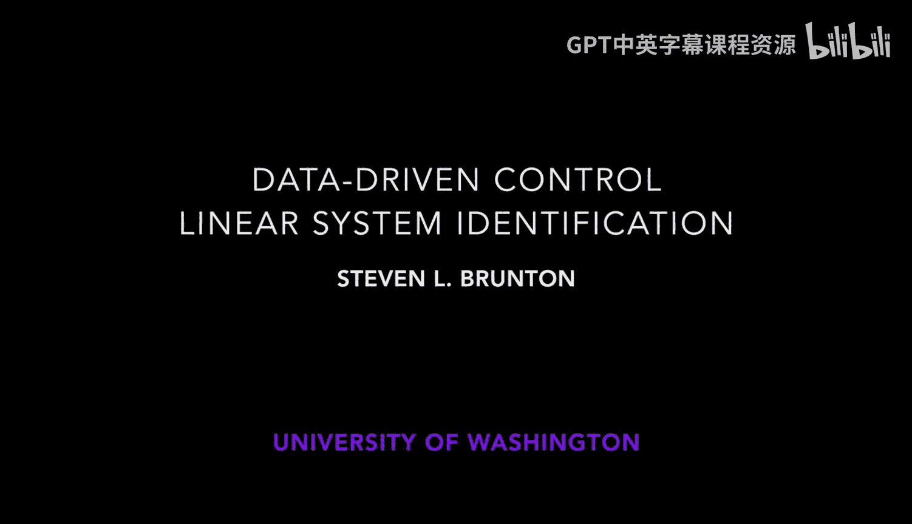

# 华盛顿大学《基于数据的机器学习控制｜Data-Driven Control with Machine Learning 2018》中英字幕 p02 -02-Data-Driven Control_ Linear System Identification.zh_en -BV1BK6MBQEtN_p2-

Welcome back。So in the last video， we talked a lot about how you can use modern methods in data science and machine learning to tackle really hard control systems of modern interest where you might have unknown dynamics。

 nonlinear systems， very high dimensionmenional states and limited measurements and in particular we talked about how you could get into data-drin modeling。

 you could characterize your system with data。You can do data driven control。

 you can directly use machine learning to learn effective control laws。

 and we can also use these methods for optimization for sparse optimal sensor and actuator placement。

So right now what I'm going to talk about is essentially an overview of data driven modeling okay so now I'm going to give you just the roadmap of how you would use data science and machine learning for system identification。

 So really that's what I'm talking about is system identification。嗯。

And this will be a large part of this lecture series。

 So there will be multiple lectures in the vein of system identification。 right now。

 all I'm doing is giving you a big roadmap of what to expect， what you're going to find。

 So system identification is an old subject This has been around at least since ho and Kman in the mid-60s。

 and it's had a really rich history in control theory and dynamical systems ever since then。

 So in the 80s， there was the eigenys realization algorithm that was very useful for characterizing flexible space structures。

 aerospace structures like the Hubble and the international space station。

 where it was hard to get a first principles model of the dynamics because you have this very complicated kind of elastic structure and they use system identification to learn a linear model of the dynamics directly from measurement data so system identification and this data-drin modeling。

Not new。 This is not something that was invented with machine learning in the last 10 years。

 This has been around for half a century。 Okay and I， again。

 I'm a big umbrella machine learning person。 I think of system identification as being a form of machine learning。

What you're doing is you're learning models。That generalize based on past data。

 So I collect data from a system。 I build a model， and I hope that that model generalizes to the future to new input measurements you that I haven't seen before。

 And oftentimes， if you get the physics right， if you constrain that optimization in the right way。

 or you train it on a rich enough data set， this really does give you models that generalize to be useful in practice in the field。

 And so I think of system identification as being a form of old machine learning for dynamical systems。

嗯。Again， this is just a roadmap of what to expect in this kind of part on system Id。

 So part 1 is really system identification。 Sometimes I'm going to talk about something called model reduction。

Okay， and these are very similar and related things。

 but let me just give you the very high level difference so。

System identification is where I collect data。 I measure X in time， and I measure maybe U in time。

 I kick the system， and I measure what happens， and I build a proxy model for F for the dynamics。

 That's system identification。 I identify a system。

What model reduction does This is very interesting。 Sometimes I actually have a model of my system。

 I know the naviier Stokes equation for turbulence。 so I have this ridiculously big hairy equation。

 Maybe I take my PDdeE， my partial differential equation for naviier stokes。

 I discretize it on a million grid cells in a simulation。

 and I get a million dimensional nonlinear ordinary differential equation。

 People do this all the time in computational fluid dynamics。So I might actually have a model。

But I don't want a milliondial model。 I want a model that only describes the dominant。

 most important things that happen for a particular configuration。

 So maybe I have an airfoil and that airfoil is undergoing vortex shedding。

So even though I would need to represent this in a simulation with a million or a billion degrees of freedom。

I might be able to find a reduced order model， a model that captures most of the interesting dynamics。

 maybe in terms of 5 or 10 or 50 states instead of a million。 Okay， if I。

 if I find a good coordinate system， that's what all the physics is about。

 It finding a good coordinate system。 I might be able to represent these dynamics in a reduced order representation。

 So that's what model reduction is。 I have a big hair model， but I want to find a more tractable。

 simpler model， maybe in terms of。A dot a state A， which is much smaller than x。

 which is equal to some F of a。 So a much， much smaller model that captures most of the dynamics。

 That's what model reduction is。 And what we're going to find is that a lot of the same techniques can be used both for model reduction。

 If I have the model， and I want to reduce it， or if I have no model。

 and I just have data and I wanted to discover a model okay。Now， again。

 there's lots and lots of different layers of system identification for anything that's a half a century old。

 I'm only going to be able to give you kind of the the shallow treatment。

 Okay so read more about this， there's a rich， rich history of system identification I'm only going to tell you the highlights so。

A huge part of this is based around linear。System identification。

 Now you might be asking yourself why linear your system identification well。

The most powerful techniques in control theory are developed for linear dynamical systems。

 So if I had x dot equals a X and a is a matrix， So x is a vector， A is a matrix plus B U。

There are known closedform optimal control laws to stabilize and regulate these systems。

 if I know A and B。 So a lot of system identification goes into learning A and B for measurement data。

 Okay that that's probably the bulk of that half a century from the you know，60s until recently。

 most of that went into linear system identification。And。Again。

 one of the things of interest here is oftentimes my system state might be very。

 very high dimensional。 So what I would want to do is also learn a good coordinate system。

I would also want to learn a good coordinate system so that I get a much smaller model。

 I'm going to write it in terms of this little a state。

 Let's call it a dot equals a tilde of a plus B tilde of u。 So I still have a control Noob U。

 but I only want to affect the small vector a。That represents most of the structures I'm going to see in this high dimensional data X。

 And we'll talk about this。 This is going to be a little vague at this point， but basically。

 I want to learn the dynamics。 and I want to learn a good coordinate system。

 I want to learn a good representation of X so that I don't need a million degrees of freedom。

 Maybe I can get away with 5 degrees of freedom Now some of these these methods include the eigensyst realization algorithm。

 we're going to talk a lot about that。 That's a system identification technique that was developed in。

 I think 1985。We're going to talk a lot about。Balanced truncation。

 B T and balanced proper orthogonal decomposition。 So these are both techniques for model reduction。

 If I have a model of a linear system， but it's really high dimensional。

 And I want to find just the few coordinates that matter。

 We're gonna look at balanced truncation and balanced P OD。

We're also going to look at a more recent technique called dynamic mode decomposition DMD dynamic mode decomposition。

 this is more recent kind of 2008 until present people are still developing this DMD algorithm These are all methods that we're going to discuss and what the basic idea is we're going to collect data and we're going to learn representations of A and B and we're also going to learn good coordinate system so that we can reduce this model into a more tractable form。

Why might I want a five dimensional model instead of a million dimensional model？Well。

 lots of reasons。If I'm going to develop a control law。

I'm actually going to have to base my controller on some state of my system X or a。

 And if I'm going to be flying this around in a drone using an iPhone you， as the computer。

 I'd rather be simulating a fivedial ODE for my control prediction than a million dimensional Ode。

 So this gives me faster model predictions and faster model predictions gives me faster control and faster control means lower latencies and higher bandwidth。

 So from the control boot camp， you should know。In your heart now。If I have time delays。

 if I have a slow prediction step to get my controller that's going to introduce a time delay in my system from here to here。

 And it's going to cause my system to have instability or it'll make it so I can't track fast changes in fast disturbances。

 So if I want to have fast， tight system response。 I better have a really， really small。

 minimal reduced order model so that I can get really， really。

 really fast predictions and and control decisions。 Okay。

 so huge amount of work on linear linear system identification。 now。Oftentimes。

 we'll focus on just learning the intrinsic the dynamics X dot equals a of X。

 and we'll forget about the B U， like， for example， DMD。Is based on just learning this A matrix。

 But extensions like D And D with control also learn， learn this B matrix。 Okay。

 for very high dimensional systems。 So that's something we'll talk about。Another interesting。

Faxt here is non nonlinear system identification。 So N L non nonlinear system I D。

I'm going to just use a ton of acronyms。 N L system I means nonlinear system identification。

 This is also a very， very important branch of system identification。

 It's not quite as prevalent as linear system Id because these models are harder to get and harder to use for control。

It's that simple。 Okay， if I had a nonlinear system and I want to control it， it's harder to control。

 and it's also harder to get a nonlinear model from data。

 This has just taken a lot longer to get good at doing this。This is a very。

 very big field and a lot of great people have done work on this。

So there's a lot of work on what are called Nmax models。

 non nonlinear auto regressive moving average， exogenous input。 I'm just going to say Nmax。

These are some of the oldest and still some of the best nonlinear modeling techniques。

What I'm going to tell you about now。 So this is for x dot equals F。Of x。

There's this new method that we've developed called the Sprse identification of nonlinear dynamics。

 the acronym is Cindy。Okay， and basically， this is a new method using sparse optimization to learn what this F of x is directly from data。

 And there's a whole video on this。 I'll point you to the the link in the comments。

 You can learn about kind of modern methods to learn dynamical systems。

 And the cool thing about Cindy is。😊，You actually learn the structure of your nonlinear dynamics。

 So you can write down the O D and you can analyze the terms。 It's interpretable and physical。

 And it seems to work in a lot of cases。 You can learn Odes， PDdes。

 controlled systems and so on and so forth。 There's been some really interesting work before Cindy。

 kind of after anarms between these two， which is using genetic programming to learn dynamical systems。

 So this is。Worked by Boonguard and Schmidt and Libson。Kind of in the 2007 to 2009 time frame。

 really， really nice work using genetic programming to learn learn this F of X。

 So these are all techniques。 And this is， again， just just a few techniques that I'm naming right now for nonlinear system identification。

 Lots of times you will have a system that's fundamentally nonlinear。

 There's no good linear approximation。 and you have to model what is X dot equals F of X。Okay。

 hopefully everyone's still with me so far。 This is just the roadm。 Now。

 the last thing that I want to talk about here。Are models based on measurements。

 so something I didn't talk about here。I talked a little bit about it。

 I have dynamics in terms of a state X， but oftentimes I only have measurements。 Y equals G of x。

 Okay， so these measurements Y， they could be some linear measurement that could just measure the states。

 a few of the states of x。Or they could be these nonlinear functions of x， it could be sine of x1。

 the first component of x， or x2 squared minus x1 cubed， that could be a measurement G of x。

And there's kind of infinitely many measurements I could take of a system。Okay， and so。

There's this new emerging field， which is kind of dynamics。On。Measurements。

And I'm going to put a question mark here because it's not always clear when and how this is possible。

 So this is related to a new field。 It's not a new field。 actually， this was invented in the 1930s。

 but it's newly reemerging because of data driven modeling called Coupman theory。Okay。

 so this is related to something called Coopman theory。

 And the idea is if I have enough of these measurements Y。

 maybe I actually have a lot of measurements of my system。 maybe I'm in the big data limit。

 and I measure more than enough stuff about my system， Can I build a model。

 Can I learn a model Y dot equals， and I'm going to call this K of y because this is supposed to be approximating the coopman operator。

 can I learn a big dynamical system directly on the measurements of my system。

 these nonlinear measurements that I take of my system。 Okay， and if I do that。

 maybe I can take nonlinear dynamics。 So what Coopman theory says actually is if I have enough of these measurements。

 if I in the limit is y goes to infinity， if I have infinitely many measurements rich enough measurements of my system。

😊，Even these nonlinear dynamics can look linear。This is amazing。I just want to emphasize this point。

Many systems are fundamentally nonlinear and need this description to be able to simulate them and predict what to do with your control。

 and then you would do model predictive control on this。Even in those systems。

 if I have enough of a rich enough measurement set Y。

 it may be possible to embed these dynamics in a rich measurement space Y。

 where the dynamics start to look linear。This is very similar actually to what the support vector machine and support vector regression do。

 They take your system and they embed them in this big measurement space where things start to look linear。

That's what this is doing。 And whenever I say linear， you should be thinking easy。

 optimal control in closed form。If I can write a nonlinear system in a linear representation。

 we have known optimal control solutions to handle those situations。 Okay。

 so this is emerging and very， very promising for doing nonlinear optimal control using linear theory。

 Very cool linear theory is like textbook control theory， one line MAlab commands。

 So let's just put that in here。 One line Matlab control。Now， the real trick here。

 the kind of modern research is how do I find a good measurement set why。

 how do I find good measurements so that this linear approximation really does work for nonlinear dynamics。

 That's unknown and it's emerging。 This is something that's still being developed all of these techniques。

 once I build a model。 So， you know， why would I do data drivenrive modeling data drivenri modeling is so I can do model based control。

 So we can do linear quadratic regulator if we have a linear model in lots of cases we're going to do model predictive control。

 So I'm going to put this down。Model predictive control。This is called MPC， very。

 very important control technique。 This is lots of industrial control， uses model predictive control。

 It's super flexible。 You can build in constraints It can handle nonlinear dynamics。 Time delays。

 you name it。 It's awesome。 And so a lot of the system identification is building towards this model predictive control framework。

 This requires my dynamics。😊，To be fast to simulate， I'm going to be simulating a lot of different。

Trajectories and testing them out。 And so I need these simulations to be fast。 So again。

 that goes back to this model reduction。 We want， even if we have big high dimensional dynamics。

 I want to find the minimal form necessary to describe the dynamics I care about for control。 Okay。

 so that's going to be a big theme is high dimensional dynamics to the intrinsic essential low dimensional representation in the context of system identification。

U。Yeah， I think that's about it， so just last thoughts on this overview。

There are a lot of videos out there by by myself and my colleagues on Cindy。

 So I'm going to point to those references。 We have a lot of videos out there on DMD， so。

I'm going to point to those videos， a lot of stuff out there on Coopman。

The new videos that I'm going to generate for this lecture series。

 I'm going to generate some new videos on balance truncation and BPPOD。

 I'm going to do a little bit more on kind of the history and use of DMD and Coopman。

 ER eigenysem realizationization algorithm。Really important one I don't want to forget neural networks。

So neural networks are actually getting really good at predicting dynamical systems。

 So we're also going to talk about how to use neural networks to model nonlinear dynamical systems。

 Very cool。 So we'll talk about this as well。 We'll talk about model predictive control。

 In a lot of these cases， what we're going to talk about is how to extend DMMD and Cindy and Coopman to handle this plus B U to handle control。

 Most of these methods， DMMD， Cindy and Coopman are normally just use to identify unforced dynamics。

 So we're going to have to extend them。😊，To include the effect actuation U。Now， really。

 really important， all of these methods。All of them。Are fundamentally regression based。

 So regression is an incredibly powerful tool all the way back to Ho and Coleman。

 They were using essentially linear regression on data to discover these models。

 Everything we're going to talk about is regression。

 And so this is kind of the main technique that we're thinking about in terms of machine learning and statistical learning。

 And there's flavors of regression。 We could do sparse regression。 Okay。

 that's what Cindy's going to do。 We're only going to pick a few model terms to describe F so that it remains tractable and interpretable。

 We can have constrained。😊，Regression， so I can discover models。

 If I know that there's constraints or symmetries， we can enforce those in the regression。

 And there's， there's many， many others。 So this is all gonna be about regression of data onto dynamical systems。

 That's what system identification is。 Okay， so there's gonna to be a ton of videos on this。

 And then we'll talk about how to learn controllers and optimal sensor and actua replacement later。

 Okay， thank you。😊。

