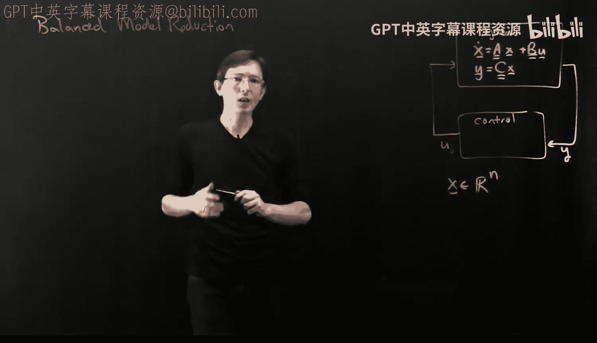
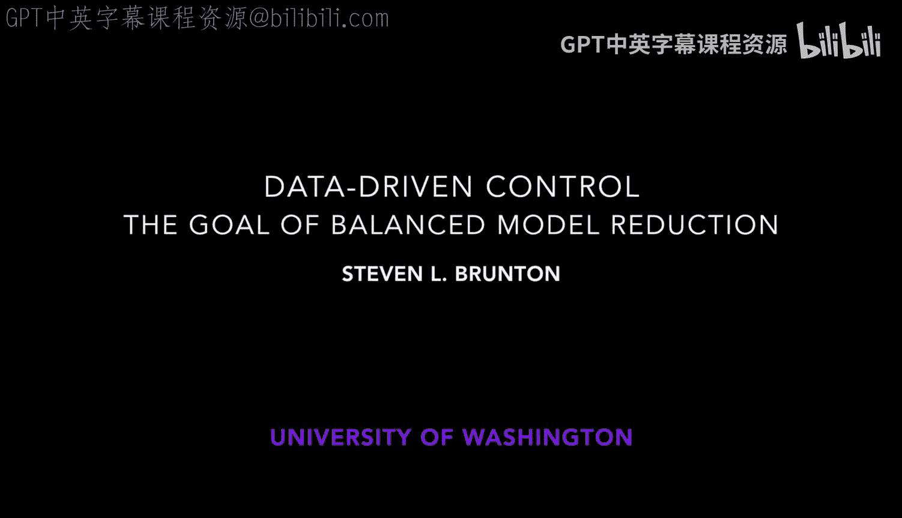

# 华盛顿大学《基于数据的机器学习控制｜Data-Driven Control with Machine Learning 2018》中英字幕 p03 -03-Data-Driven Control_ The Goal of Balanced Model Reduction.zh_en -BV1BK6MBQEtN_p3-

Welcome back。So today， I'm going to talk about model reduction。 And in particular。

 we're going to talk about balanced model reduction。 So I'm just going to write this down， balanced。

Model reduction。A lot of the ideas I'm going to talk about today in the context of model reduction are also going to be useful for system identification。

 So remember， model reduction is when you have a model， but it's too big to use for control。

 And we're going to try to find a smaller model that captures most of the dynamic features。

 I'll tell you what I mean by balanced in a little bit。

 But most of what I'm going to talk about with balance model reduction again applies to system identification。

So let's just put this into some context here。 Remember， we have some system。

That system is going to eventually， we hope be controlled， so we're going to try to control。

The system。We're going to take some measurements y。

And the control law is going to give some actuator signal， U。

 some control knob U that it has control over to change the dynamics and behavior of this system。

So everything I'm going to talk about for the next few lectures are going to be with respect to linear dynamical systems。

 not nonlinear system I， but purely linear。 so we're going to assume that our system is X dot equals。

A X plus B， U， Y equals Cx。And to start with， we're going to assume that we know。

What the dynamics are。 We have a model for A， B and C， but X is really， really big。

 way too big to use。 So X is in， let's call this R and。

 that means there's n degrees of freedom needed to describe the system X。

 Let's put vector notation under this matrices will have double。 Okay。

 maybe U and Y are vectors as well。So this vector x is a really， really， really。

 really high dimensional state of my system and might be a million or a billion degrees of freedom if this is a turbulent fluid。

Disretized onto a grid， or if this is the state of a state of a disease system in a country。

 maybe this is every individual in that country， maybe there's 80 million people。Okay。

So if this is a very high dimensional vector， the goal of model reduction is to find a new system that captures most of the input to output dynamics。

 It captures most of the into to out dynamics。 but with a much， much smaller state than X。

 so we'll walk through this in a minute。 and I'll tell you what I mean by balanced later。

So the goal， okay， the goal。What we're going to do is we're going to start with a system like this。

 I'm just going to write it over here， x dot equals AX plus B， U， Y equals Cx now。

If I'm a control theorist， I do care what the dynamics are。 I care what the dynamics of x。

 the internal state of the system are， if it oscillates or if it grows exponentially。

 if it's unstable， if it decays really fast， I care what those are， but what really matters to me。

Is if I kick the system with my control input， with my actuation U， if I， if I。

Impulsively kick the system with what I can force it with。

What happens to the measurements Y those will be a function of the dynamics of because they're measurements of the state。

 So I kick the system。 I get some transient response。 Maybe it's even unstable。

 And then I measure some portion of the state in my measurements Y。

 and that's going to be my input to output。 So input U output Y what I really want to do。

Is I want a smaller model in terms of a smaller state。

So that most of those dynamics from input to output are captured。 Okay。

 so what I really want is a new state。 Let's call this x tilde。 Okay， so tilde is my reduced state。

 This is my full。Hi D。This is gonna to be my reduced。Lodi。State， okay。

 this is going to capture most of the behavior of X。 But in a much， much smaller。

 we're going to call this R， R。 So I'm only going to use little R degrees of freedom for this where little R is much。

 much， much less than n。Okay， so what I want to do is I want to write this in terms of a new system in terms of this small state。

 Let's write that down。 Okay， so what I'm going to have is X tilde dot。

 the time derivative of my reduced state is going to equal a tilde x tilde。Plus， B tilde you。

And then my measurements y are going to equal C tilde x tilde。So notice that U and why didn't change。

 I still have the same input。 I can't reduce that input。

 it's what I have the ability to control in my car。

 I have a steering wheel and a gas pedal and a break。 That's you。 Okay， Y are my measurements。

 Those don't change either。 The only thing that's changing is how I represent the internal dynamics of the state of the system in terms of x tilde instead of X。

 And X tilde is many， many fewer degrees of freedom。

 It's only the essential information that most matters for modeling what happens from input to output。

So sometimes I kind of think of this as a black box， okay， from U' to Y's。

 and I want to just find some minimal linear model in terms of tilde variables that captures most of the energy from U to Y。

And remember。For control design。The reason I don't want a million dimensional。

X vector is because my control would be huge。 My， my LQR control would now be this million size。

Feedback matrix。 So what I want to do instead is I want to be able to characterize these dynamics in terms of a much。

 much smaller state that's our dimensional， which will make it much faster to predict and to actuate and that faster actuation。

 because I'm only evaluating a small model will essentially allow me to have much lower latency。

 higher bandwidth control。 Okay so。😊，Really， this is just a fundamental hardware problem。

 I can't simulate a million dimensional system fast enough to get good high bandwidth control on the time scales of the system I care about。

 So I want a reduced representation that I can simulate faster and more attractively。

 So as simple as that。 Okay， so the goal。Is to find these new coordinates x tilde and a new dynamics A tilde B Tilda C tilde that best capture the input output by put dynamics from u to Y。

And what we are also going to assume。Is that we can reconstruct our state X from these X tilde。

 So there's going to be some big matrix Psi。 I like psi。 It's like a poseidon in terms of X tilde。

So if I want to draw this just in terms of pictures， remember x is a really， really， really。

 really tall vector， million dimensional vector of all the states。But maybe there are only a few。

 a small handful of dominant patterns that are exhibited by these million dimensional dynamics。

 maybe， you know， if I'm looking at flow over a wing in the million degrees of freedom space。

 I always see。Big vortices forming and shedding。 Okay。

 so there's a few dominant patterns that I see all the time。 Those are captured in this matrix p Psi。

 So this matrix psi might have  five or 10 columns， each of which is the size of X。 Those。

 each column is a pattern。 A dominant pattern in my system。

And then little x tilde is a fivedimensal vector that tells me which of those five patterns are active at this particular moment in time for the state X。

 And so basically I can approximate my big high dimensional vector by finding some mixture of these dominant patterns that I've seen in the data。

 So patterns live in psi X tilde are the lowdial coefficients of those patterns。

 maybe five or 10 of them or might be5 or 10， and then I can reconstruct my high dimensional state by just multiplying back。

So， okay， I can develop my controller here。 I can develop my model here。

 And if I want a pretty picture to see what's actually happening in my system。

 I just reconstruct with psi， and I get my full vector X。 Very cool。 So this is basically the goal。😊。

Is defined。 So this is my original system。 This is my original。

I want to find a new system in terms of this new state x tilde that's much。

 much smaller than x that best captures the input to output dynamics from U to Y。Now。

 best captures input to output dynamicss is a little bit vague。

 but there are ways of actually formalizing what that means in terms of mathematics。

 and we'll do that in a bit。Let me give you a really。

 really simple example that illustrates some of these ideas。Okay， so a really simple examples。

Let's make a two state system。 So this isn't really fancy high dimensional model reduction。

 but let's assume that n is 2。 and I want to find a one dimensional approximation。 R is1。

So we're going to write DDT。Of x1， x2。Equals， okay。

 and I'm going to write down an a matrix and a B matrix x1， x 2 plus going have a B matrix times u。

 And I'm going to measure y equals some C matrix。Times x 1， x2。

 So let me just write down what the numbers are， and then we'll work work through this problem。 Okay。

 so the numbers， I'm going to have-2，0，0-1。Now， if I didn't think about controllability and observability。

 remember from the control boot camp， there are these observability and controllability Grmyions that tell me what directions in state space are most controllable and most observable。

 So if I had a gallon of gas in my tank and you， which directions and X I could go farthest along。

And if I had some measurement with noise Y， what states of x could I best estimate？

If I didn't think about any of that， if I forgot everything I know about control theory。

If I wanted to pick one of these states。To capture the best captures of the dynamics。

I would probably pick the x2 state， I would write a new system just x2 dot equals minus x2。

Because this-1 eigenvalue is more lightly damped than this -2 eigenvalue。

 The x1 dynamics are decoupled from x2， and they're going to die out faster。

 if I just started with x1 equals x2 equals 1， a vector 11。

The x1 dynamics are going to decay faster than the x2 dynamics。

 so I'm going to see these sticking around for a lot longer。

 So if I was naive and all I cared about in the universe was a。

 I would probably pick the x2 variable I'd probably reduce out by killing x1 and only keeping x2 because this is a more lightly damped eigenvalue。

Now， this is where it gets interesting for lots of systems that is that that intuition is wrong。

 So let me give you this， these new variables。 So now the B matrix is going to be one。

And 10 to the minus 10。Okay， big， teeny， tiny。And here I'm going to do the same thing。

 the first element of C is going to be 1， and then this is 10 to the minus10。

So now you can see that choosing x2 solely because it had lightly damp dynamics that were're going to stick around longer was a terrible idea。

 This is kind of an exaggeration because you barely affects X2 at all。 I could kick you。

A thousand times harder。And it's not going to affect x nearly as much as it affects x just because of this second component of my B matrix is tiny。

 Does everyone see that。The way that the actuation affects the state is through this B matrix。

 and because the second component is tiny， no matter what I do to you， it's not going to affect x2。

 So even if these dynamics are more dominant。They're not controllable at all。

 The X2 direction is not is barely controllable。 Similarly。

 even if I could muster enough energy to kick X 2， I can barely measure it。

 It barely barely comes out in my sensor measurement because that's 10 to the -10。So in this example。

 it becomes very clear that we can't simply make decisions based on one matrix A。

 we have to consider a and B and C， and in this case the reduced dynamics。

 the dynamics that make the most sense is actually to keep the x1 variable and say the best approximation from u to y in terms of one variable is just x tilde equals x1。

 we're going to kill the x2 variable， even though it has stronger dynamics。

And I'm going to get x1 dot equals minus2 x1 plus U， and I'm going to get Y equals x1。

This reduction from two variables to one variable is by far the best way of capturing the u to y dynamics。

 Okay， so this is just like a very， very simple example of what we're going to be doing。

 We're going to develop a formal theory。For how to find these coordinates X Tilde and this coordinate transformation。

 this is just。A coordinate transformation。Okay， coordinate transformation。

 We're going to find a coordinate transformation into new。

 better coordinates where I still capture most of my input output energy from U to Y based on these matrices。

 A B and C and that's what balance means。 Okay， so I told you I I would mention what balance model reduction means。

There's a million different ways of choosing a reduced order model。

 My naive approach just going based on the eigenvalues of a was wrong In this case。

 What balance model reduction does is it balances， it finds states that balance the controllability of that state with the observability。

And that's really what I want to do。 I want to care more about states that are simultaneously easy to control and easy to observe。

Because if I have a state that is not controllable or observable， I don't care about it at all。

If I have a system that's very controllable， but barely observable， even if I control it。

 I can't measure it。 So it's hard to control based on that。 And similarly。

 if I have a state that's really easy to measure， but I can't control it at all。

 I don't want to care about that either。 So what I really care about。Is finding states。

 these dominant patterns， these states， these are these these columns of p Psi are directions in state space that are most jointly controllable and observable。

 And we're going to quantify that with the controllability and observability Grmyions。

 So if you need a refresher， just go back to the control boot camp。

 and and kind of get caught back up on controllability and observability Grmyians because that's what this is all going to be based on。

Okay， thank you。

