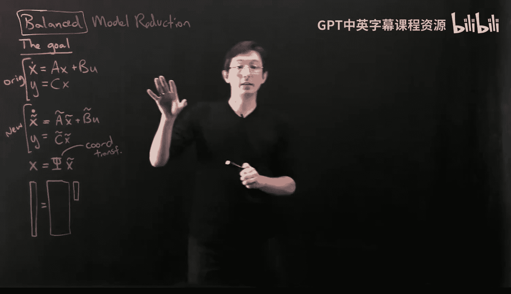
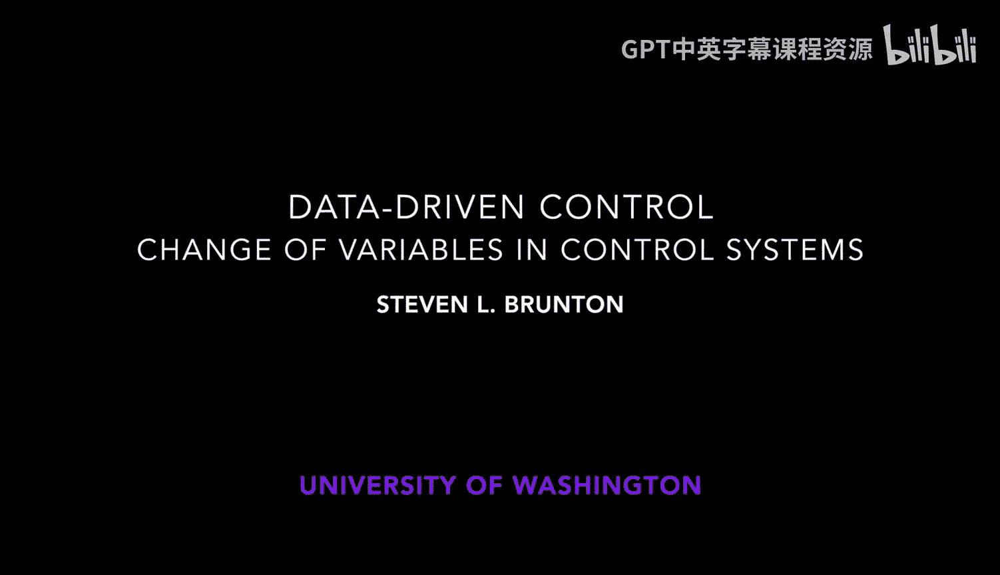

# 华盛顿大学《基于数据的机器学习控制｜Data-Driven Control with Machine Learning 2018》中英字幕 p04 -04-Data-Driven Control_ Change of Variables in Control Systems.zh_en -BV1BK6MBQEtN_p4-

Welcome back。Okay in the last video， we talked about what is the high levelve goal of balance model reduction。

 which is to find some coordinate transformation from a high dimensional state x to a low dimensional state x tilde that captures the most input output dynamics from u to Y。

 because that's all I really care about for control because I can affect you and I can measure Y。

Now before we get into finding this what this we're going to call this the balancing transformation。

 we' going this is a coordinate transformation that balances controllability with observability Before we get into that。

 I have to tell you how dynamical systems how these linear state space models change。

Under a change of coordinates。 So what we're going to do essentially is we're going to look at what happens。

X equals。I'm going to draw this as a big square matrix T。Time Z。So this is a reduced state x tilde。

 First， what we're gonna do is we're gonna to look at what happens just if I do some coordinate transformation T。

 So this is an invertible matrix T that all it does is just changes my x coordinates to Z coordinates or vice versa。

 We're going see what happens when we。😊，What happens to these dynamics when we do this coordinate transformation and then we're going to pick a very。

 very special T that balances that takes my controllability gramian and my observability Grian。

 And under this coordinate transformation， we're going to find that there are special coordinate transformations that make those Grians equal and diagonal。

 so I can basically find a coordinate transformation。 I'm going to draw this。

 This is a super important picture。 So maybe I have a controllability gramian。

 I'm going to draw this as an ellipsoid in state space。 So this is my most controllable direction。

 that's my least controllable direction。😊，Maybe I have。An observability graian like this， Okay。

 pointing in a slightly different。 So this is， let's say， O B， S V。 This is Gramian observable。

This is。Let's call this CTRB， this is my WC Grian。Maybe that isn't going to come through WC。

 my controllability Grian。Then what's really amazing is that there exists a coordinate transformation T。

 a special one out of all the possible invertible matrices T。

 there's a very special one that essentially changes the coordinates so that both of these graians are equal。

To this pink Grian。And then this becomes in these new coordinates。

 WC equals WO equals a diagonal matrix sigma。And this diagonal matrix is ordered from most controllable and observable to least controllable and observable。

 And this gives me a very clear way of truncating。 If I only want， you know， one state or two states。

 I pick the directions that are most jointly controllable and observable。 So in this case。

 I would pick。This direction， because that is the most controllable and observable direction。

 and I would disregard this direction。And so we're going to find that special T matrix。

 We're then going to pick a subset of those columns and we're going to call that ps that'll be our balancing transformation Okay。

 so that's what we're going to do。 we're basically going to find a special coordinate transformation that makes my controllability and observability gramyians equal in diagonal that's going to give me a hierarchy of my state space in terms of the most jointly controllable and observable states to my least jointly controllable and observable states so from highest to lowest。

And that gives me an easy way of drawing a line and saying if I want to keep five modes。

 if I want a five dimensional representation that most captures the controllability and observability。

 I can just pick the first five columns of T and that's my balancing transformation that's where it's going。

Right now， I'm going to tell you。How this dynamical system and how these gramyians change under a coordinate transformation T。

 So if this is a little fast， we're going to go back through this。

 we're actually going to code this up and visualize it in Matlab。

 And we're going to go through finding that coordinate transformation T that does this。

 It's very related to eigen decompositions。 So it's like eigenvectors。 T is essentially going to be。

A fancy set of eigenvectors。 Okay， super simple basic concept。

 What we're going to do is we're going to write this dynamical system in terms of a new variable Z。

 where x equals T Z。Okay， so what does this actually do？Okay， so x dot is t times z dot， right？

So essentially， I'm just going to say。I'm just gonna basically， every time I see an X。

 I'm going replace it with the T Z。 super simple。 So I'm going to say。Ti。😔，Z dot equals a。Times Ty。

Plus， B。You。And y is going to equal C。Times Tz。This is really simple。 I literally just took this。

 And every time I saw an X， I plugged in a T Z。 I took the time derivative and t is a constant。

 So it doesn't get a dot， but Z is a variable。 It gets a dot。 Okay， so T Z dot。 Now， remember。

 this is a full coordinate transformation。 This is a big invertible matrix。 It's an n by N matrix T。

 So we're gonna left multiply by T inverse to get just my Z dot equations。

 So now what I'm going to get is。Z dot equals T inverse。AT。Zi。Plus T inverse B U。

And y isn't going to change its just C T。Z。And so now what's cool about this is these。

These essentially give me my new A， B and C matrices in my Z coordinates。 So in my Z coordinates。

 this is my a matrix。 This is my B matrix， and this is my C matrix。

 So I think what I'm going to do is I'm going to just call those hats。 I'm going say any A。

 B and C matrix in Z coordinates are A hat， B hat and C hat。😊，So finally I'm going to say。

 let's group these this is one set of equations， two sets of equations。Z dot is a hatt。Zi。Plus。

 B hat U。And y equals C hat。Z， where a hat is just T inverse A T， B hat is T inverse B。

 and C hat is C times T。嗯。That's pretty simple。 Okay， Now， if the columns of T are orthon normalmal。

Then T inverse would be a T transpose， and this t inverse would be a t transpose。

 So if I had a very special transformation T where it was not only invertible。

 but the columns are ortho normalmal， meaning that the inner product of any two columns is equal to0。

Unless that inner product is that column with itself。Then this inverse is even easier than T inverse。

 it would just be T transpose， so that's a nice thing that you can do with these coordinate transformations。

Okay。So this is really， really simple。 I can just do a change of coordinates with an inverttable T。

 Let's make a little note。 This is important。 This is invertible。Okay。

Because it's a big square matrix， it's a real coordinate transformation， it's not a truncated state。

If I have this coordinate transformation T， then I can write my dynamics in these new Z coordinates pretty simply in terms of AB。

C and T。now what I want to tell you， what's really important。

Is understanding not only how this affects the dynamics。But how this affects the graians。

 this is the most important part， Okay， because what we're going to be doing is we're going to be trying to design a very special that does this that takes these graions and makes them equal equal and diagonal Okay so I'm going to do my best attempt at trying to write down what all these gramyians are here。

And it's a little bit。you know involved so this is going to be some math。

 so bear with me so what I want to do is I want to write down what is the Grmyian in these coordinates in my Z and hat coordinate system。

And again， you can go back to the Controllability boot camp。

 the control boot camp and remember what is this WC， so I'm going to say WC hat。

I should have probably called this a hat。 Let's call this hat hat。 right。

 We're going to find this new coordinate transform that makes my hats do a special thing。 Okay。

 so what is my controllability Grammyian， I think。😊，It's an integral from time zero to time infinity。

Of。Integral from time 0 to time infinity。OfOkay， I'm cheating a little。Of E to the a。Tao B。B， okay。

 I'm going to do star。 That means complex conjugate transpose。 So if I happen to have。

Complex value dynamics， which happens in quantum mechanics。 This is the complex conjugate transpose。

 for any real value dynamics， this is just a transpose。I want you to， okay， let's put a note。

Star equals complex。Conjugate transpose。So for all real systems。

 this is just a transpose times E to the a complex conjugate transpose tau。Ditao。Okay， and remember。

 these are hat variables。 This is a hat， B hat， B， hat， A hat。Okay， remember what I'm trying to do。

 I have dynamics。 Those dynamics have controllability and observability gradientians。

 I want to know how do the dynamics change in a new coordinate system and how do the gramyians change in a new coordinate system。

 That's all we're going to do right now。 Then we're going to design that coordinate transformation to have good properties。

 So this is the controllability Grian in my A hat， B hat， C hat coordinates。Okay。

Now what we get to do is expand A hat is really T inverse A T， and B hat is T inverse B。

 So it' is going to get a little messy。W， allright， let's try it。

 I'm gonna give myself a little more room here。 This is an integral from 0 to infinity of E to the。

T inverse， A T。Tao。Okay， B hat is T inverse。B， okay， B hat transpose is。Be hat transpose。

Is B transpose T inverse transpose。Okay， this is gonna be a B。Transpose T inverse transpose。

 I'm gonna just do minus star。 But you're gonna have to remember that is literally T inverse。

Transposed， I just invented this。 Well， I didn't invent it， but this is just notation。

 This means T inverse transposed。And then I need my E to the T inverse， A T， tao， D， tau。Not great。

 Not terrible either。 Okay， that is what my controllability Grmian and Z coordinates looks like in terms of my original ABC。

And team matrices。Now， the cool thing is I can pop because I'm going to assume that this is somehow kind of an eigenvector or an orthogonal。

 I'm going to assume that this T inverse I can pop out of this exponential， which I can。

So I'm going to pop out my T inverse on both sides of everything。 So I'm going to pop my T inverse。

 I'm going to have my integral。 I'm going to get integral 0 to infinity。

E to the a tau times the matrix T。Times t inverse， those cancel。Times B， B star， T minus star。

T minus1 E to the a tau， this should have been a star up here。

 You guys should be catching me on this。A star。Big T detail。 Okay， sounds like a bunch of math。

 But all I did was I pop the T's and T in verses out of the exponentials and these guys cancel and these guys cancel。

And when those cancel， what's really cool， okay， I dropped a T here。

What's really cool about this is that this is a constant t in versus a constant matrix。

 this T on the outside is a constant， so I can bring those outside of the integral。

And all that's left is an integral from0 to infinity of E to the A， B， B star， E to the A star T。

That's my controllability Grmmyian in my original coordinates， that's original WC。So， this equals T。

Inverse。WC。T， if I didn't mess anything up， what this means is that when I do a coordinate transformation with this T matrix。

 my new controllability Grian is simply T inverse times my old controllability Grmyian in my original x coordinates times T。

That's a pretty useful， useful to know。 Okay， so now what we're going to do is we're going to try to find a good T that takes my original WC and makes it。

Equal to W， O and equal to a diagonal matrix。 That's what we're going to do。

 I should probably also tell you what W O does， just。This is an exercise。

 You can just do this yourself at home。 W O Ha is going to equal。T star。W O。T。Okay， and this was。

Is this right？T inverse， WC T。T inverse， I think this was supposed to be。A t minus star。

 And I think this is a t minus star， and this is a minus star。

Let me see about that and get back to you。Okay， big picture we have。Dynamics。

 we're doing a coordinate transformation。 We want to know how the dynamics change and how the controllability and observability Grians change。

 Next time， we're going to design this T matrix specifically so that these graians have beneficial properties。

 Okay， thank you。

