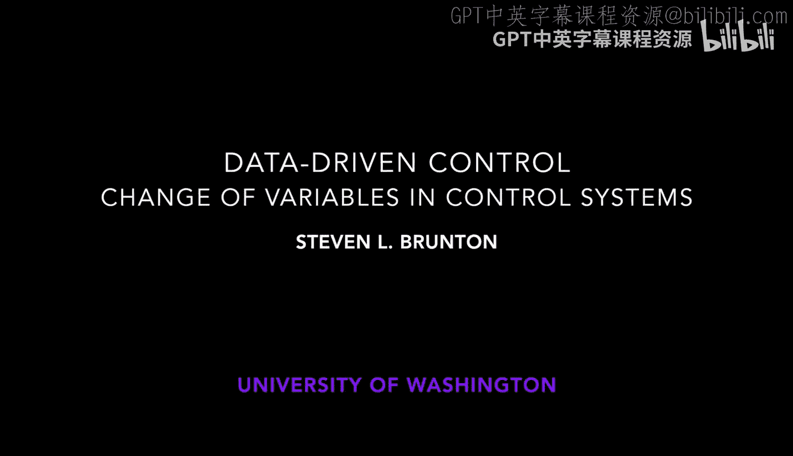

# 华盛顿大学《基于数据的机器学习控制｜Data-Driven Control with Machine Learning 2018》中英字幕 p05 -05-Data-Driven Control_ Change of Variables in Control Systems (Correction).zh_ -BV1BK6MBQEtN_p5-

Welcome back。 Okay， I had a typo in my last。My last description of this Grian。

 the thing I missed was that this is a hat complex conjugate transpose。

 which means that this T inverse a star T star should actually be， let's just actually work this out。

I have this matrix。 that's a hat。 Okay， a hat。 So a hat star。Let's just do a transpose。T star。A star。

T inverse star。 Okay， so if I have a product of these matrices and I want to transpose that product。

 I literally just flip the order and transpose each of them。

 So the transpose of this is T star times a star times T inverse star。 That's this thing。

So that's what I messed up。 This should have a T star。A star。T minus star。Okay， this is a nasty。

 ugly math。 So now， instead of this being a T inverse， this is supposed to be a T。🤢，Star。

And instead of this being a T。Inverse， it's a minus star。Okay。

 these guys actually do cancel T inverse star times T star is the identity matrix of this cancels。

 and what I'm left with is T inverse WC T inverse complex conjugate transpose。

This sounds super complicated。This is what WC hat equals At the end of the day。

 These are all things you can actually compute in MatTlab in one line。 This is in the inverse。

 you can compute an inverse。 You can compute an inverse and then transpose。

 transpose is just apostrophe。 Okay， so it's really easy to actually compute these。

 It's fancy math notation， but this is just。The inverse of T， and then transpose it。

And so this is how how the Grians transform。 And I think this is also right for the observability Grian。

So you can go back and just kind of work through all of this super carefully on a clean sheet of paper and convince yourself that this is how Grmyians transform your controllability transforms like this。

 your observability， Grmian transforms like this， and then we're going to use that property to design a good tea that balances controllability and observability。

Thank you。

