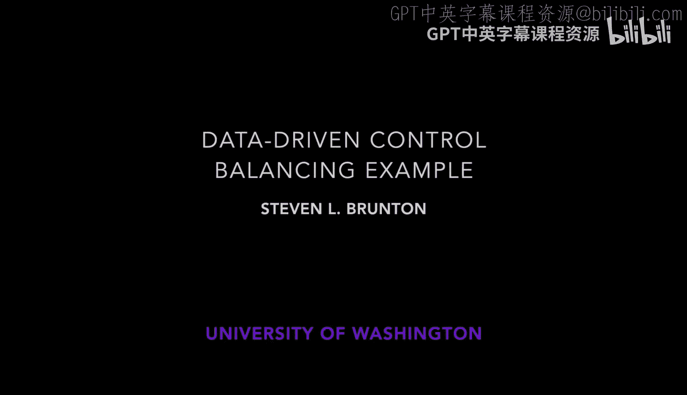

# 华盛顿大学《基于数据的机器学习控制｜Data-Driven Control with Machine Learning 2018》中英字幕 p06 -06-Data-Driven Control_ Balancing Example.zh_en -BV1BK6MBQEtN_p6-

Welcome back。So in the last video， what we saw was essentially how dynamics。

 linear dynamical systems change under some invertible coordinate transformation from X coordinates to Z coordinates。

 they basically。Turn into， you know， instead of A， B and C， we have these A hat， B hat and C hats。

 which are simple functions of my original dynamics here。

 And we also saw how that transformed my Grmmyion。 So my new controllability Grmian and these new coordinates is this expression in terms of my old Grmian and my new observability Grmyian looks like this also。

So I want to work through a really simple example， and I should point out。

All of this balance model reduction really started with this very。

 very important seminal paper by Moore in I think 1981， very great paper， you should all go read it。

 it's a classic now。Basically， he laid the foundation for the fact that there are these transformations that have this property of balancing migrians。

 making these equal and diagonal。And then he showed you how to actually do it with a real system。

 and then he showed us how to do it with data， so everything we're doing is kind of in the spirit of more 1981。

 I believe this is an IEEE transactions on automatic control paper， but don't quote me on that。

So as a really simple example， I just want to show you kind of what we would be doing here to balance these。

 Let's start with a really， really simple example in X coordinates。 We're gonna have。Good， okay， DDT。

Of x1， x2。Equals， and I'm going to make this-1，0，0，-10。

 So I'm going to make this a decoupled dynamical system just because it's easier to think about。

 Okay， we don't have to do this， but it's much easier。If I do。

 and what I'm going to do is I'm going to have a system state that's 10 to the -3，10 to the plus3 U。

 So notice that my first state is much harder for you to control than my second state。

 It's like U impacts the first state way， way， way more aggressively。

 And then I'm going to have my measurement。 Y。Equals。10 to the three，10 to the minus3。

 So in this case， it's the exact opposite。Notice that my first state is way easier to measure than my second state。

 This is -3。 This is plus 3。 Okay， so this is just a kind of。Really exaggerated toy system。 in fact。

 this is basically modified from an example that Moore gave in his 1981 paper。Okay。

 so what I could do a very simple balancing transformation。If I went through。

 I would find that the X1 state is。The x2 state is super controllable。

 and the x1 state is super observable， basically， okay。

 so these would be kind of perpendicular gramyions where x2 is much more controllable than x1 and x1 is much more observable than x2。

And this simple example is going to show us how a T matrix could actually make this balanced and find a state that's equally controllable and observable。

So the state we're going to do now is we're going to say， okay， Z。

This is just a super simple Z1 and Z2。 Z1 is going to equal。10 to the three times x1。

And Z2 is going to equal 10 to the minus3。Times x2。 This seems just ridiculously simple。

 and you could write this as a matrix if you wanted， I could say this is。Z equals 10 to the 3，0，0。

10 to the minus3 times x， and I could invert that to get T。 Okay， this is a T matrix。

 This is T inverse。What this is doing all I'm doing is rescaling X1。

 I'm making it1 thousand times bigger， and I'm rescaling x2 to make it1 thousand times smaller。

 That's all I'm doing。 That's what the T matrix does。 is it just rescales my state。

 But what we're going to find is that in those new Z coordinates， we actually get balanced dynamics。

 The inputs in the outputs are somehow balanced。 So let's write this DDT of Z。😊。

And I'm pretty sure we can just write this down Z2。 So what's DDT。Okay， DDT of Z1。Is。

My dynamics don't change。 Okay， because even though I pick up a 10 to the -3。

 I also have a 10 to the -3 over here。 So those cancel out。 So my dynamics don't change。

 My a matrix stays exactly the same。You can verify。

 you can go through this procedure and figure out that your a matrix doesn't change because it's diagonal and this is diagonal so nothing changes。

 this is Z1 Z2。But what's going to be dramatically different are these B hat and C hat vectors。

 So this is where it gets really interesting。I'm going to just。Write this all out。Okay， so。

You now affect what I did was I made this X1 state。 I multiplied it by 1000。 Okay。

 so now I'm amplifying x1 by a factor of 1000。And so essentially， what that does。

 if you go through this T inverse B is it makes this 1 thousand times bigger。

 And I made x210 times smaller。 It makes this1 thousand times smaller。

 So what this does to my B matrix。Is 11， and I want you to actually go through， I'm going fast。

 I want you at home to go through and take these ABC matrices， and this is T inverse。

AndCompute T and then compute A hat， B hat and C hat and verify that what I'm doing here is correct。

 Okay， I'm just kind of taking this for granted Similarlyly， if I make this one。

If I scale this one up and this one down， because x1 is the inverse of T， I have to like。

Divide z1 by1000 and divides and multipies z2 by 100， these also get balance to1 and1。

Long story short。 What we're finding is even if I had dynamics that looked terribly unbalanced。

 right This is as bad as it can get。 this mode was ultra controllable。

 and this mode was barely controllable。 and the opposite was true。 This was very， very observable。

 And this was barely observable。 This was just an artifact of how I chose to write X。

 Maybe I wrote I don't know x1 in millimeters。 and I wrote x2 in kilometers。 That was stupid。

 So what Z does is it writes them both in meters。 So make sense x1 up here was written in mill in millimeters。

 X2 was written in kilometers。 So these numbers just looked artificially off。

 What I do is I coordinate transform so that now everything's in meters。 I multiply this by 100。

 I divide this by 1000。 And when I write them in meters。

 I get these balance dynamics where now x1 and x2 are equally controllable and observable。

 That's kind of an extreme example， but this is just a cartoon of what we're going to be doing。

 And I want。To show you this on a two by two decoupled linear system， because eventually。

 what more did， he showed how you could do this for 1 thousand00 by thousand00 or million by million system。

 where the intuition is a little bit less obvious。 So this is for building intuition。 Now。

 we're going scale this up to really big systems。 We're going to design a T matrix that balances mygrmions。

That's coming up next， thank you。

