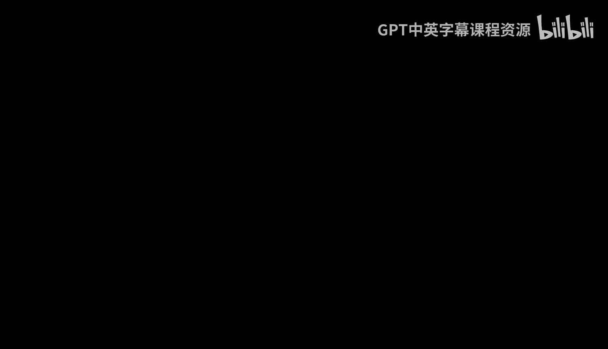

# 华盛顿大学《基于数据的机器学习控制｜Data-Driven Control with Machine Learning 2018》中英字幕 p07 -07-Data-Driven Control_ Balancing Transformation.zh_en -BV1BK6MBQEtN_p7-

Welcome back。Okay， we're finally ready to design a coordinate transformation T that balances our gramions okay so up until now what we've done is we've taken this original system。

 we've shown how those dynamics transform under a coordinate transformation from X to Z。

 we've also looked at how the grammyians， the controllability and observability Grmyians change。

 so this is my controllability and observability Grmian in my original X coordinates and they transform into these new hat gramyions in my Z coordinates according to this set of formulas。

And now what we're trying to do what Moore showed in 1981 and what we're going to do is we're going to design a very。

 very special T matrix。😊，So that we take our original controllability and observability graions and in these new tea coordinates and these hat coordinates。

 we're going to get them to be balanced， which means that they're equal and diagonal and that's eventually so in the next phase。

 we're going to use those balanced graians to chop off and truncate our huge high- dimensional state and only pick the modes。

 the directions in state space that are most jointly controllable and observable in this case。

 this big pink direction。And that'll allow us to get an input output model in terms of a much smaller state X that still captures most of the dynamics。

 Okay， so what we're going to do right now is we're going to essentially find this coordinate transformation。

 So we're going to find the coordinate transformation T so that in that transform coordinates。

 my new gramyions are going to be WC equals W O hat。Equals。Sigma， now。

 sigma is kind of my go to notation for a diagonal matrix because of the singular value decomposition。

 Okay， so this is actually pretty related to singular value decomposition。

 But this is just a diagonal matrix。 And the entries of sigma go from biggest to smallest。

 So the first。Column of WC hat is the most controllable direction， most observable direction。

 The second one is sigma is smaller。 So the second column is the second most controllable and observable direction and so on and so forth。

 Okay， go back to the control boot camp and refresh yourself on what the the Grians mean physically because I'm assuming that you know that these graians essentially tell me what directions in state space are most controllable and observable。

 The columns of this literally tell me in order。 what's the most to least controllable and observable directions in state space。

Okay， good are really the columns of T。So this is what we want。

And now what we're going to do is I'm just going to take a product of these two gradients。

 I'm going to multiply them， so we're going to do some math。

 and eventually we're going to come out to an expression that will allow me to solve for T to get these graians。

So first of all， let's just multiply these WC hat。Times WO hat。

And what I'm going to do is I'm going to use this expression and this expression。

 So WC hat times W O hat is T inverse WC T minus star， T star， W， O T。Sounds like a lot。Okay。

 let's write that out that's equal to。T inverse WC。Now， T inverse star times T star is the identity。

 So I'm not going to write those。 I'm just going write W O。Ti。

So I skipped a step here where this times this is the identity。 So this times this。

 those middle matrices cancel out。 And this is what I get。 That's pretty nice。

Now what we're going to do is we're going to plug in that we want these to both equal Sigma。

So I can basically say now this thing。Should。一こ。Sigma squared。

I'm just plugging this equal sigma into here， and I get these equal sigma squared。

This is really cool last step， okay？Left inverse by T。

Left multiply by T to get rid of this T inverse， and what I get is WC， WO T。Equals T。Sigma squared。

So this should look really familiar to you。This。Is the formula for the eigen decomposition。

 This is my big matrix。 These are my eigenvectors。And these are my eigenvalues。

 And notice that the eigenvalues of this product will have to always be non negative because this is cigma squared。

 So these could sometimes be 0， but they're never gonna to be negative。 Okay。

 so this is a diagonal matrix of nonneative eigenvalues of the product W C times W O。

 And these are the eigenvectors。 So this is kind of amazing。 If I had， this is model reduction。

 So I have access to A， B And C。 If I had access to A， B And C。

 I could build my controllability and observability graians in those original coordinates。😊。

And then what I do is I do a big eigen decomposition。 Remember in Matlab， this is super simple。

 It's just T comma， Sigma squared。Equals Ig of W C W O。 Okay。

 so it's like a one line not lab command to get T and sigma squared。

 Now I have that coordinate transformation that balances my Grians。

 and I have the sigma that those balance graians should equal。 This is amazing。 Okay。

 All we did was basically。😊，Multiply two matrices and plug in what we want。

 And we came out at the eigen decomposition。 This is the formula for the eigen decomposition。

Hope everyone gets this， so if I had A B and C， I could compute these gramyians。

 I could compute their eigenvectors， and that is the coordinate transformation that balances my graions。

Okay， that is almost the whole story。I'm going to tell you about the subtlety。The subtlety here is。

The subtlety is there are lots of。Ts。I can scale my eigenvectors。 Let's say it that way。

 I if I have an eigenvector and I multiply it by  two， it's still an eigenvector。

 So this T is not exactly unique。 I could。 I could do unit。Length columns of T。

 and that would be unique。 I could kind of normalize the columns of T。

 That's what normally the I command does。 it normalizes these columns。

But what's interesting is there are actually lots of ways that WC times WO can equal sigma squared。

Without them being exactly equal to Sigma， let me give you an example。

 I could have WC hat equals2 Sigma。And I could have WO hat equals1 half sigma。

And this expression would still be true， and this eigen decomposition would still be true。

 but I would have a T that's off by a scaling factor because these are not equal anymore。

 they're off by a factor of four。So the last step， the main step。

 this is kind of the hands down the most important step is multiplying my Grians and computing the eigen decomposition。

 the eigenvectors， but there's this very important second step which is now I have to scale these eigenvectors to get these to be exactly equal to each other and I'm just going to kind of give you the punchline you can work through all of the math。

 In fact this is in chapter 9 of the book on datadriven modeling that we we just wrote myself and Nathan Cutz。

 and so you can go and verify all of the details either yourself or in that book I'm just going to give you the punchline。

Okay。So the punchline is lets that I have let's say that I call this my unscaleed eigenvectors。 Okay。

 so my T subu is just my unscaleed eigenvectors that come out of the MAlab command。

 and I'm going to have to find a scaling that makes these exactly equal to each other。

So in those unscaleed coordinates， what I have is T U inverse WC。

T U minus star is this new hat Grian。 Let's call that it's going to be diagonal。

 but it doesn't have to equal the observability。 It's going to be sigma control。Similarly。

 I'm going to have T U observability Grmyian and T。You，There's a star here。Is going to equal sigma O。

And remember， these are both diagonal， but they might be this might be four times bigger than that one or four times smaller or whatever。

 And I'm trying to now scale this T so that these are equal to sigma。

Their product is still Sigma squared， but I want them to both be equal to Sigma。

 so I get to scale these eigenvectors to do that。Now so the punchline， this is。

 you can verify this yourself， but the punchline is that there's this sigma S。

Which is sigma control to the one fourth times sigma observable to the one fourth minus。Okay。And。

If I take T equals my unsscaleed T。Times sigma S。Then if I do this in those T coordinates。

 I get WC hat equals W O hat equals Sigma。 They're equal to each other。 There's no scaling。

 This one isn't four times smaller than that or three times smaller or whatever。

 They're really equal and their products still equal Sigma squared。Okay， I want to recap。

Most important thing。Most important thing。There is a coordinate transformation T that takes my controltlability and observability grammyian and makes them equal and diagonal。

 and it's given by this eigen decomposition of their product， which is amazing。

 you can compute this in MATLAb pretty easily。Now， if I naively do this， there's lots of T matrices。

 there's lots of scalings of these eigenvectors T that will give me。

Controrollability and observability Grians， whose product is Sigma squared。

 but they're off by a scaling。 So I have to rescale my eigenvectors using the Sigma S。

 which is some funky quarter power of bh， blah， bh， whatever。

 It's just a rescaling of these columns of T。 And then I get these to be exactly equal and diagonal。

And then what's really cool？Is if I have this equal and diagonal T matrix here， T。

The first column is the most controllable state direction and the most observable。

 It's the most jointly controllable and observable state direction。

 The second one is the second most。 And essentially， what I can do is if I want a model reduction。

 I can chop off all but the first， let's say， five columns of T。

 And now I have a model in terms of five variables that captures。 It's guaranteed to capture。

Most of that input output energy。 Okay， that's really cool。 So that's where we're going to go next。

 We're going to use this。 This is called the balancing transformation。 Really important。

 This is the balancing。😊，Transformation。And what we're going to do next two things I'm going to code this up in MATlaab and I'm going going to convince you that there's no magic this all works and we can get these eigen decompositions and we can do this balancing transformation so we're going to do a MATlab example。

 this is going to become a plot。The second thing we're going to do is we're going to use this balancing transformation。

 This is a square matrix， and we're going to truncate all but the first R columns to get a reduced order model over here。

 Okay， that's what more did。 That's what we're going to do。 That's all coming up next。 Thank you。😊。

