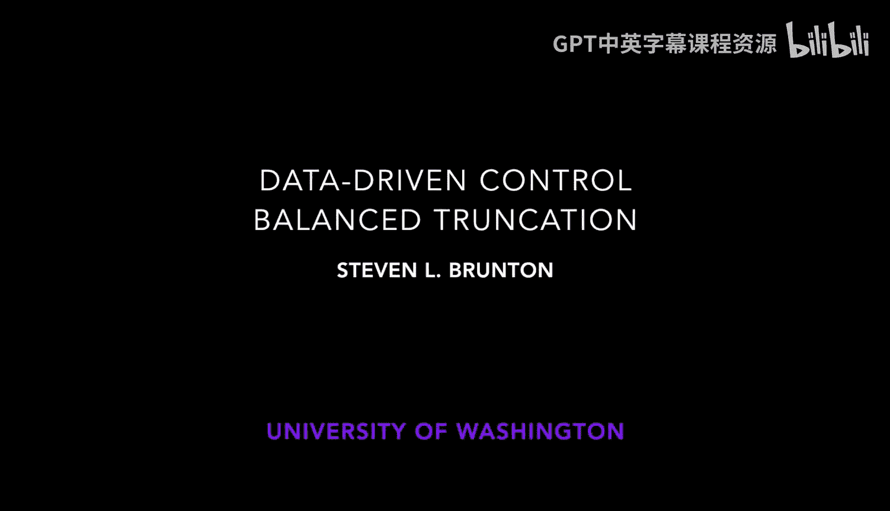

# 华盛顿大学《基于数据的机器学习控制｜Data-Driven Control with Machine Learning 2018》中英字幕 p08 -08-Data-Driven Control_ Balanced Truncation.zh_en -BV1BK6MBQEtN_p8-

Welcome back。Okay。So now we have a coordinate transformation T that makes our controllability and observability gramians equal and diagonal。

 Remember， the controllability and observability graians quantify in this very big high dimensional system。

 Which directions are most controllable and most observable and least controllable and least observable。

 Okay， so very useful geometric quantities these are square matrices。

 the size of n by N where n is the dimension of X。 And we showed last time that there is a coordinate transformation T into these new Z coordinates where my gramians are balanced。

 So these z coordinates are somehow good coordinates that are jointly controllable and observable。

 That's very interesting now。😊，What we're going to use right now。

 this T matrix is a big square N by n invertible matrix。

 And so we don't actually get any savings by writing things in Z coordinates。

 It's just a better coordinate system where the inputs and outputs are more balanced。 Okay。

 what more did， though， in 1981 is he essentially used these coordinates。

 these Z coordinates to get a reduced order model。 So let's， let's write this。 This is a reduced。😊。

Order。Model。By essentially， just picking the top most controllable and observable directions in Z and throwing away all of the rest。

 Okay， so remember， kind of the picture here is we have this tall X vector。

 This might be like a million dimensional x vector， super big。

We're going to say that that equals T times z。 Okay， so T is this big square matrix。

 It's a coordinate transformation or a change of basis， if you like。 and Z is another tall。

Tall vector Z。 Okay， this equals T times z。But what is really interesting about hierarchically ordering our controllability and observability directions or modes in these Z coordinates is that the first variable Z1 is more important than the second variable Z2。

 that's more important than Z3 than Z4 than Z5。 So if I decided at any given point。

 I can only afford four variables。 I would keep the first four Z variables。

 and I'd throw everything also away。😊，And that's a principled way of getting a truncation。

 so I'm going to draw this in another color here。What I could do is I could only keep the first R。

 let's call R， our reduced state dimension XR。Maybe r equals5 or 10。

 I only keep the first five or10 columns of T and the first five or 10 entries of Z。

And what I do is I just give that a new name， I call thatsi。诶晒。

And X tilde okay so this is it's taken a long buildup okay。

 but what we've done is essentially found a principled approach to finding good reduced coordinates x Tilde。

 These are only a few numbers to describe the dominant patterns in the system in terms of the first R columns of this balancing transformation T。

That's all there is。 Okay， we picked the first R columns psi of this big balancing transmission T。

 and those correspond to the state X tilde， which are the first most controllable and observable states in these new coordinate system in this very simple toy example of this pink ellipsoid。

 you know， basically this first direction is quantifiably more important for the dynamics in the second direction。

 So if I was going to truncate， I'd pick everything I'd project the dynamics into that direction。

Okay， that's what balanced truncation is。 This step here。

 everything so far has been just balancing dynamics with a balancing transformation。

 This step here is called balanced。Tncation。The acronym， you could call it BT。

 That is really what Moore did。 Okay， so Moore built all of this infrastructure。

 just like I built up how the transformations applied to Grammyians。

 how you would design this balancing transformation T。

 But what his ultimate goal was was finding a reduced order model by truncating。

 So this is called truncation， because this， everything below here and everything to the right of here is truncated。

Literally， we throw that all away。 and we only consider the dominant。

 controllable and observable subspace。 That's what Moore did。 That's called balance truncation。

 super powerful used everywhere。 I mean， this is a go to model reduction technique。

 If you have a linear model， you can get a reduced order model using balance truncation in Matlab。

 there's a bunch of built in Matlab command commands。 The bowel reel。

 we'll get this balance realization you can give it a trunccate option。

 I'll show you all of those in a little bit and we'll code up something to。

 to try these out on an example。 But what I want to show you now。Is essentially what happens。

 Remember， we could write our coordinate system from X coordinates to Z coordinates。 Now。

 what I want to do is I want to carefully write down what happens if I split this into T and then everything I'm going to throw away。

Okay， so this is going to be kind of important。 And this is really a mathematical exercise to convince ourselves that the reduced order model works and is principled and that we can get one just by keeping these first R columns of T。

So I'm going to have to make some definitions。 Okay， so I'm going to say that my big T。

Is equal to the first R columns， okay， I'm going to go Greek on you here。

All of the stuff I'm keeping is going to be Greek and all the stuff I'm throwing away is going to be not Greek。

 so P psi are the columns I'm keeping。And the stuff that I'm truncating。

 I'm going to call Ta Little T。 That little T stands for truncate。

 I'm going to throw all that stuff away。Okay， so I'm segmenting my matrix into T truncate and Pisi。

I'm also going to introduce a matrix S equals T inverse。Remember。

 this was an invertible matrix under some reasonable assumptions。All of this works out。

And I'm going to say that S， this S matrix， I'm going to write that。In terms of， again。

 I'm going to keep the first R rows。I'm going to call that phi。

Complex conjugate transpoposed just so the dimensions work out。And S trunccate。 Okay。

 these are both big square matrices。 This is the inverse of T。 S is the inverse of T。

 I'm going to keep the first R columns of T and the first R rows of S。

 And I'm going to name them P psi and phi transpose。Don't get you hung up on the naming。

 Just two Greek letters。 This is all I'm keeping。 And what I want to see is when I write this coordinate transformation to Z coordinates and I throw away all。

 but the first。Our components in X Tilde， what stays and what goes in the dynamics。 Okay。

 so we're just going to， we're going to write this as the following。 So DDT。Hope everyone's ready。

 This is going to be some math DDT of Z。 And remember what are we going to split Z up into。

 we're going to split Z up into the stuff we're keeping X tilde。 That's my reduced order model。

 This might only be five or 10 states。 I'm going to keep it into that。

 and then I'm going to call everything I'm going to throw away Z trunccate。So big Z。

 my million dimensional state， maybe there's 10 variables I care about。

 the 10 most controllable and observable， and then the other know nearly a million things I'm going to throw away。

Okay， so Z trunccate is that bottom of stuff down there。And what this is going to equal。

 if I split all this stuff up， just kind of work with me here。If I multiply。Remember。

 in the Z coordinates， my dynamics are T inverse A T。So I'm going to take T inverse。

 which is S times a times T。This a matrix should be T。Inverse A， which equals S。Okay， yes， I。

And so what I end up getting here is if I basically just multiply this and this and this and this times this a matrix。

 and then I try to keep track of where everything lands， I'm going to get a P star。A。Sai。

I'm going to get a P star A， all the stuff I'm truncating， T truncate。

I'm going to get an S trunccate a。s。And I'm going to get an S trunccate A T trunccate。 Okay。

 so this is kind of， I'm going to get this big matrix， the same size as a， This is an n by n matrix。

 but I can kind of keep track of the different R by R blocks and n minus R by n minus R blocks and stuff like that。

 Okay， and this is times my state。X， Tilde and Z trunccate， all the stuff I don't care about。

And now I have to keep track of what happens to my B matrix， what is B。B is just T inverse B。

 which equals S times B。Okay， and so I can keep track of what happens in my B matrix。

As there's a P star component。B， and there's all this stuff I'm going to truncate all of this S times B。

And then finally， I can also look at what happens on my measurements， y equals okay， C。What was C？

C was equal to T it was equal to c times t。And c times t， there is a component which is C Psi。

And C times everything I'm going to truncate into T。 Okay， so I hope you're following。

 all I'm doing here is basically writing what would happen if I change to Z coordinates。

 but I'm keeping very careful track of what happens to the first R variables and all of the stuff I'm going to truncate in terms of the different columns and rows of T and its inverse S。

😊，And notice that。Everything except the first R by R block。

 so the first R by R block is only in terms of Greek letters， Phi and Psi， Psi and phi。

And everything else that has something in terms of a truncated variable is going to have one of these STs or TTs。

 and we're going to just chop all of that stuff off。

Notice that not this is not a perfect model if I just throw a ail of my ZT because X tilde does in fact depend on ZT。

But we're going to make that assumption anyway。 and we're just going to chop this stuff off。

 So the basic idea now is I'm going to get DDT。OfX tilde is approximately equal to。This thing。

5hi star A Psi。Plus times x tilde， sorry。Plus five star。B you。

And y is going to equal to c times Psi x tilde and this。Is。My reduced order model。

 This is the thing we've been trying to build towards for the last， you know。

 five videos or so is this is the dynamical system in my reduced state X tilde。

 where all I'm doing is I'm taking this coordinate transformation that balances my Grians。

 And I'm just chopping it off at some point and only keeping the first R components。

 This is the projection onto the first R most controllable and observable subspace。Of my dynamics。

 And this is a little R by R matrix。 You know， this thing is， you know， R tall and R wide。

 So this is really， really nice。 Okay， this is a fast reduced order model。 It's easy to simulate。

 It captures most of the input output energy， and it's。😊，It's useful， for control。

 for fast low latency control。 Okay， so that's that's the big picture。 This is balanced truncation。

 If you have A， B and C， you can go through all of these procedures， you can compute the graions。

 You can compute their eigenvectors。 You can scale those eigenvectors to get T and S。

 And then you can keep the first R columns and rows and obtain a reduced order model that。

 in some sense， is pretty good at capturing input to output dynamics。

 Okay that's what it's designed for。😊，So that is balanced truncation in a nutshell。

You should be asking yourself some questions， okay？

I said that this would work for a million or a billion dimensional state vector x。

None of what I told you actually works for a million or a billion dimensional state vector because all of this relies on me being able to build these gramyions and compute their eigenvectors and eigenvalues。

That's not very reasonable。 Computing the graion of a million dimensional state space system is very expensive。

 Okay， maybe you can do it on a really， really big computer。

 but you can't do it easily and you can't do it on a billion dimensional system， Okay， so。

And then computing its eigenvectors is also really hard。

 So all of this works really well on00 or 10000 dimensional systems。

 but it's pretty ugly when it scales to million or billion dimensional systems that we actually want to work on。

So we should really be thinking about how do we approximate these from data， okay。

 all of this was just math on matrices。What we're going to talk about next。 and this is balanced POD。

 And there's major contributions by Karen Wilcox and also by Clancy R in essentially using datadrin approaches to approximate these transformations Psi and fee that scale to much。

 much larger systems， million billion dimensional systems。

 So that's what we're going to talk about next is essentially， how do you do this at scale。

 How do you take Moore's balanced truncation and scale it up to million or billion dimensional systems where I never really want to actually build a Grammyian。

 So a data drivenrin way of approximating these transformations。 Okay， that's coming up。

 And that's actually going to be directly useful。 Thank you。

