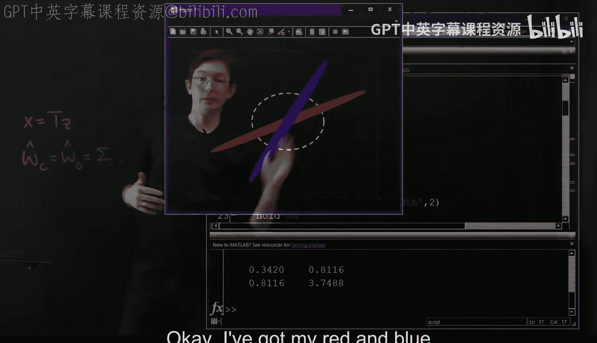
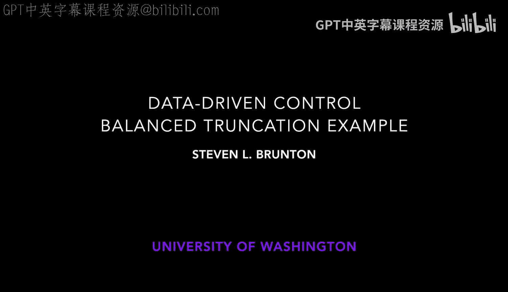

# 华盛顿大学《基于数据的机器学习控制｜Data-Driven Control with Machine Learning 2018》中英字幕 p09 -09-Data-Driven Control_ Balanced Truncation Example.zh_en -BV1BK6MBQEtN_p9-

Welcome back， everyone。 Okay， so in the last few lectures。

 we've been looking at balancing transformations， so those are coordinate transformations。

From some original X coordinates into some new Z coordinates so that my controllability and observability graions in these Z coordinates。

 WC hat。Equals W O hat equals a diagonal and hierarchically ordered matrix sigma。 Okay， so my。

 my controllability Grmian equals my observability Grmyian equals a diagonal matrix where the entries are going from biggest to smallest。

 Okay， So now we're going to code this up in matlab。 Again， just as an illustration。

 this is kind of the end figure that we're going to generate。

 we have our observability Grmyian for our original system in blue here。

 So there's this really observable direction。 And this one's not as observable。 I have my。

Red controllability Grians。 So again， this direction is super controllable。

 This direction is barely controllable。 but in these balanced coordinates。

 what we're going do is we're gonna find this t transform in these new coordinate Z where I find a hierarchical coordinate system so that the first coordinate in this purple direction。

 this kind of direction here is the most jointly controllable and observable direction。

 So this is a compromise between this Grian and this graian。

 So this direction and it tells me that if I wanted to truncate if I only wanted a one mode model I would get rid of this direction because this is the least jointly controllable and observable Okay so that's what we're gonna to do in Matlab is cook up this balancing transformation and balance these graions。

 great。😊，And you can do this at home， the script。His online links to all the codes are available。

 This is also in the book on data driven science and engineering。Okay， so here's what we're going do。

 We're just going to cook up a system， a two by two system with one input and one output。

 no D matrix， no feed through terms。 So an A， B and C matrix。In MatTlab。

 it's easy to build a state space system with the SS command。

 so we're going to build a state space system， and I'm going to look at what the controllability and observability Gions are using this convenient gra command Okay so I'm just going to run all of this control enter。

Okay， it's running。And now let's just verify that our controllability and observability graians are not equal so WC。

Is this matrix not diagonal， okay it's not a diagonal matrix first of all。

 and then remember what it looks like。And then， W O。Is not equal to that。 In fact。

 it's almost opposite， right， Like this direction is more more observable and this direction was more controllable。

 Okay， so these are kind of those those two ellipsoids。Now， plotting these things is kind of fun。

 So what I'm going to do to plot these gramyians， I'm going to define basically a unit sphere or a circle in R2。

 and I'm going to map that circle through these these controllability and observability graians。

 And remember these graians are positive semi definite。

 So what I'm going to do is I'm actually going to map through the square root of the gramian。

 this is just for scaling and so my circle is going to turn into a controllability ellipse and an observability ellipse and I'm then going to plot those ellipses。

 So that's all I'm doing here。😊，Okay， I've got my red and blue observability and controllability ellipses。

 So I'm just going put this in the background and go back here。 Now。

 that was just to get the controllability and observability in my original X coordinates。

 But what I want is I want controllability。 I want those new coordinate system Z where these are balanced and equal。

 So that's what we're going to do now。

Okay， and I make it look cool by making my current axes and current figure color black background。

 Okay， in case you want to make。😊，Super cool black background figures。Okay。

 so the great thing about MATLAb。Is that computing these balancing transformations is one line。

 This is super simple。 I think one of the great things about this is that。😊，Mat Labs。

 I think this is maybe the robust control toolbox or maybe the original control toolbox essentially wraps for trans code。

 I think written by Peter Benner。In in the 80s， if I'm not mistaken called scott。

 and essentially it wraps this super powerful fourran code that does all of this numerical linear algebra。

 even for pretty large systems。 So what we're gonna to do is we're going to find a balanced realization of our system。

 This is a built in Matlab command ball rail balanced realization。

 And what it gives me is the balanced system。 And then these transformations T and the inverse transformation S is what I called it before。

 they call it T inverse。 And I can't remember what G is。 But if I was doing this， I'd， I'd give my。😊。

Diaagonal elements of Sigma， probably。Okay， and then all I'm going to do is I'm going to look at what the graians of this balance system are。

 because in these balance coordinates， these graians should be equal and diagonal。Then I'm going to。

Run my circle through this coordinate system。 And I can't just use BWC because I have to map into those coordinates and out of those coordinates with T and T inverse。

 So you can kind of go through the math and convince yourself that this is really how to draw these ellipses。

 But this is that。Ellipse from before。 and then I'm going to plot it in purple because it's supposed to be the compromise between my red and blue controllability and observability ellipses。

Okay， that makes sense。 okay， take away one line Matlab command to balance the system。

 I run bowel railil on my system， and I got a balance system and the direct and inverse transforms。

 And all of this is just verifying that it gives me a balance model。Okay。

 so let's run this control enter。And a couple things， first of all， in my command window。

 I plotted the controllability， the BWC， this is my balanced controllability Grmyian。 1。9439 and 0。

32， so it's diagonal， and now I'm going to plot my balance observability graian。And it's the same。

 It's exactly the same。 These little minuses popped up because those are 0 plus or minus something really。

 really small。 But basically， my balanced controllability and observability gram handss are equal and diagonal。

 And what's really cool。 notice that this first diagonal entry is a lot bigger than my second diagonal entry。

 That means this one's a lot more important for control controllability and observability。

 So this one， you know， is。😊，More than five or six times more important than this one。

 so if I wanted to only pick one state， I'd pick the Z1 coordinate and I'd throw away the Z2 coordinate。

Okay， so then remember I plotted my original observability and controllability gramyians in blue and red。

 now what I'm doing is I'm plotting in these balance coordinates， so I map into Z coordinates。

 I plot my ellipse， and then I map out to show it in the X coordinates。

 and I get this nice purple ellipsoid which balances the trade offs between good observability and good controllability。

Okay， prettyty simple。 really， You can do this to much larger systems。

 I'm showing you this on a two by two system just so we can plot everything and see it and play around with it。

 But you can imagine that these ellipoids。In three dimensions might look like an M& M or you know a football or something like that。

 in 10 dimensions， they're going to be this hyper ellipsoid and in 1 thousand dimensions。

 you know everything generalizes。 So you still get these ellipsoids。

 you still get preferred directions。 you still get tradeoffs between controllability and observability。

 So that's all really really interesting， easy to plot。

 even easier to compute noticeice that like all of my commands here are just building the matrices。

 building the system and plotting。One line for balancing your system。Okay， and if you're interested。

I actually did write a code that allows you to manually compute these balancing transformations。

 remember we。If you remember from before， what we actually did was we took the original Grians WC Times WO。

Times T equals T。Sigma squared。 And if I remember this was an unsscaleed set of eigenvectors T。

 and then we went through some scaling to find the scaled coordinate transformation T that exactly balances and diagonalizes these graians。

 And that's what this code here does。 Okay， so I basically take the eigen decomposition of this product here。

 that gives me T unscaleed and a diagonal matrix that Sigma squared。

 And then I go through all of the business of building these gras and scaling T。

 And then you can convince yourself。😊，Through the end of this。

 that this T is the same as you get with the ball reel command。I'm not going to run it。

 you can run it， all the codes are online。Now， the upshot， of course。

 is just going to run this again。Yeah the upshot is one line MALb command I can take a system that has some preferred observability directions。

 other preferred controllability directions and what it will do is it will automatically just using linear algebra find a hierarchy of most to least jointly controllable and observable modes Why is that important？

This is important because if I have a milliondial system and I want to control it really fast。

 there's fast time scales and I have to control it super fast。

 then I need to approximate that million dimensional system with the best possible five or 10 or 20dial system that I can actually simulate and control online。

 And so what this does is this gives me a principled approach to pruning down that very highdial state space X into a hierarchy of the most to least important coordinates in Z so I can pick the first five coordinates of Z。

 the first 10 coordinates of Z and every time I add more。

 I'm kind of guaranteed to be capturing the next most controllable and observable states。Okay。

 that's it for now， thank you。

