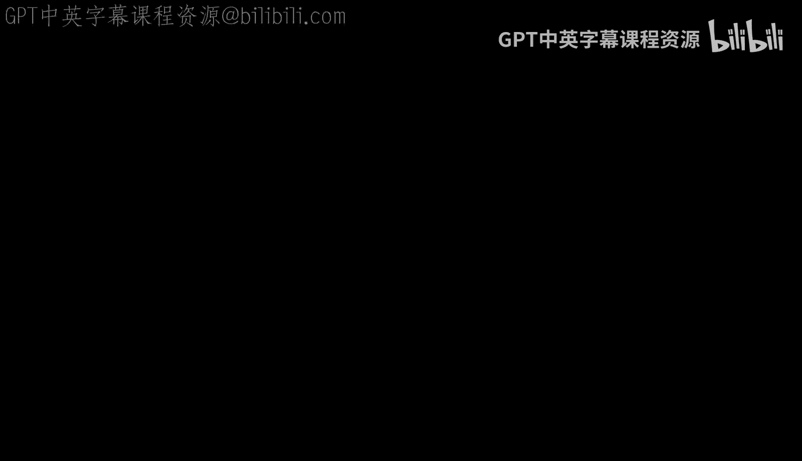
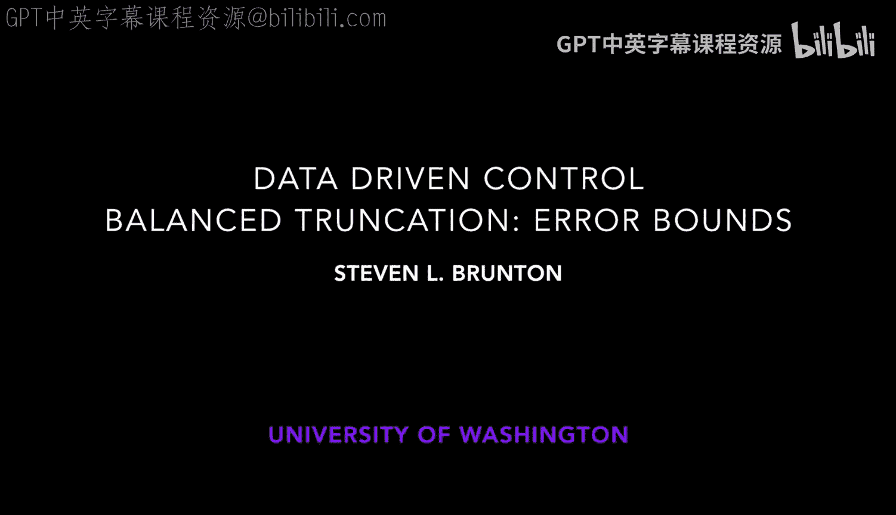

# 华盛顿大学《基于数据的机器学习控制｜Data-Driven Control with Machine Learning 2018》中英字幕 p10 -10-Data-Driven Control_ Error Bounds for Balanced Truncation.zh_en -BV1BK6MBQEtN_p10-

Welcome back， everyone。 Okay， so in the last few lectures。

 we've been building up these balancing transformations。

 these coordinate transformations from my original state vector X to some new coordinate system Z。

 where my controllability and observability Grians become equal and balanced。

 This was a great idea by more in 1981。 And one of the nice things about this is that there are error bound。

 So for a given model order， we know kind of。😊，We know how good or how bad the model is。

 how much information we're we're throwing away。 So something important to think about。 Remember。

 we had our original system。 Let's call it。X dot equals a X plus B， U， and Y equals C X。

And what we were going to do is find this balancing transformation in terms of some new。

 let's called them tilde coordinates x tilde dot equals a tilde X， tilde plus B， tilde U。 remember。

 this is what we get when we go through our balancing transformation and then trunccate and keep only the first our most controllable and observable modes。

Where R is a lot less than the dimension of x。 Okay。

 so the there's essentially a way of quantifying how good this reduced order model approximates the input output characteristics of this full order model。

 So let's remember， this is called the full order model。 Sometimes people call the f。

 I like full order model。 This is the ram， the reduced order model， high dimensional。

 low dimensional。 So this is dimension。N， this is dimension。

R， okay， where r is much， much less than n， very important。

So there's ways of quantifying how good the reduced order model approximates the input output characteristics okay and so remember。

 I can always take my state space system and I can get an associated transfer function G of S where this is my complex Laplace variable。

 and I can do the same thing here and I can get G tilde of S。

 this is my reduced approximation of that transfer function。

Now this is nice because these kind of are the same size if this is if I have like two inputs and three outputs。

 then this is a three by two matrix of transfer functions and this is a three by two matrix of transfer functions。

Even though my state dimension went down， my inputs and outputs didn't change。

 That's really important in this reduced order modeling framework。

 you and y are the same because my system in reality， is like a black box， my system。

It has some U in and it has some Y out。 I can't change that。

 but I can get a different approximation of what's going on in the guts of the system， the A。

 B and C matrices。Okay， so essentially。There's a norm called the infinity norm。

 I think of this as the worst case scenario norm， so the infinity norm of G。Is infinity norm of G。

 It sounds super cool， right， Infinity norm of G。Is the max over all frequencies and all frequencies。

Of the maximum singular value of G omega because this is a handful。

 let me just walk you through this。 So first of all， if if this G is a scalar。

 if I have a single input and a single output， So this is just a scalar function。

 then you can forget the sigma1。 there's no singular values。

 all I'm doing is I'm evaluating this transfer function at all frequencies。

 this basically means I inject a sinusoidal frequency at frequency omega T。

And I see how big is the output response or how small is the output response。

 Then what I do is I sweep across all frequencies and I find the biggest possible output response to that given frequency。

That's that's all that this is saying is I basically want to sweep through the frequency response of G。

 and I want to find the biggest possible frequency that that amplifies everything that's amplified by these dynamics。

If I happen to have multiple inputs and multiple outputs， then this is a matrix。

 and so I pick the maximum singular value of that matrix Okay that's what this infinity norm is。

And what we want for control。Okay， so essentially， the goal。Of control。

 and this is another way of saying what I was saying earlier。The goal here。

Is for the norm of G minus G tilde。The infinity norm to be small。

Now small you know is relative what is small for your system might be different than for my system Okay so but the basic idea is after I go through this this balanced truncation procedure or any model reduction procedure。

 maybe there's something better than balanced truncation It's not optimal。

 it's just a good strategy When I get this G tilde。

 I want it to be close to my original transfer function G in this infinity norm okay。

That's what we want。 This is what you compute。 And so the nice thing about this is that there are upper and lower bounds based on balance truncation。

 So upper bound。😊，Lower bounds。Let's just write these down， upper and lower bound。Okay。

 and and when I say。The infinity norm of the difference， what I mean。

 when I call this the worst case scenario， what I mean is， is there some particular magic input U。

Some special U。 I can force the system at just the right frequency where this G hat。

 my approximation looks really， really different than my original transfer function G。

 That's why it's the worst case scenario。 because if there's even one frequency where these are really different。

 Then this infinity norm is going to be big。 So I basically am tightening down the agreement between G and my approximation G tilde over all frequencies。

 And if any of those frequencies start to get bad approximations， I call my model bad。 Okay。

 that's why this is such a。Really like tough norm。 The Infinity norm is the worst case scenario norm。

 Okay， so we have an upper bound on what G minus G tilde is。 So the infinity norm。

 and we have a lower bound。On G minus g tilde infinity norm。

 And these are based in terms of the singular values of mygrians， so。Let me。

 I should probably write this down for you。 right， Remember， what we had was。In my new coordinates。

 WC hat equals WO hat equals。Sigma， this diagonal matrix。Okay。

Controllability Grian and observability Grian in my new transform coordinates。A diagonal。

 and these diagonal elements are called the Hankel singular values。Very important。

 Hekle Henkkles a person。 Hek singular values。And so the elements of sigma are essentially little Sigma1。

 little Sigma 2， dot dot dot， little sigma， let's call this you know。There's a lot of you。

 there beat。Okay。In the original system， x is n by n， that's my high dimensional system。

We transform this into balance coordinates Z。 This is still n by N。

 and that's what I'm talking about here。 This is an n by N Grmmyian。

 this is an n by N Grmmyian this is an n by N diagonal matrix， so I have n singular values。

And recall， what we do to get ted up is we basically just chop this off at the first R。

We take the first R of these and we throw away everything， everything else。 Okay。

 so these are called the ankle singular values are the singular values of my high dimensional system。

And these upper and lower bounds can be written in terms of these singular values。

 So the procedure is， you know， you have this big system， I compute its gramions。

 I compute its singular values， and I can quantify how good is a order R model。

 given the distribution of the singular values。 Okay， so the upper bound。

This is less than or equal to2。Times the sum from basically the sum of all the stuff I'm throwing away。

 J equals r plus 1 to n of sigma J。Pretty simple。 Okay， basically。

 just add up all of the singular values I'm throwing away。 That's an upper bound。 You know。

 I of my error。 It can't be worse than all this stuff I'm throwing away。 And the lower bound。

 this is greater。 This is really cool， Great than sigma R plus1。😊，So my lower bound。

 my error is never lower than the next singular value that I throw away。

 can't possibly be lower than that。 And it is never bigger than the sum of all the singular values I throw away。

Why do we want to have these expressions？ Why is this so important， This is important。

Because if I have a00 or a million dimensional system and I'm designing a controller for it。

 what I might want to do is instead of saying， oh， I'm just going to use an order 5 model arbitrarily。

 I might say I want a model that captures 99% of the input output energy。 And so I will choose R。

So that I'm kind of bounded。 I'm guaranteed to have， you know。

 at least 99% of that input output energy according to these bounds。 That's very useful。

 And that depends on what this distribution of singular values looks like。

So if I plot sigma J versus J。Usually I plot log。Of Sigma J because these tend to decay fast。

 there's two fundamental behaviors that you can see。And this is an oversimplification。

 So one of those behaviors is a very， very fast drop off in the singular values like this。

 And this is in a log scale。 So these are ultra fast decay of my singular value energy。

 What this means is that Sigma 1 is a lot bigger than Sigma 2 is a lot bigger than Sigma 3 and so on。

😊，Which means that my first mode is a lot more controllable and observable。

 My second mode is a lot more controllable， you know， and so on and so forth。 So if I chop this off。

 there's a very clear point where I can chop this off and capture almost all of the energy and still have a very low dimensional model because I'm throwing away all of these。

😊，Unobservable and uncontrollable modes。But what might also happen in a lot of systems and really complex systems is I might have a fast decay。

And then a really slow gradual drop off in singular values。

 And this is a lot less clear where to truncate because the sum of all of the stuff I truncate might be pretty big。

 There might be a pretty big upper bound on my error， and so choosing a good R。

 a good order of your model for these systems can be harder。 They're harder to control。

 They have more stuff that you can control in the systems。So。

 you know what's an example of controllability and observability， kind of physically。

 what are some of these blue curves here， So you're driving your car， you have a steering wheel。

 you have a gas pedal， you have brakes， you have a shifter。But you have a lot of other stuff。

 You have a radio。 You have an air conditioner。 you have your windows， right。

 So all of these modes are essentially like turning the radio up or rolling my windows down。

 like these are knobs。 these are states of my system。

 but they don't matter at all to going from point A to point B。

 so these are kind of uncontrollable and unobservable with respect to the real dynamics of where my car is going。

 I hope that makes sense。 There's things that actually matter from the control objective。

 Y and there's things that don't。 So that's what these blue things are is like know turning my radio up or down。

Okay。All right， really， really important， your Grions。

 your balanced truncation model has upper and lower bounds in terms of the singular values of your Grians。

 which are called your Henkel singular values， very important， and we'll talk more about this later。

 Thank you。

