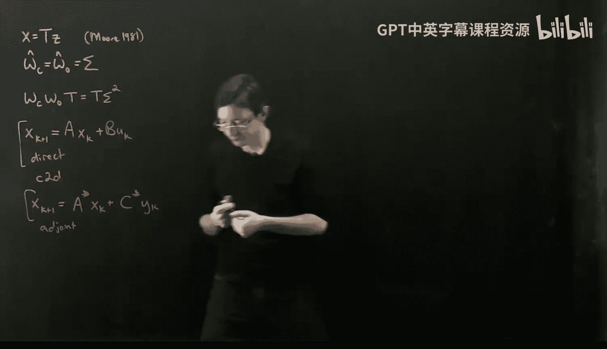
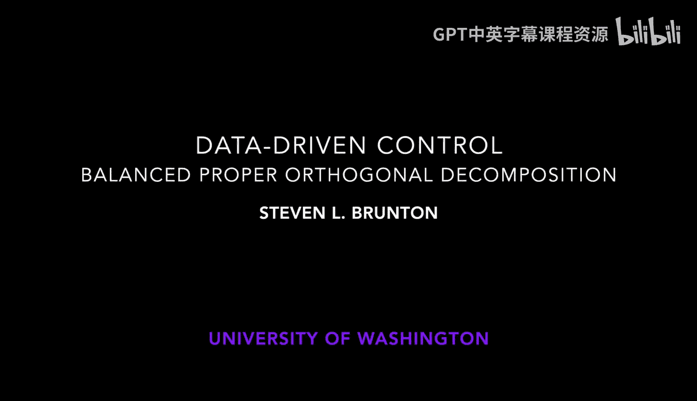

# 华盛顿大学《基于数据的机器学习控制｜Data-Driven Control with Machine Learning 2018》中英字幕 p11 -11-Data-Driven Control_ Balanced Proper Orthogonal Decomposition.zh_en -BV1BK6MBQEtN_p11-

Welcome back。Okay， up until now we've been talking about balanced truncation。

 which is an effective strategy of model reduction。

 So if you have a lot of a high dimensional system with a lot of states and you want to get a reduced order representation in terms of the most important states so that you can control it faster we can use balance truncation。

 So the basic idea here is I have some coordinate transformation x equals T Z x or my original coordinates。

 Z or my new balanced coordinates and t is my balancing transformation。

 This is an invertible square matrix T。So that in my new coordinates。

 my controllability Grian equals my observability Grian equals a diagonal matrix where these diagonal entries go from biggest to smallest。

 So most controllable and observable to least controllable and observable。

 That was the whole framing of a balanced balanced truncation until now。

And if you remember one way that you can actually derive this T transformation is I could take my controllability gramian from my original system in my coordinates x times WO。

 again， my observability gramian in my original coordinates x。

 and I could compute the eigen decomposition of this super big n by n matrix of Grmyians。Now。

It's super interesting math that you can do this， the balancing transformation is's rock solid。

 we worked through it all， we coated it up， it works。But computing Grmyians is extremely expensive。

 These Grians， the way people normally compute them is as the solution of a Leopov equation。

 which I think scale something like order and cubed or it's really an ugly scaling to get these。

 So if n is big， even moderately big like 10000 or 100。

000 or a million computing these WOs and WCs is very。

 very hard almost intractable and computing the eigen decomposition is also really nasty so long story short。

 this works great for moderately large systems， like maybe I have1000 degrees of freedom back when this was developed people were thinking about things like aerospace structures like the space shuttle or the international space station and the Hubble Space Telescope where you might get these vibrational modes in the structure。

But you could write down a pretty decent model in terms of maybe a thousand or a few thousand components。

 okay？Now we're thinking about applying these to much bigger systems in turbulence， neuroscience。

 disease modeling， where you might have millions or billions of degrees of freedom。

 And so going through this kind of standard procedure of computing your Grmyions and then balancing is intractable。

 Okay， so there were a lot of innovations。 Remember， this was more。嗯。1981。

 and so I'm going to tell you in the next few lectures about some of the major innovations that came afterwards that made this tractable for very。

 very large systems with a huge end。嗯。So to get into the nuts and bolts of how this actually works。

 I'm going to introduce a system， I'm going to switch to discrete time The only reason I'm switching to discrete time is because the matrix math becomes a little bit simpler。

I don't want you to think too hard about this。 Okay。

 what we're going to do is we're going to have X at time step K plus1。

Equals some discrete version of my a matrix times x at time k。pl b you at time k。

And what we're going to have is y equals C。At time K as well， okay？嗯。Good。

And I think something else important here is looking at the adjoint system。 Okay。

 so the adjoint system here， this is， this is basically my dynamics written in discrete time。

 So time step K Delta T。And these AB and C matrices are different than my original AB and C matrices。

 but there's formulas for how to get these and if you want to do this in MATLAb。

 there's a super simple command called C2D continuous to discrete or you can go check the control boot camp for how to go from a continuous time system to a discrete time system anyway I'm just this will make it a little bit easier。

This is my direct system。 I have something called an adjoint system。

 So a lot of what I'm going to tell you about right now。

Is applicable to systems that you can simulate in a computer where you have the equations of motion。

 but they're really big。So if I have these equations of motion。I can write down an adjuvant system。

 I can't do this in an experiment。 This， I can do in an experiment。

 I can have a high dimensional nonlinear system that I can control and measure。

 But what I'm going to show you now is only doable in simulations。

 So what I could also do is I could define a new system X K plus1。And basically。

 I'm just going to transpose everything。 so now this becomes a complex conjugate transpose Xk。Plus。

 the complex conjugate transpose of C。Times Yk。And I'm actually going to just even erase this output equation。

 So for now， all we're thinking about。Is big simulations。

 Maybe I can simulate the climate or a disease spread or a turbulent fluid。

 So I have a big simulation code that can do this。 I can kick it with U， and I can measure Ys。

 So if I give my system an impulse in you， I can measure how that rings through the dynamics of the system X。

And then this ajoint system， this is called direct。My adjoint system。

Is basically if I complex conjugate transpose my dynamics。

 then my output y becomes the input in these adjoint equations and what I can do is kind of this thought experiment。

 a numerical simulation where I impulse my measurements y。

 and I see how in kind of adjoint dynamics those ring through and lead to a state X。

So this isn't forward time and backward time， but the way I kind of think of it is if I kick you。

 I measure what happens in time in X and if I。And then what this adjunct system tells me is what states are most。

Most excite my measurements Y So if I have like a delta in my measurement Y。

 what is the state's history and time that most excites that measurement Y This is a mathematical construct you can only do this in simulations。

 This is fine in experiments you need simulations to do the adjoint stuff。

 So everything I'm telling you about is model reduction that people generally do in high performance computing contexts。

Okay， good。Remember， fundamental central challenge。 Let's write down the central challenge。

Is that I don't want to ever compute WC or W O or do this n by N eigen decomposition。 This is nasty。

 Okay， Comping these La on of exponents is really terrible。

 So what you do instead is you use basically impulse responses of the direct and adjoint system。 Now。

 remember what an an impulse responses。 Let's say I have an airfoil。 I have some some airfoil。

 let's see if I can still draw an airfoil。 Okay， airfoil。

 What an impulse response is as at time K equals 0， I'm going to impulsively kick。The system。

 I'm going to impulsively kick it。 Maybe I'll give it an angle of attack or something like that。

 And then I watch how the dynamics evolve through the states of x。

 So I impulsively kick this thing up， and then I measure how the dynamics。

Go through the state X in time。 So this is a movie now of how the state is evolving in time after I kick the system。

 That's an impulse response。Impulse response。And the kind of bizarre thing is you can do an adjuint impulse response。

 I can take this little imaginary measurement。 Maybe I have a， maybe I have a sensor。Here。

And what I can do is I can give this an impulse in that sensor in this adjoint system。

 and I can measure what states， what the dynamics do to that and what state history maximally informs that measurement。

 very interesting stuff。 And if I do this， what I end up getting are these two matrices that essentially look just like the controllability and observability matrices。

From the controlled boot camp before， okay， so I had this curly sea。

And what currently see in discrete time， if I give this thing a delta function。

 an impulse at time zero。With zero initial condition。

 my state history starts looking like it's an impulse， so it looks like B。

Then it gets multiplied by a。 then it looks like A， B。

 That's what X looks like at the next time step。 then a squared B， dot dot dot。

 and then a to some power M。B。And I'm just， you know， I'm basically going to kick my system。

 and I'm going to watch M frames， N plus one frames of this movie evolving。 And each of those。

 I'm going stack into a tall column vector of dimension N into this big matrix。

 So this is a big matrix。 Every column。😊，Is a state of my system。As time increases。

After my impulse response， and I can do the same thing with this adjoint system。

 And I get this thing called the observability matrix。

 This is kind of the discrete time version of the observability matrix。Which is C。C A dot dot dot C。

 A again， to the M power。So。😊，This is kind of cool。What we find is that I can。

 you I have my high dimensional system， but I can conduct experiments， numerical experiments。

 simulations， I can give this thing impulses in my out in my inputs U。

 I can give this thing impulses in my sensors Y， and I can construct these two matrices。

 dis controltlability and observability matrices purely from simulation data。

 So this is still data driven。Driven by a simulation。

And so now what we're going to be able to do is approximate these gras。

 These were really hard to compute using the Leapanov equation。 So instead。

 what we're going to do is we're going to say that WC。Is approximately equal。

To this controllability matrix times its complex conjugate transpose。 again， for real matrices。

 this is just a transpose。And W， O is approximately， I think it's O star。 O， again。

 complex conjugate transpose for real matrices is just a transpose。 So C times C transpose。

 O transpose times O。 And you can verify for yourself。 Basically。

 what I would like you to do as kind of an exercise or a homework is write down C。Time C transpose。

 multiply it all out and verify for yourself that this actually looks a lot like the terms in the controllability Grian。

This is in discreteet time。So there's a few caveats here。

 Remember my controllability and observability Grammyians arc smooth integrals from time equals0 to infinity。

So this will be a good approximation， this is good。When two things happen， when the Delta T。Is small。

 So I remember I'm doing this discrete time system when I have a really small delta T。

 I'm essentially getting a Riman approximation of that integral of the gramyian using these products。

 and that Riman approximation will get better and better when my deelta T is small。And。When。

M is large。So basically， when I have enough snapshots that I'm actually approximating this integral from t equals 0 to infinity。

 Okay， so I'm basically doing a riman approximation of my Grmyians。

 And if my Delta T is small and I integrate for long enough， I get a good approximation。

 And this is really cool。😊，Because what this means。

 what this is what more showed basically more in 1981 showed that I can construct these。

 These are called your empirical Grmyions。 Okay， these are empirical gramyions because they're data driven。

 You run a simulation of your direct and adjoint system。 You get this and this。

 and you can build these approximations of your Grians without ever doing a leopponom equation solve。

 which is really， really expensive。 So this is， believe it or not cheaper than what people were doing before。

Then I can multiply these。And fine tea。And more also built in that you could use the principal component analysis to essentially get expressions in terms of the dominant principal components of these structures。

So it's interesting。More still。Went through this procedure。

And constructed N by N controllability and observability Grmyions and then computed an n by N T matrix。

 So that's still very expensive for large N this is a way of doing it， but it's still very expensive。

Wilcox and。Pairri in 2002。Essentially showed that what you could do is compute a rank R truncation of these graions before you compute this eigen decomposition。

 So instead of computing this n by n， huge matrix rank n invertible T matrix。

 they compute like a rank R approximation and only directly get the our most important columns of T because that's all we wanted in the first place。

 we're going to truncate this。 So we're computing this T just so that we can throw away most of the columns and only keep the first R components。

 And so this was way of basically accelerating that and not wasting a bunch of computational effort Comp all of T。

But then afterwards in 2005， Raley。Rally 2005 essentially showed that you could kind of bypass even cooking up these gramyions in the first place。

 And that's what I'm going to tell you about now。 So these are both。

 both of these methods are called BPPOD。And these are both very kind of important additions after more 1981 these made it so that you could scale to big systems。

 I'm going to show you about kind of this method where you don't have to compute any graians at all。

I encourage you there's a lot of stuff that happened between 1981 and 2002。

 so I think you had work by Lawell and Marsden and Glovski and others。

 lots of interesting work from there to there， I'm oversimplifying history here。

 but really these two papers are where this scaled。To very high systems。BPOD means balanced。

 proper orthogonal decomposition。Proper orthogonal decomposition is just what physicists call principal components analysis。

 so it's all connected。Good。Okay， so now I want to tell you about essentially how you would do this without ever computing any gramyians because this is at the end of the day。

 what's actually important to us。Is not actually computing gradientians。Okay。Good。Okay。

 so're we're going to essentially find the leading R columns of T， the stuff that we want。

 the balancing transformation into these balance coordinates。

And we only want the first R columns of this because we want a reduced order model of rank R。

So what we're going to do now is instead of ever cooking up these gramyions。

 we're going to work on this assumption or this innovation。

 then I can basically directly take the singular value decomposition of O。Times curly C。

 the controllability matrix。So instead of building these empirical graions or a rank truncated version of these empirical gramions。

 what I'm going to do directly， This is what Ra did was I'm going to compute my direct modes。

 I'm going to compute my adjut sorry my direct impulse response and my adjuint impulse response。

 stack those into matrices C and O， curly C and curly O。

 and then what I can do is I can multiply these directly。

 and I could just bam multiply them together。And work only in terms of this quantity here to get my reduced order model。

And this is called。Balanced。Proper。Orthgonal decomposition。Or BPO D。And remember。

 PoOD is just physicists's way of saying PCA， they're kind of all based on the singular。

Value decomposition。 Okay， so S VD， PC A， POD， and there's about five other names for this because it's that important。

 Many， many people have developed this for for fields along along the way。Okay。

 so right now what we're doing is we're trying to compute the leading R columns of the balancing transformation T using this product O times C。

Now what's cool is。You can write this O times C。 if I actually expand this out。

 what I get is now this is gonna be a little crowded。 Okay， so O is C， A dot dot dot C。

 A to some power。And curly see。Remember， this is my system matrix C， it's different than curly C。

Currenturly C is B， A， B， dot， dot， dot， A to some power M。Bi。Okay， and if I write this。

 if I multiply this out， these have the right dimensions that I can multi you know。

 the inner dimensions match。 so I can multiply this out。 and what I end up getting。

Is this big matrix that's called a Hanel matrix H。 Now。

 remember our anklenk singular values that's going to come into play here。

So I can multiply this out and I get C B， CA B， dot dot dot， CA B， CA squared B。

 this will be CA cubed B， and so on and so forth， dot dot dot dot dot dot， and so on and so forth。

So C， B， C， A， B， C， A， squared， B， C， A cube B， and so on。

 This is just a big symmetric matrix called the Hanel matrix。 Let's put that Han。 Very important。

Should be reminding you of the Hannkel singular values， okay？And so。This ankle matrix。

We're going to come back to this later when we talk about the eigenystem realization algorithm。

 but I just want to plant this idea in the back of your mind。

We built our controllability matrix and our observability matrix。

 assuming that I could measure my full state X， and I could run this adjuint simulation。

 so we're doing this in a simulation where we can measure the full milliondisal state X as it evolves in time and we can run this nonphysical adjoint simulation to get these two things。

But what's really cool， and we're going to come back to this when we talk about eigenysem realization algorithms。

 So let's just put a little note in that eigenysem realization algorithm will be a lecture in a few lectures。

If I gave an impulse in U and I just measured Y， I couldn't measure the full state x。

 but I could kick the system in U and I could measure my measurements y。

This would essentially be why at time1， Y at time2， Y at time 3， so on and so forth。

 This would be Y at time 2， Y at time 3， dot dot dot dot dot and so on。 So I can long story short。

 I can actually compute this ankle matrix。From real experimental input output data without ever having access to X or my adjoint system。

Okay， and so we're going to talk about that in the experimental context later in terms of E。

 but for now we're going to assume that we have access to our equations。

We have access to adjoint equations， we can measure the full state and we have these big data matrices。

Okay， this is pretty hairy。 Okay， we're going to fill up the whole board。

 So what we're going to do now is we're going to take this Han matrix and we're going to take its singular value decomposition。

 Okay， we're always going to rely on singular value decompositions to make our lives easier。

 So we're going to say this is U Sigma V complex conjugate transpose star just to transpose for real matrices。

 And what I'm going to do is I'm going to decompose this。Into different。Different components。

 I'm gonna to say there's uilda， the stuff I'm going to keep the first R columns of U。

 and then all the stuff I'm going to truncate。 This is just like what we did before。

 My sigma matrix is diagonal。 These are my anklenk singular values， my HS Vs。

 my anklenkel singular values。I'm going to have sigma， tilde and all the sigma stuff。

 I'm going to trunccate。And then finally I'm also going to have V， how do I want to write this。

 I want to write this as a column of V。Till the star。 And then all the stuff。 I'm going to。Changkei。

No， Tilda。 Just tru it。Okay， so basically what I do is I， I can。 this is my。Direct。Impulse response。

This is my adjoint。Impulse response。I just I compute these in a computer， I direct an adjoin。

 I multiply them together to get a Hank matrix， and I take the singular value decomposition and basically the singular values here are very。

 very related to these diagonal elements of my balance Grmyian here so these are the same Han singular values there。

 And this again then tells me how do I chop the system up to only keep the first R portion of this model。

All right， a little bit longer， we're going to write down the last step now。Okay， remember。

 I just wanted the first R columns of T and itss inverse。 And so that's what I get here。

 So now what I can get is my direct modes。I think in the past， what I did was I called thesesi。

So what Psi equals is it equals curly C。Times v tilde。Times sigma tilde to the minus12。

There's some math。 you can you can kind of convince yourself that this actually matches what you got with balance truncation。

 That's a really nice exercise， or you could read about it in rally 2005。

 It's really nicely outlined there。 It's also in our book okay and then you can get our adjoint modes。

And we're going to call these phi and phi are going to equal curly O star。

U till the sigma to the minus12。 so these are literally the first R columns of this balancing transformation。

 and these are the first R columns of the inverse transposed。

And then the last kind of the punchline of all of this is that I can use these to actually get my reduced order models。

 so I'm just going to show you how you do this because it's super nice。

Then what I can do is I can say， okay， a tilde， B， tilde， C tilde equals。

OkayI'm going to recap in a minute， so if you're feeling like this is just overwhelming。

 we're going to just do a recap。This equals phi transpose times my original A times psi。

This equals phi star。B and this equals C times P psi。

 And I think if you go back to the balance truncation lectures。

 that's exactly what we found is that if I take the first R columns of T and I call those p Psi。

And I take the first star columns of the inverse。 and I call those phi or P star or whatever。

 Then this is how you get your reduced order model。 This is my。My order are。Reduced order model。Okay。

 so let's do a recap。 This is really cool。 So why did we go through all of this math？

We went through all of this math。Because。Although more had the right idea of finding so before more。

People didn't think of degrees of controllability and observability。

 There are these rigid definitions of it is controllable or it is not controllable。

 What Moore said was there are degrees of controllability that are given by kind of these directions of the Grians。

 Okay， so more allowed us to hierarchically arrange our state space in a new coordinate system so that we could。

Get a reduced order model in terms of the most controllable and observable directions in state space。

 That gives us a reduced order model that we can do control with。

But that involves computing these gigantic end by N gramyions， which is ridiculous。

 We don't want to do that。So what Moore did was he said， okay。

 if you have a direct system and an adjuint system and you can collect data from these measurements。

You can approximate your Grmyions， and you can do this procedure。Still very expensive。

 so Wilcox and Prari said， well， I don't have to compute this entire rank n n by n gram。

 if I only want the first R columns of T to get psi， so they did a rank R truncation of this。

And then Ra 2005 kind of。Came up with this expression that you didn't actually have to work with these empirical Grians at all。

 What I could do is directly work with this Hannk matrix。 O times C。

 And this is a lot better because this， you know， O is a lot smaller。Thenhan these gramyions。

 And C is a lot smaller than these gramians。 When I multiply them together， I get this Han matrix。

 I can take the SVD， and I can get a reduced order model。 Okay。

 so you still need a direct and adjut simulation。 You still need to collect that data。

 But then you can build this Han matrix SvD it and get your model directly。

 So this is a pretty streamlined procedure to getting reduced order models without ever building these graions。

😊，Okay， so one of the things we're going to talk about next is。

I drew this red dot that was supposed to be my sensor Y。

 and I had you is like the angle of attack of this airfoil。But in many systems。

 the measurement Y is actually very high dimensional。 I can measure the whole state X。

 So I might have a million measurements。I can't do an impulse response in every single one of those million pixels or million grid points in my simulation。

 I can't store a million impulse responses， so in the next video I'm going to tell you about what Rley did in 2005 to handle that case where my number of outputs was massive so to kind of bypass doing this observability this O impulse response。

For really， really high dimensional output data。Still data driven， you have data， you get models。

 but it's based on an equation。 You have to have access to the equation。 Okay， thank you。

