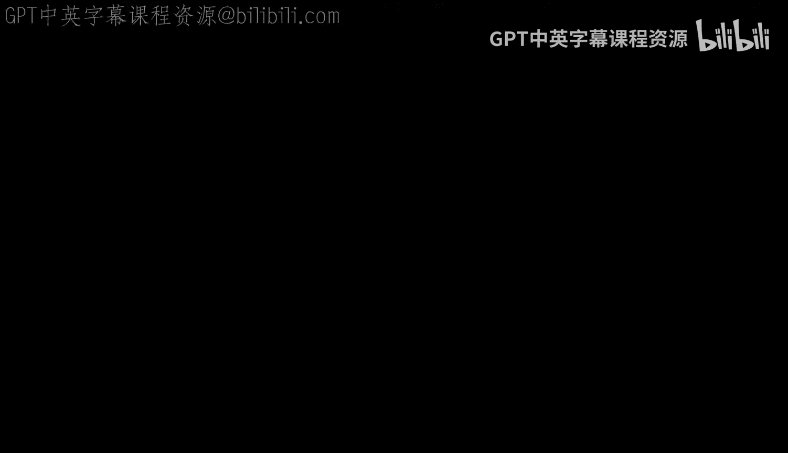
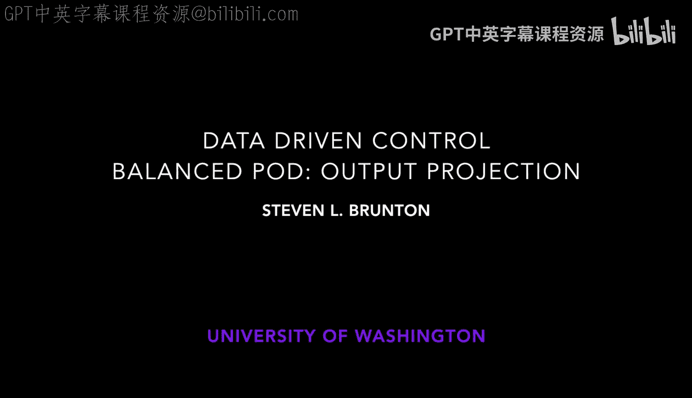

# 华盛顿大学《基于数据的机器学习控制｜Data-Driven Control with Machine Learning 2018》中英字幕 p12 -12-Data-Driven Control_ BPOD and Output Projection.zh_en -BV1BK6MBQEtN_p12-

Okay， welcome back。So in the last video， we talked about how to scale up Moore's balanced truncation algorithm to really。

 really big dynamical systems using the balanced proper orthogonal decomposition of Wilcox and R。

2002， 2005 papers， we talked about how you can get rank our approximations of these Grians or you could bypass Grmyians altogether and just work on these impulse response snapshot matrices。

 curly C and curly O here so you build this big Han matrix， SVD use some math and you get a model。

 but the central problem here is what if usually the number of actuators。

 the dimension of U is small in my airfoil example。

 maybe I can do a couple of things to pitch the airfoil I've got one or two control knobs。

But in a lot of systems， my measurements might be exceedingly high dimensional。

 I might actually have the luxury in my simulation of measuring the full state X。

 I can measure a million things in my simulation。But I can't do an impulse response。

 so these impulse responses require you to give a delta function in every independent channel of U or Y。

And so if y is a million measurements， I can't realistically give an impulse to each of those million inputs separately and collect all that data that would take forever in a computer that fill all of your hard drives and you'd never be able to work with these objects。

So this was an innovation that R made in 2005 was essentially to realize。Most dynamical systems。

 even very high dimensional ones， like million dimensional systems。

 if you kick them and you measure the output response， there's some dominant patterns。

 some coherent structures that emerge from that data in this controllability matrix C。

So essentially what I can do。I I could take this controllability matrix C。

 and I could take its singular value decomposition， I'm going just。

Abuse notation and call it U U Sigma。 This is a different sigma。

 Maybe I'll call it a diagonal matrix D， just so I don't confuse everyone。

U diagonal matrix Dv transpose and what we find is that the dominant patterns that are excited by impulse responses in the input are given by the first columns of U so I can basically describe my milliondial system in terms of a small handful of modes or you know shapes that I can add up in a linear combination to reconstruct X。

 So basically this says x is pretty well approximated by U alphapha where I keep the first。

 let's say five columns of U and then this is a fivedimensal vector telling me the mixture of those modes。

 These are called my proper orthogonal decomposition modes PoD。

 people do this all the time in fluids and physics and optics they compute poD of their measurement data to find what are the coherent structures in this highdial data。

And what Raigh did was he realized that this adjuint matrix， I could essentially。

 instead of impulsively exciting every element of my state independently if I'm measuring the full state。

 I can do these coordinated impulses where I impulsively excite these alpha modes instead I can excite POD mode1 and see how that rings through the dynamics。

 I can excite POD mode2 and see how that rings through the dynamics。

And that approximates what would happen if you went through this full impulse response on every element of y。

 And so in that case， the adjoint equation becomes X K plus 1 equals a star X K。But now。

 instead of C star Y， we have C star U。You。I'm going to call this alpha Okay， and so basically。

 you know， if I was measuring， this is for if I measured if we measure。Y equals x。

 we measure the full state， then instead of this being an x here， I can replace it with U alpha。

And then， this is a matrix。And I only have to do order。A。Impulsse experiments。Remember。

 I shouldn't say experiment。 These are numerical experiments。 They' simulations。 But remember。

 for every single measurement in alpha， I have to do a full simulation。 I mean。

 an impulse response simulation literally means I run my code for that Delta function。

 And I measure what happens。 This could take days or weeks to collect one of these。

 And so I want to make this as small as possible。😊，And so what Clancy Raigh did was he said， okay。

 find the dominant patterns in the data and only excite those dominant patterns for the adjujoint response。

 So that's another critical innovation when you're going to very high dimensionional systems。

 and if you have full state measurements if you want a model based on full state measurements。

 you do PoD on your direct snapshots， you get your PoD modes。

 these are the dominant coherent structures， and then in the adjuint equation。

 you only excite those modes instead of directly exciting every channel of X。Pretty cool idea。 Okay。

 so next we're going to code this up and see what happens。 Thank you。😊。

