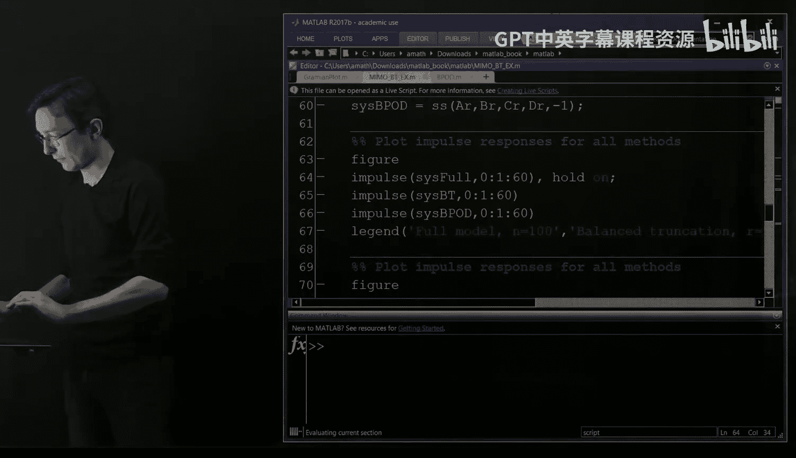
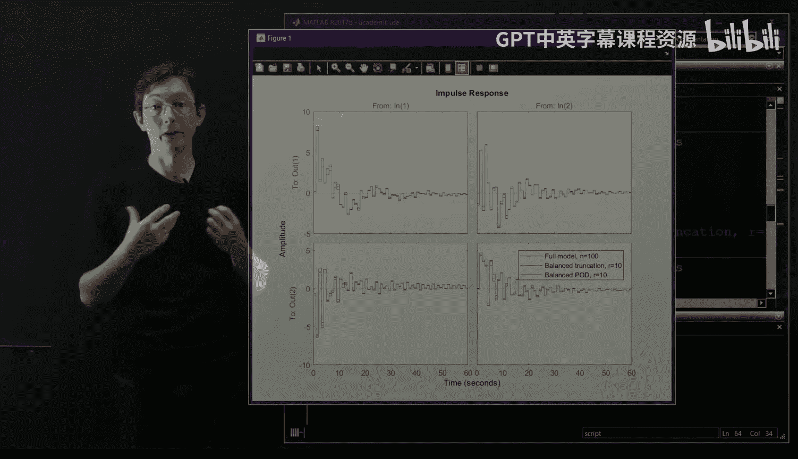
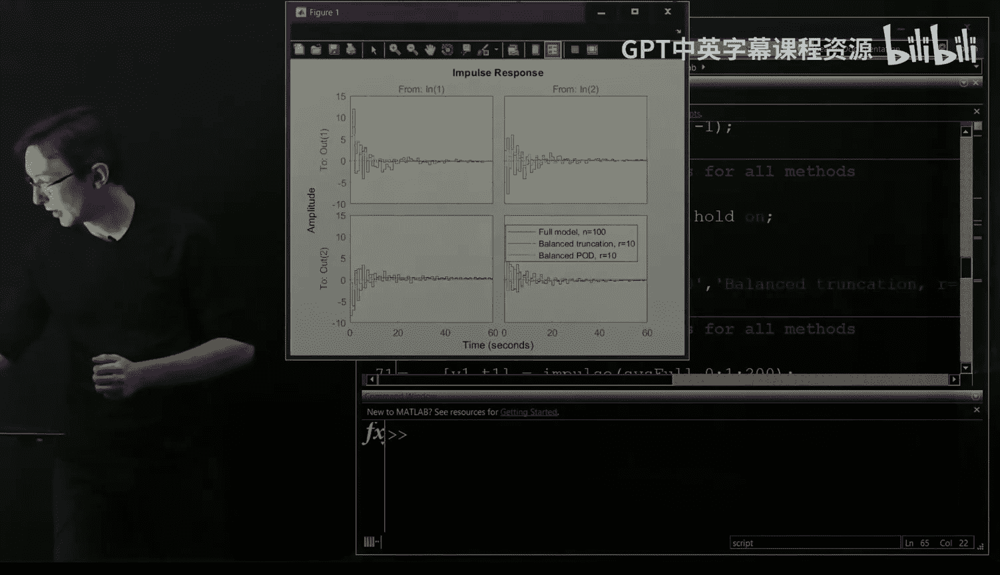
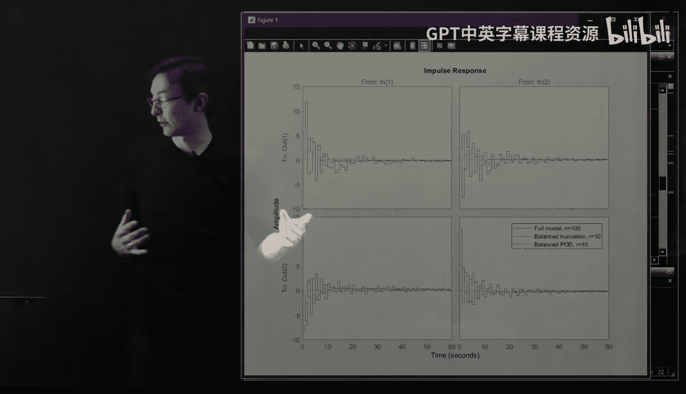
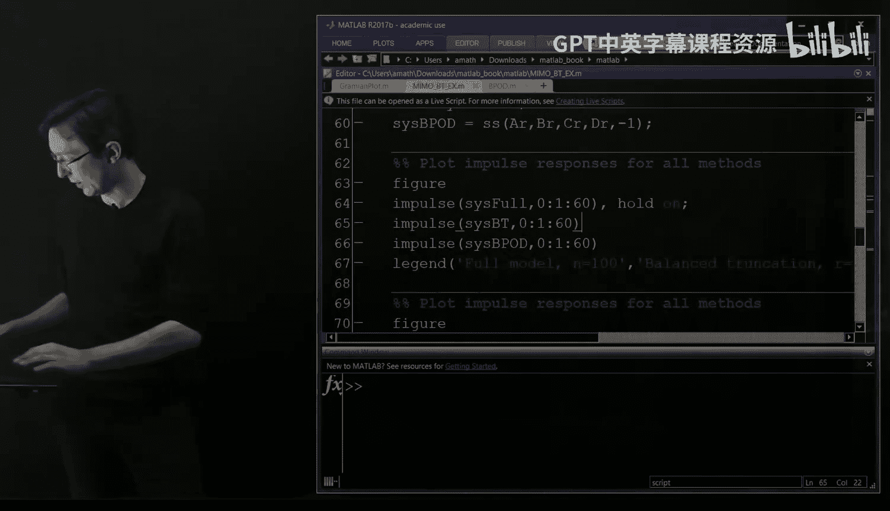
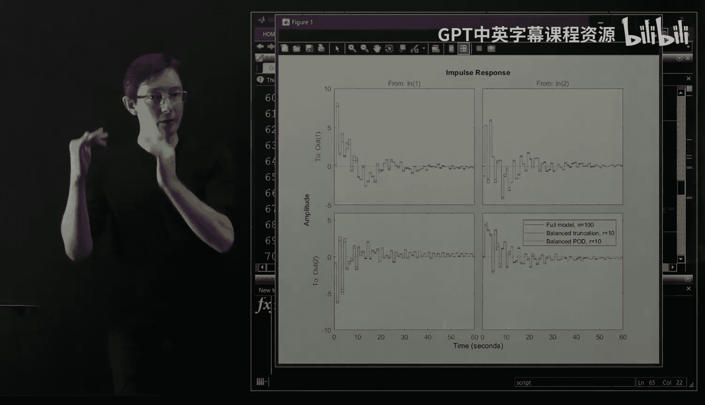

# 华盛顿大学《基于数据的机器学习控制｜Data-Driven Control with Machine Learning 2018》中英字幕 p13 -13-Data-Driven Control_ Balanced Truncation and BPOD Example.zh_en -BV1BK6MBQEtN_p13-

嗯。Welcome back。So in the last few videos we've been talking about balanced truncation and balanced proper orthogonal decomposition。

 which scales to very large systems， and here we're going to code up an example。

 So this is MImo balanced truncation example， MImo just means I have a system with multiple inputs。

 multiple outputs， MImo。Okay， so we're going to clear everything。

 we're going to build a system that has two inputs two outputs and a state dimension of 100 okay so you could do bigger but10s enough for our purposes in MatTLb there's this great built in command called DRSS discrete random state space system that allows me to get a system that has order N state P outputs and Q inputs。

 so this is100 dimensional state， two inputs and two outputs in system full。

Because this is a live demo， I pre generated one that looks kind of nice and I saved it in test systems。

 so I'm just going to load that one。But you can try this with different random state space systems and see what happens in different cases。

 And then what I'm doing is I'm choosing a rank。 and my truncated rank of my system is going to be R equals 10。

 So in this example， we're going to use balance truncation and balance PoD to reduce the rank of my system to get a reduced order model from order 100 down to order 10。

 And we're going to see how good that that order 10 model is at capturing the fold dynamics。 Okay。

 so I'm going to run this。Good。Now， when I。Whenever I look at a system。

 especially I generate a random state space system， I always plot。

I always plot the ankle singular values of that system to see how aggressively I can truncate。

 So in this case， it's very simple in Matlab to get these。

 You just do HSVD Han singular value decomposition of my full system。

 I'm going to only save the vector of singular values， and I'm going to plot them on a log scale。😊。

Okay， good。 So I hope you can see this。 What we have is on a log scale。

 the Hannk singular values versus the model order， and this is the cumulative sum of those ha singular values。

 So I literally just add all of these up and it should go from0 to1。 And so what you can see here。

 this is on a log scale。 So this is a little hard to interpret this is 16 orders of magnitude on a log scale。

 it's huge okay And so even though it looks like there's this slow decay。

 if you look over here in the cumulative sum plot， you can see that the first 10 modes capture like over 90% of the Hankel singular value energy so over 90% of the energy is captured in those first 10 modes given by this red dot here。

 So that's a good sanity check for me， which means I can probably get a pretty good input output model that captures most of the most important behavior with a rank 10 model。

😊，Okay now for 100 dimensional system I can just do straight up balance truncation if I was in a much larger setting I'd have to do balance POD so I'm going to show you how to do both in the code。

Okay， the thing I love about MatTlab is that exact balanced truncation is one line in Matlab。 Okay。

 so ball red balanced reduction。Of my system at rank R。 And it just spits out a reduced order model。

 a rank R model， ABCD matrices in this system using balance truncation。 This is built in。

 It's wrapped around super efficient for trans code。 So this is great。 One line in that lab command。

 Now， if we had a bigger system， we'd actually have to do balance proper orthogonal decomposition。

 which is a lot more involved。 It's not one line。 It's tens of lines。 Okay。😊。

And I have it in this code here。 I might just very briefly walk through。

 but you can read all of the code， and I also have a dedicated function called BPPOD。 M。

 which takes my full system， my adjuinnct system and rank R and returns a balanced model of rank R so you can use this code for big systems you can read through it。

 you can figure out you can basically verify that this is doing all of the steps of math that I showed you in the previous lectures。

Okay， so what do you do， You take an impulse response of your full system。 Okay， you take an impulse。

 you have to compute the adjoint system。 So this is my adjoint system。

 and then you have to take an impulse response of your adjoint system。

 So these give me big data matrices。 X full and X adjot are these kind of。

Curly C and curly O matrices of my direct and adjunct snapshots in time。 Okay。

 we run those from these impulse response simulations。

This is so much easier in Matlab than it would be to code up your own simulation。

 because these impulse responses in a real system， you'd actually have to simulate that system。 Okay。

 so this is this is easier for linear state space systems。Okay， then I basically。

 this is some fancy mat lab to build that ankle matrix C times O， curly， C times。Sorry。

 curly O times curly C is this Han matrix。And then I take the singular value decomposition。

 I pull out the relevant pieces， I build my direct and adjuint modes， phi and psi。And finally。

 last step is I project my dynamics， my big A， B and C dynamics down onto these reduced A。

 B and C dynamics， just like I showed you in the lectures with math。 Okay。

 and my balanced model is that rank R model。Okay， you don't have to understand everything that's going on。

 but what you should know is I should probably run these codes。

You can compute your balanced truncation super efficiently one line MATlab if it's a small enough system。

 if it's a much larger system， you're going to have to do BPPOD。So I'm going to run that code。

 this might take a little while。Because it's running all these impulse responses。

And now what I'm going to do is I'm going to plot the impulse responses for all of the methods。

OkayIt's evaluating。 It takes a little bit of time to run all these impulse responses。Okay。

 so what did we have， We had a multi input， multi output system， two inputs， two outputs。

And so because we had two inputs and two outputs， the impulse response。

 what it does is it impulsively kicks the first input， holding the second input equal to 0。

 and it measures the two outputs。 And then it does the same thing。

 It impulsively kicks the second input while the first input is 0 and it measures those two outputs。

 So I get this two by two array of impulse response is here。 Now， I hope you can read this。

The full order model is in blue。The balanced truncation model with rank R is in red。

 and the balanced PoD model of rank R is in gold。 Okay And so I hope what you see here is that all of these curves are following quite closely。

 So there's some natural dynamics and some time scales。

 My rank 10 model is doing an excellent job of capturing the dynamics of the full hundred dimensional system。

 If you zoom in， you can see there are some little differences。 So， you know。

 I could do better with a higher order model。 But this is pretty impressive a rank 10 model。😊。

Is actually capturing almost all of the input output energy， input to output energy of this system。

 So my transfer function is going to be good。 My impulse responses look clean。

 and I have a much more， a much smaller， more efficient model to evaluate。

 I can evaluate this little 10 by 10 model instead of my big  hundred0 by00 model。

 And I can do that faster online for control。 Okay。

 also nice to see that balance truncation and balance P D basically give you the same thing。 Okay。

 they should。😊。

Okay， so I guess what I would try now， this is just on the fly。

 We should probably try to see what happens if I have a smaller model order。

 maybe order three or four。 If we are more aggressive， what's going to happen。 So let's go back。

 All we have to do is change R to 3。I'm not sure how this is going to work。

 I've never done this live。Okay， I'm going to again plot my ankle singular values。

 and now you see that we're only capturing 40% of the energy here， so that's not a lot。

Let's see how my system response looks。Okay， balance truncation。Balanced P OD。

And now we're going to plot all of the methods together。Really don't know what's going to happen。

Interesting， okay。

Okay， so what do we notice right off the bat， the blue curves and the red and orange curves agree much less well and the gold curves and and the red curves also agree less well。

 so the balance truncation and the balanced POD do not agree very well if I go too aggressively on the model reduction。

And neither of them agree with a full order model， so I really do need， you know， in this case。

 more like model order 10。嗯。To get a good model， case of 10。HSVD。

 we're capturing more like 90% of the energy。Let's go back and compute my balance truncation。

Balance P OD。Okay， and then we're going to run these impulse responses。

And it's thinking。Okay， so good。 This is just a sanity check that if I have enough model order。

 everything starts agreeing。 Okay so something I'd like you to think about。

 and I'm gonna think about it， too， is why is it that the balanced PoD and the balance truncation agree well for enough rank for rank 10 where I get a good system response。

 Why don't they agree for rank 3。 Why is it the BOD starts to fail at approximating balanced truncation。

 if I overly aggressively truncate the rank that would be something interesting to think about in terms of kind the equations we wrote down earlier in the matrices。

 and that'll give you a lot of intuition for for what this connection is。

 So if you can work that out， you're a master of balanced truncation and proper orthogonal decomposition。

Okay， useful technique。 If you have the equations of motion。 If you have A， B and C。

 you have a simulation that can run them， but they're big。

 you can use balanced truncation and balanced PoD to get a reduced order system。

 that's much more tractable fast run， fast to design and implement controllers on and pretty accurate。

 Okay so in the next few lectures， we're going to talk about what happens if I don't have a simulation。

 was this was model reduction。 I have the model。 What happens if I don't have the model And all I have is measurement data like this。

 All I have these blue curves。 How would I build a model， That's system identification。

 It's based on the exact same mathematical framework of balanced graions and all of this stuff。

 Hankel matrices。 But procedurally It only assumes that you have experimental data。

 So this is something you can actually do from real experiments。

 That's what we're gonna talk about next time， that's the eigenyst realization algorithm。 Thank you。

