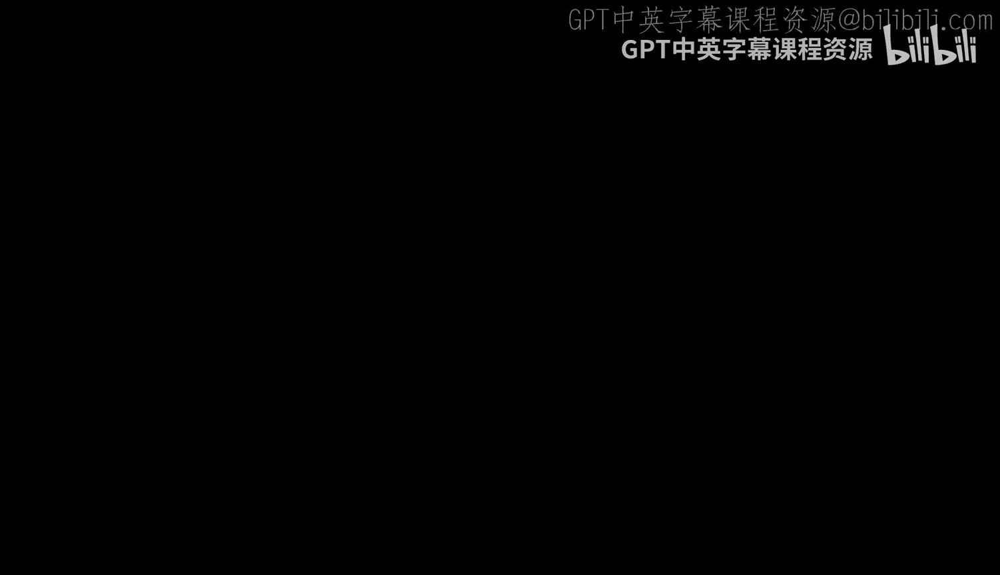
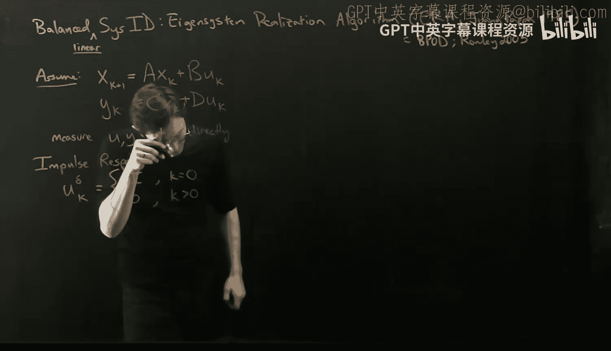

# 华盛顿大学《基于数据的机器学习控制｜Data-Driven Control with Machine Learning 2018》中英字幕 p14 -14-Data-Driven Control_ Eigensystem Realization Algorithm.zh_en -BV1BK6MBQEtN_p14-

Welcome back。 So in the last few lectures， we've been talking about balance model reduction。

 which means you take a high dimensional system that， you know， you have the system。

 You can simulate it。 and you， there's a procedure， essentially for。

Finding a coordinate transformation that gives you a reduced order model that's much faster to simulate。

 and it gives you the most controllable and observable dynamics that captures the most input output energy of your system。

So that is a very interesting perspective。 It's called model reduction。

 It assumes you have the model。 Lots of times we do。 I have the naer Stokes equations。

 I know what fluids do。 I have the equations of really complicated multijo robots。

 I know what they do。 But for lots of systems， all I have is measurement data。 Okay。

 so what we're going to talk about now is system identification to get balanced models。

 So kind of I'm going just call this balanced。😊，System identification， cis ID， system identification。

 and what we're going to be talking about in particular is the eigen system。The eigen system。

Realization algorithm。Very， very， very powerful algorithm。 I use it all the time。Algorithm， okay。

 one of the rules never spell in public。 Eigenysem realization algorithm E R。

 This was developed by Wang and Papa， Prety sure Wang。And papa。In 1985， Okay。

 so very shortly after Moore came out with his 1981 paper， Wong and pop up。In 1985。

 came out with this eigen system realization algorithm。

 which is still my go to method for linear system I D。 This is， let's say， linear。Linear system I。

 I'll tell you all about nonlinear system I later。 super powerful stuff。

 kind of modern method based on machine learning， but my go to linear system I method is the eigenystem realization algorithm from Wang and Papa。

 It turns out actually this took a couple of decades to figure out。

 But it turns out that this ER gives equivalent models to balance PD。

 balance proper orthogonal decomposition。 remember it's very much equivalent in some circumstances to BPD the rowly。

2005 BPPOD， and this connection was established by John Wa Ma in a 2011 TCFD paper you can Google John Wa Ma and Ra TCFD 2011 and you can find the connection it's really cool。

 but remember BPPOD and B truncation and more and Ra。

Always assume that you had access to this direct and adjoint system， you had your A。

 B and C matrices， or you had a simulation that could give you data and adjoint data。

And the E doesn't。 All that E assumes is that you have measurement data of your complex system。

 and it gives you an equivalent， balanced， reduced order model。 So it's awesome， okay， and。😊。

So this is going to be an overview。 I'm going to show you what the overview is。

 And then we're going dive into a lot of math because there' are steps and it could get really kind of hairy。

 So what is the overview， the overview。Is。嗯。😊，We assume so there's a basic assumption。

So assume that our system is， in fact， linear。 And I'm always going to do this in discrete time dynamics if I do impulse responses because it's so much easier。

 We assume that we have a system。This thing， like。Like this。

 and we're going to assume that Y K equals CxK， and for now I'm just going to assume that there might be the possibility of a feed through term so that my actuation U directly gives an impact on my measurement Y。

 so I have these four matrices， AB， C and D。Now， I do not assume that I know what these are。

 All I'm assuming is that my system can be described。

 The input output dynamics of my system can be described in terms of some some linear system。

 So we also assume that we measure。A you。And y， but not X directly。In fact。

 I don't even know what the state of my system is， I don't know。What those variables even mean。

 I'm going to get some latent variables， some hidden variables that are necessary to describe the input output dynamics。

 but they might have nothing to do physically with things in my system。 So we can measure you and Y。

 but we can't measure the big full state of my system directly。 This is kind of the assumption。

What's the other assumption？So the other assumption， I guess。

 is that I can do what's called an impulse response experiment， so's an impulse response experiment。

嗯。I can do an impulse response。And what an impulse response is is。This you。

 so I'm assuming I have multiple inputs and multiple outputs。 So everything's a vector。

What an impulse response is， is you。You。K， I'm going call it Delta。 Okay。

 I'm gonna call my impulse response to Delta。 It assumes that at time 0。

 I can hit U with a deelta function。 And then for all future times， U is 0。 So this is going to be。

What is this， This is going to be an identity matrix for K equals0。

 and it's going to be a0 matrix for K greater than 0。

And this is an identity matrix because this is a vector of inputs。

 If it was a single input and single output， this would be easier。 this would just be a1。

 I impulsively kick u equals1 at time 0， and then I drop it off to0 afterwards。

And what's kind of cool is I can actually write down my output response analytically。

 So Y k given a delta is equal to。

And we're kind of assuming X not equals0 initial zero initial conditions。 So it starts at rest。

 I whack it with a hammer。 That's my impulse response。 And I measure how the system evolves。

So if x was0 at time 0， and I give you an impulse， an input， then y0 equals D。Okay， that's D。

At time step K equals 0。 And then for all future time steps， now x equals B。

And then x so y equals C B。Then x would equal A， B， and y would equal C， A B and so on and so forth。

 So this will be C。A to the K minus-1 B。For all bigger， all positive。Okay。

And so if I was going to draw this in a picture for single input and single output。

 know I do draw this quite a bit。 let me give myself two axes okay。

Then what my U looks like is this it's unit at time zero。 it's this unit discrete time impulse。

 this is all discrete times。 So this is an impulse is like a little rectangle。

Where it's just on at time 0 and it's off at all future times。

 And what y is going to happen is it's going to have some dynamics。That respond。

 and I'm just making dynamics up as I go。It's going to have some response that is measured discretely in time。

 given that impulse。 That's what these， these measurements are。 So why is going to you know。

 ring through the system and what E is going to do。What E tries to do。

 So we're gonna this is our data。 Okay， this is our data for E。 It's purely data driven。

 It's experimental data。 I impulse my system。 I measure why I take this data。

And I pipe it through ER and what ER gives me。Is it gives me reduced order A， a reduced order B。

 and a reduced order， let's say， C and D。Of the dimensions， so this is a rank R model。

 so this is a rank。Our model。And so I could write down my system， X tilde。K plus1 equals A， R， X。

 tilde K plus B， R， UK。Y K equals C， R， X， tilde K plus D。U， notice I didn't put a tilde on D。

Because the dimensions of my U and Y， the inputs and outputs， those never change。

 I can't reduce those。 I have five inputs。 I keep five inputs。 I have five outputs。

 I keep five outputs。 So this D matrix is still size5 by5 or whatever it is。 This can't be reduced。

 But what I can do is I can learn， I'm learning from data。 This is really machine learning。

 If you want to think about it。 You're learning a model that describes your data that generalizes。

 So this is machine learning。 It's old machine learning。I learned from my impulse response data。

 the A， B and C matrices of rank R that best approximate the U to Y dynamics。

 the measured input output response。 So this is kind of a black box model。 If you think about it。

 this is my system， my ER system is designed to take use。

And give wise in a way that's most faithfully representing the data of rank R model。

 given a rank R model。 That's what E does。Pretty simple。

 I should probably tell you why this was developed。 Let's see if I can draw my。Hbble space telescope。

 It's not the best hubbble ever drawn， but。You get the picture。 So in 1985， you know。

 we were in the space race。 This is super exciting。

 We were putting up the Hubble and the space station and in the space shuttle and designing all of these aerospace structures。

 and these structures generally have vibrational modes。 Okay， you kick the system。

 you do something and it oscillates。 you're trying to make it as light as possible。 Okay。

 so you're trying to make this thing as light as possible。 It's going to vibrate。

 It's going to have kind of these these structural waves going through it。😊。

And this is a pretty hard system to model from first principles it's hard just like in that example。

 it's hard to open a textbook and find the equation for the Hubble Space Telescope。So instead， what。

Wong and Papa and others。Fan and Longmen。 and there's a lot of great people that have worked in this field。

 What they do is they build models and mockups or they run， you know， big simulations of this thing。

And they collect impulse response data。 You hit it with a hammer， and you see how the system rings。

Rings through。 you collect that measurement data Y， and you directly build a reduced order model for。

 for that input output system。 Okay， so that's where this came from was kind of aerospace structure vibrations。

 But now we're applying this to huge systems and turbulence control。 It's applied all over the place。

 super useful method。This is the roadm。 We are going to assume that all we have is data impulse output。

 input output data。 This is what we actually have。As the in， this is our inputs。Okay。

 the input is impulse response data。 we can measure impulse response data。

The assumption is that there's some linear system that governs the observed behavior that。

You know there's some linear system under the hood going on here。 these， you know。

 for small perturbations， that's a pretty good assumption here。

 If I have small amplitude perturbations， this is a pretty linear system。And so。

You basically assume that you had a linear system。 you write down what would be the linear impulse response if I had a linear system。

 and then I basically try to back out what are the best rank are， A。

 B and C and D matrices that agree with that data。 That's what we're going to do with ER。

 That's all coming up。 We're going to work through how to do this math。

 And we're also going to talk about how this is connected to balance model reduction balance truncation and balance PoD。

And we'll code it up。 All right， thank you。