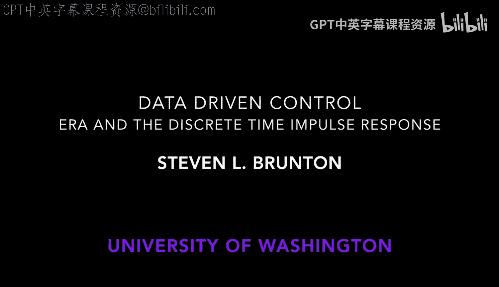

# 华盛顿大学《基于数据的机器学习控制｜Data-Driven Control with Machine Learning 2018》中英字幕 p15 -15-Data-Driven Control_ ERA and the Discrete-Time Impulse Response.zh_en -BV1BK6MBQEtN_p15-

Welcome back。So in the last lecture， I gave an overview of what we're going to do with the eigenystem realization algorithm。

 we're going to fit a linear model of best fit linear dynamical system of rank R to measured impulse response data for something like an aerospace system。

And I just wrote this down， I kind of did this pretty fast。

 I said what is an impulse response in you and what does it elicit。

 what kind of a response does it excite and why and I wrote down the answer。

 but I figure I use this all the time so maybe I should be a little bit more explicit and walk you through through these steps here so so let's actually just do that right now。

What I'm going to do is I'm going to walk you through how to compute this discrete time impulse response。

Now I'm using the identity matrix here for my input because I might have multiple inputs and I might excite them individually。

 I excite the first one， the second one， the third one。

 that would be an identity matrix of delta functions okay but if you want to think about single input and single output systems which can be a little bit easier and that's probably how I usually think about it。

 so single input， single output， then B and C are vectors， and this would just be a one。Okay。

 so let's， let's， let's work through this。 So what， how do I do a discrete time impulse response。

 What I do。I I basically just go through a thought experiment of what is U X and y at various times。

 so what is U， what is X and what is y， and this is important。

 We're going to use this basic thought experiment more later when things get complicated。Okay。

 so K equals0。U is equal to the identity。We assumed zero initial conditions。

 so x is equal to0 and y is equal to c times 0 plus d times I， so y is equal to the D matrix。

 pretty simple okay。Now at k equals1。So， x at time 1。Is B times u at times 0。 U at times 0 was I。

 So x1 is B。Plus， my  zero initial condition。 So at time， okay， so at time1。

 my impulse response turns off。 I'm no longer kicking the system。 So it's I kicked it and now 0。

 But x goes from 0 to B。 Now， x is B at time1。And what is why， well， why is。C times x。Right now。

 plus D times 0。So y is C， B， Let me just say that one more time。 That was fast。 Y at K1。

Is C times exit at K1， which is B， C times B plus D times 0 because U is off now。 Okay， so y is C B。

 So I kick my system。 I get an impulse， zero initial condition that feeds directly through this D matrix。

 Then my impulse turns off。 And now all that's happening is that impulse is trickling through the dynamics。

 and I'm measuring that。So now we're at K2。Again， U is going to be zero for all time now。

 dot dot dot dot， dot， zero， it's always zero。At K2。This is0， and x2 is a times x1。X1 is B。

 So it's a times B。A times B。 And then again， all I'm doing at time 2 is I'm measuring a times B。

 So y is C A B。 Maybe I will give myself the room and actually do K equals 3 just for。Gins， okay。

 so now my state is A B， I multiply it by another A， I get an A squared B， and I measure it C。

 A squared B and so on and so forth。 And you can very clearly see the pattern here。

 I get kind of A to the M。 let's say K 1。B C， A to the K minus1。

 B for a generic K And so that's how I arrived at this expression here of my impulse response。

 I literally just did the thought experiment of what if this was identity at time zero and zero for all future time with initial conditions and you can just follow through all of the math。

So this is going to get a little hairier what we're going to do。

 The eigensy realization assumes you can do an impulse response。

 but that's hard to do in a lot of systems。 So instead。

 I might feed this like a white noise input or some kind of a pseudo random input and try to back out。

What the impulse response would have been or back out these matrices。

 And if this U didn't drop off to 0， all of these expressions would get a lot more nasty。 Okay。

 so this would no longer just be A B。 This would be A B plus whatever U is at this time。

 It would get really nasty。 So I want you to think about it in the simple case。

 we're going come back to this later for the case where these are you know U and 0， U1， U2， U3。

 and we'll write down the general expression。 Okay， but for now for eigensyem realization algorithm。

 we assume we have an impulse response。 we have this data。 These are measurements。

 We have actually what we have is。This data。And。This was the impulse。 So this is Y 0， Y 1， Y 2。

 I hope I'm doing this right。 Y 3 dot dot dot。 This is the data that we have for the eigensystem realization algorithm。

 We literally just have this data。 And then from this data。

 we're going to build a reduced order model， a system identification model。Okay， thank you。

