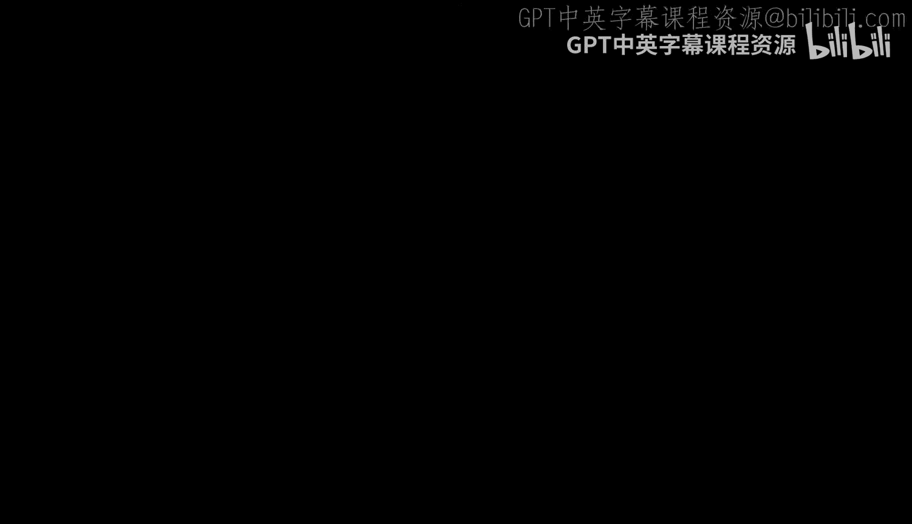

# 华盛顿大学《基于数据的机器学习控制｜Data-Driven Control with Machine Learning 2018》中英字幕 p16 -16-Data-Driven Control_ Eigensystem Realization Algorithm Procedure.zh_en -BV1BK6MBQEtN_p16-

Welcome back。Okay， so now we're talking about the eigenystem realization algorithm。

 which is another method of getting a linear dynamical system that fits your data。

 so this is purely data drivenri。 it works for experimental systems。

 The assumption here is that you can describe your data with linear dynamics。

And that you have an impulse response。 Okay， so that basically means that my input you。

 I whack it very fast with some energy。 I hit my system with a hammer。

 I measure how my measurements change in time and hopefully eventually die out like this。

And at the end of the day， what I do is I collect that measurement data， Y at time 0， Y at time1。

 Y at type 2 and so on and so forth。 Like I measure a time series of y。

 I've drawn this as a single input， single output system， but in general。

 this could be a you know vector of inputs and a vector of outputs。

 I could have three inputs in 10 outputs。 All of this generalizes。

 These would just then be little matrix blocks of size out by in。But。

I collect this data in pink here。 Okay now， if， if my assumption of this being a true linear system。

 this is a linear system， but I don't know what AB，C and D are。

 but there is some linear system under underlying these dynamics。

Then this y0 would correspond to the D matrix， Y 1 would be CB， Y 2 would be CA A B and so on。

 So there's a corresponding expression of these measurements in terms of these unknown matrices that I don't have access to。

So the first thing we're going to do just really simply is we're just going to pull off y0。

 the first measurement， and we're going to call that our D matrix。 first thing is first。

 so we have our D matrix， that's easy。 we have D。 and now what we're going to do is we're going to take y1 through Y K where K might be large。

 We're going to take these measurements and we're going to try to back out a best fit model。For A。

 B and C， in terms of a small a state X， it's as small as possible that still captures these input output dynamics。

 very similar in flavor to balance truncation， except that this is system identification。

 I do not have access to the model。 I just have data， whereas balanced truncation and balance PD。

 you had you know data and a model to generate that data。

But the starting point is actually super similar between ER and balanced PoOD。

And so I'll just write this down so what we do is we take all of this measurement data。

And we stack it into a big Han matrix。 Okay， this big Han matrix is y 1， y 2， y 3， dot dot dot dot。

 y 2， y 3， y4 dot dot， dot dot， and you get the picture you can keep doing this over and over。

 You hope that you have enough data that this can be a big matrixt dot dot， dot， dot dot dot dot dot。

And you might ask yourself， well， how much data should I collect？Basically。

 I want to collect data until y approaches 0。 So if I have a really lightly damp system。

 this could be a very large matrix。 And I also want a small delta T so that I capture the fast times scales。

 Okay， so this could be a big matrix。 But this is basically just your time series of measurements in a row。

 and then you shift them over1 Delta T。 That's your next row。 You shift them over Delta T。

 That's your next row and so on and so forth。 So this is a big matrix。嗯。Of course。

 you could write this in terms of C， B， C， A， B， C， A squared B， and so on。

 You could write this in terms of the unknown system。 But for now， I just want to be very clear。

 this is data。 Okay， this is a data matrix， H， A Hannkel matrix。嗯。😊，What you can then do is。

You can then take the singular value decomposition to figure out what are the kind of left and right eigenspaces of this Before I do that。

 I think there's one more thing I want to show you， which is。If I plugged in CB， C， A， B， C。

 A squared， B and all of this， I want to just remind you that this equals。That。

Curly O matrix times my curly C matrix from before。

 where this was my adjuint impulse response matrix， and this was my direct impulse response matrix。

 Now， this was nonphysical to get。 I can't get access to curly O in an experiment。

 I can't run an adjuint experiment。 There's no such thing as a transpose Hubble Okay or a transpose International space station。

 but I can build this Hannk matrix， nonetheless， from data。

 and it is what I would get if I could run that adjuint simulation。

 direct modes and adjuint modes Time to write。Ad jointint snapshots times direct snapshots。

 So this is equal to that O times C from before when we were doing balanced POD。

 all a Clancy rally 2005， This Han is the same as curly O times curly C from BPOD。 Let's say from。

BPOD。Okay， and then what I can also do， I mean， I have all this data。 I hit the system。

 I measure it for a long time。 Data is cheap。 nowadays。 I can also measure H prime。

Which is basically。嗯。All of this one time step in the future。 So it's the same matrix。

 but instead of y1， this is y 2， y3， y4， dot dot dot， y 3， y 4。

 y 5 dot dot dot dot dot dot dot dot dot dot running out of space。

 but you get the idea it's exactly the same size as H just shifted1 delta T in the future。

 And so y1 becomes y2 and so on and so forth。嗯。It would be cool to verify you should probably verify this。

 so remember O is this big matrix of C， CA， CA squared and CA cubed。Curly C is a big matrix B。A B。

 A squared B， A cube B， you should verify that when you multiply those together。

 you get this matrix if you substituted in all of these blue terms here。 so anyway。

 I'm starting to establish that there is a connection between ER and the balance models that we talked about earlier basically。

 it's the exact same Han matrix we built before， except I'm building it purely for measurement data。

 and I build H prime。 and I want to point out this is the important part。

 This is why I introduced O and C。This is equal to curly O。Times the a matrix。Times curly see。

So if you think about what y2 is。I'm going to do this for one of these cases。 Okay。

 so y1 would be C B。All that y2 is is C A B。Okay， Y2 is CAAB。All the Y3 is is C A squared B。

 All I do to get H prime is I add an A in the middle of all of these expressions。

 I just advance them one more time step by multiplying with A。

 That's what my discrete time dynamics are is multiplying by a。 So I add another A and I get H prime。

And so if I could write this as O curlio Curly C， I can write this as curlio A， Curly C。

And what the eigenystem realization algorithm is doing under the hood。

Is essentially we're trying to to take H。 This is data H prime。 This is data we have。

 We're trying to approximate the left eigen space， the left singular vectors of O。

 and we're trying to approximate the right singular vectors of C。

 And we're going to try to unwrap this and isolate A。

 We're going to try to solve for a from H and from these eigenspaces。

 So that's what we're really doing。 And this is also going to further establish that connection to balance truncation。

Okay， I hope everyone's with me so far。 We have data。 We built a matrix。 we built another matrix。

 That's all we've done so far。 All of the other stuff is just the framing。 I have data。

 and I build H and H prime。 That's step one。 Well step1 is collect the data。

 step  two is build H and H prime。Step three is take the singular value decomposition of H。

 and I'm going to do this exactly like I did before， I have U sigma V。

 I'm just going to call it transpose， it's complex conjugate transpose， but let's just use transpose。

And just like before in balance POD， I'm going to write this as my first R columns of you。

 the dominant modes， the dominant left singular vectors。Times all the stuff I'm going to trunccate。

I'm going to have the same thing for Sigma dominant。And then， sigma trunccate。

And I'm going to have V， I don't know I want to draw this probably vertically V tilde transpose and everything I'm going to trunccate transpose。

Okay this is exactly what we did with balanceance POD， we built this Hannkkel matrix。

 but we did it from direct and adjut snapshots。We took a singular value decomposition。

This is going to come back time and time again。 So there's a new method we've developed called the Hankel alternative view of Coopman for No nonlinear systems。

 It's also going to be in terms of an SVD of a Hannkel matrix。 So we're going to do this a lot。

 We build a Hannkel matrix。 These are time series data。

I take the singular value decomposition of that time series data。

 and I get a set of dominant columns in U and a set of these dominant rows in V transpose。

And those are my dominant eigen。Time series， kind of rows and columns that best describe this H matrix。

 So I can approximate this if， if my singular values drop off fast。

 I can throw away all these truncated things。 And it's still pretty good approximation with u tilde s Tilde V tilde transpose to this。

 And maybe I can do that with five columns and five rows instead of 1000。😊。

That's where the reduction is going to come in。K。Collected data， built a matrix， took the SVD。

 Now what are we going to do？So this is where it's gonna get a little hairy。

 And I'm not going walk you through all of the steps because there's a lot of them。

 I gonna take a lot of time。 but you can go back to the original paper or you could go to。

Ma and Raigh 2011 TCFD， or you can go look in the book and work this out。InIn detail， okay。

So we're going to use utilda。To kind of。Factor out。This。O matrix。

 And we're going to use V tilde to kind of factor out this C matrix。

 And we're going to try to solve for a。 So that's what we're going to do。 Basically。

 once I've collected my data， built my matrices and taken the SVD。

 I can go directly to building a model。 So that's what I'm going to do。 Okay。

 so now I have all this stuff。 I'm going build my model。 And my model is going be a tilde， B， Tilde。

 C， tilde。This is going to be a rank R model， so I'm going to choose this truncation。We're to choose。

R。Based on Sigma。Okay， so if you were actually doing this in practice， you collected your data。

 you built this matrix， you took the SVD， what you should do is you should plot the singular values and see where you can trunccate。

 what is the good R， where you can truncate those singular values。嗯。Yeah， that art。

And so we pick an R so that we capture most of the input output energy of this。

 most of the hekel singular values are in those first R。

And then I'm going to build these a tilde B tilde C tilde matrices from data that I already have。

 So what am I going to do， I'm going to say a tilde is， And this is a hairy expression。

 I always forget this。 So it's sigma， Tilde -1 half。You till the transpose。H prime。V Tilde。

Sigma tilde 12。-1 half。It's a hairy expression， but I just want to impress on you。

 this is a symmetric matrix。Okay， H is a symmetric matrix。

 So there is some inherent symmetry of U's and V's and the sigma。 So I can kind of split this。

 So what I'm doing is I'm splitting u tilde sigma 1 half sigma 1 half V tilde。

 And I'm inverting that。 I'm trying to I'm， I'm calling that O， and and C， And I'm trying to。

I'm trying to basically multiply by O inverse and C inverse to isolate A if I could multiply this by O inverse and C inverse。

 I'd get an A， that's what I'm trying to do here very hand wavy。

 but there's kind of rigorous math to back up what we're doing here。B Tilde。

 also kind of a funny expression， its sigma Tilde now to the positive one half。

Times V tilde transpose。Times this funky matrix， which is the identity。

 the P by P identity matrix times 0 times 0。 I'll tell you what this means in I'm minute。's。

 it's kind of a mess。And C Tilde is similarly。A Q by Q identity matrix，0，0，0 now times utilde。

Time is sigal one half。Now the reason I have this thing here is basically because I can only have P I only have P inputs and I have Q outputs。

 I think。I should swap P and。 It doesn't matter whatever。

 whatever the number of inputs and the number of outputs are。

 that's what I'm I'm doing here because this sigma tilda to the one half V tilde T， this is a rank R。

These are rank R matrices， but I might have R equals 10， I need 10 hidden states x。

 but I might only have two inputs， so I select the first two columns of Bilde of this matrix to get B tilde Similarlyly。

 I select the first Q rows of this rank R matrix to get C。

There's some fancy stuff going on under the hood， but this is a procedure。 Okay， so step 1。

Collect the data step two。1， to build your ankle matrices in H prime。 Step 3。

 you can take the SVD and step 4， you directly get a reduced order model。

 A tilde B tl to C tilde very useful。 You can do this directly from data。

 This is why this is my go to linear system identification method because it's super simple。

 You collect impulse response data。 You build these matrices， Take an SVD and you have dynamics Okay。

 and this a tilde B to to C tilde。Is。I mean， very much in the vein of balance truncation。

 this is a very good model。 It's one of the best models you can get for rank R that describe the system。

 and you choose that rank by looking at these henk singular values and seeing kind of how much。

 how many modes are necessary to describe the dynamics。Okay。

 so the last thing I'm going to show you is basically。

That you can actually write down the system model。 So then， you know， X tilde K plus1 equals a。

Tilde X K plus B， tilde UK。Y k equals C tilde。X， K plus D。UK， and remember， I grabbed this D matrix。

 It was my first measurement。 A tlde B Tlde， C Tilde come through this ER procedure。So， this is。

A discovered model。We literally had data and we discovered this model that best fits the data。

 This is essentially a regression that it finds the best fit A tilde B til to C tilde and D that match that impulse response data for a given rank R。

Very cool。 I can collect measurement data， and I can essentially find a model that describes that data。

 Notice these are all tilde X's。😊，I don't know what these states mean。

 these tilde states are in terms of eigen time delay coordinates。

 It's this weird metastate X that I might not have a physical interpretation for。

 but it is the hidden state and the hidden dynamics that are necessary。

 It's somehow abstracts in the case of the Hu Space telescope。

 It's abstracting all of these rich elastic waves into a few modes。

 a few dominant shapes that you can superposedse with different eigenvalues to get that input output of dynamics。

 That's what the eigensysem realization algorithm does。

 It's very closely connected to BPPOD because you can write in terms of these。

Direct and adjuint snapshot matrices。And that connection has been established to show that this really is the same model you would get with BPOD if under some assumptions。

 Okay， thank you。