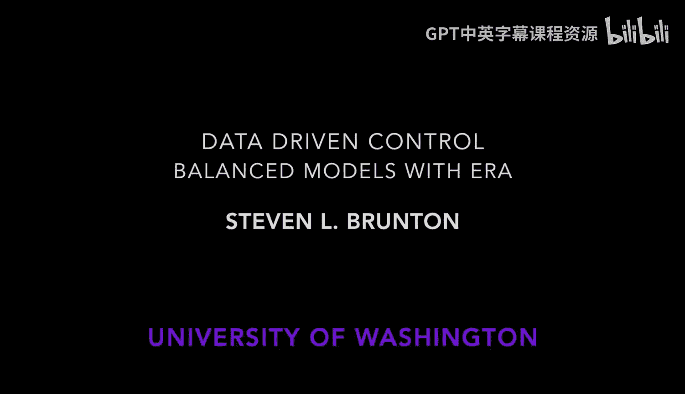

# 华盛顿大学《基于数据的机器学习控制｜Data-Driven Control with Machine Learning 2018》中英字幕 p17 -17-Data-Driven Control_ Balanced Models with ERA.zh_en -BV1BK6MBQEtN_p17-

Welcome back Okay， so in the last time we developed the eigensysem realization algorithm。

 it really is an algorithm， it's data driven， you collect data， you build a matrix。

 you take the SVD and you get a model。We're going to code this up next。 we're gonna you know。

 we're going program this up and see how it works。 There's a big code that does all of these steps and keeps track of the sizes of everything and P's and Qs and。

You know your parents always told you to mind your P's and Qs well's what we're talking about here so this is connected to balance model reduction it turns out that based on a symmetry of the Hankel matrix these are inherently balanced models if you collect enough data if you collect this long enough that all of the tails of this die out these will be balanced models the gramyians will be approximately equal and diagonal in these coordinates which is really cool。

There's a connection to balance proper orthogonal decomposition and balanced truncation。

 you can basically take all of the data driven stuff and write it in terms of direct snapshot C and adjunct snapshots O。

 and you can go through the math and figure out that it's the same。But I。

 there's a more concrete connection to balance POD is what。If I have。Full state measurements。Right。

 so we assumed。That there's some underlying linear system with some true full state X that we probably can't measure。

 but we can just measure input and output data， and we're trying to approximate those dynamics in terms of some proxy state x tilde that's low dimensional。

 But what if I actually have like real data， I do my I'm always going to do an airfoil because that's what I can draw。

 I actually have my full simulation， and I can get the movie of this thing evolving in time。

 That's my full state。 So what if I actually had， in addition to the measurements let's say。

 in this case， let's say y is a pressure measurement on the wing。 And I have that time series。

And I want to build a model that I can use for an online flight controller where I will only have this pressure measurement。

That's great， this all works。But what if when I was building that model。

 I did this in a laboratory or in a simulation， and I actually did have access in that one time。

I had access to the entire full state measurement X as it evolved in time x K。

I want to make this very clear。I want to build a model that I can use in the field。

 So I'm only going in the field。 I'm only going to have this one pressure measurement。

 So I still want why to be that pressure measurement。

 I still want a reduced order model to do control on。 So I'm going to build that model。

But maybe when I was building this model， I did this in a laboratory or in a simulation where I actually had access to X。

 So I'm going to use the model in the field where I only have Y。 but in my laboratory。

 I had access to to X， I spent a lot of money， a lot of time， a lot of resources and I got X。

 So if I can measure the full state X， then in addition to all of this impulse response data。

 I also have curly C， which was， you know， if I wrote down my system matrix， it was B A B。😊。

A squared b dot dot dot， or really it's just X。1， x 2， x 3， dot dot dot。

 the measurements of my state of my system X as they evolve in time。

 I don't actually need these matrices， I can just measure my state as it evolve in build C。

If I had this。Remember I said that the model here is kind of uninterpreable。

 There's this funny hidden state x tilde， it's this latent set of variables you need to describe the dynamics。

 Well， if I have access to the full state measurements， I can get an interpretable model。

What I can do is I can essentially say those psi modes。

 these are my modes from balance truncation are going to equal curly C。Times V tilde。

Times sigma tilde minus1 half。Okay， so if I had access to this data。

 this is very expensive data to get sometimes， but maybe I can do this at one time in a laboratory。

 I can take these reduced order Vs and sigmas， and I can build these full state modes。

 every column of Psi。Is the size of an X。 It's a big vector that in this case would be a flow field picture。

 Okay， every column of this is a mode and each of these modes。

Is what those little x tilde states mean。 So X tilde had， let's say， three modes， X 1， tilde， X 2。

 tilde， x 3， tilde。There were three hidden states， let's say。

Then this would have three columns and that first column would be a flow field picture。

And this is the amplitude of that mode。 It's how much of that mode is on at that given time。

 X 2 tilde would correspond to the second column。 That would be another picture of a flow field。

 And x 3 tilde would correspond to the third column， which would be another flow field picture。

 So this allows me to get like movies of what my reduced order system is doing。 I can， in fact。

 I can approximate the full high dimensional X x is approximately now Psi。😊，Times my reduced state。

So this allows me to， if I have access to full data and training。

 it allows me to build a reduced order model and interpret what that reduced state means in terms of the big full state in this case of fluid。

 I get a full movie of my reduced order model。And so this is really how BPPOD is connected to ER is in the case that you have full state measurements。

 then these models really do become equivalent。 This really is exactly the psi matrix that you would get from BPPOD and so on and so forth。

 So very useful， you can build reduced order models just from inputs to outputs。

 but if you happen to be lucky or careful and you can build this full state measurements in the laboratory。

 you can then get much more interpretable ER models， really cool， very useful。😊。

Next time we're going to talk about what happens if。I can't do a direct impulse response。

 What if I can't kick the system cleanly， And instead I have to give it some pseudo random forcing。

 How could I back out the impulse response。 Okay， thank you。

